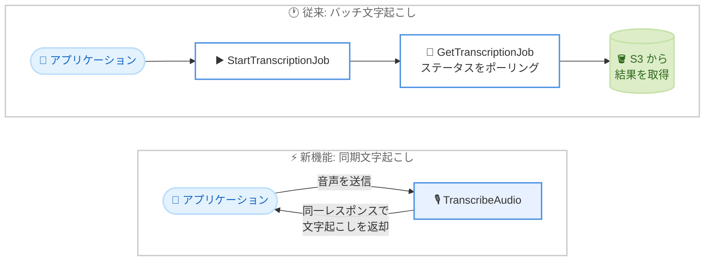

# Amazon Transcribe - 同期文字起こし API (TranscribeAudio)

**リリース日**: 2026 年 11 月 20 日
**サービス**: Amazon Transcribe
**機能**: 同期文字起こし API (TranscribeAudio API)

📊 [このアップデートのインフォグラフィックを見る](https://takech9203.github.io/aws-news-summary/20261120-amazon-transcribe-sync-api.html)

## 概要

Amazon Transcribe が同期文字起こし API「TranscribeAudio」を発表しました。音声ファイル全体を 1 回のリクエストで送信すると、同じレスポンスで完全な文字起こし結果を受け取ることができます。ジョブの開始、ステータスのポーリング、接続の管理は一切不要です。精度はバッチ文字起こしと同等であり、音声アシスタント、エージェントアシストツール、オンデマンドのクリップ文字起こしなど、インタラクティブなユースケースに適しています。

これまで Amazon Transcribe には、非同期のバッチ文字起こし (ジョブ作成とポーリングが必要) と、ストリーミング文字起こし (接続管理が必要) の 2 つの方式がありました。今回の同期 API により、短い音声を低レイテンシーかつシンプルなリクエスト / レスポンス型で処理する第 3 の選択肢が加わりました。

対象ユーザーは、ボイスメモやコンタクトセンターの通話クリップ、音声コマンドなど、1 時間以内の音声を即座にテキスト化したいアプリケーション開発者です。

**アップデート前の課題**

このアップデート以前は、録音済み音声の文字起こしに以下の課題がありました。

- バッチ文字起こしでは `StartTranscriptionJob` でジョブを開始し、`GetTranscriptionJob` でステータスをポーリングし、完了後に S3 から結果を取得するという複数ステップが必要だった
- 短い音声ファイルでもジョブ管理のオーバーヘッドが発生し、インタラクティブな用途ではレイテンシーが課題だった
- ストリーミング文字起こしで代替する場合は、WebSocket や HTTP/2 の接続管理を実装する必要があった

**アップデート後の改善**

今回のアップデートにより、以下が可能になりました。

- 1 回の API 呼び出しで音声を送信し、同じレスポンスで文字起こし結果を受け取れるようになった
- ジョブの開始、ステータスのポーリング、接続の管理が不要になった
- カスタム語彙や語彙フィルターをリクエスト内で直接指定できるようになり、事前のリソース作成なしで利用できるようになった
- バッチ文字起こしと同等の精度を、低レイテンシーのリクエスト / レスポンス型で得られるようになった

## アーキテクチャ図



従来のバッチ文字起こしではジョブ開始、ポーリング、結果取得の 3 ステップが必要でしたが、新しい TranscribeAudio API では 1 回のリクエストで文字起こし結果を受け取れます。

## サービスアップデートの詳細

### 主要機能

1. **単一リクエストでの文字起こし (TranscribeAudio API)**
   - 音声ファイルをリクエストにインラインで含める (最大 25 MB)、または Amazon S3 の URI で指定 (最大 500 MB)
   - 文字起こし結果は API レスポンスで直接返却され、オプションで S3 への出力も可能
   - 対応音声の長さは 0.5 秒から 1 時間まで

2. **バッチ文字起こしと同等の機能セット**
   - 単語レベルのタイムスタンプとスマートフォーマット (数値、日付、通貨、電話番号)
   - 自動言語識別 (`LanguageDetectionMode: IDENTIFY_LANGUAGE`)
   - 話者分離 (speaker diarization) と最大 2 チャンネルのチャンネル識別
   - PII (個人識別情報) の自動マスキング

3. **リクエスト内でのカスタマイズ指定**
   - カスタム語彙をリクエスト内でフレーズとして直接指定可能 (事前のリソース作成が不要)
   - 既存のカスタム語彙リソース名の指定にも対応
   - 語彙フィルター (remove / mask / tag) もリクエスト内で指定可能

## 技術仕様

### 入出力仕様

| 項目 | 詳細 |
|------|------|
| 入力方式 | インライン (最大 25 MB) または S3 URI (最大 500 MB) |
| 音声の長さ | 0.5 秒〜1 時間 |
| 対応フォーマット | WAV、MP3、FLAC、M4A、MP4、Ogg、WebM、AMR |
| 対応言語 | 英語、スペイン語、フランス語、イタリア語、ドイツ語、日本語、ポルトガル語、韓国語、中国語 (簡体字、繁体字、香港) |
| 出力 | API レスポンスで返却、オプションで S3 出力 (`OutputConfiguration`) |
| チャンネル識別 | 最大 2 チャンネル |

### API変更履歴

| 日付 | サービス | 変更内容 |
|------|----------|----------|
| 2026/11/20 | [transcribe](https://awsapichanges.com/archive/changes/e9d2b3-transcribe.html) | 1 new api methods - 同期文字起こし用の TranscribeAudio API を追加。インラインまたは S3 からのメディア送信、話者分離、チャンネル識別、言語識別、カスタム語彙、語彙フィルター、PII マスキングに対応 |

### リクエスト例 (boto3)

```python
import boto3

transcribe = boto3.client("transcribe")

response = transcribe.transcribe_audio(
    Media={"MediaFileUri": "s3://my-bucket/audio/meeting-clip.mp3"},
    Language="ja",
    ShowSpeakerLabels=True,
    MaxSpeakerLabels=4,
    VocabularySettings=[
        {
            "Language": "ja",
            "Phrases": [
                {"Text": "イーシーツー", "DisplayAs": "EC2"},
            ],
        },
    ],
)

print(response["TranscriptResponse"]["Results"]["Transcript"])
```

`TranscribeAudio` を呼び出すと、レスポンスの `TranscriptResponse` に全文 (`Transcript`) と単語ごとの詳細 (`Items`: タイムスタンプ、話者ラベル、チャンネルラベルなど) が含まれます。

## 設定方法

### 前提条件

1. AWS アカウントと、Amazon Transcribe の `transcribe:TranscribeAudio` 相当の操作を許可する IAM 権限
2. S3 の音声ファイルを使用する場合、対象バケット / オブジェクトへの読み取り権限
3. 最新の AWS CLI または AWS SDK (TranscribeAudio API 対応バージョン)

### 手順

#### ステップ1: 音声ファイルを準備する

```bash
aws s3 cp ./voicemail.wav s3://my-bucket/audio/voicemail.wav
```

文字起こし対象の音声ファイルを S3 にアップロードします。25 MB 以下のファイルであれば S3 を経由せず、リクエストにインラインで含めることもできます。

#### ステップ2: TranscribeAudio API を呼び出す

```bash
aws transcribe transcribe-audio \
  --media '{"MediaFileUri": "s3://my-bucket/audio/voicemail.wav"}' \
  --language ja \
  --show-speaker-labels \
  --max-speaker-labels 2
```

S3 上の音声ファイルを指定して同期文字起こしを実行します。言語に日本語 (`ja`) を指定し、話者分離を有効化しています。レスポンスで文字起こし結果が直接返却されるため、ポーリングは不要です。

#### ステップ3: 必要に応じて結果を S3 に出力する

```bash
aws transcribe transcribe-audio \
  --media '{"MediaFileUri": "s3://my-bucket/audio/voicemail.wav"}' \
  --language ja \
  --output-configuration '{"OutputMediaFileUri": "s3://my-bucket/transcripts/"}' \
  --content-redaction '{"RedactionType": "PII", "RedactionOutput": "redacted"}'
```

`OutputConfiguration` を指定すると、文字起こし結果を S3 にも保存できます。この例では `ContentRedaction` により PII をマスキングした結果を出力しています (PII マスキングは有料のアドオン機能)。

## メリット

### ビジネス面

- **開発期間の短縮**: ジョブ管理やポーリングロジックの実装が不要になり、音声機能の組み込みが数行のコードで完結する
- **ユーザー体験の向上**: 音声アシスタントやエージェントアシストなど、即時の応答が求められるアプリケーションで低レイテンシーの文字起こしを提供できる
- **追加コストなしの付加機能**: 話者分離、言語識別、カスタム語彙、チャンネル識別が追加料金なしで利用できる

### 技術面

- **アーキテクチャの簡素化**: ポーリング用の Lambda や EventBridge ルール、ジョブ完了通知などの周辺実装が不要になる
- **状態管理が不要**: ジョブやストリーミング接続の状態を持たないステートレスな設計が可能になる
- **バッチと同等の精度**: 同期処理でありながらバッチ文字起こしと同等の精度を得られる

## デメリット・制約事項

### 制限事項

- 音声の長さは最大 1 時間 (それを超える長尺音声は従来のバッチ文字起こしが必要)
- インライン送信は最大 25 MB、S3 経由でも最大 500 MB まで
- チャンネル識別は最大 2 チャンネルまで
- 対応言語は 9 言語 (英語、スペイン語、フランス語、イタリア語、ドイツ語、日本語、ポルトガル語、韓国語、中国語) で、バッチ文字起こしより少ない

### 考慮すべき点

- 同期 API のため、呼び出し側は音声の長さに応じた処理時間を待機する必要がある (タイムアウト設定に注意)
- PII マスキングは有料のアドオンであり、サンパウロリージョンでは利用できない
- 大量の長尺ファイルを一括処理するワークロードでは、引き続きバッチ文字起こしの方が適する場合がある

## ユースケース

### ユースケース1: ボイスメモ・音声コマンドの即時テキスト化

**シナリオ**: モバイルアプリでユーザーが録音したボイスメモを、その場でテキスト化して表示・検索可能にしたい。

**実装例**:
```python
# 録音した音声 (25 MB 以下) をインラインで送信
with open("voice_memo.m4a", "rb") as f:
    audio_bytes = f.read()

response = transcribe.transcribe_audio(
    Media={"MediaBytes": audio_bytes},
    Language="ja",
)
memo_text = response["TranscriptResponse"]["Results"]["Transcript"]
```

**効果**: S3 へのアップロードやジョブ管理なしに、録音直後にテキストを取得でき、アプリの応答性が向上する。

### ユースケース2: コンタクトセンターのエージェントアシスト

**シナリオ**: 通話後の短い録音クリップを即座に文字起こしし、エージェントの後処理 (アフターコールワーク) を支援したい。顧客の個人情報はマスキングする必要がある。

**実装例**:
```python
response = transcribe.transcribe_audio(
    Media={"MediaFileUri": "s3://contact-center/calls/call-1234.wav"},
    Language="ja",
    ChannelIdentification=True,  # 顧客とエージェントを 2 チャンネルで識別
    ContentRedaction={
        "RedactionType": "PII",
        "RedactionOutput": "redacted",
        "PiiEntityTypes": ["NAME", "PHONE", "ADDRESS", "CREDIT_DEBIT_NUMBER"],
    },
)
```

**効果**: 通話終了直後に PII をマスキングした文字起こしを取得でき、要約生成や CRM への記録を自動化できる。2 チャンネル音声の課金はファイルの長さに基づく 1 回分のみ。

### ユースケース3: 多言語音声の自動識別と文字起こし

**シナリオ**: グローバル向けサービスで、ユーザーが話す言語が事前に分からない音声メッセージを処理したい。

**実装例**:
```python
response = transcribe.transcribe_audio(
    Media={"MediaFileUri": "s3://my-bucket/audio/message.ogg"},
    LanguageDetectionMode="IDENTIFY_LANGUAGE",
    LanguageOptions=["ja", "en", "ko", "zh-CN"],
)
detected = response["TranscriptResponse"]["Metadata"]["LanguageCode"]
```

**効果**: 言語識別が追加料金なしで利用でき、言語ごとの分岐処理を実装せずに多言語対応を実現できる。

## 料金

TranscribeAudio API の料金は、音声 1 分あたり 0.0070 USD で、秒単位で課金されます。話者分離、言語識別、カスタム語彙、チャンネル識別は追加料金なしで利用できます。2 チャンネル音声はファイルの長さに基づいて 1 回分のみ課金されます。PII マスキングは有料のアドオン機能です。

### 料金例

| 使用量 | 月額料金 (概算) |
|--------|------------------|
| 月 1,000 分の音声 | 7.00 USD |
| 月 10,000 分の音声 | 70.00 USD |
| 月 100,000 分の音声 | 700.00 USD |

最新の料金は [Amazon Transcribe 料金ページ](https://aws.amazon.com/transcribe/pricing/) を確認してください。

## 利用可能リージョン

以下のリージョンで利用可能です。

- 米国東部 (バージニア北部、オハイオ)
- 米国西部 (オレゴン)
- カナダ (中部)
- 欧州 (アイルランド、ロンドン、フランクフルト)
- アジアパシフィック (ムンバイ、シンガポール、シドニー、東京、ソウル)
- 南米 (サンパウロ)

PII マスキングはサンパウロを除く上記リージョンで利用可能です。

## 関連サービス・機能

- **Amazon Transcribe バッチ文字起こし**: 1 時間を超える長尺音声や大量ファイルの一括処理に適した従来の非同期方式
- **Amazon Transcribe ストリーミング文字起こし**: リアルタイムの音声ストリームを逐次文字起こしする方式。ライブ字幕などに適する
- **Amazon S3**: 500 MB までの音声入力と文字起こし結果の出力先として連携
- **Amazon Bedrock**: 文字起こし結果を基にした要約や分析など、生成 AI との組み合わせで活用可能

## 参考リンク

- 📊 [インフォグラフィック](https://takech9203.github.io/aws-news-summary/20261120-amazon-transcribe-sync-api.html)
- [公式発表 (What's New)](https://aws.amazon.com/about-aws/whats-new/2026/11/amazon-transcribe-sync-api/)
- [Amazon Transcribe API リファレンス](https://docs.aws.amazon.com/transcribe/latest/APIReference/API_Operations_Amazon_Transcribe_Service.html)
- [料金ページ](https://aws.amazon.com/transcribe/pricing/)

## まとめ

TranscribeAudio API により、1 時間以内の音声を 1 回の API 呼び出しで文字起こしできるようになり、ジョブ管理やポーリングの実装が不要になりました。東京リージョンでも利用可能で、日本語にも対応しています。音声アシスタントやエージェントアシストなどインタラクティブな用途では、まず同期 API の採用を検討し、長尺音声や大量バッチ処理には従来のバッチ文字起こしを使い分けることを推奨します。
