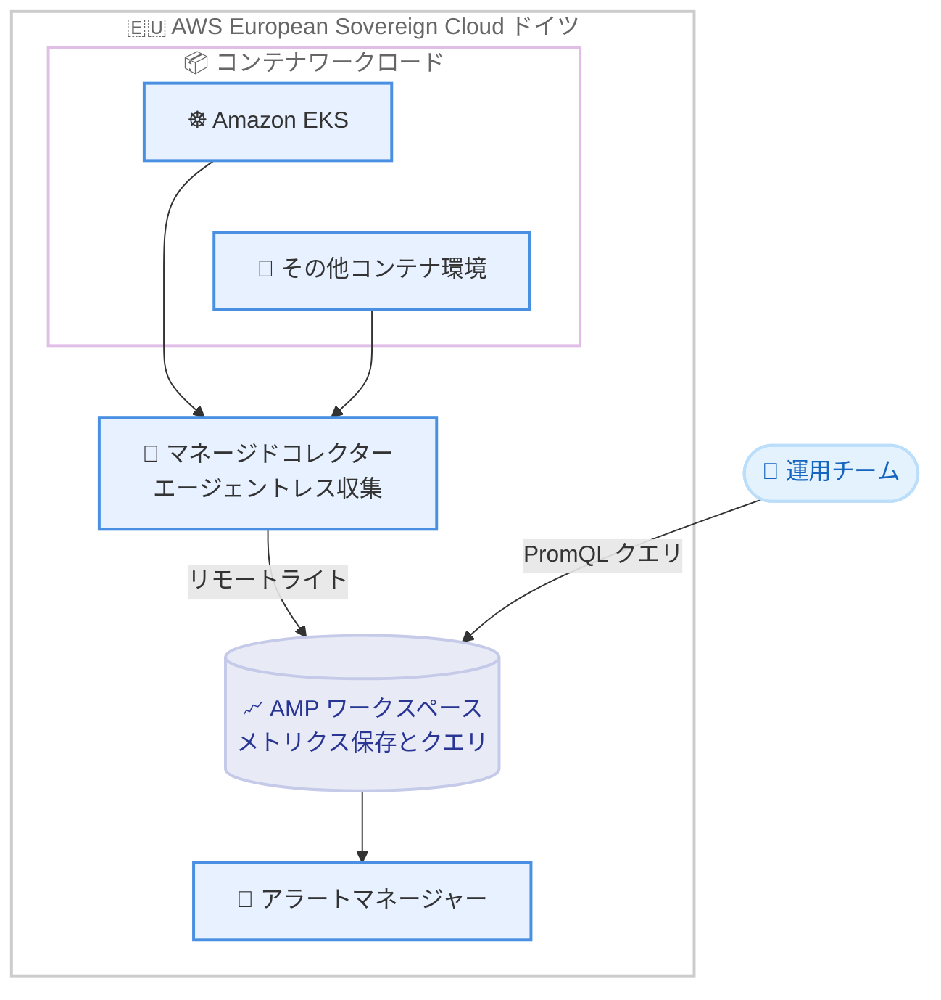

# Amazon Managed Service for Prometheus - AWS 欧州ソブリンクラウド (ドイツ) リージョンで利用可能に

**リリース日**: 2026 年 11 月 20 日
**サービス**: Amazon Managed Service for Prometheus
**機能**: AWS European Sovereign Cloud (Germany) リージョンでのサービス提供開始

📊 [このアップデートのインフォグラフィックを見る](https://takech9203.github.io/aws-news-summary/20261120-amp-aws-european-sovereign-cloud.html)

## 概要

Amazon Managed Service for Prometheus が、マネージドコレクターとともに AWS European Sovereign Cloud (ドイツ) リージョンで利用可能になりました。Amazon Managed Service for Prometheus は、Prometheus 互換のフルマネージドなモニタリングサービスで、大規模な運用メトリクスの監視とアラートを実現します。

AWS European Sovereign Cloud は、欧州のデータ主権要件に対応するために設計された、既存の AWS リージョンから独立したクラウド環境です。今回のアップデートにより、同環境を利用するお客様は、メトリクスデータをリージョン内に保持したまま、Prometheus 互換のモニタリングワークロードを低レイテンシーで実行できるようになります。

データレジデンシーやソブリンティ要件が厳格な欧州の公共機関、金融機関、規制産業のお客様が主な対象です。

**アップデート前の課題**

- AWS European Sovereign Cloud 上のコンテナワークロードを監視するには、セルフマネージドの Prometheus を自前で構築・運用する必要があった
- セルフマネージド Prometheus では、スケーリング、高可用性、長期保存の設計・運用負荷が大きかった
- メトリクス収集エージェントの管理 (デプロイ、パッチ適用、スケーリング) をお客様自身が行う必要があった

**アップデート後の改善**

- AWS European Sovereign Cloud 内でフルマネージドな Prometheus 互換モニタリングが利用可能になった
- フルマネージドかつエージェントレスのマネージドコレクターにより、コンテナワークロードからのメトリクス検出・収集を収集エージェントなしで実行できるようになった
- メトリクスデータをリージョン内に保持できるため、データレジデンシー要件を満たしつつレイテンシーも削減できるようになった

## アーキテクチャ図



AWS European Sovereign Cloud 内で完結するモニタリング構成です。マネージドコレクターがコンテナワークロードからメトリクスを自動収集し、ワークスペースに保存します。メトリクスデータはリージョン外に出ません。

## サービスアップデートの詳細

### 主要機能

1. **Prometheus 互換のフルマネージドモニタリング**
   - AWS European Sovereign Cloud (ドイツ) リージョンでワークスペースを作成可能
   - ワークスペースは Prometheus メトリクスの保存とクエリのための論理的な空間として機能
   - 大規模な運用メトリクスの監視とアラートに対応

2. **マネージドコレクター**
   - フルマネージドかつエージェントレスのコレクターが同時に利用可能
   - コンテナワークロードから Prometheus メトリクスを自動的に検出・収集
   - お客様自身で収集エージェントを運用する必要がない

3. **データレジデンシーと低レイテンシー**
   - メトリクスデータを AWS European Sovereign Cloud リージョン内に保持
   - リージョン内のワークロードに対するモニタリングのレイテンシーを削減

## 技術仕様

### 提供内容

| 項目 | 詳細 |
|------|------|
| 対象リージョン | AWS European Sovereign Cloud (ドイツ) |
| 提供機能 | ワークスペース、マネージドコレクター |
| 互換性 | Prometheus 互換 (PromQL、リモートライト) |
| データ保持 | メトリクスデータはリージョン内に保持 |

## 設定方法

### 前提条件

1. AWS European Sovereign Cloud のアカウントを保有していること
2. 監視対象のコンテナワークロード (Amazon EKS クラスターなど) が同リージョンに存在すること
3. ワークスペースおよびスクレイパーを作成する IAM 権限があること

### 手順

#### ステップ 1: ワークスペースの作成

```bash
aws amp create-workspace \
    --alias my-sovereign-workspace
```

AWS European Sovereign Cloud リージョンに Amazon Managed Service for Prometheus のワークスペースを作成します。ワークスペースはメトリクスの保存とクエリの単位です。

#### ステップ 2: マネージドコレクターの作成

```bash
aws amp create-scraper \
    --source eksConfiguration="{clusterArn=<EKS クラスター ARN>,securityGroupIds=[<セキュリティグループ ID>],subnetIds=[<サブネット ID>]}" \
    --destination ampConfiguration="{workspaceArn=<ワークスペース ARN>}" \
    --scrape-configuration configurationBlob=<Base64 エンコードしたスクレイプ設定>
```

EKS クラスターを収集元、作成したワークスペースを送信先とするマネージドコレクター (スクレイパー) を作成します。エージェントレスでメトリクス収集が開始されます。

#### ステップ 3: メトリクスのクエリ

```bash
awscurl -X POST --region <リージョン> \
    --service aps "<ワークスペースのクエリエンドポイント>/api/v1/query?query=up"
```

PromQL を使用してワークスペースに保存されたメトリクスをクエリし、収集が正常に行われていることを確認します。

## メリット

### ビジネス面

- **データ主権要件への対応**: メトリクスデータが AWS European Sovereign Cloud リージョン内に保持されるため、欧州のデータレジデンシー・ソブリンティ要件を満たしやすくなる
- **運用コストの削減**: セルフマネージド Prometheus の構築・運用が不要になり、運用チームの負荷を削減できる
- **規制産業での採用促進**: 公共機関や金融機関など、厳格なコンプライアンス要件を持つ組織でもマネージドモニタリングを採用できる

### 技術面

- **低レイテンシー**: リージョン内のワークロードに近い場所でモニタリングを実行することで、レイテンシーを削減できる
- **エージェントレス収集**: マネージドコレクターにより、収集エージェントのデプロイやスケーリングの管理が不要になる
- **Prometheus 互換性**: 既存の PromQL クエリ、ダッシュボード、アラートルールをそのまま活用できる

## デメリット・制約事項

### 制限事項

- AWS European Sovereign Cloud は通常の AWS リージョンから独立した環境であり、専用のアカウントが必要
- 利用可能な機能の詳細は AWS Regional Services List での確認が必要

### 考慮すべき点

- 料金は AWS European Sovereign Cloud 専用の料金ページ (aws.eu) で確認する必要がある
- 通常の AWS リージョンにある既存ワークスペースとのクロスリージョン構成は、ソブリンティ要件の観点から設計時に検討が必要

## ユースケース

### ユースケース 1: 欧州公共機関のコンテナ基盤モニタリング

**シナリオ**: 欧州の公共機関が、データ主権要件を満たすために AWS European Sovereign Cloud 上で EKS クラスターを運用しており、メトリクスデータも域内に保持する必要がある。

**実装例**:
```
1. AWS European Sovereign Cloud リージョンに AMP ワークスペースを作成
2. EKS クラスターに対してマネージドコレクターを設定
3. アラートマネージャーで重要メトリクスのアラートルールを定義
```

**効果**: メトリクスデータを域内に保持したまま、フルマネージドなモニタリングを実現し、コンプライアンスと運用効率を両立できる。

### ユースケース 2: セルフマネージド Prometheus からの移行

**シナリオ**: AWS European Sovereign Cloud 上でセルフマネージドの Prometheus を運用しているが、スケーリングと高可用性の運用負荷が課題になっている。

**実装例**:
```
1. AMP ワークスペースを作成
2. 既存 Prometheus のリモートライト設定でワークスペースへ二重書き込み
3. ダッシュボードとアラートを AMP に切り替え後、セルフマネージド環境を廃止
```

**効果**: 既存の PromQL 資産を維持しながら、スケーリングや可用性の運用負荷を AWS にオフロードできる。

### ユースケース 3: 規制産業における大規模メトリクス監視

**シナリオ**: 欧州の金融機関が、多数のマイクロサービスから発生する大量のメトリクスを、規制要件を満たしつつ一元的に監視したい。

**実装例**:
```
1. 環境ごと (本番、ステージング) にワークスペースを分離して作成
2. マネージドコレクターで各クラスターからメトリクスを収集
3. PromQL でサービス横断のメトリクスを集計・可視化
```

**効果**: 収集エージェントの管理なしで大規模メトリクスを収集でき、規制要件を満たした監視基盤を短期間で構築できる。

## 料金

Amazon Managed Service for Prometheus の料金は、取り込んだメトリクスサンプル数、クエリ処理、ストレージ使用量に基づく従量課金です。AWS European Sovereign Cloud での具体的な料金は、専用の料金ページ (aws.eu) を参照してください。

## 利用可能リージョン

AWS European Sovereign Cloud (ドイツ) リージョンで利用可能になりました。その他の利用可能リージョンの全一覧は AWS Regional Services List を参照してください。

## 関連サービス・機能

- **Amazon EKS**: マネージドコレクターの主要な収集元となるコンテナ基盤。クラスター上のワークロードからメトリクスを収集
- **Amazon Managed Grafana**: AMP のメトリクスを可視化するダッシュボードサービス。利用可否はリージョンごとに確認が必要
- **AWS European Sovereign Cloud**: 欧州のデータ主権要件に対応した、既存 AWS リージョンから独立したクラウド環境

## 参考リンク

- 📊 [インフォグラフィック](https://takech9203.github.io/aws-news-summary/20261120-amp-aws-european-sovereign-cloud.html)
- [公式発表 (What's New)](https://aws.amazon.com/about-aws/whats-new/2026/11/amp-aws-european-sovereign-cloud/)
- [Amazon Managed Service for Prometheus 製品ページ](https://aws.amazon.com/prometheus/)
- [ユーザーガイド](https://docs.aws.amazon.com/prometheus/latest/userguide/what-is-Amazon-Managed-Service-Prometheus.html)
- [AWS Regional Services List](https://aws.amazon.com/about-aws/global-infrastructure/regional-product-services/)

## まとめ

Amazon Managed Service for Prometheus が AWS European Sovereign Cloud (ドイツ) リージョンで利用可能になり、欧州のデータ主権要件を持つお客様もフルマネージドな Prometheus 互換モニタリングを利用できるようになりました。同環境でコンテナワークロードを運用している場合は、セルフマネージド Prometheus からの移行やマネージドコレクターの活用を検討することを推奨します。
