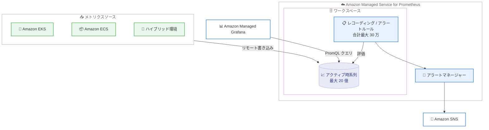

# Amazon Managed Service for Prometheus - ワークスペースあたり 20 億アクティブメトリクスと 30 万ルールをサポート

**リリース日**: 2026 年 11 月 20 日
**サービス**: Amazon Managed Service for Prometheus
**機能**: ワークスペースあたり最大 20 億アクティブメトリクス時系列および最大 30 万ルールのサポート

📊 [このアップデートのインフォグラフィックを見る](https://takech9203.github.io/aws-news-summary/20261120-amp-supports-2b-metrics-300k-rules.html)

## 概要

Amazon Managed Service for Prometheus が、1 ワークスペースあたり最大 20 億のアクティブメトリクス時系列と、最大 30 万のレコーディングルールおよびアラートルール (合計) をサポートするようになりました。さらに、アカウントごとに複数のワークスペースを作成できるため、組織全体で数十億規模の Prometheus メトリクスを保存・分析できます。

Amazon Managed Service for Prometheus は、Prometheus 互換のフルマネージドモニタリングサービスです。コンテナ、サーバーレス、ハイブリッド環境にまたがる高カーディナリティのワークロードに対して、取り込みとストレージを自動的にスケールします。今回のアップデートは、大規模なコンテナ基盤や多数のマイクロサービスを運用する企業にとって、モニタリング基盤の設計を大幅に簡素化するものです。

アクティブ時系列数やルール数の上限を引き上げるには、AWS Support Center または AWS Service Quotas からサービス制限の引き上げをリクエストします。

**アップデート前の課題**

大規模環境でのメトリクス管理には、以下のような課題がありました。

- 単一ワークスペースの上限を超える規模のメトリクスを扱う場合、複数のワークスペースに分割し、クエリやダッシュボードをワークスペースごとに管理する必要があった
- ルール数の上限により、大規模環境では評価したいレコーディングルールやアラートルールを複数のワークスペースに分散させる運用上の工夫が必要だった
- ワークスペース分割に伴い、メトリクスの横断的な分析やアラート設定の一元管理が複雑になっていた

**アップデート後の改善**

今回のアップデートにより、以下が可能になりました。

- 1 ワークスペースで最大 20 億のアクティブメトリクス時系列を扱えるようになり、超大規模環境でもワークスペースを統合して運用できる
- 1 ワークスペースで最大 30 万のレコーディングルールとアラートルールを定義でき、大規模なルール管理を単一ワークスペースで完結できる
- 複数ワークスペースと組み合わせることで、組織全体で数十億規模のメトリクスを保存・分析できる

## アーキテクチャ図



単一ワークスペースが最大 20 億のアクティブ時系列と最大 30 万のルールをサポートし、大規模環境のメトリクスを統合的に取り込み・評価・可視化できる構成を示しています。

## サービスアップデートの詳細

### 主要機能

1. **ワークスペースあたり最大 20 億アクティブ時系列**
   - 直近 2 時間以内にサンプルが報告された時系列が「アクティブ」としてカウントされる
   - デフォルトクォータは 5,000 万で、クォータ引き上げリクエストにより最大 20 億まで拡張可能
   - ワークスペースは使用量に応じて自動的に容量を調整する (30 分間の平均使用量に基づく動的スケーリング)

2. **ワークスペースあたり最大 30 万ルール**
   - レコーディングルールとアラートルールの合計で最大 30 万まで設定可能
   - デフォルトクォータは 2,000 で、引き上げはクォータリクエストで対応
   - 大規模環境のルール管理を単一ワークスペースに集約できる

3. **複数ワークスペースによる更なるスケール**
   - アカウントごとに複数のワークスペースを作成可能 (デフォルトはリージョンあたり 25、調整可能)
   - 組織全体で数十億規模の Prometheus メトリクスの保存・分析に対応

## 技術仕様

### 主なクォータ (ドキュメント記載値)

| 項目 | デフォルト | 調整可否 | 備考 |
|------|-----------|----------|------|
| アクティブ時系列 / ワークスペース | 50,000,000 | 可 | 最大 20 億まで。使用量に応じて自動調整 |
| ルール / ワークスペース | 2,000 | 可 | レコーディング + アラートルールの合計。最大 30 万 |
| 取り込みレート / ワークスペース | 1,666,666 サンプル / 秒 | 可 | アクティブ時系列クォータの 1/30 に自動調整 |
| ワークスペース / リージョン / アカウント | 25 | 可 | 複数ワークスペースで更にスケール可能 |

### スケーリング時の注意 (スロットリング)

- デフォルトクォータを超える引き上げ後は、直近 2 時間のベースラインに対して 2 倍超、または 5,000 万超のアクティブ時系列の急増でスロットリングが発生する可能性がある
- 取り込み超過時は CloudWatch メトリクスの `DiscardedSamples` (理由: `rate_limited`) で検知できる
- ベースラインを超えて取り込みを増やす場合は、段階的に増加させることが推奨されている

## 設定方法

### 前提条件

1. AWS アカウントを保有していること
2. Amazon Managed Service for Prometheus のワークスペースを作成済み、または作成する権限があること
3. クォータ引き上げには AWS Support Center または AWS Service Quotas へのアクセス権限が必要

### 手順

#### ステップ 1: ワークスペースの作成

```bash
aws amp create-workspace --alias my-large-scale-workspace
```

Amazon Managed Service for Prometheus のワークスペースを作成します。`--alias` でワークスペースの別名を指定します。

#### ステップ 2: 現在のクォータの確認

```bash
aws service-quotas get-service-quota \
  --service-code aps \
  --quota-code L-5A151448
```

AWS Service Quotas からアクティブ時系列クォータ (クォータコード L-5A151448) の現在値を確認します。

#### ステップ 3: クォータ引き上げのリクエスト

```bash
aws service-quotas request-service-quota-increase \
  --service-code aps \
  --quota-code L-5A151448 \
  --desired-value 100000000
```

アクティブ時系列クォータの引き上げをリクエストします。ルール数 (クォータコード L-3D15CDB4) も同様にリクエストできます。大規模な引き上げは AWS Support Center のサービス制限引き上げリクエストでも対応可能です。

## メリット

### ビジネス面

- **運用コストの削減**: ワークスペース分割に伴う管理オーバーヘッドが減り、モニタリング基盤の運用負荷を軽減できる
- **組織全体の可観測性向上**: 数十億規模のメトリクスを一元的に保存・分析でき、全社的な可観測性戦略を実現しやすくなる
- **スケールへの備え**: ビジネス成長に伴うメトリクス増加に対して、基盤再設計なしで対応できる

### 技術面

- **アーキテクチャの簡素化**: 単一ワークスペースで超大規模メトリクスを扱えるため、フェデレーションや分割設計が不要になる
- **ルール管理の一元化**: 最大 30 万ルールにより、レコーディングルールやアラートルールを集約管理できる
- **自動スケーリング**: 使用量に応じて時系列容量が自動調整され、突発的な増加にも追従しやすい

## デメリット・制約事項

### 制限事項

- デフォルトクォータ (アクティブ時系列 5,000 万、ルール 2,000) を超えるには、クォータ引き上げリクエストが必要
- 引き上げ後も、直近ベースラインに対する急激な取り込み増加 (2 倍超または 5,000 万超) ではスロットリングが発生する可能性がある
- 増加した容量を十分に使用しない場合、未使用分は時間の経過とともに回収される (使用量が増えれば再び自動スケール)

### 考慮すべき点

- 取り込みレートはアクティブ時系列クォータの 1/30 に自動調整されるため、時系列クォータと合わせて計画する必要がある
- 大量のルールを単一ワークスペースに集約する場合、ルール評価間隔 (最小 30 秒、調整可能) とルールグループの設計を検討する
- CloudWatch 使用量メトリクスでクォータ使用状況を監視し、上限到達前にアラームを設定することが推奨される

## ユースケース

### ユースケース 1: 大規模 Kubernetes 基盤の統合モニタリング

**シナリオ**: 数百クラスター、数万ノード規模の Amazon EKS 基盤を運用しており、高カーディナリティのメトリクスが数億時系列に達している。

**実装例**:
```
1. 統合用ワークスペースを作成し、アクティブ時系列クォータの引き上げをリクエスト
2. 各クラスターの AWS Distro for OpenTelemetry または Prometheus Agent から
   リモート書き込みで統合ワークスペースに送信
3. Amazon Managed Grafana から単一データソースとして横断クエリ
```

**効果**: クラスターごとのワークスペース分割が不要になり、基盤全体を単一のクエリエンドポイントで分析できる。

### ユースケース 2: 大規模アラートルールの一元管理

**シナリオ**: マイクロサービスごとに SLO ベースのアラートルールを定義しており、サービス数の増加によりルール数が数万に達している。

**実装例**:
```
1. ルールクォータ (L-3D15CDB4) の引き上げをリクエスト
2. サービスごとにルールグループ名前空間を分けてルールを登録
3. アラートマネージャーから Amazon SNS 経由で通知を集約
```

**効果**: ルール上限を理由としたワークスペース分割が不要になり、SLO アラートを一元管理できる。

### ユースケース 3: 組織横断のメトリクス分析基盤

**シナリオ**: 複数事業部がそれぞれ Prometheus メトリクスを収集しており、組織全体で数十億時系列規模のデータを分析したい。

**実装例**:
```
1. 事業部ごとにワークスペースを作成 (アカウントごとに複数ワークスペースを利用)
2. 各ワークスペースのクォータを必要に応じて引き上げ
3. Amazon Managed Grafana で複数ワークスペースをデータソースとして統合可視化
```

**効果**: 事業部単位の分離を維持しつつ、組織全体で数十億規模のメトリクスを保存・分析できる。

## 料金

Amazon Managed Service for Prometheus の料金は、取り込んだメトリクスサンプル数、メトリクスの保存量、クエリ処理量などの従量課金です。今回のクォータ上限引き上げ自体に追加料金はありませんが、取り込み・保存するメトリクス量の増加に応じて利用料金が増加します。詳細は料金ページを確認してください。

## 利用可能リージョン

公式発表ではリージョンは明記されていません。Amazon Managed Service for Prometheus が利用可能なリージョンについては、[AWS リージョン別サービス一覧](https://aws.amazon.com/about-aws/global-infrastructure/regional-product-services/)を参照してください。クォータの引き上げはリージョンごとに AWS Service Quotas からリクエストします。

## 関連サービス・機能

- **Amazon Managed Grafana**: Amazon Managed Service for Prometheus をデータソースとして、大規模メトリクスを可視化できる
- **AWS Distro for OpenTelemetry**: EKS や ECS などからメトリクスを収集し、ワークスペースへリモート書き込みするコレクターとして利用できる
- **Amazon CloudWatch**: 使用量メトリクス (`DiscardedSamples` など) を監視し、クォータ到達前にアラームを設定できる
- **AWS Service Quotas**: アクティブ時系列やルール数などのクォータ引き上げリクエストに使用する

## 参考リンク

- 📊 [インフォグラフィック](https://takech9203.github.io/aws-news-summary/20261120-amp-supports-2b-metrics-300k-rules.html)
- [公式発表 (What's New)](https://aws.amazon.com/about-aws/whats-new/2026/11/amp-supports-2b-metrics-300k-rules/)
- [ドキュメント (サービスクォータ)](https://docs.aws.amazon.com/prometheus/latest/userguide/AMP_quotas.html)
- [製品ページ](https://aws.amazon.com/prometheus/)
- [料金ページ](https://aws.amazon.com/prometheus/pricing/)

## まとめ

Amazon Managed Service for Prometheus が 1 ワークスペースあたり最大 20 億アクティブ時系列と最大 30 万ルールをサポートし、超大規模環境でもワークスペース分割なしでメトリクスを統合管理できるようになりました。大規模なコンテナ基盤やマイクロサービスを運用している場合は、現在のワークスペース分割構成を見直し、AWS Service Quotas からのクォータ引き上げによる統合を検討することを推奨します。
