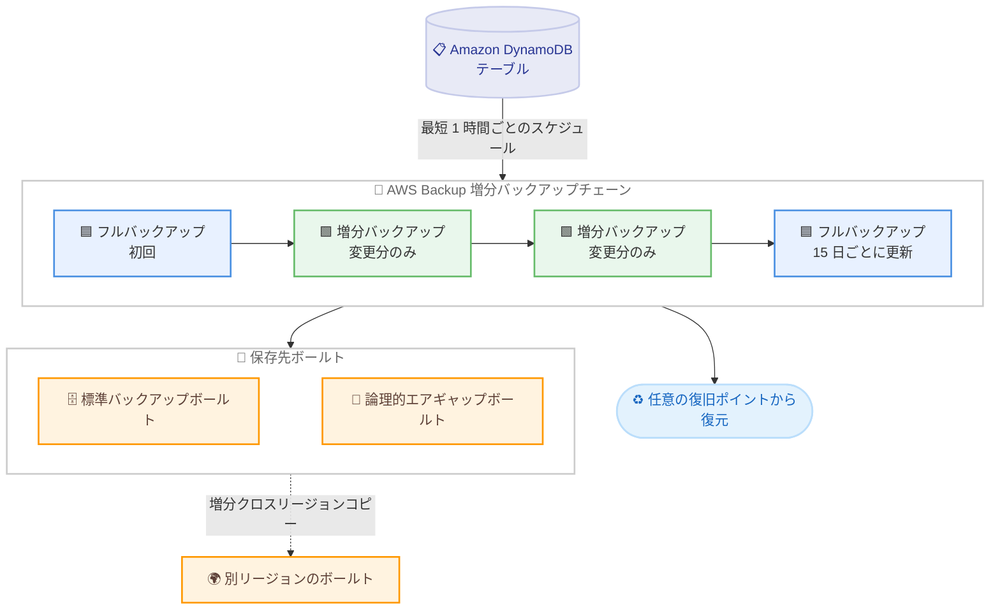

# AWS Backup - Amazon DynamoDB の増分バックアップサポート

**リリース日**: 2026 年 11 月 20 日
**サービス**: AWS Backup / Amazon DynamoDB
**機能**: Amazon DynamoDB テーブルの増分バックアップ

📊 [このアップデートのインフォグラフィックを見る](https://takech9203.github.io/aws-news-summary/20261120-aws-backup-incremental-backups-dynamodb.html)

## 概要

AWS Backup が Amazon DynamoDB テーブルの増分バックアップをサポートしました。初回のフルバックアップを取得した後は、変更されたデータのみを増分として取得するため、バックアップストレージの使用量を大幅に削減できます。あわせて、最短 1 時間ごとの高頻度なバックアップスケジュールにも対応し、復旧ポイント目標 (RPO) の短縮が可能になりました。

増分バックアップのチェーンは 15 日ごとに新しいフルバックアップで更新され、チェーン内の任意の復旧ポイントから復元できます。増分バックアップは標準のバックアップボールトに加えて、論理的エアギャップボールトにも保存可能です。さらに、クロスリージョンコピーも増分で転送されるため、リージョン間のデータ保護コストも削減できます。

DynamoDB を大規模に利用し、バックアップストレージコストの最適化や、より短い間隔でのデータ保護を求めるユーザーに特に有用なアップデートです。

**アップデート前の課題**

- 以前は DynamoDB テーブルのバックアップは毎回フルコピーとして取得されるため、テーブルサイズに比例してストレージコストが増大していた
- 高頻度でバックアップを取得すると、変更量にかかわらずフルバックアップが蓄積し、コスト面で現実的ではなかった
- クロスリージョンコピーもフルコピーとして転送されるため、リージョン間のデータ保護コストが高くなっていた

**アップデート後の改善**

- 初回フルバックアップ以降は変更データのみを取得する増分バックアップにより、ストレージ使用量を削減できるようになった
- 最短 1 時間ごとから最長 1 週間ごとまでのバックアップスケジュールを設定でき、RPO を短縮しながらコストを抑えられるようになった
- クロスリージョンコピーも増分で転送され、リージョン間コピーのコストも削減されるようになった

## アーキテクチャ図



初回フルバックアップの後は変更分のみを増分として取得し、15 日ごとに新しいフルバックアップでチェーンを更新します。チェーン内の任意の復旧ポイントから復元でき、クロスリージョンコピーも増分で転送されます。

## サービスアップデートの詳細

### 主要機能

1. **増分バックアップによるストレージ削減**
   - 初回にフルバックアップを取得し、以降は前回からの変更データのみを増分として取得
   - 15 日ごとに新しいフルバックアップを自動取得してチェーンを更新
   - チェーン内の任意の復旧ポイントから復元可能

2. **高頻度バックアップスケジュール**
   - 最短 1 時間ごとから最長 1 週間ごとまでのスケジュールを設定可能
   - 増分方式によりコストを抑えながら RPO を短縮できる

3. **多様な保存先とクロスリージョンコピー**
   - 標準のバックアップボールトと論理的エアギャップボールトの両方に保存可能
   - クロスリージョンコピーも増分で転送され、リージョン間のコピーコストを削減

4. **有効化の管理**
   - 新規に DynamoDB バックアップを利用するアカウントではデフォルトで有効
   - 既存ユーザーは AWS Backup 設定の高度な機能からオプトイン可能
   - アカウント単位・リージョン単位で管理し、コンソール、CLI、API から操作可能

## 技術仕様

### 増分バックアップの仕様

| 項目 | 詳細 |
|------|------|
| 対象リソース | Amazon DynamoDB テーブル |
| バックアップ方式 | 初回フル + 以降は増分 |
| フルバックアップの更新間隔 | 15 日ごと |
| スケジュール頻度 | 最短 1 時間ごと〜最長 1 週間ごと |
| 復元 | チェーン内の任意の復旧ポイントから可能 |
| 保存先 | 標準バックアップボールト、論理的エアギャップボールト |
| クロスリージョンコピー | 増分で転送 |
| 有効化の単位 | アカウント単位・リージョン単位 |
| デフォルト設定 | 新規 DynamoDB バックアップユーザーは有効、既存ユーザーはオプトイン |

### API変更履歴

| 日付 | サービス | 変更内容 |
|------|----------|----------|
| 2026/11/20 | [backup](https://awsapichanges.com/archive/changes/e9d2b3-backup.html) | 2 updated api methods - `UpdateRegionSettings` リクエストと `DescribeRegionSettings` レスポンスに `ResourceTypeOptInIncremental` が追加され、増分バックアップのオプトイン / オプトアウトが可能に (現時点では DynamoDB テーブルのバックアップのみ対象) |

### リージョン設定の確認例

```json
{
    "ResourceTypeOptInPreference": {
        "DynamoDB": true
    },
    "ResourceTypeManagementPreference": {
        "DynamoDB": true
    },
    "ResourceTypeOptInIncremental": {
        "DynamoDB": true
    }
}
```

`DescribeRegionSettings` API のレスポンスに `ResourceTypeOptInIncremental` フィールドが追加され、リソースタイプごとの増分バックアップ有効化状態を確認できます。

## 設定方法

### 前提条件

1. AWS Backup で DynamoDB リソースタイプのオプトインが有効であること
2. AWS Backup の高度な機能 (フルマネジメント) で DynamoDB が有効であること
3. 設定変更に必要な IAM 権限 (`backup:UpdateRegionSettings` など) があること

### 手順

#### ステップ1: 現在のリージョン設定を確認する

```bash
aws backup describe-region-settings
```

現在のリージョンにおけるリソースタイプごとのオプトイン状態と、増分バックアップの有効化状態 (`ResourceTypeOptInIncremental`) を確認します。

#### ステップ2: 増分バックアップを有効化する

```bash
aws backup update-region-settings \
  --resource-type-opt-in-incremental DynamoDB=true
```

リージョン設定を更新し、DynamoDB テーブルの増分バックアップを有効化します。既存ユーザーはこの操作、またはコンソールの AWS Backup 設定にある高度な機能からオプトインします。

#### ステップ3: バックアッププランのスケジュールを調整する

バックアッププランのルールでバックアップ頻度を設定します。増分バックアップにより、最短 1 時間ごとの高頻度スケジュールもコストを抑えて運用できます。必要に応じてクロスリージョンコピーや論理的エアギャップボールトへの保存もルールに追加します。

## メリット

### ビジネス面

- **ストレージコストの削減**: 変更データのみを保存するため、フルバックアップを毎回保存する場合と比べてバックアップストレージコストを削減できる
- **RPO の短縮**: 最短 1 時間ごとのバックアップにより、障害時のデータ損失リスクを低減できる
- **DR コストの最適化**: クロスリージョンコピーも増分で転送されるため、災害対策のコストを抑えられる

### 技術面

- **運用の簡素化**: フルバックアップの自動更新 (15 日ごと) を AWS Backup が管理するため、チェーン管理の運用負荷がない
- **柔軟な復元**: チェーン内の任意の復旧ポイントから復元でき、増分方式を意識する必要がない
- **ランサムウェア対策との両立**: 論理的エアギャップボールトへの保存に対応し、増分方式でも改ざん耐性のある保護を実現できる

## デメリット・制約事項

### 制限事項

- 対象は Amazon DynamoDB テーブルのバックアップのみ (他のリソースタイプは現時点で対象外)
- フルバックアップは 15 日ごとに自動取得されるため、その分のストレージは定期的に発生する
- 利用可能なのは AWS Backup が DynamoDB を保護しているリージョンに限られる

### 考慮すべき点

- 既存の DynamoDB バックアップユーザーはデフォルトでは無効のため、AWS Backup 設定の高度な機能から明示的にオプトインする必要がある
- 設定はアカウント単位・リージョン単位で管理されるため、マルチリージョン / マルチアカウント環境では各リージョンでの有効化状況を確認する必要がある
- 変更量が非常に多いテーブルでは、増分バックアップによる削減効果が相対的に小さくなる可能性がある

## ユースケース

### ユースケース1: 大規模テーブルのバックアップコスト最適化

**シナリオ**: 数 TB 規模の DynamoDB テーブルを毎日バックアップしており、フルコピーの蓄積によりバックアップストレージコストが増大している。

**実装例**:
```bash
aws backup update-region-settings \
  --resource-type-opt-in-incremental DynamoDB=true
```

**効果**: 日次バックアップが変更分のみの増分となり、バックアップストレージコストを大幅に削減できる。

### ユースケース2: 高頻度バックアップによる RPO 短縮

**シナリオ**: 金融・EC 系のワークロードで、日次バックアップでは障害時に最大 24 時間分のデータ損失リスクがあり、RPO を短縮したい。

**実装例**:
```json
{
  "RuleName": "HourlyDynamoDBBackup",
  "TargetBackupVaultName": "my-backup-vault",
  "ScheduleExpression": "cron(0 * * * ? *)",
  "Lifecycle": { "DeleteAfterDays": 35 }
}
```

**効果**: 1 時間ごとの増分バックアップにより、コストを抑えながら RPO を 1 時間に短縮できる。

### ユースケース3: 増分クロスリージョンコピーによる DR 構成

**シナリオ**: コンプライアンス要件により DynamoDB のバックアップを別リージョンに保管する必要があるが、フルコピーの転送コストが課題となっている。

**実装例**:
```json
{
  "RuleName": "DailyWithCrossRegionCopy",
  "TargetBackupVaultName": "primary-vault",
  "ScheduleExpression": "cron(0 3 * * ? *)",
  "CopyActions": [
    {
      "DestinationBackupVaultArn": "arn:aws:backup:us-west-2:123456789012:backup-vault:dr-vault"
    }
  ]
}
```

**効果**: クロスリージョンコピーも増分で転送されるため、DR 要件を満たしながらリージョン間コピーのコストを削減できる。

## 料金

AWS Backup の料金は保存したバックアップデータ量などに基づいて課金されます。増分バックアップでは初回フルバックアップ以降は変更データのみが保存されるため、毎回フルバックアップを保存する従来方式と比べてストレージコストを削減できます。クロスリージョンコピーも増分で転送されるため、コピーにかかるコストも削減されます。

具体的な料金は [AWS Backup 料金ページ](https://aws.amazon.com/backup/pricing/) を参照してください。

## 利用可能リージョン

AWS Backup が Amazon DynamoDB を保護しているすべての AWS リージョンで利用可能です。

## 関連サービス・機能

- **Amazon DynamoDB**: 今回のアップデートの対象リソース。DynamoDB 自体のオンデマンドバックアップやポイントインタイムリカバリ (PITR) と AWS Backup を組み合わせたデータ保護戦略を設計できる
- **AWS Backup 論理的エアギャップボールト**: 増分バックアップの保存先として利用でき、ランサムウェア対策としての改ざん耐性を提供
- **AWS Backup クロスリージョンコピー**: 増分転送に対応し、DR 構成のコストを削減

## 参考リンク

- 📊 [インフォグラフィック](https://takech9203.github.io/aws-news-summary/20261120-aws-backup-incremental-backups-dynamodb.html)
- [公式発表 (What's New)](https://aws.amazon.com/about-aws/whats-new/2026/11/aws-backup-incremental-backups-dynamodb/)
- [AWS Blog: Reduce Amazon DynamoDB backup storage costs with incremental backups in AWS Backup](https://aws.amazon.com/blogs/storage/reduce-amazon-dynamodb-backup-storage-costs-with-incremental-backups-in-aws-backup/)
- [ドキュメント: Working with Amazon DynamoDB](https://docs.aws.amazon.com/aws-backup/latest/devguide/working-with-supported-services.html#working-with-ddb)
- [料金ページ](https://aws.amazon.com/backup/pricing/)

## まとめ

AWS Backup の DynamoDB 増分バックアップにより、ストレージコストを削減しながら最短 1 時間ごとの高頻度バックアップが可能になりました。新規ユーザーはデフォルトで有効ですが、既存ユーザーは AWS Backup 設定の高度な機能からのオプトインが必要です。大規模な DynamoDB テーブルを運用している場合は、まず `DescribeRegionSettings` で現在の設定を確認し、有効化とバックアップスケジュールの見直しを検討することを推奨します。
