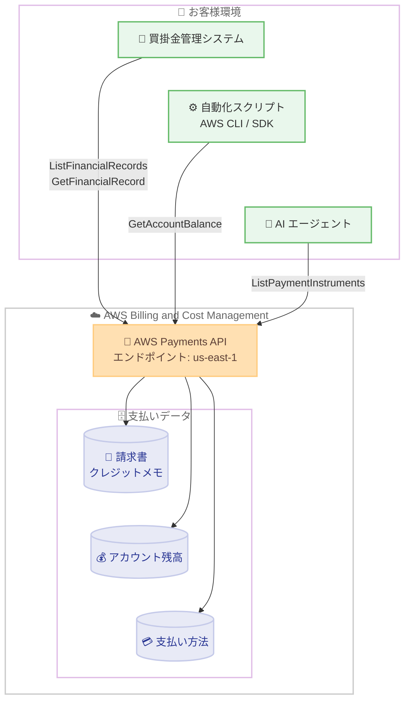

# AWS Billing and Cost Management - 支払いステータスを追跡する API の提供開始

**リリース日**: 2026 年 11 月 20 日
**サービス**: AWS Billing and Cost Management (AWS Payments)
**機能**: 支払いステータスを追跡する AWS Payments API

📊 [このアップデートのインフォグラフィックを見る](https://takech9203.github.io/aws-news-summary/20261120-aws-billing-cost-management-apis-payment-status.html)

## 概要

AWS Billing and Cost Management は、支払い情報を AWS SDK および AWS CLI から取得できる新しい API (AWS Payments API) の提供を開始しました。今回リリースされた 6 つの API を使用することで、アカウントの残高確認、支払い期限が到来した請求書や支払い期限超過の請求書の特定、各請求書に適用された支払いおよびクレジットメモの確認、アカウントに登録された支払い方法が有効かどうかの検証をプログラムから実行できます。

これらの API は自社のツールから直接呼び出せるほか、AI エージェント経由での利用も想定されています。買掛金管理 (Accounts Payable) システムと統合することで、支払い期限超過の残高を自動的に監視したり、AWS の請求書を自社のスケジュールで消し込み (リコンサイル) したりすることが可能になります。経理・財務部門を持つ企業や、多数の請求書を扱う大規模組織にとって特に有用なアップデートです。

**アップデート前の課題**

このアップデート以前は、支払い情報の確認に手動のコンソール操作が必要でした。

- 支払い期限超過の請求書を確認するには、AWS マネジメントコンソールに手動でログインして探す必要があった
- 支払いと請求書の突合 (どの支払いがどの請求書に適用されたか) をコンソール上で手作業で行う必要があった
- 支払い方法 (クレジットカードなど) が有効かどうかの確認も手動で行う必要があり、支払い失敗の検知が遅れるリスクがあった
- 買掛金管理システムとの連携が難しく、AWS の請求・支払い状況を自社の経理プロセスに組み込みにくかった

**アップデート後の改善**

今回のアップデートにより、支払い関連の確認作業を自動化できるようになりました。

- API 経由でアカウント残高 (支払い期限内・期限超過・未適用クレジットメモ) を取得できるようになった
- 請求書やクレジットメモの一覧と詳細 (適用された支払い・クレジットメモを含む) をプログラムから取得できるようになった
- 支払い方法の有効性を API で検証できるようになり、支払い失敗を事前に防ぎやすくなった
- 買掛金管理システムや AI エージェントと統合し、支払い期限超過の監視や請求書の消し込みを自社のスケジュールで自動実行できるようになった

## アーキテクチャ図



買掛金管理システム、自動化スクリプト、AI エージェントなどのクライアントが AWS Payments API を呼び出し、請求書・クレジットメモ、アカウント残高、支払い方法の情報を取得する構成です。

## サービスアップデートの詳細

### 主要機能

1. **金融レコード (請求書・クレジットメモ) の取得**
   - `ListFinancialRecords`: アカウントの金融レコード (請求書またはクレジットメモ) の一覧をサマリー形式で取得。レコードタイプ (`INVOICE` / `CREDIT_MEMO`)、決済ステータス (`OPEN` / `CLOSED`)、発行日時の範囲でフィルタリング可能
   - `GetFinancialRecord`: 単一の金融レコードの詳細を取得。請求書に適用された支払いやクレジットメモの情報を確認できる
   - `BatchGetFinancialRecord`: 複数の金融レコードの詳細を一括取得

2. **アカウント残高の取得**
   - `GetAccountBalance`: 残高タイプを指定してアカウント残高を取得
   - 残高タイプは `INVOICES_DUE` (期限内の未払い請求書残高)、`INVOICES_PAST_DUE` (期限超過の未払い請求書残高)、`OUTSTANDING_CREDIT_MEMOS` (未適用のクレジットメモ残高) の 3 種類
   - 残高は merchant of record (記録上の販売者) と通貨の組み合わせごとに返却され、通貨をまたいだ合算は行われない

3. **支払い方法の確認**
   - `GetPaymentInstrument`: 特定の支払い方法 (payment instrument) の詳細を取得
   - `ListPaymentInstruments`: アカウントに登録された支払い方法の一覧を取得
   - 支払い方法が有効 (アクティブ) かどうかを検証し、支払い失敗を未然に防止

## 技術仕様

### 提供される API 一覧

| API | 説明 |
|------|------|
| `GetAccountBalance` | 残高タイプを指定してアカウント残高を取得 |
| `ListFinancialRecords` | 請求書・クレジットメモの一覧をサマリー形式で取得 |
| `GetFinancialRecord` | 単一の請求書・クレジットメモの詳細を取得 |
| `BatchGetFinancialRecord` | 複数の請求書・クレジットメモの詳細を一括取得 |
| `GetPaymentInstrument` | 特定の支払い方法の詳細を取得 |
| `ListPaymentInstruments` | 支払い方法の一覧を取得 |

### 金融レコードのステータス

| 項目 | 詳細 |
|------|------|
| `status` | `OUTSTANDING` (未払い)、`PROCESSING` (処理中)、`SETTLED` (決済済み)、`CANCELED` (キャンセル済み) |
| `settlementStatus` | `OPEN` (`OUTSTANDING` または `PROCESSING`)、`CLOSED` (`SETTLED` または `CANCELED`) |
| レコードタイプ | `INVOICE` (AWS からの請求書)、`CREDIT_MEMO` (請求訂正やサービスクレジットなどのクレジット) |
| ページネーション | 1 ページ最大 100 件、`nextToken` で次ページを取得 |
| 整合性 | `GetAccountBalance` は結果整合性 (eventually consistent) |

### API変更履歴

| 日付 | サービス | 変更内容 |
|------|----------|----------|
| 2026/11/20 | [payments](https://awsapichanges.com/archive/changes/e9d2b3-payments.html) | 6 new api methods - AWS Payments API の初回リリース。アカウント残高、請求書、クレジットメモ、支払い方法の参照に対応 |

### IAM 権限

AWS Payments API の利用には、各アクションの権限に加えて `payments:GetPaymentStatus` 権限が必要です。

```json
{
  "Version": "2012-10-17",
  "Statement": [
    {
      "Effect": "Allow",
      "Action": [
        "payments:GetAccountBalance",
        "payments:ListFinancialRecords",
        "payments:GetFinancialRecord",
        "payments:BatchGetFinancialRecord",
        "payments:GetPaymentInstrument",
        "payments:ListPaymentInstruments",
        "payments:GetPaymentStatus"
      ],
      "Resource": "*"
    }
  ]
}
```

## 設定方法

### 前提条件

1. AWS CLI v2 または各言語の AWS SDK の最新バージョンがインストールされていること
2. 上記の `payments:*` アクション (各アクションと `payments:GetPaymentStatus`) を許可する IAM 権限が付与されていること
3. API エンドポイントは米国東部 (バージニア北部) リージョンにホストされているため、リージョンとして `us-east-1` を指定すること

### 手順

#### ステップ1: 支払い期限超過の残高を確認する

```bash
aws payments get-account-balance \
  --balance-type INVOICES_PAST_DUE \
  --region us-east-1
```

残高タイプに `INVOICES_PAST_DUE` を指定して、支払い期限を超過した未払い請求書の残高を取得しています。残高は merchant of record と通貨の組み合わせごとに返却されます。

#### ステップ2: 未決済の請求書を一覧表示する

```bash
aws payments list-financial-records \
  --types INVOICE \
  --settlement-statuses OPEN \
  --region us-east-1
```

レコードタイプに `INVOICE`、決済ステータスに `OPEN` を指定して、未払いまたは処理中の請求書のサマリー一覧を取得しています。`issuedAfter` / `issuedBefore` パラメータで発行日時の範囲を絞り込むこともできます。

#### ステップ3: 請求書の詳細と適用された支払いを確認する

```bash
aws payments get-financial-record \
  --id <financial-record-id> \
  --region us-east-1
```

ステップ 2 で取得した請求書の ID を指定して詳細を取得しています。請求書に適用された支払いやクレジットメモの情報を確認し、買掛金管理システムでの消し込み処理に利用できます。

#### ステップ4: 支払い方法の有効性を確認する

```bash
aws payments list-payment-instruments \
  --region us-east-1
```

アカウントに登録された支払い方法の一覧を取得し、支払い方法がアクティブかどうかを検証しています。無効な支払い方法を早期に検知することで、支払い失敗を未然に防げます。

## メリット

### ビジネス面

- **経理業務の自動化**: コンソールへの手動ログインが不要になり、支払い期限超過の監視や請求書の消し込みを自社のスケジュールで自動実行できる
- **支払い遅延リスクの低減**: 期限超過残高や無効な支払い方法をプログラムで早期に検知し、サービス停止や延滞のリスクを低減できる
- **既存システムとの統合**: 買掛金管理システムや ERP と統合し、AWS の請求・支払い情報を自社の経理プロセスに組み込める

### 技術面

- **標準的な SDK / CLI サポート**: AWS CLI v2 および各言語の AWS SDK (Python、Java、Go、JavaScript など) から利用可能
- **柔軟なフィルタリング**: レコードタイプ、決済ステータス、発行日時の範囲、ソート順を指定した絞り込みが可能
- **AI エージェント連携**: AI エージェントから API を呼び出し、自然言語での支払い状況の問い合わせや自動化ワークフローを構築できる

## デメリット・制約事項

### 制限事項

- API エンドポイントは米国東部 (バージニア北部) リージョンのみにホストされている
- `ListFinancialRecords` のソートキーは `ISSUED_AT` (発行日時) のみ
- 1 ページあたりの最大取得件数は 100 件で、それ以上は `nextToken` によるページネーションが必要
- `GetAccountBalance` は結果整合性のため、直近の支払いが即座に反映されない場合がある

### 考慮すべき点

- 各アクションの IAM 権限に加えて `payments:GetPaymentStatus` 権限が必要なため、IAM ポリシーの設計時に注意が必要
- 残高は merchant of record と通貨ごとに個別に返却され、合算されないため、複数通貨を扱う場合は自社側で集計処理が必要
- 支払い情報は機密性の高い情報であるため、API を呼び出す IAM プリンシパルの権限は最小限に絞ることが望ましい

## ユースケース

### ユースケース1: 支払い期限超過の自動監視と通知

**シナリオ**: 経理部門が AWS の支払い期限超過を毎日自動チェックし、残高がある場合に Slack やメールで通知したい。

**実装例**:
```python
import boto3

client = boto3.client("payments", region_name="us-east-1")

response = client.get_account_balance(balanceType="INVOICES_PAST_DUE")
for balance in response["accountBalances"]:
    amount = balance["amount"]
    if float(amount["value"]) > 0:
        notify(
            f"期限超過残高があります: "
            f"{amount['value']} {amount['currency']} "
            f"({balance['merchantOfRecord']})"
        )
```

**効果**: EventBridge Scheduler と Lambda で定期実行することで、支払い遅延を早期に検知し、サービスへの影響を未然に防げる。

### ユースケース2: 買掛金管理システムとの請求書消し込み連携

**シナリオ**: 自社の買掛金管理システムで AWS の請求書と支払いを突合 (消し込み) し、月次決算を効率化したい。

**実装例**:
```python
import boto3

client = boto3.client("payments", region_name="us-east-1")

# 未決済の請求書一覧を取得
records = client.list_financial_records(
    types=["INVOICE"],
    settlementStatuses=["OPEN"],
)

# 各請求書の詳細 (適用された支払い・クレジットメモ) を取得
for summary in records["financialRecordSummaries"]:
    detail = client.get_financial_record(id=summary["id"])
    sync_to_ap_system(detail)  # 買掛金管理システムへ連携
```

**効果**: 手作業での突合が不要になり、月次決算の作業時間を短縮できる。消し込み漏れや転記ミスも防止できる。

### ユースケース3: AI エージェントによる支払い状況の問い合わせ対応

**シナリオ**: 社内の AI エージェントに「今月の AWS の未払い請求書はある?」といった自然言語の質問に回答させたい。

**実装例**:
```text
AI エージェントのツールとして AWS Payments API を登録する。

- ツール 1: GetAccountBalance - 残高タイプ別のアカウント残高を取得
- ツール 2: ListFinancialRecords - 請求書・クレジットメモの一覧を取得
- ツール 3: ListPaymentInstruments - 支払い方法の有効性を確認

エージェントは質問内容に応じて適切な API を呼び出し、
取得結果を自然言語で要約して回答する。
```

**効果**: 経理担当者がコンソールを操作することなく、チャットで支払い状況を即座に確認できる。

## 料金

What's New 発表には、AWS Payments API 自体の利用に関する追加料金の記載はありません。詳細は [AWS Billing and Cost Management の料金ページ](https://aws.amazon.com/aws-cost-management/pricing/)を参照してください。

## 利用可能リージョン

API は米国東部 (バージニア北部) リージョンにホストされており、すべての AWS 商用リージョンのお客様が利用できます。

## 関連サービス・機能

- **AWS Billing Conductor / AWS Billing**: 請求データのカスタマイズや請求設定の管理を行うサービス。AWS Payments API は支払い (ペイメント) 側の情報を補完する
- **AWS Invoicing (Invoice Units)**: 請求書の分割・管理機能。請求書単位での支払いステータス追跡と組み合わせて利用できる
- **AWS Cost Explorer / Data Exports**: コストと使用量の分析・エクスポート機能。コスト分析と支払い管理を合わせて自動化できる
- **Amazon EventBridge Scheduler + AWS Lambda**: 定期的な残高チェックや通知の自動化基盤として組み合わせ可能

## 参考リンク

- 📊 [インフォグラフィック](https://takech9203.github.io/aws-news-summary/20261120-aws-billing-cost-management-apis-payment-status.html)
- [公式発表 (What's New)](https://aws.amazon.com/about-aws/whats-new/2026/11/aws-billing-cost-management-apis-payment-status/)
- [AWS Payments API リファレンス](https://docs.aws.amazon.com/aws-cost-management/latest/APIReference/API_Operations_AWS_Payments.html)
- [API 変更履歴 (awsapichanges.com)](https://awsapichanges.com/archive/changes/e9d2b3-payments.html)
- [AWS Billing and Cost Management 料金ページ](https://aws.amazon.com/aws-cost-management/pricing/)

## まとめ

AWS Payments API のリリースにより、これまでコンソールでの手動確認が必要だった AWS の支払いステータス管理 (残高確認、請求書の突合、支払い方法の検証) を完全に自動化できるようになりました。経理・財務プロセスに AWS の請求情報を組み込みたい組織は、まず `GetAccountBalance` と `ListFinancialRecords` を使った期限超過残高の自動監視から導入することを推奨します。
