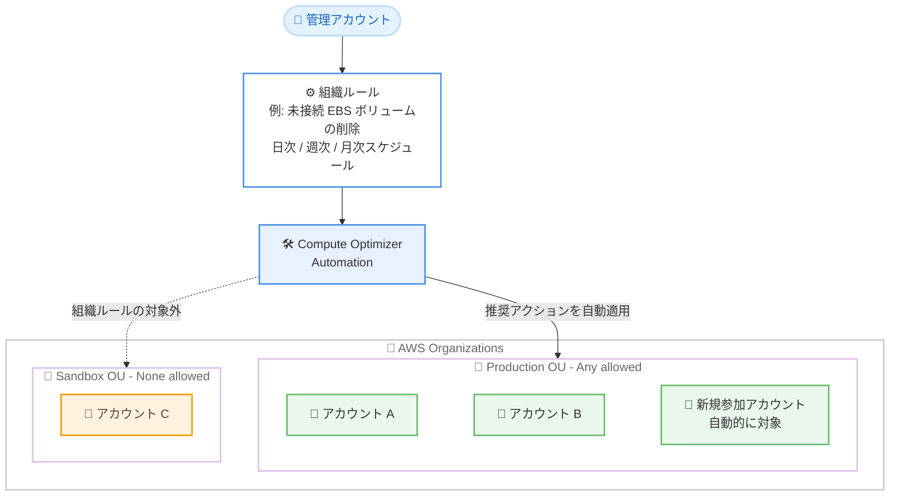

# AWS Compute Optimizer - 自動化ルールの組織単位 (OU) サポート

**リリース日**: 2026 年 11 月 20 日
**サービス**: AWS Compute Optimizer
**機能**: 自動化ルール (Automation rules) における組織単位 (Organizational Units) のサポート

📊 [このアップデートのインフォグラフィックを見る](https://takech9203.github.io/aws-news-summary/20261120-aws-compute-optimizer.html)

## 概要

AWS Compute Optimizer の自動化ルール (Automation rules) が、AWS Organizations で管理する組織単位 (OU) をターゲットとして指定できるようになりました。管理アカウントは、OU を指定した 1 つのルールを作成するだけで、その OU 配下のすべてのメンバーアカウントに最適化アクションを適用できます。将来その OU に追加されるアカウントも自動的にルールの対象となるため、大規模な組織でも最適化の取り組みをスケールさせることが可能になります。

自動化ルールは、条件に一致したリソースに対して推奨アクションを日次、週次、または月次のスケジュールで自動適用する機能です。たとえば、未接続の Amazon EBS ボリュームの削除や、旧世代ボリュームの新世代タイプへのアップグレードなどを自動化できます。今回のアップデートにより、これらの運用を組織全体に一括展開しつつ、特定の子 OU や個別のメンバーアカウントを除外する柔軟な制御も可能になりました。

本アップデートは、AWS Organizations で多数のアカウントを管理し、コスト最適化をガバナンスとして組織全体に展開したい企業の管理者や FinOps チームに特に有用です。

**アップデート前の課題**

このアップデート以前には、以下の課題や制限がありました。

- 管理アカウントが作成する自動化ルールは、1 ルールあたり最大 50 のメンバーアカウントまでしか指定できなかった
- 多数のアカウントを持つ組織では、同じ内容のルールを複数作成して管理する必要があった
- 組織に新しいアカウントが追加されるたびに、ルールのターゲットを手動で更新する必要があった

**アップデート後の改善**

今回のアップデートにより、以下が可能になりました。

- 1 つの自動化ルールで OU を指定し、OU 配下のすべてのアカウントを対象にできるようになった
- 将来 OU に追加されるアカウントも自動的にルールの対象となり、手動更新が不要になった
- 特定の子 OU や個別のメンバーアカウントをルールの対象から除外できるようになった
- 推奨アクションや自動化イベントを OU でフィルタリングできるようになった

## アーキテクチャ図



管理アカウントが OU をターゲットとする組織ルールを 1 つ作成すると、Compute Optimizer Automation が OU 配下の全アカウント (将来の追加分を含む) に推奨アクションを適用します。組織ルールモードが None allowed の OU は対象から除外されます。

## サービスアップデートの詳細

### 主要機能

1. **OU をターゲットとする組織ルール**
   - 自動化ルールのターゲットとして OU を指定可能
   - OU 配下のすべてのアカウントと子 OU に再帰的に適用される
   - 将来 OU に追加されるアカウントも自動的に対象となる
   - 従来の 1 ルールあたり最大 50 アカウントという制限を超えて組織全体へ展開可能

2. **柔軟な除外設定**
   - 特定の子 OU や個別のメンバーアカウントをルールから除外可能
   - リソース所有者はタグを付与することで、個別のリソース (例: EBS ボリューム) を自動クリーンアップの対象外にできる

3. **組織登録設定 (Enrollment configuration)**
   - 組織のルート、OU、または個別アカウントに対して登録設定を作成し、Automation を一括有効化
   - 登録設定を持たない OU やアカウントは、最も近い親の設定を継承する (親に設定がない場合のデフォルトは None allowed)
   - 組織ルールモードにより、集中ガバナンスとアカウントの自律性のバランスを制御

4. **組織ルールモード (Organization rule mode)**
   - **Any allowed**: 管理アカウントが推奨アクションを適用でき、組織ルールの対象に含められる
   - **None allowed**: アカウント自身が推奨アクションと自動化ルールを管理し、組織ルールは適用されない
   - モードを None allowed に変更した場合、実行中の自動化ステップは完了まで継続するが、新規ステップは開始されない

## 技術仕様

### 組織登録設定の対象と動作

| 設定対象 | 動作 |
|------|------|
| ルート | 組織内のすべてのメンバーアカウント (後から参加するアカウントを含む) で Automation を有効化 |
| OU | OU とその子 OU 内のすべてのアカウント (後から参加するアカウントを含む) で Automation を有効化 |
| 個別アカウント | 指定したメンバーアカウントのみで Automation を有効化 |
| 設定の継承 | 自身の設定がない場合、最も近い親の設定を継承。親にも設定がない場合のデフォルトは None allowed |

### API 変更履歴

| 日付 | サービス | 変更内容 |
|------|----------|----------|
| 2026/11/20 | [aco-automation](https://awsapichanges.com/archive/changes/e9d2b3-aco-automation.html) | 4 new 12 updated api methods - 組織登録設定 (Organization enrollment configurations) の追加。組織ルールでの OU の包含・除外、推奨アクションと自動化イベントの OU によるフィルタリングに対応 |

### 組織全体で Automation を有効化するための IAM ポリシー

管理アカウントまたは委任管理者には、以下の権限が必要です (抜粋)。

```json
{
    "Version": "2012-10-17",
    "Statement": [
        {
            "Effect": "Allow",
            "Action": "iam:CreateServiceLinkedRole",
            "Resource": "arn:aws:iam::*:role/aws-service-role/aco-automation.amazonaws.com/AWSServiceRoleForComputeOptimizerAutomation",
            "Condition": {"StringLike": {"iam:AWSServiceName": "aco-automation.amazonaws.com"}}
        },
        {
            "Effect": "Allow",
            "Action": [
                "aco-automation:PutOrganizationEnrollmentConfiguration",
                "aco-automation:DeleteOrganizationEnrollmentConfiguration",
                "aco-automation:ListOrganizationEnrollmentConfigurations",
                "aco-automation:ListOrganizationalUnits"
            ],
            "Resource": "*"
        },
        {
            "Effect": "Allow",
            "Action": [
                "aco-automation:UpdateEnrollmentConfiguration",
                "aco-automation:AssociateAccounts",
                "aco-automation:DisassociateAccounts",
                "aco-automation:ListAccounts"
            ],
            "Resource": "*"
        }
    ]
}
```

## 設定方法

### 前提条件

1. AWS Organizations の管理アカウント、または Compute Optimizer の委任管理者アカウントを使用していること
2. AWS Organizations の信頼されたアクセス (trusted access) が有効であること。組織の管理アカウントで全メンバーアカウントを含めて Compute Optimizer にオプトインすると自動的に有効化される
3. 上記の IAM 権限 (aco-automation の各アクション) が付与されていること

### 手順

#### ステップ 1: 組織登録設定の作成

1. [Compute Optimizer コンソール](https://console.aws.amazon.com/compute-optimizer/) を開く
2. ナビゲーションペインの **Preferences** セクションで **Account management** を選択
3. **Automation** タブを選択
4. **Enrollment configurations** セクションで **Create enrollment configuration** を選択
5. **Select organizational units and accounts** ページで、Automation を有効化するルート、OU、またはアカウントを選択して **Next** を選択
6. **Set organization rule mode** ページで、各 OU とアカウントに **Any allowed** または **None allowed** を設定
7. **Create enrollment configuration** を選択

コンソール上で登録設定を作成し、対象 OU の全アカウントで Automation を有効化します。各アカウントの適用結果は **Automation** タブの **View organization status** から確認できます。

#### ステップ 2: OU をターゲットとする組織ルールの作成

Automation を有効化した OU をターゲットとして自動化ルールを作成します。たとえば、未接続の EBS ボリュームを組織全体でクリーンアップするルールを、日次、週次、または月次のスケジュールで設定できます。CloudFormation を使用した自動化ルールの作成もサポートされています。

#### ステップ 3: 除外設定の調整

組織ルールの対象から外したい子 OU やアカウントがある場合は、ルール側で除外するか、対象 OU に **None allowed** の登録設定を作成します。子 OU の設定はルートや親 OU の設定より優先されます。また、リソース所有者は個々のリソースにタグを付与することで、自動クリーンアップの対象から除外できます。

## メリット

### ビジネス面

- **組織全体のコスト最適化**: 未使用リソースの削除や新世代タイプへの移行を組織規模で自動化し、コスト削減を継続的に実現できる
- **運用負荷の削減**: アカウント追加のたびにルールを更新する作業が不要になり、FinOps チームの運用負荷が軽減される
- **ガバナンスと自律性の両立**: 組織ルールモードにより、集中管理する OU と各アカウントに任せる OU を明確に分けられる

### 技術面

- **スケーラビリティ**: 1 ルールあたり最大 50 アカウントという制限を超えて、OU 単位で組織全体に適用できる
- **将来のアカウントへの自動適用**: OU に新規参加したアカウントが自動的にルールの対象となり、設定漏れを防止できる
- **柔軟な除外制御**: 子 OU、アカウント、リソースタグの各レベルで除外を制御できる

## デメリット・制約事項

### 制限事項

- 組織ルールが適用されるのは、組織ルールモードが Any allowed のアカウントのみ
- 登録設定は管理アカウント自身には適用されない
- 利用には AWS Organizations の信頼されたアクセスの有効化が必要。無効化すると管理アカウントはメンバーアカウントの推奨事項と自動化にアクセスできなくなる

### 考慮すべき点

- 未接続ボリュームの削除などのアクションは組織全体に影響するため、除外タグの運用ルールを事前に周知しておく必要がある
- 組織ルールモードを None allowed に変更しても、すでに開始された自動化ステップは完了まで継続する
- 登録設定は親からの継承で決まるため、OU 階層が複雑な場合は **View organization status** で各アカウントの最終的な適用状態を確認することが推奨される

## ユースケース

### ユースケース 1: 組織全体での未接続 EBS ボリュームのクリーンアップ

**シナリオ**: 数百のメンバーアカウントを持つ組織で、未接続のまま放置された EBS ボリュームのコストが問題になっている。

**実装例**:
```text
1. ルートに Any allowed の登録設定を作成し、全アカウントで Automation を有効化
2. 管理アカウントで、ルート配下を対象に「未接続 EBS ボリュームを削除」する
   組織ルールを週次スケジュールで作成
3. 保持が必要なボリュームには、リソース所有者が除外用のタグを付与
```

**効果**: 組織全体で未使用ストレージのコストを継続的に削減しつつ、必要なボリュームはタグで保護できる。

### ユースケース 2: 本番 OU のみを対象とした新世代ボリュームへの移行

**シナリオ**: 本番環境のアカウントを集約した Production OU で、旧世代の EBS ボリュームを新世代タイプへ計画的に移行したい。

**実装例**:
```text
1. Production OU に Any allowed の登録設定を作成
2. Production OU をターゲットに、ボリュームを新世代タイプへ
   アップグレードする組織ルールを月次スケジュールで作成
3. Production OU に新しいアカウントが追加されても自動的にルールの対象となる
```

**効果**: 本番環境のパフォーマンスとコスト効率を、アカウント追加時の設定作業なしで継続的に改善できる。

### ユースケース 3: サンドボックス OU を除外した集中ガバナンス

**シナリオ**: 組織全体に最適化ルールを適用したいが、検証用の Sandbox OU は各アカウントの自律的な運用に任せたい。

**実装例**:
```text
1. ルートに Any allowed の登録設定を作成
2. Sandbox OU に None allowed の登録設定を作成
   (子 OU の設定がルートの設定より優先される)
3. ルート配下を対象とする組織ルールを作成
```

**効果**: Sandbox OU のアカウントは自身のルールのみを実行し、それ以外のアカウントには組織ルールが適用される。集中ガバナンスとアカウントの自律性を両立できる。

## 料金

今回のアップデート (OU サポート) 自体に関する追加料金の発表はありません。Compute Optimizer および自動化機能の料金詳細は、公式の料金ページを参照してください。

## 利用可能リージョン

Compute Optimizer の自動化ルールが利用可能なすべての AWS リージョンで利用できます。

## 関連サービス・機能

- **AWS Organizations**: OU によるアカウント階層管理と信頼されたアクセスの基盤。本機能は Organizations の OU 構造をそのままターゲット指定に利用する
- **Amazon EBS**: 自動化ルールの代表的な適用対象。未接続ボリュームの削除や新世代タイプへのアップグレードを自動化できる
- **AWS CloudFormation**: 自動化ルールを IaC として作成・管理可能
- **AWS Cost Explorer / AWS Budgets**: コスト最適化の効果測定と組み合わせて利用できるコスト管理サービス

## 参考リンク

- 📊 [インフォグラフィック](https://takech9203.github.io/aws-news-summary/20261120-aws-compute-optimizer.html)
- [公式発表 (What's New)](https://aws.amazon.com/about-aws/whats-new/2026/11/aws-compute-optimizer/)
- [ドキュメント: Enabling Automation for your organization](https://docs.aws.amazon.com/compute-optimizer/latest/ug/automation-org.html)
- [AWS Compute Optimizer 製品ページ](https://aws.amazon.com/compute-optimizer/)
- [API 変更履歴 (awsapichanges.com)](https://awsapichanges.com/archive/changes/e9d2b3-aco-automation.html)

## まとめ

AWS Compute Optimizer の自動化ルールが OU をサポートしたことで、従来の 1 ルールあたり最大 50 アカウントという制限を超え、将来追加されるアカウントも含めた組織全体への最適化アクションの自動適用が可能になりました。AWS Organizations で多数のアカウントを管理している場合は、まずルートまたは主要な OU に登録設定を作成して Automation を有効化し、未接続 EBS ボリュームのクリーンアップなど影響の小さいルールから組織ルールの導入を始めることを推奨します。
