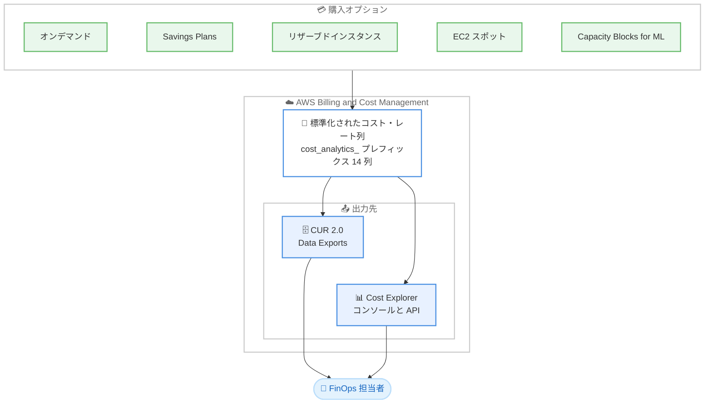

# AWS Billing and Cost Management - CUR 2.0 と Cost Explorer における標準化されたコスト・レート列の提供開始

**リリース日**: 2026 年 11 月 20 日
**サービス**: AWS Data Exports (CUR 2.0)、AWS Cost Explorer
**機能**: 標準化されたコスト・レート列 (Standardized Cost and Rate Columns)

📊 [このアップデートのインフォグラフィックを見る](https://takech9203.github.io/aws-news-summary/20261120-aws-cur-cost-explorer.html)

## 概要

AWS Data Exports の Cost and Usage Report (CUR) 2.0 に、`cost_analytics_` プレフィックスを持つ 14 個の標準化されたコスト・レート列が追加されました。これらの列は、オンデマンド、Savings Plans、リザーブドインスタンス、EC2 スポット、EC2 Capacity Blocks for ML といったすべての購入オプションにわたって、コストを一貫した形式で表現します。あわせて、Cost Explorer でも新しいコストタイプを選択できるようになりました。

各明細行 (ラインアイテム) に対して、請求コスト (billed)、実効コスト (effective)、定価コスト (list)、契約コスト (contracted)、パブリックオンデマンドコストに加え、割引適用前のパブリック換算の請求コスト・実効コストと、それぞれに対応するレートが含まれます。これにより、コミットメント、割引、段階的料金によって実現している削減額を、CUR 2.0 のデータだけで直接定量化できます。

FinOps 担当者、コスト分析基盤を運用するデータエンジニア、組織全体のコスト最適化を推進する管理者にとって、独自のコスト計算ロジックを大幅に簡素化できる重要なアップデートです。

**アップデート前の課題**

このアップデート以前は、購入オプション横断でのコスト比較や削減額の算出に手作業の組み合わせが必要でした。

- 削減額を算出するには、CUR のデータを Savings Plans のレートやパブリック料金表 (Price List) と手動で突き合わせる必要があった
- 償却コストの参照に使用する列が料金モデル (RI、Savings Plans など) によって異なり、横断的な集計クエリが複雑になっていた
- 定価ベースのコストと実際の請求額の差分 (割引効果) を一貫した方法で可視化する標準的な手段がなかった

**アップデート後の改善**

今回のアップデートにより、標準化された列を使った一貫性のあるコスト分析が可能になりました。

- CUR 2.0 のエクスポート設定で標準化されたコスト・レート列を有効化するだけで、14 個の `cost_analytics_` 列が追加される
- カスタム計算なしで、削減額や償却コストを明細行単位で測定できるようになった
- Cost Explorer の詳細オプションから新しいコストタイプを選択し、コンソール上でも同じ指標で分析できるようになった
- Cost Explorer API (`GetCostAndUsage`、`GetCostAndUsageWithResources`) でも 5 つの標準化コストメトリクスが利用可能になった

## アーキテクチャ図



すべての購入オプションのコストが標準化された列に正規化され、CUR 2.0 のエクスポートと Cost Explorer の両方から一貫した指標で参照できる構成を示しています。

## サービスアップデートの詳細

### 主要機能

1. **CUR 2.0 への 14 個の標準化コスト・レート列の追加**
   - `cost_analytics_` プレフィックスを持つ 14 列が CUR 2.0 のテーブルスキーマに追加される
   - 請求 (billed)、定価 (list)、契約 (contracted)、実効 (effective)、パブリック換算の請求 (public equivalent billed)、パブリック換算の実効 (public equivalent effective)、パブリックオンデマンド (public On-Demand) の 7 種類のコストと、それぞれに対応するレートで構成される
   - エクスポートの作成時または編集時に、標準化されたコスト・レート列を含めるオプション (テーブル設定 `INCLUDE_STANDARDIZED_COST_AND_RATE`) を選択することで有効化できる

2. **購入オプション横断での一貫したコスト表現**
   - オンデマンド、Savings Plans、リザーブドインスタンス、EC2 スポット、EC2 Capacity Blocks for ML のすべてで同じ列を使用してコストを比較できる
   - コミットメント、割引、段階的料金による削減額をカスタム計算なしで定量化できる
   - 料金モデルごとに異なる列を参照する必要がなくなり、償却コストの集計が簡素化される

3. **Cost Explorer での新しいコストタイプのサポート**
   - Cost Explorer の詳細オプション (Advanced options) から新しいコストタイプを選択できる
   - API では `BilledCost`、`ListCost`、`ContractedCost`、`PublicEquivalentBilledCost`、`PublicOnDemandCost` の 5 つのメトリクスが `GetCostAndUsage` および `GetCostAndUsageWithResources` で利用可能
   - これらのメトリクスは 2026 年 11 月以降の使用量に対して値を返す

## 技術仕様

### 標準化されたコストタイプ

| コストタイプ | 説明 |
|------|------|
| 請求コスト (Billed) | 実際に請求される金額 |
| 実効コスト (Effective) | コミットメントの償却を反映した実効的なコスト |
| 定価コスト (List) | 割引適用前の定価ベースのコスト |
| 契約コスト (Contracted) | 契約条件に基づくコスト |
| パブリックオンデマンドコスト | 同じ使用量をオンデマンドで利用した場合のコスト |
| パブリック換算の請求コスト | 割引適用前のパブリック料金に換算した請求コスト |
| パブリック換算の実効コスト | 割引適用前のパブリック料金に換算した実効コスト |

上記 7 種類のコストと、それぞれに対応するレートをあわせた 14 列が `cost_analytics_` プレフィックスで提供されます。

### API変更履歴

| 日付 | サービス | 変更内容 |
|------|----------|----------|
| 2026/11/19 | [Cost Explorer](https://awsapichanges.com/archive/changes/b8bc94-ce.html) | 2 updated api methods - 5 つの標準化コストメトリクス (BilledCost、ListCost、ContractedCost、PublicEquivalentBilledCost、PublicOnDemandCost) を追加。`GetCostForecast` と `GetUsageForecast` の `Metric` パラメータにも新メトリクスが追加された |

### Cost Explorer API の利用例

```bash
aws ce get-cost-and-usage \
  --time-period Start=2026-11-01,End=2026-12-01 \
  --granularity MONTHLY \
  --metrics "BilledCost" "PublicOnDemandCost" \
  --group-by Type=DIMENSION,Key=SERVICE
```

請求コストとパブリックオンデマンドコストをサービス別に取得するコマンドです。2 つのメトリクスの差分から、購入オプションによる削減額をサービス単位で把握できます。

## 設定方法

### 前提条件

1. AWS Billing and Cost Management へのアクセス権限を持つ IAM プリンシパル
2. CUR 2.0 を使用する場合は、AWS Data Exports のエクスポート作成権限と出力先の Amazon S3 バケット
3. 標準化コストメトリクスの値は 2026 年 11 月以降の使用量が対象であることの理解

### 手順

#### ステップ1: CUR 2.0 エクスポートで標準化列を有効化する

```bash
aws bcm-data-exports create-export \
  --export '{
    "Name": "cur2-with-standardized-cost",
    "DataQuery": {
      "QueryStatement": "SELECT * FROM COST_AND_USAGE_REPORT",
      "TableConfigurations": {
        "COST_AND_USAGE_REPORT": {
          "TIME_GRANULARITY": "HOURLY",
          "INCLUDE_STANDARDIZED_COST_AND_RATE": "TRUE"
        }
      }
    },
    "DestinationConfigurations": {
      "S3Destination": {
        "S3Bucket": "your-cur-bucket",
        "S3Prefix": "cur2",
        "S3Region": "ap-northeast-1",
        "S3OutputConfigurations": {
          "OutputType": "CUSTOM",
          "Format": "PARQUET",
          "Compression": "PARQUET",
          "Overwrite": "OVERWRITE_REPORT"
        }
      }
    },
    "RefreshCadence": {"Frequency": "SYNCHRONOUS"}
  }'
```

テーブル設定 `INCLUDE_STANDARDIZED_COST_AND_RATE` を `TRUE` にして CUR 2.0 エクスポートを作成するコマンドです。これにより `cost_analytics_` プレフィックスの 14 列がスキーマに追加されます。既存のエクスポートの場合は、コンソールまたは `update-export` で編集して同じオプションを有効化します。

#### ステップ2: Cost Explorer コンソールで新しいコストタイプを選択する

1. AWS Billing and Cost Management コンソールで [Cost Explorer] を開く
2. 詳細オプション (Advanced options) を展開する
3. 新しいコストタイプ (請求コスト、定価コスト、契約コストなど) を選択してグラフを表示する

コンソール操作のみで、購入オプション横断の標準化された指標による可視化が可能です。

#### ステップ3: 削減額を分析するクエリを実行する

```sql
SELECT
  product_servicecode,
  SUM(cost_analytics_public_on_demand_cost) - SUM(cost_analytics_billed_cost)
    AS estimated_savings
FROM COST_AND_USAGE_REPORT
GROUP BY product_servicecode
ORDER BY estimated_savings DESC;
```

Amazon Athena などで CUR 2.0 をクエリし、パブリックオンデマンドコストと請求コストの差分からサービス別の削減額を算出する例です。実際の列名はエクスポート有効化後に [CUR 2.0 データディクショナリ](https://docs.aws.amazon.com/cur/latest/userguide/table-dictionary-cur2.html)で確認してください。

## メリット

### ビジネス面

- **削減額の可視化**: コミットメント、割引、段階的料金による削減効果を定量的に示せるため、Savings Plans や RI の購入判断とその効果報告が容易になる
- **レポーティングの標準化**: 組織内の複数チームが同じ定義のコスト指標を使用でき、FinOps レポートの一貫性が向上する
- **追加コストなし**: 標準化された列は追加料金なしで利用できる

### 技術面

- **カスタム計算の削減**: CUR と料金表を突き合わせる ETL パイプラインや独自の償却計算ロジックが不要になり、コスト分析基盤の保守負荷が下がる
- **購入オプション横断の一貫性**: 料金モデルごとに異なる列を参照する条件分岐が不要になり、分析クエリがシンプルになる
- **コンソールと API の両対応**: Cost Explorer のコンソール、API、CUR 2.0 のいずれでも同じ考え方の指標を利用できる

## デメリット・制約事項

### 制限事項

- AWS GovCloud (US) リージョンと中国リージョンでは利用できない
- Cost Explorer API の標準化コストメトリクスは、2026 年 11 月以降の使用量に対してのみ値を返す
- CUR 2.0 で列を利用するには、エクスポートの作成時または編集時にオプションを明示的に有効化する必要がある

### 考慮すべき点

- 14 列が追加されるため、エクスポートのファイルサイズと下流の分析基盤 (Athena テーブル定義、BI ツールのスキーマなど) への影響を確認する必要がある
- 既存の独自削減額計算ロジックから移行する場合、定義の違い (どの割引を含むかなど) を検証してから切り替えることが望ましい

## ユースケース

### ユースケース1: Savings Plans と RI の削減効果レポート

**シナリオ**: FinOps チームが、経営層向けにコミットメント購入による月次の削減額を報告したい。

**実装例**:
```sql
SELECT
  bill_billing_period_start_date,
  SUM(cost_analytics_public_on_demand_cost) AS on_demand_equivalent,
  SUM(cost_analytics_billed_cost) AS billed,
  SUM(cost_analytics_public_on_demand_cost) - SUM(cost_analytics_billed_cost)
    AS savings
FROM COST_AND_USAGE_REPORT
GROUP BY bill_billing_period_start_date;
```

**効果**: 料金表との手動突き合わせなしで、オンデマンド換算額と実請求額の差分として削減額を毎月自動算出できる。

### ユースケース2: 購入オプション横断の償却コスト集計

**シナリオ**: データエンジニアリングチームが、RI と Savings Plans が混在する環境で、チーム別の償却コストを単一のクエリで集計したい。

**実装例**:
```sql
SELECT
  cost_category,
  SUM(cost_analytics_effective_cost) AS amortized_cost
FROM COST_AND_USAGE_REPORT
GROUP BY cost_category;
```

**効果**: 料金モデルごとに参照列を切り替える複雑な CASE 式が不要になり、償却コスト集計クエリが大幅に簡素化される。

### ユースケース3: Cost Explorer API による定価ベースのコスト追跡

**シナリオ**: 割引交渉の効果を評価するため、定価コストと請求コストの推移をダッシュボードに表示したい。

**実装例**:
```bash
aws ce get-cost-and-usage \
  --time-period Start=2026-11-01,End=2026-12-01 \
  --granularity DAILY \
  --metrics "ListCost" "BilledCost"
```

**効果**: 定価と実請求額の乖離を日次で追跡でき、割引やコミットメントの効果を継続的にモニタリングできる。

## 料金

標準化されたコスト・レート列は追加料金なしで利用できます。なお、CUR 2.0 エクスポートの出力先となる Amazon S3 のストレージ料金や、Athena などでのクエリ実行費用は通常どおり発生します。

## 利用可能リージョン

AWS GovCloud (US) リージョンと中国リージョンを除く、すべての AWS リージョンで利用可能です。

## 関連サービス・機能

- **AWS Data Exports**: CUR 2.0 のエクスポートを作成・管理するサービス。テーブル設定で標準化列の有効化を制御する
- **AWS Cost Explorer**: コンソールと API で新しいコストタイプを選択してコストを可視化できる
- **Amazon Athena**: S3 に出力された CUR 2.0 をクエリして削減額や償却コストを分析する際に使用する
- **Savings Plans / リザーブドインスタンス**: 標準化列により、これらのコミットメントによる削減効果を直接定量化できる

## 参考リンク

- 📊 [インフォグラフィック](https://takech9203.github.io/aws-news-summary/20261120-aws-cur-cost-explorer.html)
- [公式発表 (What's New)](https://aws.amazon.com/about-aws/whats-new/2026/11/aws-cur-cost-explorer/)
- [ドキュメント: CUR 2.0 データディクショナリ](https://docs.aws.amazon.com/cur/latest/userguide/table-dictionary-cur2.html)
- [ドキュメント: Cost Explorer の詳細オプション](https://docs.aws.amazon.com/cost-management/latest/userguide/ce-advanced.html)

## まとめ

CUR 2.0 と Cost Explorer に標準化されたコスト・レート列が追加され、購入オプション横断での削減額や償却コストの算出がカスタム計算なしで可能になりました。料金表との手動突き合わせや独自の償却ロジックを運用しているチームは、CUR 2.0 エクスポートで `INCLUDE_STANDARDIZED_COST_AND_RATE` を有効化し、既存の計算結果と比較検証したうえで移行を進めることを推奨します。
