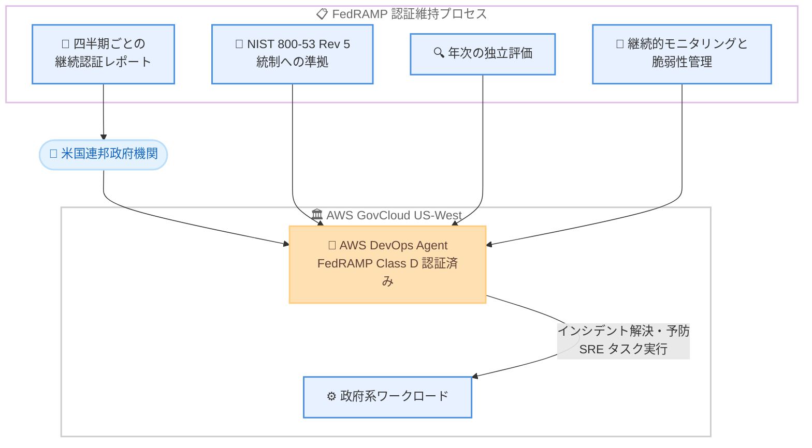

# AWS DevOps Agent - AWS GovCloud (US-West) における FedRAMP Class D 認証の取得

**リリース日**: 2026 年 11 月 20 日
**サービス**: AWS DevOps Agent
**機能**: FedRAMP Class D 認証 (AWS GovCloud (US-West))

📊 [このアップデートのインフォグラフィックを見る](https://takech9203.github.io/aws-news-summary/20261120-aws-devops-agent-fedramp-class-d.html)

## 概要

AWS DevOps Agent が、AWS GovCloud (US-West) において FedRAMP (Federal Risk and Authorization Management Program) Class D レベルの認証を取得しました。AWS DevOps Agent は「常に利用可能な運用チームメイト」として、インシデントの解決と予防、アプリケーションの信頼性とパフォーマンスの最適化、オンデマンドの SRE タスクの実行を、AWS、マルチクラウド、オンプレミス環境を横断して支援するサービスです。

FedRAMP は米国連邦政府機関がクラウドサービスを利用する際に求められるセキュリティ評価・認証プログラムです。今回の認証取得により、米国連邦政府機関や FedRAMP 準拠が求められる政府関連組織が、コンプライアンス要件を満たしながら AWS DevOps Agent を利用できるようになります。

**アップデート前の課題**

このアップデート以前に存在していた課題は以下のとおりです。

- FedRAMP 準拠が必須の米国連邦政府機関は、AWS GovCloud (US) 上で AWS DevOps Agent を利用する際のコンプライアンス上の裏付けが不足していた
- 政府系ワークロードの運用自動化やインシデント対応に AI エージェントを導入する際、認証取得済みサービスの選択肢が限られていた
- セキュリティ統制の継続的な評価を自組織で補完する必要があった

**アップデート後の改善**

今回のアップデートにより可能になったことは以下のとおりです。

- FedRAMP Class D 認証の下で、政府機関が AWS GovCloud (US-West) 上の AWS DevOps Agent を利用可能になった
- NIST 800-53 Rev 5 統制への準拠、年次の独立評価、継続的モニタリングといった FedRAMP の認証維持プロセスがサービス側で担保される
- 政府系ワークロードにおいても、インシデントの自動解決・予防や SRE タスクの自動化といった AI エージェントの価値を享受できるようになった

## アーキテクチャ図



FedRAMP Class D 認証を取得した AWS DevOps Agent を、政府機関が AWS GovCloud (US-West) 上で利用する構成と、認証を維持するためのコンプライアンスプロセスを示しています。

## サービスアップデートの詳細

### 主要機能

1. **FedRAMP Class D 認証の取得**
   - AWS GovCloud (US-West) において AWS DevOps Agent が FedRAMP Class D レベルで認証された
   - FedRAMP 準拠が求められる米国連邦政府機関やその関連組織での利用が可能になった

2. **AWS DevOps Agent の運用支援機能**
   - インシデントの解決と予防的な防止
   - アプリケーションの信頼性とパフォーマンスの最適化
   - AWS、マルチクラウド、オンプレミス環境を横断したオンデマンドの SRE タスクの実行

3. **認証維持のための継続的なコンプライアンスプロセス**
   - NIST 800-53 Rev 5 統制への準拠
   - FedRAMP 認定の独立評価機関による年次評価
   - 継続的モニタリングと脆弱性管理
   - 四半期ごとの継続認証レポート (Ongoing Certification Report) の公開
   - 利用中のサービスに重大な変更が発生した場合の政府機関への変更通知 (Significant Change Notification)

## 技術仕様

### FedRAMP 認証維持の要件

| 項目 | 詳細 |
|------|------|
| 準拠統制 | NIST 800-53 Rev 5 |
| 独立評価 | FedRAMP 認定の独立評価機関による年次評価 |
| モニタリング | 継続的モニタリングと脆弱性管理 |
| レポート | 四半期ごとの継続認証レポートの公開 |
| 変更通知 | 重大な変更発生時の Significant Change Notification の発行 |
| 対象リージョン | AWS GovCloud (US-West) |

## 設定方法

### 前提条件

1. AWS GovCloud (US) アカウントを保有していること
2. AWS DevOps Agent へのアクセス権限を持つ IAM プリンシパルが設定されていること
3. 組織のコンプライアンス要件 (FedRAMP 準拠レベルなど) を確認済みであること

### 手順

#### ステップ 1: コンプライアンス要件の確認

AWS FedRAMP コンプライアンスページで、AWS DevOps Agent の認証状況と自組織の要件が合致することを確認します。Significant Change Notification などの認証関連の更新情報も同ページで確認できます。

#### ステップ 2: AWS GovCloud (US-West) で AWS DevOps Agent をセットアップ

AWS GovCloud (US-West) リージョンで AWS DevOps Agent のユーザーガイドに従い、エージェントのセットアップと監視対象ワークロードの関連付けを行います。

#### ステップ 3: 運用への組み込み

インシデント対応フローや SRE タスクの運用プロセスに AWS DevOps Agent を組み込み、継続的な信頼性・パフォーマンス最適化を開始します。

## メリット

### ビジネス面

- **政府系ワークロードでの利用解禁**: FedRAMP 準拠が必須の連邦政府機関でも AI エージェントによる運用自動化を導入できる
- **コンプライアンス対応コストの削減**: 認証の維持 (年次評価、継続的モニタリング、レポート公開) がサービス側で実施されるため、利用者側の評価負担が軽減される
- **透明性の確保**: 四半期ごとの継続認証レポートと重大変更時の通知により、認証状況を継続的に把握できる

### 技術面

- **運用の自動化**: インシデントの解決・予防、信頼性とパフォーマンスの最適化を AI エージェントが支援する
- **幅広い環境への対応**: AWS だけでなくマルチクラウド、オンプレミス環境の SRE タスクにも対応する
- **NIST 800-53 Rev 5 準拠**: 最新の統制フレームワークに基づくセキュリティが担保される

## デメリット・制約事項

### 制限事項

- 今回の FedRAMP Class D 認証の対象は AWS GovCloud (US-West) である
- FedRAMP 認証は主に米国連邦政府機関向けの枠組みであり、日本国内のコンプライアンス制度 (ISMAP など) とは別の制度である

### 考慮すべき点

- 自組織に求められる FedRAMP の認可レベルと、今回の Class D 認証の適合性を事前に確認する必要がある
- 利用中のサービスに重大な変更があった場合は Significant Change Notification が発行されるため、FedRAMP コンプライアンスページを定期的に確認することが推奨される

## ユースケース

### ユースケース 1: 連邦政府機関のインシデント対応自動化

**シナリオ**: FedRAMP 準拠が必須の連邦政府機関が、AWS GovCloud (US-West) 上のミッションクリティカルなシステムのインシデント対応を迅速化したい。

**実装例**:
```text
1. AWS GovCloud (US-West) で AWS DevOps Agent をセットアップ
2. 対象ワークロードをエージェントの監視対象として関連付け
3. インシデント発生時の自動調査・解決フローを有効化
```

**効果**: コンプライアンス要件を満たしながら、インシデントの検知から解決までの時間を短縮できる。

### ユースケース 2: 政府系システムの予防的な信頼性管理

**シナリオ**: 政府関連組織が、障害発生前にリスクを検出し予防的に対処する体制を構築したい。

**実装例**:
```text
1. AWS DevOps Agent による継続的なアプリケーション監視を構成
2. 信頼性・パフォーマンスの最適化提案をレビューするプロセスを整備
3. 予防的な改善アクションを運用フローに組み込み
```

**効果**: 障害の未然防止により、政府サービスの可用性と市民への提供品質を向上できる。

### ユースケース 3: ハイブリッド環境における SRE タスクの省力化

**シナリオ**: AWS GovCloud とオンプレミスが混在する政府系システムで、SRE タスクの運用負荷を削減したい。

**実装例**:
```text
1. AWS、オンプレミス両環境を AWS DevOps Agent の対象として構成
2. 定型的な SRE タスクをオンデマンドでエージェントに依頼
3. 運用チームは高度な判断業務に集中
```

**効果**: 環境を横断した運用タスクの省力化により、限られた人員で広範なシステムを運用できる。

## 料金

今回のアップデートは認証取得に関する発表であり、FedRAMP Class D 認証自体に追加料金は発生しません。AWS DevOps Agent の利用料金は公式の料金ページを参照してください。

## 利用可能リージョン

- AWS GovCloud (US-West)

## 関連サービス・機能

- **AWS GovCloud (US)**: 米国政府のコンプライアンス要件に対応した専用リージョン。今回の認証対象環境
- **AWS Artifact**: AWS のコンプライアンスレポートをオンデマンドで取得できるサービス。FedRAMP 関連文書の確認に利用可能
- **AWS Organizations**: 複数アカウント環境の統制に利用。AWS DevOps Agent はエージェントスペースから組織内メンバーアカウントの監視にも対応

## 参考リンク

- 📊 [インフォグラフィック](https://takech9203.github.io/aws-news-summary/20261120-aws-devops-agent-fedramp-class-d.html)
- [公式発表 (What's New)](https://aws.amazon.com/about-aws/whats-new/2026/11/aws-devops-agent-fedramp-class-d/)
- [AWS Blog: Announcing general availability of AWS DevOps Agent](https://aws.amazon.com/blogs/mt/announcing-general-availability-of-aws-devops-agent/)
- [ドキュメント: AWS DevOps Agent ユーザーガイド](https://docs.aws.amazon.com/devopsagent/latest/userguide/)
- [AWS FedRAMP コンプライアンス](https://aws.amazon.com/compliance/fedramp/)

## まとめ

AWS DevOps Agent が AWS GovCloud (US-West) で FedRAMP Class D 認証を取得したことにより、米国連邦政府機関が厳格なコンプライアンス要件を満たしながら AI エージェントによる運用自動化を導入できるようになりました。政府系ワークロードを運用する組織は、FedRAMP コンプライアンスページで認証状況を確認のうえ、インシデント対応や SRE タスクの自動化への活用を検討することを推奨します。
