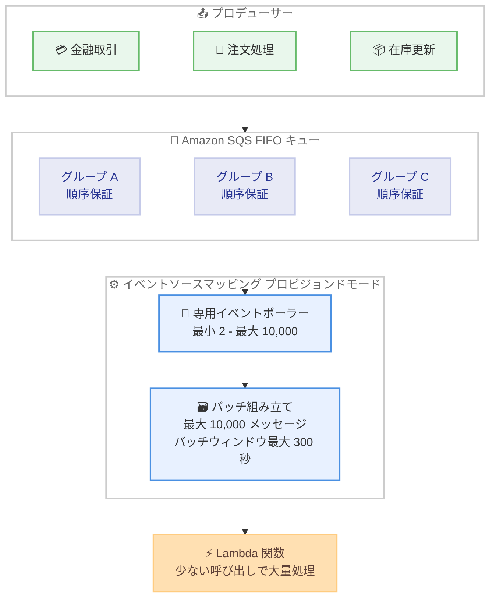

# AWS Lambda - Amazon SQS FIFO キューで最大 10,000 メッセージのバッチサイズをサポート

**リリース日**: 2026 年 11 月 20 日
**サービス**: AWS Lambda / Amazon SQS
**機能**: SQS FIFO キューのイベントソースマッピング (プロビジョンドモード) における最大バッチサイズの 10,000 メッセージへの拡張

📊 [このアップデートのインフォグラフィックを見る](https://takech9203.github.io/aws-news-summary/20261120-aws-lambda-10K-batch-size-SQSFIFO.html)

## 概要

AWS Lambda は、Amazon SQS FIFO キューをイベントソースとするイベントソースマッピング (ESM) において、プロビジョンドモード使用時の最大バッチサイズを従来の 10 メッセージから 10,000 メッセージへと大幅に拡張しました。あわせて、最大 300 秒のバッチウィンドウ (MaximumBatchingWindowInSeconds) を設定できるようになり、大量の順序保証付きメッセージをより少ない呼び出し回数で処理できます。

SQS FIFO キューは、金融取引、注文処理、在庫更新といった厳密な順序保証と重複排除が求められるイベント駆動型アプリケーションで広く利用されています。今回のアップデートにより、メッセージグループ内の順序保証を維持したまま、Lambda 関数の呼び出し回数を削減し、スループットを向上させることができます。アプリケーションを再設計することなく、設定変更のみで大規模な順序付きワークロードに対応できる点が大きな価値です。

**アップデート前の課題**

- SQS FIFO キューのイベントソースマッピングでは、バッチサイズが最大 10 メッセージに制限されていた
- 大量のメッセージを処理するには呼び出し回数を増やしてスケールアウトする必要があり、呼び出しコストが増加していた
- より大きな単位でまとめて処理するには、独自のバッファリング機構を構築する必要があり、運用負荷が高かった

**アップデート後の改善**

- プロビジョンドモードの SQS FIFO イベントソースマッピングで、最大 10,000 メッセージのバッチサイズを設定可能になった
- 最大 300 秒のバッチウィンドウを設定でき、メッセージを蓄積してからまとめて処理できるようになった
- メッセージグループごとの順序保証を維持したまま、少ない呼び出し回数で高スループットを実現できるようになった
- アプリケーションの再設計や独自バッファリング機構が不要になった

## アーキテクチャ図



複数のメッセージグループから届いたメッセージを、プロビジョンドモードの専用イベントポーラーが最大 10,000 メッセージのバッチにまとめて Lambda 関数を呼び出す流れを示しています。各メッセージグループ内の順序は維持されます。

## サービスアップデートの詳細

### 主要機能

1. **最大バッチサイズの拡張 (10 → 10,000 メッセージ)**
   - プロビジョンドモードの SQS FIFO イベントソースマッピングで、最大 10,000 メッセージのバッチサイズを設定可能
   - 呼び出し回数が削減され、呼び出しあたりの処理効率とスループットが向上
   - バッチサイズが 10 を超える場合は、1 秒以上のバッチウィンドウの設定が必要

2. **最大 300 秒のバッチウィンドウ**
   - MaximumBatchingWindowInSeconds を最大 300 秒まで設定可能
   - バッチウィンドウの満了、呼び出しペイロードサイズ上限への到達、設定した最大バッチサイズへの到達のいずれかの条件を満たすまでメッセージを蓄積してから関数を呼び出す

3. **メッセージグループ単位の順序保証の維持**
   - Amazon SQS は、あるメッセージグループの先行メッセージが処理中 (インフライト) の間、そのグループから追加のメッセージを返さない
   - このため、1 つのバッチに含まれる同一メッセージグループのメッセージは最大 10 件となる
   - より大きなバッチを構成するには、メッセージを多くのメッセージグループに分散して送信する

4. **プロビジョンドモードによる高スループット**
   - 専用のイベントポーラーを最小 2 から最大 10,000 まで設定可能
   - デフォルトモードと比較して 3 倍高速なスケーリング (毎分最大 1,000 同時実行の増加) と 80 倍の同時実行数 (最大 100,000 同時実行) をサポート

## 技術仕様

### バッチ処理の仕様比較

| 項目 | デフォルトモード (FIFO) | プロビジョンドモード (FIFO、今回の拡張後) |
|------|------|------|
| 最大バッチサイズ | 10 メッセージ | 10,000 メッセージ |
| 最大バッチウィンドウ | 設定不可 (プロビジョンドモードが必要) | 300 秒 |
| バッチサイズ 10 超の条件 | - | バッチウィンドウ 1 秒以上が必須 |
| 同一メッセージグループのメッセージ数 / バッチ | - | 最大 10 件 |
| 順序保証 | メッセージグループ単位 | メッセージグループ単位 (維持) |

### プロビジョンドモードの仕様

| 項目 | 詳細 |
|------|------|
| 最小イベントポーラー数 (MinimumPollers) | 2〜200 (デフォルト: 2) |
| 最大イベントポーラー数 (MaximumPollers) | 2〜10,000 (デフォルト: 200) |
| ポーラーあたりの処理能力 | 最大 1 MB/秒のスループット、最大 10 同時呼び出し、最大 10 回/秒の SQS ポーリング API 呼び出し |
| スケーリング速度 | 毎分最大 1,000 同時実行 (デフォルトモードの 3 倍) |
| 最大同時実行数 | 最大 100,000 (デフォルトモードの 80 倍) |
| 制約 | 最大同時実行数 (Maximum Concurrency) 設定とは併用不可 |

### 設定例 (ProvisionedPollerConfig)

```json
{
  "EventSourceArn": "arn:aws:sqs:ap-northeast-1:123456789012:orders.fifo",
  "FunctionName": "process-orders",
  "BatchSize": 10000,
  "MaximumBatchingWindowInSeconds": 60,
  "ProvisionedPollerConfig": {
    "MinimumPollers": 5,
    "MaximumPollers": 100
  }
}
```

## 設定方法

### 前提条件

1. Amazon SQS FIFO キューが作成済みであること
2. Lambda 関数と SQS FIFO キューが同一リージョンに存在すること (アカウントは別でも可)
3. イベントソースマッピングでプロビジョンドモードを有効化すること (バッチサイズ 10 超にはプロビジョンドモードとバッチウィンドウ 1 秒以上が必須)

### 手順

#### ステップ 1: プロビジョンドモードを有効化してイベントソースマッピングを作成

```bash
aws lambda create-event-source-mapping \
    --function-name process-orders \
    --event-source-arn arn:aws:sqs:ap-northeast-1:123456789012:orders.fifo \
    --batch-size 10000 \
    --maximum-batching-window-in-seconds 60 \
    --provisioned-poller-config '{"MinimumPollers": 5, "MaximumPollers": 100}'
```

SQS FIFO キューをイベントソースとして、バッチサイズ 10,000、バッチウィンドウ 60 秒、プロビジョンドモード (最小ポーラー 5、最大ポーラー 100) のイベントソースマッピングを新規作成します。

#### ステップ 2: 既存のイベントソースマッピングを更新する場合

```bash
aws lambda update-event-source-mapping \
    --uuid a1b2c3d4-5678-90ab-cdef-EXAMPLE11111 \
    --batch-size 10000 \
    --maximum-batching-window-in-seconds 60 \
    --provisioned-poller-config '{"MinimumPollers": 5, "MaximumPollers": 100}'
```

既存のイベントソースマッピングの UUID を指定して、バッチサイズとバッチウィンドウ、プロビジョンドモードの設定を更新します。

#### ステップ 3: プロビジョンドモードを解除する場合

```bash
aws lambda update-event-source-mapping \
    --uuid a1b2c3d4-5678-90ab-cdef-EXAMPLE11111 \
    --provisioned-poller-config '{}' \
    --maximum-batching-window-in-seconds 0 \
    --batch-size 10
```

FIFO キューのイベントソースマッピングからプロビジョンドモードを解除します。バッチウィンドウを 0、バッチサイズを 10 以下に戻す操作を、解除前または同一の UpdateEventSourceMapping リクエスト内で行う必要があります。

**補足**: マネジメントコンソール、AWS SDK、AWS CloudFormation、AWS CDK、AWS SAM でも同様に設定できます。また、Agent Toolkit for AWS を利用すると、Kiro、Claude Code、Codex などのコーディングアシスタント経由での設定も可能です。

## メリット

### ビジネス面

- **コスト効率の向上**: 呼び出し回数が削減されるため、呼び出し課金とオーバーヘッドが減り、大量メッセージ処理のコスト効率が向上する
- **再設計不要**: 既存の SQS FIFO + Lambda 構成を変更せず、設定変更のみで大規模ワークロードに対応できる
- **運用負荷の軽減**: 独自のバッファリング機構やメッセージ集約処理の構築・運用が不要になる

### 技術面

- **スループットの向上**: 1 回の呼び出しで最大 10,000 メッセージを処理でき、高ボリュームの順序付きワークロードに対応できる
- **順序保証の維持**: メッセージグループ単位の順序保証と重複排除という FIFO キューの特性を維持したままバッチサイズを拡大できる
- **柔軟なバッチ制御**: 最大 300 秒のバッチウィンドウにより、レイテンシーとスループットのバランスを調整できる

## デメリット・制約事項

### 制限事項

- バッチサイズ 10,000 はプロビジョンドモードの SQS FIFO イベントソースマッピングでのみ利用可能 (デフォルトモードは従来どおり最大 10)
- バッチサイズが 10 を超える場合、1 秒以上のバッチウィンドウの設定が必須
- 1 つのバッチに含まれる同一メッセージグループのメッセージは最大 10 件 (大きなバッチには多数のメッセージグループへの分散が必要)
- プロビジョンドモードは最大同時実行数 (Maximum Concurrency) 設定と併用できない
- Lambda の呼び出しペイロードサイズ上限 (同期呼び出しで 6 MB) に達した場合、バッチサイズ上限に達する前に関数が呼び出される

### 考慮すべき点

- プロビジョンドモードの利用には、イベントポーラーに対する追加料金が発生する
- バッチウィンドウを長く設定するとスループットは向上するが、メッセージ処理のレイテンシーが増加するため、要件に応じた調整が必要
- 大きなバッチの一部のみが失敗した場合に成功済みメッセージが再処理されないよう、部分バッチ応答 (ReportBatchItemFailures) の実装が重要
- イベントソースマッピングは少なくとも 1 回の処理 (at-least-once) であるため、関数コードの冪等性を確保する必要がある
- 大きなバッチを処理する場合、関数のタイムアウトとメモリ設定、キューの可視性タイムアウトを適切に見直す必要がある

## ユースケース

### ユースケース 1: 金融取引の順序保証付き一括処理

**シナリオ**: 証券取引システムで、口座ごとの取引イベントを厳密な順序で処理しつつ、ピーク時には秒間数万件のメッセージを処理する必要がある。

**実装例**:
```bash
aws lambda create-event-source-mapping \
    --function-name process-trades \
    --event-source-arn arn:aws:sqs:ap-northeast-1:123456789012:trades.fifo \
    --batch-size 10000 \
    --maximum-batching-window-in-seconds 5 \
    --provisioned-poller-config '{"MinimumPollers": 20, "MaximumPollers": 500}' \
    --function-response-types "ReportBatchItemFailures"
```

**効果**: 口座 ID をメッセージグループ ID とすることで口座単位の順序を保証しながら、多数の口座のメッセージを 1 回の呼び出しでまとめて処理し、呼び出し回数とコストを削減できる。

### ユースケース 2: EC サイトの注文処理パイプライン

**シナリオ**: セール期間中に急増する注文イベントを、注文 ID 単位の順序を維持しながら在庫引当や決済処理に連携する。従来はバッチサイズ 10 の制限により呼び出し回数が膨大になっていた。

**実装例**:
```bash
aws lambda update-event-source-mapping \
    --uuid a1b2c3d4-5678-90ab-cdef-EXAMPLE11111 \
    --batch-size 5000 \
    --maximum-batching-window-in-seconds 10 \
    --provisioned-poller-config '{"MinimumPollers": 10, "MaximumPollers": 200}'
```

**効果**: 既存アーキテクチャを変更せずに設定変更のみでスループットを向上でき、セールなどのスパイク時もプロビジョンドモードの高速スケーリングで安定した処理を実現できる。

### ユースケース 3: 在庫更新イベントの集約処理

**シナリオ**: 多数の店舗・倉庫から送信される在庫更新イベントを SKU 単位の順序で処理し、データベースへの書き込みをまとめて実行したい。1 件ずつの処理ではデータベース接続のオーバーヘッドが大きい。

**実装例**:
```python
def handler(event, context):
    updates = []
    failures = []
    for record in event["Records"]:
        try:
            updates.append(parse_inventory_update(record["body"]))
        except Exception:
            failures.append({"itemIdentifier": record["messageId"]})
    # 最大 10,000 件の更新をまとめてバルク書き込み
    bulk_write_inventory(updates)
    return {"batchItemFailures": failures}
```

**効果**: 大きなバッチをバルク書き込みに活用することで、データベースへの接続回数とトランザクション数を削減し、全体の処理効率を大幅に改善できる。

## 料金

バッチサイズの拡張自体に追加料金はありませんが、前提となるプロビジョンドモードの利用には、イベントポーラーに対する追加料金が発生します。これに加えて、通常の Lambda 料金 (リクエスト数と実行時間) および Amazon SQS の API リクエスト料金が適用されます。

バッチサイズを大きくすると呼び出し回数が減るためリクエスト課金は削減されますが、1 回あたりの実行時間は長くなる可能性があるため、ワークロードに応じた試算を推奨します。詳細は [AWS Lambda 料金ページ](https://aws.amazon.com/lambda/pricing/) を参照してください。

## 利用可能リージョン

すべての AWS 商用リージョンで利用可能です (東京・大阪リージョンを含む)。

## 関連サービス・機能

- **Amazon SQS FIFO キュー**: メッセージグループ単位の順序保証と重複排除を提供するキュー。本アップデートのイベントソース
- **Lambda イベントソースマッピング プロビジョンドモード**: 専用イベントポーラーによる高スループット・高速スケーリングを提供。本アップデートの前提機能
- **部分バッチ応答 (ReportBatchItemFailures)**: バッチ内の失敗メッセージのみを再処理対象にする機能。大きなバッチの処理では特に重要
- **Powertools for AWS Lambda (Batch Processor)**: 部分バッチ応答のロジック実装を簡素化するユーティリティ
- **Amazon EventBridge Pipes**: Lambda 以外のターゲットへの配信やエンリッチメントが必要な場合の代替手段

## 参考リンク

- 📊 [インフォグラフィック](https://takech9203.github.io/aws-news-summary/20261120-aws-lambda-10K-batch-size-SQSFIFO.html)
- [公式発表 (What's New)](https://aws.amazon.com/about-aws/whats-new/2026/11/aws-lambda-10K-batch-size-SQSFIFO/)
- [ドキュメント: Using Lambda with Amazon SQS](https://docs.aws.amazon.com/lambda/latest/dg/with-sqs.html)
- [ドキュメント: プロビジョンドモード](https://docs.aws.amazon.com/lambda/latest/dg/with-sqs.html#sqs-provisioned-mode)
- [料金ページ](https://aws.amazon.com/lambda/pricing/)

## まとめ

SQS FIFO キューと Lambda の組み合わせにおける最大 10 メッセージというバッチサイズの制約が、プロビジョンドモードで最大 10,000 メッセージへと 1,000 倍に拡張され、順序保証を維持したまま高ボリュームワークロードを少ない呼び出し回数で処理できるようになりました。金融取引や注文処理などの順序保証が必要な大規模ワークロードを運用している場合は、プロビジョンドモードの追加コストと部分バッチ応答の実装を考慮したうえで、バッチサイズとバッチウィンドウの最適化を検討することを推奨します。
