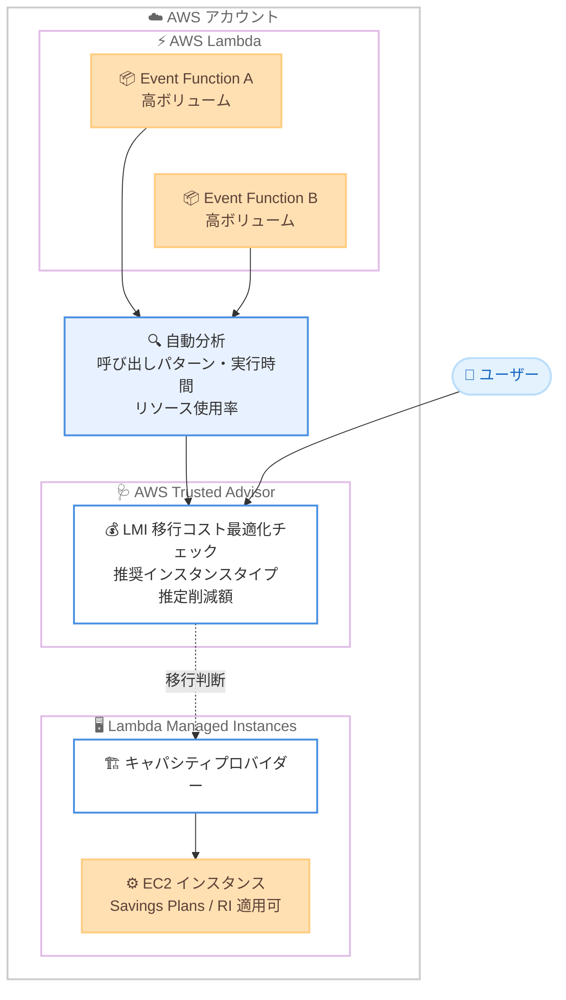

# AWS Lambda - Event Functions 向けコスト最適化レコメンデーション

**リリース日**: 2026 年 11 月 20 日
**サービス**: AWS Lambda / AWS Trusted Advisor
**機能**: Lambda Managed Instances 移行のコスト最適化レコメンデーション

📊 [このアップデートのインフォグラフィックを見る](https://takech9203.github.io/aws-news-summary/20261120-aws-lambda-cost-optimization-recommendations.html)

## 概要

AWS Lambda が、Event Functions を対象としたコスト最適化レコメンデーションを AWS Trusted Advisor で提供開始しました。このレコメンデーションは、Lambda Managed Instances (LMI) に移行することでコスト削減が見込めるオンデマンド関数を自動的に特定し、移行に必要な設定ガイダンスを提示します。推定削減額の大きい関数に移行作業を集中させることで、Lambda のコストを効率的に削減できます。

LMI は、Lambda のシンプルな運用体験を維持しながら、関数を Amazon EC2 インスタンス上で実行できる機能です。最新の Graviton や GPU 搭載インスタンスなどの特化したコンピューティング構成を利用でき、EC2 Savings Plans やリザーブドインスタンスといった EC2 の料金オプションによるコスト効率も得られます。インフラストラクチャの管理は不要です。

対象ユーザーは、高頻度で安定したトラフィックを持つ Lambda 関数を運用しており、コスト削減の機会を体系的に把握したい組織です。対象の AWS Support プランを契約しているお客様は、Trusted Advisor コンソールで他のコスト最適化チェックと並んでこのレコメンデーションを利用できます。

**アップデート前の課題**

このアップデート以前は、LMI への移行判断に多くの手作業が必要でした。

- 関数の呼び出しパターンを手動で分析し、LMI への適合性を判断する必要があった
- Lambda オンデマンドと LMI のコストを自分で見積もる必要があった
- 適切な EC2 インスタンスタイプとメモリ対 vCPU 比率を自分で選定する必要があった
- 多数の関数の中からどれを優先的に移行すべきか判断する客観的な材料がなかった

**アップデート後の改善**

今回のアップデートにより、移行候補の特定から設定の選定までが自動化されました。

- Lambda が高ボリュームの Event Functions の呼び出しパターン、実行時間、リソース使用率を自動分析するようになった
- 各関数の推定現行コスト、推定 LMI コスト、推定削減額が Trusted Advisor に表示されるようになった
- 推奨 EC2 インスタンスタイプとメモリ対 vCPU 比率が提示され、設定選定の負担がなくなった
- 推定削減額に基づいて移行の優先順位付けができるようになった

## アーキテクチャ図



Lambda が高ボリュームの Event Functions を自動分析し、Trusted Advisor のコスト最適化チェックとして LMI 移行の推奨設定と推定削減額を提示します。ユーザーはレコメンデーションを確認し、削減効果の大きい関数から LMI へ移行できます。

## サービスアップデートの詳細

### 主要機能

1. **移行候補の自動特定**
   - Lambda がすべての高ボリューム Event Functions の呼び出しパターン、実行時間、リソース使用率を自動分析
   - LMI に移行した場合にコスト削減が見込めるオンデマンド関数を特定
   - 分析はユーザーの操作なしで自動的に実施される

2. **具体的な設定ガイダンスの提示**
   - 関数ごとに推奨 EC2 インスタンスタイプを提示
   - 推奨のメモリ対 vCPU 比率を提示
   - 従来はユーザー自身が行っていたインスタンス選定の作業が不要になる

3. **コスト削減額の見積もり**
   - 各関数の呼び出しパターンのシミュレーションに基づいて推定値を算出
   - AWS Lambda と Amazon EC2 の公開オンデマンド料金を使用して計算
   - 現行の推定コスト、LMI 移行後の推定コスト、両者の比率を表示

4. **Trusted Advisor コンソールへの統合**
   - 「AWS Lambda Managed Instances migration cost optimization recommendation」チェックとして提供
   - 他のコスト最適化チェックと同じ画面で一元的に確認可能
   - キーワード検索やフィルターで素早くチェックを見つけられる

## 技術仕様

### レコメンデーションに含まれる項目

| 項目 | 詳細 |
|------|------|
| Function ARN / Region | 推奨対象の関数の ARN と AWS リージョン |
| Instance Type | LMI で実行する際の推奨 EC2 インスタンスタイプ |
| Memory to vCPU Ratio | 推奨のメモリ対 vCPU 比率 |
| Lambda On-Demand Cost | Lambda オンデマンド料金で算出した現行の推定コスト |
| Expected LMI Cost | EC2 オンデマンド料金で算出した LMI 移行後の推定コスト |
| Expected LMI to Current Cost Ratio | 移行後コストと現行コストの比率 |
| Date Range | レコメンデーションの根拠となった使用データの期間 |
| Last Refresh Timestamp | Trusted Advisor が最後にレコメンデーションを更新した時刻 |

### Lambda (デフォルト) と Lambda Managed Instances の比較

| 項目 | Lambda (デフォルト) | Lambda Managed Instances |
|------|---------------------|--------------------------|
| 同時実行モデル | 1 実行環境につき最大 1 呼び出し | 1 実行環境で複数呼び出しを同時処理 (マルチコンカレンシー) |
| テナンシーと分離 | 共有フリート上の Firecracker MicroVM | 自アカウント内の EC2 Nitro インスタンス上のコンテナ |
| 料金モデル | リクエスト・実行時間ベース | インスタンスベース (EC2 料金 + 管理費) |
| スケーリング | コールドスタートでスケール、ゼロまで縮退 | CPU 使用率とマルチコンカレンシー飽和度に基づき非同期スケール |
| 適した用途 | バースト性のあるトラフィック | 高ボリュームで予測可能なトラフィック |

## 設定方法

### 前提条件

1. 対象の AWS Support プラン (Trusted Advisor のすべてのチェックを利用できるプラン) を契約していること
2. 対象リージョンで Lambda Event Functions を運用していること
3. 高ボリュームの呼び出し実績があること (分析対象は高ボリュームの Event Functions)

### 手順

#### ステップ 1: Trusted Advisor コンソールを開く

```text
https://console.aws.amazon.com/trustedadvisor/
```

Trusted Advisor コンソールにアクセスし、ナビゲーションペインの [Recommendations] から [Cost optimization] を選択します。

#### ステップ 2: チェックを検索する

```text
検索キーワード: Lambda
```

[Cost optimization checks] セクションで、検索ボックスに「Lambda」と入力するか、[Investigation recommended] などのビューフィルターを使用して、「AWS Lambda Managed Instances migration cost optimization recommendation」チェックを見つけます。

#### ステップ 3: レコメンデーションを確認する

チェックを展開すると、説明、アラート基準、推奨アクション、追加リソースが表示されます。結果テーブルには候補となる関数が行単位で表示され、推奨インスタンスタイプ、メモリ対 vCPU 比率、推定コストと削減額を確認できます。

#### ステップ 4: LMI への移行を実施する

推定削減額の大きい関数から、キャパシティプロバイダーを作成して関数をアタッチし、関数バージョンを発行することで LMI へ移行します。移行手順の詳細は Lambda Managed Instances のドキュメントを参照してください。

## メリット

### ビジネス面

- **コスト削減機会の可視化**: 推定削減額が定量的に提示されるため、投資対効果の高い移行対象を明確に判断できる
- **移行作業の優先順位付け**: 削減効果の大きい関数に作業を集中でき、限られたリソースで最大の効果を得られる
- **追加コストなし**: 対象の Support プラン契約者は追加料金なしでレコメンデーションを利用できる

### 技術面

- **分析の自動化**: 呼び出しパターン、実行時間、リソース使用率の分析を Lambda が自動で実施するため、手動分析が不要
- **設定選定の負担軽減**: 推奨インスタンスタイプとメモリ対 vCPU 比率が提示され、試行錯誤なしで移行設計を開始できる
- **既存運用との統合**: Trusted Advisor の既存のコスト最適化チェックと同じワークフローで確認でき、新しいツールの習得が不要

## デメリット・制約事項

### 制限事項

- 利用可能リージョンは米国東部 (バージニア北部)、米国西部 (オレゴン)、欧州 (アイルランド)、欧州 (ミラノ) の 4 リージョンに限定される
- 対象の AWS Support プランの契約が必要
- 分析対象は高ボリュームの Event Functions のみで、低頻度の関数はレコメンデーション対象にならない
- LMI 自体が現時点では Event Functions のみをサポートする

### 考慮すべき点

- 推定削減額はシミュレーションに基づくものであり、実際の削減額は異なる場合がある
- 見積もりは Lambda と EC2 の公開オンデマンド料金に基づくため、EC2 Savings Plans やリザーブドインスタンスを利用する場合は実際の削減額が見積もりを上回る可能性がある
- LMI はマルチコンカレンシーモデルを採用するため、移行時にはスレッドセーフティ、状態管理、コンテキスト分離の扱いをランタイムに応じて見直す必要がある
- LMI はゼロへのスケールインは行わず、設定した最小実行環境数まで縮退するため、トラフィックがほぼない時間帯が長い関数では逆にコストが増える可能性がある

## ユースケース

### ユースケース 1: 大規模 Lambda 環境のコスト削減計画

**シナリオ**: 数百個の Lambda 関数を運用する企業が、年次のコスト削減目標に向けて削減余地の大きい領域を特定したい。

**実装例**:
```text
1. Trusted Advisor コンソールで LMI 移行コスト最適化チェックを確認
2. Expected LMI to Current Cost Ratio が小さい (削減率が大きい) 関数を抽出
3. 推定削減額の合計から削減インパクトを試算し、移行ロードマップを作成
```

**効果**: 手動分析なしで削減効果の大きい関数を特定でき、データに基づいた移行計画を短期間で立案できる。

### ユースケース 2: 高ボリュームなイベント処理基盤の最適化

**シナリオ**: SQS や Kinesis からのイベントを常時処理する高頻度・安定トラフィックの関数群を運用しており、オンデマンド料金が高額になっている。

**実装例**:
```text
1. レコメンデーションで対象関数の推奨インスタンスタイプと
   メモリ対 vCPU 比率を確認
2. 推奨設定でキャパシティプロバイダーを作成し、関数をアタッチ
3. 関数バージョンを発行して LMI 上で稼働開始
4. EC2 Savings Plans を適用してさらにコストを削減
```

**効果**: 安定したトラフィックを持つ関数を EC2 ベースの料金モデルに移行し、Savings Plans の適用により見積もり以上の削減を実現できる。

### ユースケース 3: FinOps チームによる定期的なコストレビュー

**シナリオ**: FinOps チームが月次のコストレビューで、サーバーレスワークロードの最適化機会を継続的に監視したい。

**実装例**:
```text
1. 月次レビューの手順に Trusted Advisor の
   LMI 移行コスト最適化チェックの確認を組み込む
2. Date Range と Last Refresh Timestamp で分析データの鮮度を確認
3. 新たに候補となった関数を開発チームへ共有し、移行を検討
```

**効果**: 使用状況の変化に応じて新しい移行候補を継続的に発見でき、コスト最適化を定常的な運用プロセスに組み込める。

## 料金

レコメンデーション自体の追加料金はありません。対象の AWS Support プランを契約しているお客様は、Trusted Advisor コンソールで利用できます。

移行先となる Lambda Managed Instances の料金は、EC2 インスタンスコストに 15% の管理費を加えたものです。EC2 Savings Plans やリザーブドインスタンスなどの割引は基盤の EC2 コンピューティング部分に適用されます (管理費には適用されません)。詳細は [AWS Lambda 料金ページ](https://aws.amazon.com/lambda/pricing/) を参照してください。

## 利用可能リージョン

以下の 4 リージョンで利用可能です。

- 米国東部 (バージニア北部)
- 米国西部 (オレゴン)
- 欧州 (アイルランド)
- 欧州 (ミラノ)

## 関連サービス・機能

- **AWS Trusted Advisor**: レコメンデーションの提供基盤。コスト最適化、セキュリティ、耐障害性などのチェックを一元的に提供する
- **Lambda Managed Instances**: 移行先となる実行環境。Lambda の運用体験を維持しつつ EC2 インスタンス上で関数を実行する
- **Amazon EC2 Savings Plans / リザーブドインスタンス**: LMI の基盤 EC2 コンピューティングに適用でき、見積もり以上の削減を実現できる料金オプション
- **AWS Compute Optimizer**: Lambda 関数のメモリサイズ推奨など、別の観点からのコスト最適化レコメンデーションを提供する

## 参考リンク

- 📊 [インフォグラフィック](https://takech9203.github.io/aws-news-summary/20261120-aws-lambda-cost-optimization-recommendations.html)
- [公式発表 (What's New)](https://aws.amazon.com/about-aws/whats-new/2026/11/aws-lambda-cost-optimization-recommendations/)
- [ドキュメント: Trusted Advisor recommendations for Event Functions](https://docs.aws.amazon.com/lambda/latest/dg/lambda-managed-instances-trusted-advisor.html)
- [ドキュメント: Lambda Managed Instances](https://docs.aws.amazon.com/lambda/latest/dg/lambda-managed-instances.html)
- [AWS Trusted Advisor ユーザーガイド](https://docs.aws.amazon.com/awssupport/latest/user/trusted-advisor.html)
- [Lambda Managed Instances 製品ページ](https://aws.amazon.com/lambda/lambda-managed-instances/)
- [料金ページ](https://aws.amazon.com/lambda/pricing/)

## まとめ

このアップデートにより、Lambda Managed Instances への移行判断に必要だった呼び出しパターン分析、コスト見積もり、インスタンス選定の作業が自動化され、Trusted Advisor 上で推定削減額とともに確認できるようになりました。対象リージョンで高ボリュームの Event Functions を運用している場合は、まず Trusted Advisor のコスト最適化チェックを確認し、削減効果の大きい関数から LMI 移行を検討することを推奨します。
