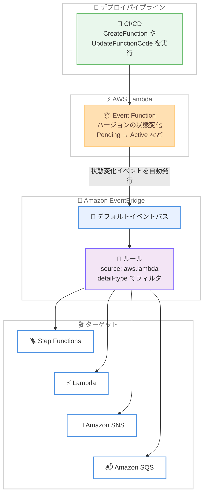

# AWS Lambda - Event Function 状態変化イベントの Amazon EventBridge への発行

**リリース日**: 2026 年 11 月 20 日
**サービス**: AWS Lambda / Amazon EventBridge
**機能**: Event Function state change events to Amazon EventBridge

📊 [このアップデートのインフォグラフィックを見る](https://takech9203.github.io/aws-news-summary/20261120-aws-lambda-function-state-events.html)

## 概要

AWS Lambda が、Event Function のバージョンが顧客のアクション (関数の作成、更新、バージョン発行、削除など) によって状態を変化させるたびに、Amazon EventBridge へイベントを発行するようになりました。これにより、新しいバージョンが呼び出し可能になったタイミング、コードや設定の更新が完了したタイミング、作成・発行・更新の操作が失敗したタイミングを、`GetFunction` API をポーリングすることなく検知できます。

イベントは Lambda 側での有効化やオプトイン、権限変更を一切必要とせず、関数を所有する AWS アカウントのデフォルトイベントバス (関数と同じリージョン) に自動的に配信されます。EventBridge ルールで関数 ARN、`detail-type`、`state` などのフィールドをマッチングし、AWS Step Functions、Lambda、Amazon SNS、Amazon SQS などのターゲットへルーティングできます。数千の関数を運用するプラットフォームチームや DevOps チームにとって、デプロイパイプラインの自動化を大幅に簡素化するアップデートです。

**アップデート前の課題**

このアップデート以前は、関数の状態変化を追跡する仕組みが用意されていませんでした。

- 関数の状態 (Pending、Active、Failed など) を確認するには `GetFunction` API を繰り返しポーリングする必要があった
- 大規模環境ではポーリングが API クォータを消費し、デプロイパイプラインの速度を低下させていた
- タイムアウトやリトライのためのカスタムロジックを独自に実装・保守する必要があった
- 更新中も `State` は `Active` のままのため、`State` だけを見ていると更新の失敗を成功と誤認するリスクがあった

**アップデート後の改善**

今回のアップデートにより、イベント駆動で関数のライフサイクルを追跡できるようになりました。

- 状態変化が発生するとイベントが自動的にデフォルトイベントバスへ配信され、ポーリングが不要になった
- `Event Function Version Updated` と `Event Function Version Update Failed` のイベントにより、更新の成功と失敗を明確に区別できるようになった
- EventBridge ルールで条件を絞り込み、Step Functions や Lambda などのターゲットで後続処理を自動実行できるようになった
- イベントの発行は追加料金なしで利用できる

## アーキテクチャ図



CI/CD パイプラインなどの操作で Lambda 関数バージョンの状態が変化すると、Lambda がイベントをデフォルトイベントバスへ自動発行し、EventBridge ルールで絞り込んだうえで各種ターゲットに後続処理を実行させるフローです。

## サービスアップデートの詳細

### 主要機能

1. **関数ライフサイクルイベントの自動発行**
   - 関数の作成、更新、バージョン発行、削除といった顧客アクションによる状態変化のたびにイベントを発行
   - すべてのイベントは `"source": "aws.lambda"` として発行され、`detail-type` が状態遷移の種類を表す
   - Lambda 側での有効化、オプトイン、権限変更は不要で、デフォルトで配信される

2. **デフォルトイベントバスへの配信とクロスアカウント転送**
   - イベントは関数を所有する AWS アカウントの、関数と同じリージョンのデフォルトイベントバスに配信される
   - 他アカウントのロールが API を呼び出した場合でも、イベントを受け取るのは常に関数の所有アカウント
   - 中央監視アカウントなど他アカウントへ送る場合は、所有アカウント側で転送用ルールを作成する

3. **柔軟なルールマッチングとターゲット連携**
   - 関数 ARN (バージョンを含む修飾 ARN)、`detail-type`、`state` などのフィールドでマッチング可能
   - ターゲットとして AWS Step Functions、AWS Lambda、Amazon SNS、Amazon SQS などを指定可能
   - ルールは EventBridge コンソール、AWS CLI、SDK、CloudFormation、CDK、SAM から作成できる

4. **更新の成否を正確に判別**
   - 更新中も `State` は `Active` のままで、更新完了まで呼び出しは以前のコードと設定を使用する
   - `Event Function Version Updated` と `Event Function Version Update Failed` のイベントにより、`State` だけでは判別できない更新の失敗を検知できる

## 技術仕様

### イベントタイプ一覧

各イベントの `detail-type` が状態遷移を表します。

| Detail Type | 送信されるタイミング |
|------|------|
| Event Function Version Activating | `CreateFunction` または `PublishVersion` の後、State が Pending になったとき |
| Event Function Version Activated | State が Active になり、バージョンが呼び出し可能になったとき |
| Event Function Version Activation Failed | State が Failed になったとき |
| Event Function Version Active Non Invocable | Lambda Managed Instances 関数の $LATEST バージョンが ActiveNonInvocable になったとき |
| Event Function Version Updating | LastUpdateStatus が InProgress になったとき |
| Event Function Version Updated | LastUpdateStatus が Successful になったとき |
| Event Function Version Update Failed | LastUpdateStatus が Failed になったとき |
| Event Function Version Deactivating | State が Deactivating になったとき (Lambda Managed Instances の `PutFunctionScalingConfig` のみ) |
| Event Function Version Deactivated | State が Deactivated になったとき (Lambda Managed Instances の `PutFunctionScalingConfig` のみ) |
| Event Function Version Deleting | 非同期削除 (Lambda Managed Instances および durable functions) の削除開始時のみ |
| Event Function Version Deleted | 関数全体または発行済みバージョンの削除完了時 (同期・非同期の両方) |

### イベント例

```json
{
  "version": "0",
  "id": "7bf73129-1428-4cd3-a780-95db273d1602",
  "detail-type": "Event Function Version Activated",
  "source": "aws.lambda",
  "account": "111122223333",
  "time": "2026-09-26T18:43:48Z",
  "region": "us-east-1",
  "resources": ["arn:aws:lambda:us-east-1:111122223333:function:my-fn:1"],
  "detail": {
    "action": "CreateFunction",
    "state": "Active",
    "lastUpdateStatus": "Successful",
    "revisionId": "8f3b1c2a-4e5d-4a6b-9c8d-1e2f3a4b5c6d"
  }
}
```

- **resources**: バージョンを含む修飾 ARN が入り、特定バージョンのイベントをフィルタリングできる。関数全体を名前または非修飾 ARN で削除した場合、削除イベントには非修飾 ARN が入り、バージョンごとの個別イベントは送信されない
- **time**: イベント送信時刻ではなく、状態が変化した時刻を示す
- **detail.action**: 変化のきっかけとなった API を示す (`CreateFunction`、`PublishVersion`、`UpdateFunctionCode`、`UpdateFunctionConfiguration`、`DeleteFunction`、`PutRuntimeManagementConfig`、`PutFunctionScalingConfig`)
- **detail.state / lastUpdateStatus など**: `GetFunction` が返す値と同じ値を使用し、値がないフィールドは省略される

### 配信特性

| 項目 | 詳細 |
|------|------|
| 配信保証 | 少なくとも 1 回の配信 (at-least-once)。重複する可能性がある |
| 重複排除 | 同じ `detail-type` 内では `revisionId` で重複を除去できる |
| 順序 | 同じバージョンのイベントでも順不同で到着する可能性がある。`time` を比較するか、最新状態が必要な場合は `GetFunction` を呼び出す |
| 削除イベントの revisionId | 各イベントは固有の `revisionId` を持つが、同一削除の Deleting と Deleted イベントは同じ `revisionId` を共有する |

## 設定方法

### 前提条件

1. 対象の Lambda 関数が存在すること (イベント発行自体に設定は不要)
2. EventBridge ルールを作成する IAM 権限があること
3. ターゲット (Lambda、Step Functions など) への呼び出し権限を設定できること

### 手順

#### ステップ 1: イベントにマッチするルールを作成

```bash
aws events put-rule --name lambda-fn-activated \
  --event-pattern '{"source":["aws.lambda"],"detail-type":["Event Function Version Activated"]}'
```

`Event Function Version Activated` イベント (バージョンが Active になり呼び出し可能になったとき) にマッチする EventBridge ルールをデフォルトイベントバス上に作成しています。

#### ステップ 2: EventBridge にターゲット関数の呼び出し権限を付与

```bash
aws lambda add-permission --function-name on-fn-ready --statement-id eb-fn-activated \
  --action lambda:InvokeFunction --principal events.amazonaws.com \
  --source-arn arn:aws:events:us-east-1:111122223333:rule/lambda-fn-activated
```

ターゲットとして使用する Lambda 関数 `on-fn-ready` のリソースベースポリシーに、作成したルールからの `lambda:InvokeFunction` を許可するステートメントを追加しています。

#### ステップ 3: ルールにターゲットを追加

```bash
aws events put-targets --rule lambda-fn-activated \
  --targets 'Id=1,Arn=arn:aws:lambda:us-east-1:111122223333:function:on-fn-ready'
```

ルールにターゲット関数を登録しています。以降、マッチしたイベントはこの関数に配信されます。

## メリット

### ビジネス面

- **デプロイパイプラインの高速化**: ポーリングの待機時間やリトライ間隔が不要になり、新バージョンが Active になった瞬間に後続処理を開始できる
- **運用コストの削減**: ポーリング用のカスタムロジックの実装・保守が不要になり、追加料金なしで利用できる
- **大規模環境での信頼性向上**: 数千の関数を運用する環境でも API クォータを消費せずにライフサイクルを追跡できる

### 技術面

- **イベント駆動アーキテクチャへの統合**: EventBridge ルールにより Step Functions、Lambda、SNS、SQS と宣言的に連携できる
- **失敗検知の精度向上**: `Update Failed` や `Activation Failed` のイベントで、`State` のみでは判別できない失敗を確実に検知できる
- **設定不要で即時利用可能**: オプトインや権限変更なしで、すべての関数のイベントがデフォルトイベントバスに配信される

## デメリット・制約事項

### 制限事項

- 配信は at-least-once であり、重複イベントが届く可能性がある (`revisionId` による重複排除が必要)
- イベントは順不同で到着する可能性があるため、順序に依存する処理では `time` の比較や `GetFunction` での確認が必要
- イベントは関数所有アカウントのデフォルトイベントバスにのみ配信される。他アカウントへ送るには転送用ルールを所有アカウント側に作成する必要がある
- `Deleting` イベントは非同期削除 (Lambda Managed Instances、durable functions) の場合のみ送信される

### 考慮すべき点

- 最新状態の確定が必要な場面では、イベントだけに依存せず `GetFunction` と組み合わせる
- 更新中は `State` が `Active` のまま以前のコードで呼び出しが継続されるため、更新完了の判定には `Updated` / `Update Failed` イベントを使用する
- ターゲットの呼び出しには各サービスの標準料金が発生するため、ルールのマッチ条件を適切に絞り込む

## ユースケース

### ユースケース 1: デプロイパイプラインでの自動テストとトラフィック切り替え

**シナリオ**: 新しい関数バージョンを発行した後、統合テストを実行し、成功したらエイリアスのトラフィックを新バージョンへ切り替えたい。

**実装例**:
```json
{
  "source": ["aws.lambda"],
  "detail-type": ["Event Function Version Activated"],
  "resources": [{"prefix": "arn:aws:lambda:us-east-1:111122223333:function:my-api"}]
}
```

**効果**: `GetFunction` のポーリングなしで、バージョンが Active になった瞬間に Step Functions ステートマシンで統合テストとエイリアス更新を自動実行できる。

### ユースケース 2: 更新失敗の即時通知

**シナリオ**: 本番環境の関数でコードや設定の更新が失敗した場合、運用チームへ即座に通知したい。

**実装例**:
```json
{
  "source": ["aws.lambda"],
  "detail-type": [
    "Event Function Version Update Failed",
    "Event Function Version Activation Failed"
  ]
}
```

**効果**: 失敗イベントを Amazon SNS トピックへルーティングすることで、失敗を見逃さずに即時対応できる。`State` のみの監視では検知できない更新失敗もカバーできる。

### ユースケース 3: 中央監視アカウントでの関数ライフサイクル集約

**シナリオ**: マルチアカウント環境で、全アカウントの Lambda 関数のライフサイクルイベントをセキュリティ・ガバナンス用の中央アカウントに集約したい。

**実装例**:
```bash
# 各メンバーアカウントで、中央アカウントのイベントバスへ転送するルールを作成
aws events put-rule --name forward-lambda-state \
  --event-pattern '{"source":["aws.lambda"]}'
aws events put-targets --rule forward-lambda-state \
  --targets 'Id=1,Arn=arn:aws:events:us-east-1:999999999999:event-bus/central-bus,RoleArn=arn:aws:iam::111122223333:role/eb-forward-role'
```

**効果**: 組織全体の関数の作成・更新・削除を一元的に可視化し、構成変更の監査や異常なデプロイの検知に活用できる。

## 料金

Lambda はこれらのイベントの発行に対して課金しません。また、デフォルトイベントバスへのイベント配信についても EventBridge の課金は発生しません。ルールによって呼び出されるターゲット (Lambda、Step Functions、SNS、SQS など) には、各サービスの標準料金が適用されます。

## 利用可能リージョン

すべての AWS 商用リージョンで利用可能です。

## 関連サービス・機能

- **Amazon EventBridge**: イベントの受け口となるサービス。ルールによるフィルタリングと多様なターゲットへのルーティングを提供する
- **AWS Step Functions**: イベントをトリガーにテストやトラフィック切り替えなどのワークフローをオーケストレーションできる
- **AWS Lambda Managed Instances**: `ActiveNonInvocable`、`Deactivating`、`Deactivated` など、本機能の一部イベントタイプは Lambda Managed Instances 関数に固有のもの
- **AWS Lambda durable functions**: durable functions の削除は非同期で行われるため、`Deleting` と `Deleted` の両イベントが送信される

## 参考リンク

- 📊 [インフォグラフィック](https://takech9203.github.io/aws-news-summary/20261120-aws-lambda-function-state-events.html)
- [公式発表 (What's New)](https://aws.amazon.com/about-aws/whats-new/2026/11/aws-lambda-function-state-events/)
- [ドキュメント: Lambda Function state events in Amazon EventBridge](https://docs.aws.amazon.com/lambda/latest/dg/monitoring-eventbridge-function-state.html)
- [ドキュメント: Amazon EventBridge rules](https://docs.aws.amazon.com/eventbridge/latest/userguide/eb-rules.html)
- [API リファレンス: GetFunction](https://docs.aws.amazon.com/lambda/latest/api/API_GetFunction.html)

## まとめ

AWS Lambda の関数バージョンの状態変化が EventBridge イベントとして自動発行されるようになり、`GetFunction` のポーリングに依存していたデプロイ自動化や監視をイベント駆動に置き換えられるようになりました。追加料金・追加設定なしで利用できるため、CI/CD パイプラインを運用しているチームは、まず `Event Function Version Activated` と `Update Failed` のイベントに対するルール作成から導入を検討することを推奨します。
