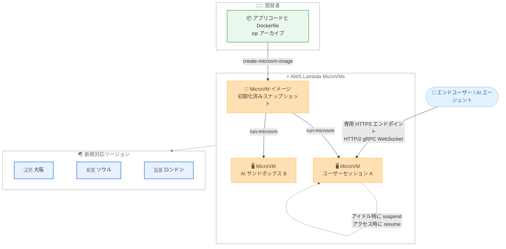

# AWS Lambda - Lambda MicroVMs が 7 つの追加リージョンで利用可能に

**リリース日**: 2026 年 11 月 20 日
**サービス**: AWS Lambda
**機能**: AWS Lambda MicroVMs のリージョン拡大

📊 [このアップデートのインフォグラフィックを見る](https://takech9203.github.io/aws-news-summary/20261120-aws-lambda-microvms-7-regions.html)

## 概要

AWS Lambda MicroVMs が新たに 7 つの AWS リージョンで利用可能になりました。今回の拡大により、アジアパシフィック (大阪)、アジアパシフィック (ソウル)、カナダ (中部)、欧州 (ロンドン)、欧州 (パリ)、南米 (サンパウロ)、米国西部 (北カリフォルニア) の各リージョンで Lambda MicroVMs を利用できるようになり、対応リージョンは合計 21 リージョンとなりました。

Lambda MicroVMs は、VM レベルの分離、ほぼ瞬時の起動・再開速度、状態の保持を提供するサーバーレスコンピューティングプリミティブです。ユーザーや AI が生成したコードを安全に実行するための環境として設計されており、AI コーディングアシスタント、インタラクティブな開発環境、脆弱性スキャナーなどのユースケースに適しています。日本のユーザーにとっては、大阪リージョンでの提供開始により、国内でのマルチリージョン構成や低レイテンシーでの利用の選択肢が広がる点が注目です。

**アップデート前の課題**

このアップデート以前に存在していた課題や制限は以下のとおりです。

- Lambda MicroVMs は限られたリージョンでのみ提供されており、大阪、ソウル、ロンドンなどのリージョンのユーザーは他リージョンを利用する必要があった
- エンドユーザーから遠いリージョンを利用する場合、インタラクティブなコード実行環境でレイテンシーが増加していた
- データレジデンシー要件により特定リージョンでの実行が必要なワークロードでは、Lambda MicroVMs を採用できないケースがあった

**アップデート後の改善**

今回のアップデートにより可能になったことは以下のとおりです。

- 新たに 7 リージョンが追加され、合計 21 リージョンで Lambda MicroVMs を利用可能になった
- エンドユーザーに近いリージョンで MicroVM を起動することで、インタラクティブなユースケースのレイテンシーを低減できるようになった
- 各国・地域のデータレジデンシー要件を満たしながら、分離されたコード実行環境を構築できるようになった

## アーキテクチャ図



Lambda MicroVMs の基本的な利用フローを示しています。Dockerfile からスナップショットベースの MicroVM イメージを作成し、ユーザーセッションやジョブごとに分離された MicroVM を起動して、専用の HTTPS エンドポイント経由でアクセスします。今回のアップデートで、この仕組みを大阪を含む 7 つの追加リージョンで利用できるようになりました。

## サービスアップデートの詳細

### 主要機能

1. **7 つの追加リージョンでの提供開始**
   - アジアパシフィック (大阪)、アジアパシフィック (ソウル)、カナダ (中部)、欧州 (ロンドン)、欧州 (パリ)、南米 (サンパウロ)、米国西部 (北カリフォルニア) で利用可能になった
   - 対応リージョンは合計 21 リージョンに拡大
   - 最新のリージョン対応状況は AWS Capabilities by Region ページで確認可能

2. **VM レベルの分離と高速な起動・再開**
   - Firecracker 仮想化技術により、テナント間の強力な分離を実現
   - 初期化済みスナップショットからの再開により、アプリケーションの初期化をスキップしてほぼ瞬時に起動
   - アイドル時にはメモリとディスクの状態を保持したままサスペンドし、コストを削減

3. **柔軟なネットワークと接続性**
   - ユーザーやジョブごとに専用の HTTPS エンドポイントを提供し、ロードバランサーなどの追加インフラは不要
   - HTTP/2、gRPC、WebSocket をサポート
   - アウトバウンドはパブリックインターネットアクセスと VPC アクセスを設定可能

4. **多様な利用インターフェース**
   - Lambda コンソール、AWS CloudFormation、AWS CDK から利用可能
   - Agent Toolkit for AWS を通じて、エージェント型開発ツールからも利用可能

## 技術仕様

### 新規対応リージョン

| リージョン名 | リージョン |
|------|------|
| アジアパシフィック (大阪) | ap-northeast-3 |
| アジアパシフィック (ソウル) | ap-northeast-2 |
| カナダ (中部) | ca-central-1 |
| 欧州 (ロンドン) | eu-west-2 |
| 欧州 (パリ) | eu-west-3 |
| 南米 (サンパウロ) | sa-east-1 |
| 米国西部 (北カリフォルニア) | us-west-1 |

### Lambda MicroVMs の主な特徴

| 項目 | 詳細 |
|------|------|
| 分離レベル | Firecracker による VM レベルの分離 |
| 起動方式 | 初期化済みスナップショットからの高速起動・再開 |
| ライフサイクル | run / suspend / resume / terminate を API またはアイドルポリシーで制御 |
| インバウンド通信 | 専用 HTTPS エンドポイント、HTTP/2、gRPC、WebSocket 対応 |
| アウトバウンド通信 | パブリックインターネットおよび VPC アクセスを設定可能 |
| リソース割り当て | ベースライン設定の最大 4 倍まで垂直スケール可能 |

## 設定方法

### 前提条件

1. AWS アカウントと適切な IAM 権限を保有していること
2. アプリケーションコードと Dockerfile を用意していること
3. 新規対応リージョンのいずれかを利用する場合は、対象リージョンで AWS CLI や SDK のリージョン設定を行うこと

### 手順

#### ステップ1: アプリケーションのパッケージングとアップロード

```bash
zip -r my-microvm-app.zip app/ Dockerfile
aws s3 cp my-microvm-app.zip s3://my-bucket/my-microvm-app.zip --region ap-northeast-3
```

アプリケーションコードと Dockerfile を zip アーカイブにまとめ、大阪リージョンの Amazon S3 バケットにアップロードしています。

#### ステップ2: MicroVM イメージの作成

```bash
aws lambda create-microvm-image \
  --code-artifact uri=s3://my-bucket/my-microvm-app.zip \
  --build-role-arn arn:aws:iam::123456789012:role/microvm-build-role \
  --region ap-northeast-3
```

Lambda が Dockerfile を実行してアプリケーションを起動し、完全に初期化された環境のスナップショットを MicroVM イメージとしてキャプチャします。

#### ステップ3: MicroVM の起動と接続

```bash
aws lambda run-microvm \
  --microvm-image-arn <MicroVM イメージの ARN> \
  --region ap-northeast-3
```

ユーザーセッションやジョブごとに MicroVM を起動します。起動後は返却される専用 HTTPS エンドポイントにクライアントから接続できます。アイドル時は suspend-microvm、再開時は resume-microvm を呼び出すか、ライフサイクルポリシーで自動制御できます。

## メリット

### ビジネス面

- **レイテンシーの低減**: エンドユーザーに近いリージョンで MicroVM を起動することで、インタラクティブな開発環境や AI サンドボックスの応答性が向上する
- **データレジデンシー要件への対応**: 各国・地域のリージョンでコード実行環境を完結させることで、コンプライアンス要件を満たしやすくなる
- **コスト効率**: アイドル時のサスペンドにより、利用のない時間帯のコストを削減しつつ、再開時にはほぼ瞬時に利用を再開できる

### 技術面

- **強力なテナント分離**: Firecracker による VM レベルの分離により、ユーザーや AI が生成した信頼できないコードを安全に実行できる
- **インフラ管理の不要化**: ロードバランサーやサーバーの管理なしで、専用 HTTPS エンドポイント付きの分離環境を提供できる
- **マルチリージョン展開の容易さ**: CloudFormation や CDK を利用して、追加されたリージョンへ同一構成を展開しやすい

## デメリット・制約事項

### 制限事項

- 対応リージョンは 21 リージョンであり、すべての AWS リージョンで利用できるわけではない
- 今回の発表では全対応リージョンの一覧は示されておらず、最新状況は AWS Capabilities by Region ページでの確認が必要

### 考慮すべき点

- リージョンごとに利用可能な機能や他サービスとの連携状況が異なる場合があるため、事前の検証が推奨される
- サスペンド中も状態保持に伴う課金が発生する可能性があるため、料金ページでコストモデルを確認する必要がある

## ユースケース

### ユースケース1: 国内向け AI コード実行サンドボックス

**シナリオ**: 日本国内のユーザー向けに、AI が生成したコードを安全に実行するサンドボックスを提供する。データを国内に保持する要件がある。

**実装例**:
```
1. 大阪リージョン ap-northeast-3 で MicroVM イメージを作成
2. AI エージェントのコード実行リクエストごとに run-microvm で分離環境を起動
3. 実行完了後に terminate で環境を破棄
```

**効果**: 国内リージョンで完結した低レイテンシーかつ安全なコード実行環境を、サーバー管理なしで提供できる。

### ユースケース2: グローバル展開するインタラクティブ開発環境

**シナリオ**: ブラウザベースの開発環境サービスを、欧州や南米のユーザーにも提供したい。

**実装例**:
```
1. ロンドン、パリ、サンパウロの各リージョンに同一の MicroVM イメージを展開
2. ユーザーの所在地に近いリージョンでセッション用 MicroVM を起動
3. アイドル時はライフサイクルポリシーで自動サスペンドし、再接続時に自動再開
```

**効果**: ユーザーの体感レイテンシーを低減しながら、アイドル時間のコストを抑制できる。

### ユースケース3: マルチテナント CI/CD の分離実行基盤

**シナリオ**: 複数の顧客のビルド・テストジョブを実行する SaaS で、テナント間の強力な分離が必要。

**実装例**:
```
1. ビルドツールチェーンを含む Dockerfile から MicroVM イメージを作成
2. ジョブごとに run-microvm で専用環境を起動し、ジョブ完了後に terminate
3. VPC アクセスを設定し、プライベートなアーティファクトリポジトリに接続
```

**効果**: テナントごとに VM レベルで分離されたビルド環境を、高速な起動で提供できる。

## 料金

今回の発表では具体的な料金は示されていません。Lambda MicroVMs は、MicroVM 実行中はベースラインレートで課金され、ベースラインを超えるアクティブな利用分に対して追加で課金されるモデルです。詳細は AWS Lambda 料金ページを参照してください。

## 利用可能リージョン

今回新たに以下の 7 リージョンが追加され、合計 21 の AWS リージョンで利用可能になりました。

- アジアパシフィック (大阪)
- アジアパシフィック (ソウル)
- カナダ (中部)
- 欧州 (ロンドン)
- 欧州 (パリ)
- 南米 (サンパウロ)
- 米国西部 (北カリフォルニア)

全対応リージョンの最新情報は [AWS Capabilities by Region](https://builder.aws.com/build/capabilities) で確認できます。

## 関連サービス・機能

- **AWS Lambda**: MicroVMs は Lambda ファミリーの機能として提供され、Lambda コンソールや API から操作する
- **Amazon S3**: MicroVM イメージ作成時のコードアーティファクトの格納先として使用する
- **AWS CloudFormation / AWS CDK**: MicroVM イメージや関連リソースを IaC で管理できる
- **Agent Toolkit for AWS**: エージェント型開発ツールから Lambda MicroVMs を利用するためのツールキット

## 参考リンク

- 📊 [インフォグラフィック](https://takech9203.github.io/aws-news-summary/20261120-aws-lambda-microvms-7-regions.html)
- [公式発表 (What's New)](https://aws.amazon.com/about-aws/whats-new/2026/11/aws-lambda-microvms-7-regions)
- [ドキュメント: AWS Lambda MicroVMs](https://docs.aws.amazon.com/lambda/latest/dg/lambda-microvms-guide.html)
- [Agent Toolkit for AWS - Lambda MicroVMs](https://github.com/aws/agent-toolkit-for-aws/tree/main/skills/specialized-skills/serverless-skills/aws-lambda-microvms)
- [料金ページ](https://aws.amazon.com/lambda/pricing/)

## まとめ

AWS Lambda MicroVMs が大阪を含む 7 つの追加リージョンで利用可能になり、対応リージョンは合計 21 リージョンに拡大しました。AI コード実行サンドボックスやインタラクティブ開発環境を国内リージョンや各地域で低レイテンシーに提供できるようになったため、データレジデンシー要件やユーザー体験を重視するワークロードでの採用を検討する価値があります。まずは開発者ガイドを参照し、対象リージョンでの動作検証から始めることを推奨します。
