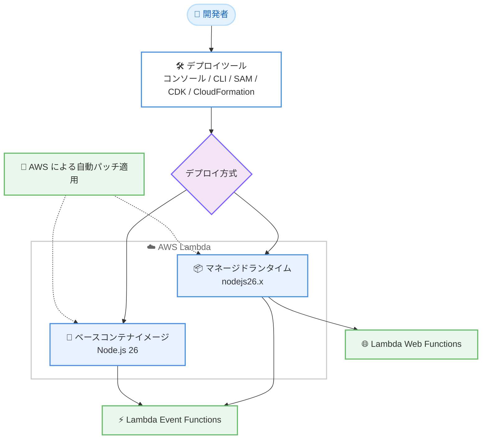

# AWS Lambda - Node.js 26 サポート

**リリース日**: 2026 年 11 月 20 日
**サービス**: AWS Lambda
**機能**: Node.js 26 ランタイムのサポート

📊 [このアップデートのインフォグラフィックを見る](https://takech9203.github.io/aws-news-summary/20261120-aws-lambda-nodejs-26.html)

## 概要

AWS Lambda が Node.js 26 をサポートしました。開発者は Node.js 26 を使用して、Lambda Web Functions と Lambda Event Functions の両方でサーバーレスアプリケーションを構築できます。Node.js 26 はマネージドランタイムとして利用できるほか、ベースコンテナイメージとしても提供されます (コンテナイメージは Event Functions のみ対応)。

Node.js 26 は現行の LTS (長期サポート) バージョンであり、2029 年 4 月までセキュリティ修正とバグ修正のサポートが見込まれています。日付・時刻・タイムゾーンの処理を容易にする Temporal API や、Fetch API の改善など、最新の言語機能を Lambda 関数で利用できるようになります。

マネージドランタイムとベースイメージへのパッチは、提供され次第 AWS が自動的に適用するため、ユーザーはランタイムのメンテナンスを意識することなく最新の状態を維持できます。

**アップデート前の課題**

- Lambda では Node.js 26 の新機能 (Temporal API など) を標準ランタイムとして利用できなかった
- 最新の LTS バージョンを使うには、カスタムランタイムやコンテナイメージを自前で構築・管理する必要があった
- 古いランタイムを使い続けると、将来のランタイム廃止 (デプリケーション) 対応が必要になるリスクがあった

**アップデート後の改善**

- マネージドランタイムとして Node.js 26 を選択するだけで、最新 LTS バージョンを利用可能になった
- Temporal API による日付・時刻・タイムゾーン処理の簡素化や、改善された Fetch API を Lambda 関数で活用できるようになった
- セキュリティパッチは AWS が自動適用するため、ランタイムの運用負荷なしに 2029 年 4 月までの長期サポートを享受できるようになった

## アーキテクチャ図



Node.js 26 はマネージドランタイムまたはベースコンテナイメージとして利用でき、Web Functions と Event Functions の両方に対応します (コンテナイメージは Event Functions のみ)。

## サービスアップデートの詳細

### 主要機能

1. **Node.js 26 マネージドランタイム**
   - Lambda Web Functions と Lambda Event Functions の両方で利用可能
   - 関数のランタイム設定で Node.js 26 を選択するだけで利用開始できる
   - ランタイムへのパッチは AWS が自動的に適用

2. **Node.js 26 ベースコンテナイメージ**
   - コンテナイメージとして Lambda 関数をデプロイする場合に利用可能 (Event Functions のみ)
   - ベースイメージへのパッチも AWS が提供され次第適用

3. **Node.js 26 の新しい言語機能**
   - Temporal API: 日付、時刻、タイムゾーンの処理を容易にする新しい API
   - Fetch API の改善
   - 現行 LTS バージョンとして 2029 年 4 月までセキュリティ修正とバグ修正のサポートが見込まれる

4. **ツールとの互換性**
   - Powertools for AWS Lambda (TypeScript) に対応: サーバーレスのベストプラクティスを実装し開発速度を高める開発者ツールキット
   - Lambda コンソール、AWS CLI、AWS SAM、AWS CDK、AWS CloudFormation など標準的なデプロイツールをサポート

## 技術仕様

### Node.js 26 ランタイムの概要

| 項目 | 詳細 |
|------|------|
| ランタイム | Node.js 26 |
| サポート期間 | 2029 年 4 月まで (LTS) |
| 対応関数タイプ | Web Functions、Event Functions |
| 提供形態 | マネージドランタイム、ベースコンテナイメージ (コンテナイメージは Event Functions のみ) |
| 主な新機能 | Temporal API、Fetch API の改善 |
| 対応ツール | Lambda コンソール、AWS CLI、AWS SAM、AWS CDK、AWS CloudFormation |

## 設定方法

### 前提条件

1. AWS アカウントと Lambda 関数を作成・更新できる IAM 権限
2. AWS CLI、AWS SAM、AWS CDK などのデプロイツール (コンソール以外を使用する場合)
3. Node.js 26 で動作確認済みの関数コード

### 手順

#### ステップ 1: 新規関数を Node.js 26 で作成する

```bash
aws lambda create-function \
  --function-name my-nodejs26-function \
  --runtime nodejs26.x \
  --handler index.handler \
  --role arn:aws:iam::123456789012:role/lambda-execution-role \
  --zip-file fileb://function.zip
```

`--runtime nodejs26.x` を指定して新しい Lambda 関数を作成します。ハンドラー、実行ロール、デプロイパッケージを指定します。

#### ステップ 2: 既存関数のランタイムを更新する

```bash
aws lambda update-function-configuration \
  --function-name my-existing-function \
  --runtime nodejs26.x
```

既存関数のランタイム設定を Node.js 26 に変更します。本番環境に適用する前に、開発環境で関数コードが Node.js 26 で正常に動作することを確認してください。

#### ステップ 3: AWS SAM テンプレートで指定する

```yaml
Resources:
  MyFunction:
    Type: AWS::Serverless::Function
    Properties:
      Handler: index.handler
      Runtime: nodejs26.x
      CodeUri: ./src
```

AWS SAM テンプレートの `Runtime` プロパティに `nodejs26.x` を指定します。`sam build` と `sam deploy` でデプロイできます。

## メリット

### ビジネス面

- **長期サポートによる安定運用**: 2029 年 4 月までの LTS サポートにより、長期間のメンテナンス計画を立てやすい
- **運用負荷の削減**: ランタイムとベースイメージへのパッチを AWS が自動適用するため、セキュリティ対応の工数を削減できる
- **移行リスクの低減**: 早期に最新 LTS へ移行することで、将来のランタイム廃止対応に余裕を持って備えられる

### 技術面

- **Temporal API**: 従来の Date オブジェクトの課題を解消する新しい日付・時刻・タイムゾーン処理 API を利用できる
- **Fetch API の改善**: 外部 API 呼び出しなどの HTTP 通信をより扱いやすい形で実装できる
- **エコシステムとの互換性**: Powertools for AWS Lambda (TypeScript) や主要なデプロイツールが最初からサポートされている

## デメリット・制約事項

### 制限事項

- ベースコンテナイメージは Event Functions のみの対応で、Web Functions では利用できない
- 利用しているライブラリや依存パッケージが Node.js 26 に対応しているかの確認が必要

### 考慮すべき点

- 既存関数を移行する場合は、Node.js のメジャーバージョン間の非互換変更がないか事前にテストする
- 古いランタイムで動作中の関数は、サポート期限を確認して計画的に移行することが推奨される

## ユースケース

### ユースケース 1: タイムゾーンを扱う業務アプリケーション

**シナリオ**: グローバルに展開する業務システムで、複数タイムゾーンにまたがる日時処理を Lambda 関数で実装する。

**実装例**:
```javascript
// Temporal API によるタイムゾーン変換
const tokyoTime = Temporal.Now.zonedDateTimeISO('Asia/Tokyo');
const nyTime = tokyoTime.withTimeZone('America/New_York');
console.log(nyTime.toString());
```

**効果**: 外部ライブラリに依存せず、標準 API だけで正確かつ読みやすい日時処理を実装できる。

### ユースケース 2: 外部 API と連携するイベント処理

**シナリオ**: Event Functions で受信したイベントをもとに、外部の REST API を呼び出してデータを集約する。

**実装例**:
```javascript
export const handler = async (event) => {
  const response = await fetch('https://api.example.com/data', {
    method: 'POST',
    headers: { 'Content-Type': 'application/json' },
    body: JSON.stringify(event),
  });
  return await response.json();
};
```

**効果**: 改善された Fetch API により、追加の HTTP クライアントライブラリなしで外部連携を実装できる。

### ユースケース 3: 既存 Node.js 関数の計画的な移行

**シナリオ**: 旧バージョンの Node.js ランタイムで稼働している多数の Lambda 関数を、サポート期間の長い Node.js 26 へ段階的に移行する。

**実装例**:
```bash
# 対象ランタイムの関数を一覧表示して移行対象を洗い出す
aws lambda list-functions \
  --query "Functions[?Runtime=='nodejs18.x'].[FunctionName,Runtime]" \
  --output table
```

**効果**: 2029 年 4 月までサポートされるランタイムへ早期に移行することで、ランタイム廃止対応の緊急作業を回避できる。

## 料金

Node.js 26 ランタイムの利用に追加料金はありません。Lambda の標準料金 (リクエスト数と実行時間に基づく従量課金) が適用されます。

## 利用可能リージョン

Lambda Web Functions および Event Functions が利用可能なすべての AWS リージョンで利用できます。

## 関連サービス・機能

- **Powertools for AWS Lambda (TypeScript)**: サーバーレスのベストプラクティスを実装するための開発者ツールキットで、Node.js 26 に対応
- **AWS SAM / AWS CDK / AWS CloudFormation**: Node.js 26 ランタイムを指定した IaC によるデプロイに対応
- **Amazon ECR**: Node.js 26 ベースコンテナイメージを利用したコンテナデプロイで使用

## 参考リンク

- 📊 [インフォグラフィック](https://takech9203.github.io/aws-news-summary/20261120-aws-lambda-nodejs-26.html)
- [公式発表 (What's New)](https://aws.amazon.com/about-aws/whats-new/2026/11/aws-lambda-nodejs-26/)
- [ドキュメント: Web Functions での Node.js](https://docs.aws.amazon.com/lambda/latest/dg/web-functions-nodejs.html)
- [ドキュメント: Event Functions での Node.js](https://docs.aws.amazon.com/lambda/latest/dg/lambda-nodejs.html)
- [Powertools for AWS Lambda (TypeScript)](https://docs.powertools.aws.dev/lambda/typescript/latest/)
- [料金ページ](https://aws.amazon.com/lambda/pricing/)

## まとめ

AWS Lambda が現行 LTS である Node.js 26 をサポートし、Temporal API などの最新言語機能を 2029 年 4 月までの長期サポートとともに利用できるようになりました。新規関数では Node.js 26 の採用を標準とし、既存の Node.js 関数も依存関係の互換性を確認のうえ、計画的な移行を検討することを推奨します。
