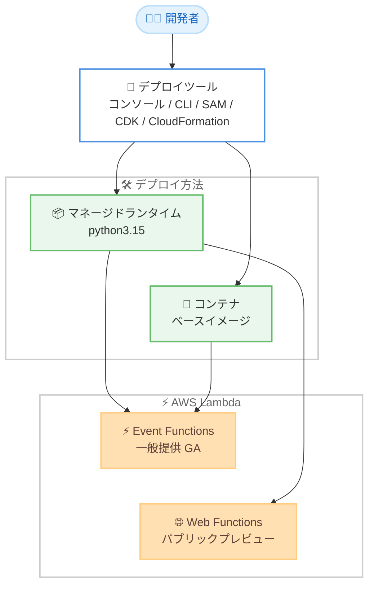

# AWS Lambda - Python 3.15 サポート

**リリース日**: 2026 年 11 月 20 日
**サービス**: AWS Lambda
**機能**: Python 3.15 ランタイムのサポート

📊 [このアップデートのインフォグラフィックを見る](https://takech9203.github.io/aws-news-summary/20261120-aws-lambda-python-315.html)

## 概要

AWS Lambda が Python 3.15 をサポートしました。開発者は Python の最新バージョンを使用してサーバーレスアプリケーションを構築できます。Event Functions では一般提供 (GA)、Web Functions ではパブリックプレビューとして利用可能です。特に Web Functions にとっては初の Python ランタイムであり、これまで Node.js のみだった Web Functions の選択肢が大きく広がります。

Python 3.15 は、マネージドランタイムとして、または Event Functions 向けのコンテナベースイメージとして使用できます。いずれの場合も、ランタイムの更新は AWS が自動的に行うため、運用負荷を抑えながら最新のセキュリティパッチを適用できます。

Python 3.15 には、関数の起動時間短縮につながる明示的な遅延インポート (lazy imports)、新しい組み込み型である frozendict と sentinel、改善された JIT コンパイラなどが含まれており、Lambda 関数のパフォーマンスと開発体験の両面で恩恵があります。

**アップデート前の課題**

このアップデート以前には、以下の課題や制限がありました。

- Lambda で Python 3.15 の新機能 (遅延インポート、frozendict、sentinel、改善された JIT コンパイラなど) を利用できなかった
- Web Functions では Node.js ランタイムしか選択できず、Python でウェブアプリケーションを構築できなかった
- 最新の Python バージョンに依存するライブラリやツールチェーンを Lambda で利用する際に制約があった

**アップデート後の改善**

今回のアップデートにより、以下が可能になりました。

- Event Functions で Python 3.15 を GA として利用可能になった
- Web Functions で初めて Python ランタイム (パブリックプレビュー) を選択できるようになった
- 明示的な遅延インポートにより、関数の起動時間 (コールドスタート) の短縮が期待できるようになった
- マネージドランタイムまたはコンテナベースイメージのどちらでも AWS による自動更新を受けられる

## アーキテクチャ図



Python 3.15 はマネージドランタイムまたはコンテナベースイメージとしてデプロイでき、Event Functions (GA) と Web Functions (プレビュー) の両方で利用できます。コンテナベースイメージは Event Functions のみの対応です。

## サービスアップデートの詳細

### 主要機能

1. **Event Functions での Python 3.15 サポート (GA)**
   - イベント駆動型の Lambda 関数で Python 3.15 を一般提供として利用可能
   - マネージドランタイムとコンテナベースイメージの両方に対応
   - ランタイムの更新は AWS が自動的に実施

2. **Web Functions での Python 3.15 サポート (パブリックプレビュー)**
   - Web Functions 初の Python ランタイム
   - これまで Node.js のみだった Web Functions で Python によるウェブアプリケーション構築が可能に
   - 現時点ではパブリックプレビューのため、本番利用には注意が必要

3. **Python 3.15 の言語新機能**
   - 明示的な遅延インポート (lazy imports): モジュールのインポートを実際の使用時まで遅延させ、関数の起動時間を短縮できる可能性がある
   - 新しい組み込み型: frozendict (イミュータブルな辞書) と sentinel
   - 改善された JIT コンパイラによるパフォーマンス向上

4. **エコシステムとツールのサポート**
   - Powertools for AWS Lambda (Python) によりサーバーレスのベストプラクティスを適用可能
   - Lambda コンソール、AWS CLI、AWS SAM、AWS CDK、AWS CloudFormation からデプロイ可能

## 技術仕様

### ランタイムの対応状況

| 項目 | 詳細 |
|------|------|
| ランタイム | Python 3.15 |
| Event Functions | 一般提供 (GA) |
| Web Functions | パブリックプレビュー (初の Python ランタイム) |
| デプロイ形態 | マネージドランタイム、コンテナベースイメージ (Event Functions のみ) |
| ランタイム更新 | AWS による自動更新 |
| デプロイツール | Lambda コンソール、AWS CLI、AWS SAM、AWS CDK、AWS CloudFormation |

## 設定方法

### 前提条件

1. AWS アカウントと Lambda 関数を作成・更新できる IAM 権限
2. AWS CLI、AWS SAM CLI などのデプロイツール (CLI からデプロイする場合)
3. Python 3.15 で動作確認済みのアプリケーションコードと依存ライブラリ

### 手順

#### ステップ1: 新規関数を Python 3.15 で作成する

```bash
aws lambda create-function \
  --function-name my-python315-function \
  --runtime python3.15 \
  --handler lambda_function.lambda_handler \
  --role arn:aws:iam::123456789012:role/lambda-execution-role \
  --zip-file fileb://function.zip
```

`--runtime python3.15` を指定して Lambda 関数を新規作成しています。ハンドラー、実行ロール、デプロイパッケージを合わせて指定します。

#### ステップ2: 既存関数のランタイムを更新する

```bash
aws lambda update-function-configuration \
  --function-name my-existing-function \
  --runtime python3.15
```

既存の Lambda 関数のランタイム設定を Python 3.15 に変更しています。更新前に、依存ライブラリが Python 3.15 に対応していることをテスト環境で確認してください。

#### ステップ3: AWS SAM テンプレートで指定する

```yaml
Resources:
  MyFunction:
    Type: AWS::Serverless::Function
    Properties:
      Runtime: python3.15
      Handler: app.lambda_handler
      CodeUri: src/
```

AWS SAM テンプレートの `Runtime` プロパティに `python3.15` を指定しています。`sam build` と `sam deploy` でデプロイできます。

## メリット

### ビジネス面

- **最新ランタイムへの追従**: 最新の Python バージョンを利用することで、セキュリティとサポートの観点から長期的な保守性が向上する
- **Web アプリケーション開発の選択肢拡大**: Web Functions で Python が使えるようになり、Python スキルを持つチームがウェブアプリケーションをサーバーレスで構築しやすくなる
- **運用負荷の軽減**: ランタイム更新を AWS が自動的に行うため、パッチ適用の運用コストを削減できる

### 技術面

- **起動時間の短縮**: 明示的な遅延インポートにより、コールドスタート時のインポートコストを削減できる可能性がある
- **パフォーマンス向上**: 改善された JIT コンパイラにより、計算処理のパフォーマンス向上が期待できる
- **新しい組み込み型の活用**: frozendict や sentinel を利用して、より安全で表現力の高いコードを記述できる

## デメリット・制約事項

### 制限事項

- Web Functions での Python 3.15 はパブリックプレビューであり、GA 前に仕様が変更される可能性がある
- コンテナベースイメージとしての利用は Event Functions のみの対応
- 依存ライブラリ (特に C 拡張を含むもの) が Python 3.15 に未対応の場合、移行できないことがある

### 考慮すべき点

- 既存関数を移行する場合は、Python 3.15 での動作をテスト環境で十分に検証する
- 遅延インポートの効果はコードの構造に依存するため、実際の起動時間を計測して評価する

## ユースケース

### ユースケース1: 既存 Python 関数のランタイムアップグレード

**シナリオ**: Python 3.13 などで稼働中のイベント駆動型 Lambda 関数を最新ランタイムへ移行し、長期的な保守性とパフォーマンスを確保したい。

**実装例**:
```bash
aws lambda update-function-configuration \
  --function-name order-processor \
  --runtime python3.15
```

**効果**: 最新の言語機能とパフォーマンス改善を享受しつつ、将来のランタイム廃止対応を前倒しで完了できる。

### ユースケース2: Python による Web Functions の構築 (プレビュー)

**シナリオ**: Python スキルを持つチームが、Web Functions を使用してウェブアプリケーションや API をサーバーレスで構築したい。これまでは Node.js のみだったため Python を選択できなかった。

**実装例**:
```text
Web Functions の作成時にランタイムとして Python 3.15 を選択し、
FastAPI などの Python ウェブフレームワークで実装したアプリケーションをデプロイする。
詳細は Web Functions のドキュメントを参照。
```

**効果**: 既存の Python 資産とスキルを活かしてウェブアプリケーションを構築でき、学習コストを削減できる。

### ユースケース3: 遅延インポートによるコールドスタート最適化

**シナリオ**: 多数のライブラリをインポートする Lambda 関数で、コールドスタート時間がレイテンシー要件を圧迫している。

**実装例**:
```python
# Python 3.15 の明示的な遅延インポートを活用し、
# 特定の処理パスでのみ必要な重いモジュールのインポートを使用時まで遅延させる
lazy import pandas
```

**効果**: 初期化時に不要なインポートコストを回避し、コールドスタート時間を短縮できる可能性がある。

## 料金

Python 3.15 ランタイムの利用自体に追加料金はありません。通常の AWS Lambda の料金 (リクエスト数と実行時間に基づく従量課金) が適用されます。詳細は [AWS Lambda 料金ページ](https://aws.amazon.com/lambda/pricing/) を参照してください。

## 利用可能リージョン

Event Functions および Web Functions が利用可能なすべての AWS リージョンで利用できます。

## 関連サービス・機能

- **Powertools for AWS Lambda (Python)**: サーバーレスのベストプラクティスを実装するためのツールキット。Python 3.15 と組み合わせて利用可能
- **AWS SAM / AWS CDK / AWS CloudFormation**: Python 3.15 ランタイムを指定した Lambda 関数のデプロイに対応
- **Lambda Web Functions**: ウェブアプリケーション向けの Lambda 関数タイプ。今回初めて Python ランタイムに対応 (プレビュー)

## 参考リンク

- 📊 [インフォグラフィック](https://takech9203.github.io/aws-news-summary/20261120-aws-lambda-python-315.html)
- [公式発表 (What's New)](https://aws.amazon.com/about-aws/whats-new/2026/11/aws-lambda-python-315/)
- [ドキュメント: Building Lambda functions with Python](https://docs.aws.amazon.com/lambda/latest/dg/lambda-python.html)
- [ドキュメント: Web Functions with Python](https://docs.aws.amazon.com/lambda/latest/dg/web-functions-python.html)
- [Powertools for AWS Lambda (Python)](https://docs.aws.amazon.com/powertools/python/latest/)
- [料金ページ](https://aws.amazon.com/lambda/pricing/)

## まとめ

AWS Lambda が Python 3.15 に対応し、Event Functions では GA、Web Functions では初の Python ランタイムとしてパブリックプレビューで利用可能になりました。遅延インポートや改善された JIT コンパイラなど、パフォーマンス面の改善が期待できる新機能が含まれています。既存の Python 関数を運用しているチームは、テスト環境での検証を経て早めのランタイム移行を検討することを推奨します。
