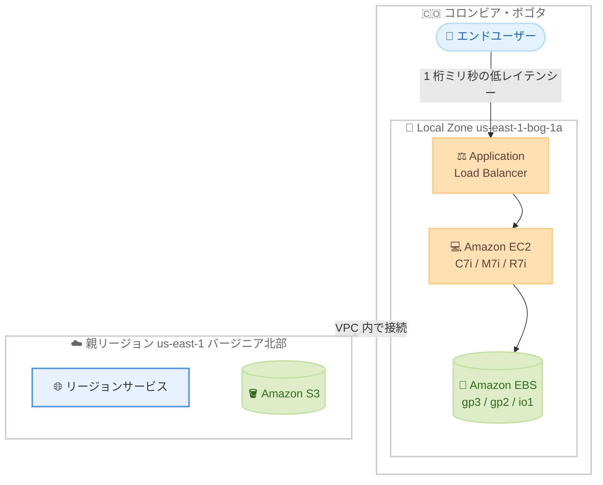

# AWS Local Zones - コロンビア・ボゴタの新しい AWS Local Zone が一般提供開始

**リリース日**: 2026 年 11 月 20 日
**サービス**: AWS Local Zones
**機能**: ボゴタ (コロンビア) Local Zone の一般提供開始

📊 [このアップデートのインフォグラフィックを見る](https://takech9203.github.io/aws-news-summary/20261120-aws-local-zone-bogota-colombia.html)

## 概要

AWS は、コロンビアの首都ボゴタにおける新しい AWS Local Zone の一般提供開始を発表しました。AWS Local Zones は、コンピューティング、ストレージ、データベースなどの AWS サービスを大都市圏や産業集積地の近くに配置するインフラストラクチャのデプロイメントであり、エンドユーザーに対して 1 桁ミリ秒のレイテンシーを実現します。

今回のボゴタ Local Zone の開設により、コロンビアおよび周辺地域のユーザーに近い場所でワークロードを実行できるようになり、リアルタイムゲーム、ライブ動画ストリーミング、医療画像処理、金融取引処理など、低レイテンシーが求められるアプリケーションの要件を満たすことが可能になります。新しい Local Zone のゾーン ID は `us-east-1-bog-1a` で、親リージョンは米国東部 (バージニア北部) リージョンです。

Local Zones は標準の AWS リージョンと同じ API とツールを使用できるため、既存の運用ノウハウをそのまま活かしながら、低レイテンシーが必要なワークロードのみをユーザーの近くに配置するハイブリッドな構成を容易に実現できます。

**アップデート前の課題**

- コロンビア国内には AWS のリージョンや Local Zone が存在せず、最寄りのリージョン (バージニア北部やサンパウロなど) までのネットワークレイテンシーが避けられなかった
- リアルタイムゲームやライブ配信など、1 桁ミリ秒のレイテンシーを要求するアプリケーションをコロンビア国内のユーザー向けに提供することが困難だった
- 低レイテンシー要件を満たすには、オンプレミスや国内データセンターでの自前運用が必要になるケースがあった

**アップデート後の改善**

- ボゴタ都市圏のエンドユーザーに対して 1 桁ミリ秒のレイテンシーでアプリケーションを提供できるようになった
- EC2、EBS、ECS、EKS、ALB など使い慣れた AWS サービスをボゴタで利用でき、標準リージョンと同じ API・ツールで運用できるようになった
- 最低利用料金やコミットメントなしの従量課金で、低レイテンシーインフラを利用できるようになった

## アーキテクチャ図



ボゴタのエンドユーザーは Local Zone 内のリソースに低レイテンシーでアクセスし、Local Zone は親リージョンであるバージニア北部リージョンと同一 VPC 内でシームレスに接続されます。

## サービスアップデートの詳細

### 主要機能

1. **ボゴタ Local Zone の開設**
   - ゾーン ID は `us-east-1-bog-1a`
   - 親リージョンは米国東部 (バージニア北部、us-east-1)
   - コロンビア初の AWS Local Zone として、国内ユーザーへの 1 桁ミリ秒レイテンシーを実現

2. **利用可能なサービス**
   - Amazon EC2: C7i、M7i、R7i インスタンスタイプ
   - Amazon EBS: gp3、gp2、io1 ボリュームタイプとローカルスナップショット
   - Amazon S3: S3 One Zone-IA ストレージクラス
   - Amazon ECS / Amazon EKS によるコンテナワークロード
   - Amazon VPC、AWS Direct Connect、Application Load Balancer

3. **標準リージョンと同じ運用体験**
   - 標準の AWS リージョンと同じ API、ツール、マネジメントコンソールで利用可能
   - 最低利用料金やコミットメントなしの従量課金
   - オンデマンド、Savings Plans、スポットインスタンスの購入オプションに対応

## 技術仕様

### ボゴタ Local Zone の概要

| 項目 | 詳細 |
|------|------|
| ゾーン ID | `us-east-1-bog-1a` |
| 所在地 | ボゴタ (コロンビア) |
| 親リージョン | 米国東部 (バージニア北部、us-east-1) |
| EC2 インスタンスタイプ | C7i、M7i、R7i |
| EBS ボリュームタイプ | gp3、gp2、io1 (ローカルスナップショット対応) |
| S3 ストレージクラス | S3 One Zone-IA |
| コンテナサービス | Amazon ECS、Amazon EKS |
| ネットワーク | Amazon VPC、AWS Direct Connect、Application Load Balancer |
| 購入オプション | オンデマンド、Savings Plans、スポットインスタンス |

## 設定方法

### 前提条件

1. AWS アカウントを保有していること
2. 親リージョンであるバージニア北部リージョン (us-east-1) を利用できること
3. Local Zone の利用には明示的なオプトイン (有効化) が必要

### 手順

#### ステップ1: Local Zone の有効化

```bash
aws ec2 modify-availability-zone-group \
  --region us-east-1 \
  --group-name us-east-1-bog-1 \
  --opt-in-status opted-in
```

`ModifyAvailabilityZoneGroup` API を使用して、ボゴタ Local Zone のゾーングループを有効化します。EC2 コンソールの AWS Global View にある [Regions and Zones] タブからも有効化できます。

#### ステップ2: Local Zone にサブネットを作成

```bash
aws ec2 create-subnet \
  --region us-east-1 \
  --vpc-id vpc-xxxxxxxx \
  --cidr-block 10.0.10.0/24 \
  --availability-zone us-east-1-bog-1a
```

既存の VPC 内に、ボゴタ Local Zone を指定してサブネットを作成します。これにより、同一 VPC 内でリージョンのリソースと Local Zone のリソースを組み合わせて利用できます。

#### ステップ3: EC2 インスタンスの起動

```bash
aws ec2 run-instances \
  --region us-east-1 \
  --image-id ami-xxxxxxxx \
  --instance-type m7i.xlarge \
  --subnet-id subnet-xxxxxxxx
```

作成したサブネットを指定して EC2 インスタンスを起動します。ボゴタ Local Zone では C7i、M7i、R7i インスタンスタイプを利用できます。

## メリット

### ビジネス面

- **コロンビア市場への低レイテンシー展開**: 国内データセンターを自前で構築することなく、ボゴタのユーザーに低レイテンシーなサービスを提供できる
- **初期投資不要の従量課金**: 最低利用料金やコミットメントなしで利用を開始でき、Savings Plans やスポットインスタンスによるコスト最適化も可能
- **ユーザー体験の向上**: ゲーム、動画配信、金融取引などレイテンシーに敏感なサービスの応答性を改善できる

### 技術面

- **標準リージョンと同じ運用**: 既存の API、ツール、IaC テンプレートをそのまま利用でき、学習コストや運用負荷の増加を抑えられる
- **ハイブリッド構成が容易**: 同一 VPC 内で Local Zone とリージョンのリソースを組み合わせ、低レイテンシー処理とバックエンド処理を分離できる
- **コンテナワークロード対応**: ECS / EKS が利用できるため、既存のコンテナベースのアーキテクチャを低レイテンシー環境に展開しやすい

## デメリット・制約事項

### 制限事項

- 利用可能なサービスとインスタンスタイプは標準リージョンより限定される (EC2 は C7i、M7i、R7i のみ)
- 利用前にゾーングループへのオプトインが必要
- S3 は One Zone-IA ストレージクラスのみの提供で、ストレージの冗長性は単一ゾーンに限定される

### 考慮すべき点

- Local Zone のリソース料金は親リージョンと異なるため、料金ページで事前に確認が必要
- 親リージョン (us-east-1) との間の通信にはレイテンシーが発生するため、アーキテクチャ設計時にデータ配置を検討する必要がある
- 単一ゾーン構成となるため、高可用性が必要なワークロードでは親リージョンとの組み合わせを検討する

## ユースケース

### ユースケース1: リアルタイムゲームサーバー

**シナリオ**: コロンビア国内のプレイヤー向けに対戦型オンラインゲームを提供しており、サーバー応答のレイテンシーがプレイ体験を左右する。

**実装例**:
```
ゲームセッションサーバー (EC2 C7i) をボゴタ Local Zone に配置し、
マッチメイキングやプレイヤーデータ管理は親リージョン us-east-1 で実行
```

**効果**: プレイヤーとゲームサーバー間のレイテンシーを 1 桁ミリ秒に抑え、快適な対戦体験を提供できる。

### ユースケース2: ライブ動画ストリーミング

**シナリオ**: スポーツイベントなどのライブ配信で、ボゴタ都市圏の視聴者に低遅延の映像を届けたい。

**実装例**:
```
エンコード・パッケージング処理を Local Zone 内の EC2 / ECS で実行し、
アーカイブは S3 One Zone-IA およびリージョンの S3 に保存
```

**効果**: 配信遅延を最小化し、視聴者のリアルタイム性の高い視聴体験を実現できる。

### ユースケース3: 金融取引処理

**シナリオ**: 金融機関がボゴタの取引システム向けに低レイテンシーの注文処理基盤を必要としている。

**実装例**:
```
注文処理アプリケーションを Local Zone の EC2 R7i + EBS io1 で稼働させ、
Direct Connect でオンプレミスの基幹システムと接続
```

**効果**: 取引処理のレイテンシーを削減しつつ、AWS の運用モデルとオンプレミス環境を安全に統合できる。

## 料金

AWS Local Zones は従量課金制で、最低利用料金や前払いのコミットメントはありません。ボゴタ Local Zone の EC2 インスタンスには、オンデマンド、Savings Plans、スポットインスタンスの購入オプションが利用できます。Local Zone のリソース料金は親リージョンと異なる場合があるため、詳細は [AWS Local Zones 料金ページ](https://aws.amazon.com/about-aws/global-infrastructure/localzones/pricing/) を参照してください。

## 利用可能リージョン

- ボゴタ (コロンビア) Local Zone: `us-east-1-bog-1a` (親リージョン: 米国東部・バージニア北部)
- AWS Local Zones は世界 30 か所以上で展開されており、今回のボゴタが新たに追加された

## 関連サービス・機能

- **Amazon EC2**: Local Zone 内で C7i、M7i、R7i インスタンスを起動可能
- **Amazon EBS**: gp3、gp2、io1 ボリュームとローカルスナップショットに対応
- **Amazon ECS / Amazon EKS**: コンテナワークロードを低レイテンシー環境で実行
- **AWS Direct Connect**: オンプレミス環境と Local Zone を専用線で接続
- **AWS Outposts / AWS Wavelength**: 同様にエッジへ AWS インフラを拡張する選択肢

## 参考リンク

- 📊 [インフォグラフィック](https://takech9203.github.io/aws-news-summary/20261120-aws-local-zone-bogota-colombia.html)
- [公式発表 (What's New)](https://aws.amazon.com/about-aws/whats-new/2026/11/aws-local-zone-bogota-colombia/)
- [AWS Local Zones 概要ページ](https://aws.amazon.com/about-aws/global-infrastructure/localzones/)
- [AWS Local Zones 料金ページ](https://aws.amazon.com/about-aws/global-infrastructure/localzones/pricing/)

## まとめ

コロンビア・ボゴタに新しい AWS Local Zone が開設され、同国のエンドユーザーに対して 1 桁ミリ秒のレイテンシーでアプリケーションを提供できるようになりました。リアルタイムゲーム、ライブ配信、金融取引など低レイテンシーが要件となるワークロードをコロンビア向けに展開している場合は、ゾーングループを有効化し、Local Zone へのワークロード配置を検討することをお勧めします。
