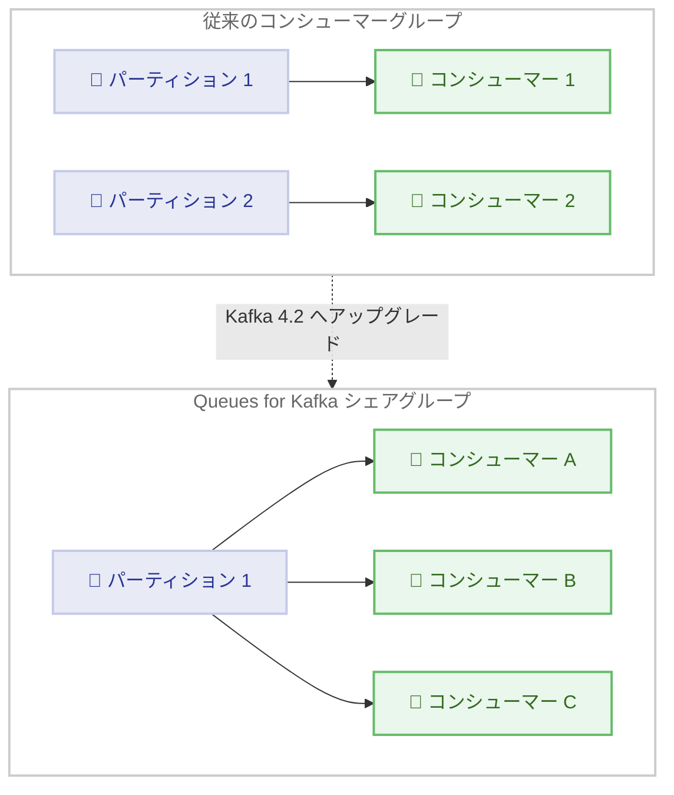

# Amazon MSK - Standard ブローカーでの Apache Kafka バージョン 4.2 サポート

**リリース日**: 2026 年 11 月 20 日
**サービス**: Amazon Managed Streaming for Apache Kafka (Amazon MSK)
**機能**: Standard ブローカーにおける Apache Kafka バージョン 4.2 のサポート

📊 [このアップデートのインフォグラフィックを見る](https://takech9203.github.io/aws-news-summary/20261120-aws-msk-standard-version-42.html)

## 概要

Amazon Managed Streaming for Apache Kafka (Amazon MSK) が、Standard ブローカーで Apache Kafka バージョン 4.2 のサポートを開始しました。新規クラスターの作成時にバージョン 4.2.x を選択できるほか、既存の MSK プロビジョンドクラスターもインプレースのローリングアップデートで 4.2 にアップグレードできます。

Apache Kafka 4.2 では、ポイントツーポイント型のメッセージングを実現する「Queues for Kafka」が本番利用可能 (production ready) になったことが大きなトピックです。複数のコンシューマーが同一のトピックパーティションから読み取れるようになり、並列性とスループットを大幅に高められます。さらに、Eligible Leader Replicas (ELR) の強化によるリーダー選出の正確性と可用性の向上、新しいコンシューマーリバランスプロトコル、Kafka Streams 向けの Streams Rebalance Protocol など、運用の安定性と効率を高める改善が含まれています。

ストリーミング基盤を運用するプラットフォームチームや、Kafka をメッセージキューとしても活用したいアプリケーション開発者にとって、アーキテクチャの選択肢が広がるアップデートです。

**アップデート前の課題**

- 従来のコンシューマーグループでは 1 つのパーティションを同時に読み取れるコンシューマーは 1 つに限られ、並列性を高めるにはパーティション数を増やす必要があった
- ポイントツーポイント型のキュー処理を実現するには、Amazon SQS など別のメッセージングサービスとの併用や独自の工夫が必要だった
- コンシューマーグループのリバランスやリーダー選出の際に、処理の一時停止や可用性低下の影響を受けやすかった

**アップデート後の改善**

- Queues for Kafka により、複数のコンシューマーが同一パーティションから読み取れるようになり、パーティション数を増やさずに並列性とスループットを向上できる
- ELR の強化により、リーダー選出の正確性が向上し、クラスターの可用性が強化された
- 新しいコンシューマーリバランスプロトコルにより、コンシューマーグループのリバランスがより高速かつスムーズになった
- Streams Rebalance Protocol により、Kafka Streams アプリケーションのタスク割り当てがブローカー側で調整され、より効率的になった

## アーキテクチャ図



従来は 1 パーティションにつき 1 コンシューマーという制約がありましたが、Kafka 4.2 の Queues for Kafka では複数のコンシューマーが同一パーティションを分担して読み取れるため、パーティション数を増やさずに処理の並列性を高められます。

## サービスアップデートの詳細

### 主要機能

1. **Queues for Kafka の本番利用対応**
   - 複数のコンシューマーが同一のトピックパーティションから読み取り可能
   - ポイントツーポイント型のメッセージングワークロードで並列性とスループットが向上
   - ジョブキューやタスク分散など、従来はメッセージキュー製品が担っていたユースケースに Kafka を適用可能

2. **Eligible Leader Replicas の強化**
   - リーダー選出の正確性が向上
   - ブローカー障害時などにおけるクラスターの可用性を強化

3. **新しいコンシューマーリバランスプロトコル**
   - コンシューマーグループのリバランスがより高速かつスムーズに
   - コンシューマーの参加・離脱時の処理停止時間を低減

4. **Streams Rebalance Protocol**
   - Kafka Streams アプリケーションにブローカー側での調整機能を提供
   - タスク割り当てがより効率的になり、ストリーム処理の安定性が向上

## 技術仕様

### Apache Kafka 4.2 の主な改善点

| 項目 | 詳細 |
|------|------|
| Queues for Kafka | シェアグループにより複数コンシューマーが同一パーティションを読み取り可能。本番利用対応 |
| Eligible Leader Replicas | リーダー選出の正確性と可用性を向上 |
| コンシューマーリバランス | 新プロトコルによりリバランスを高速化 |
| Streams Rebalance Protocol | Kafka Streams のタスク割り当てをブローカー側で調整 |
| 対象ブローカータイプ | Amazon MSK Standard ブローカー |
| 指定バージョン | 4.2.x |

## 設定方法

### 前提条件

1. AWS アカウントと Amazon MSK を操作できる IAM 権限
2. 新規クラスター作成の場合: VPC、サブネット、セキュリティグループの準備
3. 既存クラスターのアップグレードの場合: クライアントが Kafka 4.2 と互換性があることの確認

### 手順

#### ステップ 1: 新規クラスターをバージョン 4.2.x で作成

```bash
aws kafka create-cluster \
  --cluster-name my-kafka-42-cluster \
  --kafka-version "4.2.x" \
  --number-of-broker-nodes 3 \
  --broker-node-group-info file://brokernodegroupinfo.json
```

Apache Kafka バージョン 4.2.x を指定して、新しい MSK プロビジョンドクラスターを作成します。AWS マネジメントコンソールや AWS SDK からも同様に作成できます。

#### ステップ 2: 既存クラスターをインプレースアップグレード

```bash
aws kafka update-cluster-kafka-version \
  --cluster-arn <クラスターの ARN> \
  --current-version <現在のクラスター構成リビジョン> \
  --target-kafka-version "4.2.x"
```

既存の MSK プロビジョンドクラスターを Kafka 4.2 にローリングアップデートします。MSK がブローカーの再起動をオーケストレーションし、アップグレード中も可用性とデータを保護します。

#### ステップ 3: アップグレードの進行状況を確認

```bash
aws kafka describe-cluster-operation \
  --cluster-operation-arn <オペレーションの ARN>
```

アップグレードオペレーションの状態を確認します。完了後、クライアント側で Kafka 4.2 の新機能 (シェアグループなど) の利用を検討します。

## メリット

### ビジネス面

- **アーキテクチャの簡素化**: キュー型ワークロードとストリーミングワークロードを Kafka に統合でき、運用するミドルウェアを削減できる
- **スループット向上によるコスト効率**: パーティション数を増やさずに並列性を高められ、過剰なパーティション設計を回避できる
- **ダウンタイムの最小化**: インプレースのローリングアップデートにより、サービス停止なしで最新バージョンへ移行できる

### 技術面

- **並列処理の柔軟性**: シェアグループによりコンシューマー数をパーティション数に縛られずにスケールできる
- **可用性の強化**: ELR の改善により、障害時のリーダー選出がより正確になり可用性が向上する
- **運用の安定性**: リバランスの高速化と Kafka Streams のブローカー側調整により、デプロイやスケール時の影響が小さくなる

## デメリット・制約事項

### 制限事項

- 今回のサポート対象は Standard ブローカーであり、他のブローカータイプでの対応状況は別途確認が必要
- Queues for Kafka などの新機能を利用するには、クライアントライブラリ側も対応バージョンへの更新が必要

### 考慮すべき点

- アップグレード前に、使用中のクライアント、コネクタ、ツール類の Kafka 4.2 互換性を検証する必要がある
- ローリングアップデート中はブローカーが順次再起動されるため、クライアント側の再接続・リトライ設定を確認しておくことが望ましい
- シェアグループは従来のコンシューマーグループとセマンティクスが異なるため、順序保証の要件があるワークロードでは適用可否を慎重に判断する必要がある

## ユースケース

### ユースケース 1: ジョブキューとしての Kafka 活用

**シナリオ**: 画像処理やバッチジョブのタスクを多数のワーカーに分散したいが、パーティション数を増やさずにワーカーをスケールさせたい。

**実装例**:
```
1. Kafka 4.2 の MSK クラスターでタスク用トピックを作成
2. ワーカーアプリケーションをシェアグループとして構成
3. 負荷に応じてワーカー数を柔軟に増減
```

**効果**: パーティション数の制約を受けずにワーカーを水平スケールでき、タスク処理のスループットが向上します。

### ユースケース 2: 大規模コンシューマーグループの安定運用

**シナリオ**: 多数のコンシューマーを持つマイクロサービス群で、デプロイのたびにリバランスによる処理停止が発生している。

**実装例**:
```
1. MSK クラスターを Kafka 4.2 へインプレースアップグレード
2. クライアントを新しいコンシューマーリバランスプロトコル対応バージョンへ更新
3. デプロイ時のリバランス挙動をモニタリングで検証
```

**効果**: リバランスが高速化し、デプロイやオートスケーリング時の処理停止時間を短縮できます。

### ユースケース 3: Kafka Streams アプリケーションの効率化

**シナリオ**: リアルタイム集計を行う Kafka Streams アプリケーションで、インスタンスの増減時のタスク再割り当てに時間がかかっている。

**実装例**:
```
1. MSK クラスターを Kafka 4.2 へアップグレード
2. Kafka Streams アプリケーションで Streams Rebalance Protocol を利用
3. スケールイン・スケールアウト時のタスク割り当て時間を比較検証
```

**効果**: ブローカー側での調整によりタスク割り当てが効率化し、ストリーム処理の安定性が向上します。

## 料金

Apache Kafka 4.2 のサポートに伴う追加料金はありません。Amazon MSK プロビジョンドクラスターの料金は、従来どおりブローカーインスタンスの稼働時間、ストレージ容量、データ転送量に基づいて課金されます。詳細は料金ページを参照してください。

## 利用可能リージョン

Amazon MSK の Standard ブローカーが提供されているすべての AWS リージョンで利用可能です。最新のリージョン対応状況は [AWS リージョン別サービス一覧](https://aws.amazon.com/about-aws/global-infrastructure/regional-product-services/) を参照してください。

## 関連サービス・機能

- **Amazon MSK Serverless**: キャパシティ管理が不要なサーバーレス型の Kafka サービス。プロビジョンドクラスターとの使い分けの選択肢
- **Amazon SQS**: ポイントツーポイント型メッセージングの代表的なサービス。Queues for Kafka の登場により、ワークロードに応じた使い分けが可能
- **AWS Lambda**: MSK をイベントソースとしたサーバーレスなストリーム処理に利用可能

## 参考リンク

- 📊 [インフォグラフィック](https://takech9203.github.io/aws-news-summary/20261120-aws-msk-standard-version-42.html)
- [公式発表 (What's New)](https://aws.amazon.com/about-aws/whats-new/2026/11/aws-msk-standard-version-42/)
- [Apache Kafka 4.2 リリースノート](https://archive.apache.org/dist/kafka/4.2.0/RELEASE_NOTES.html)
- [Amazon MSK 開発者ガイド](https://docs.aws.amazon.com/msk/latest/developerguide/getting-started.html)
- [Amazon MSK 料金ページ](https://aws.amazon.com/msk/pricing/)

## まとめ

Amazon MSK Standard ブローカーが Apache Kafka 4.2 に対応し、本番利用可能になった Queues for Kafka をはじめ、リバランスの高速化や可用性の強化といった重要な改善をマネージドサービス上で利用できるようになりました。キュー型ワークロードの Kafka への統合を検討している場合は、新規クラスターでの検証から始めることを推奨します。既存クラスターはインプレースのローリングアップデートで移行できるため、クライアントの互換性確認のうえで計画的なアップグレードを進めてください。
