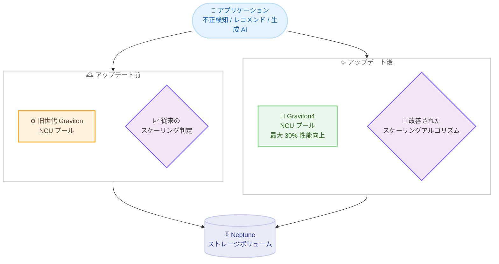

# Amazon Neptune - Neptune Serverless の最大 30% パフォーマンス向上とスマートなスケーリング

**リリース日**: 2026 年 11 月 20 日
**サービス**: Amazon Neptune
**機能**: Neptune Serverless の AWS Graviton4 ベースへの刷新による性能向上とスケーリングアルゴリズムの改善

📊 [このアップデートのインフォグラフィックを見る](https://takech9203.github.io/aws-news-summary/20261120-aws-neptune-serverless-r8g-generally-available.html)

## 概要

Amazon Neptune Serverless が AWS Graviton4 プロセッサベースのプラットフォームに移行し、Neptune Capacity Unit (NCU) あたりの価格は据え置きのまま、最大 30% のパフォーマンス向上を実現しました。Neptune Serverless はワークロードの需要に応じてデータベース容量を自動的に調整するサーバーレス構成であり、今回のアップデートにより同じコストでより高いクエリ性能が得られます。

あわせて、Graviton4 プラットフォームには改善されたスケーリングアルゴリズムが導入され、NCU の割り当てがワークロードの需要により精密に追従するようになりました。リアルタイム不正検知、レコメンデーションエンジン、生成 AI アプリケーションなど、多数のグラフクエリを同時に実行するアプリケーションで特に効果を発揮します。

新規に作成される Neptune Serverless インスタンスはすべて Graviton4 上で実行されます。既存のクラスターは、次回のリリースで最新バージョンにアップグレードすることで新しいプラットフォームを利用できます。

**アップデート前の課題**

- 以前の Neptune Serverless は旧世代の Graviton プロセッサ上で動作しており、NCU あたりの処理性能に上限があった
- スケーリングアルゴリズムの精度に限界があり、同時実行クエリが多いワークロードでは容量の割り当てが需要に対して過剰または不足になる場合があった
- 性能を引き上げるには最大容量 (MaxCapacity) を増やす必要があり、その分コストが増加していた

**アップデート後の改善**

- Graviton4 への移行により、同じ NCU あたり価格で最大 30% 高いパフォーマンスを利用可能になった
- 改善されたスケーリングアルゴリズムにより、NCU がワークロード需要により正確に追従し、無駄な容量割り当てが減少した
- 新規インスタンスは自動的に Graviton4 上で起動するため、利用者側の追加設定が不要になった

## アーキテクチャ図



Neptune Serverless のコンピューティング層が Graviton4 ベースの NCU プールに刷新され、スケーリング判定も改善されました。ストレージ層は従来どおりコンピューティングとは独立しており、サーバーレススケーリングの影響を受けません。

## サービスアップデートの詳細

### 主要機能

1. **AWS Graviton4 プロセッサへの移行**
   - Neptune Serverless の基盤が AWS Graviton4 プロセッサに刷新された
   - NCU あたりの価格は変わらず、最大 30% 高いパフォーマンスを実現
   - 新規作成される Neptune Serverless インスタンスはすべて Graviton4 上で実行される

2. **改善されたスケーリングアルゴリズム**
   - Graviton4 プラットフォームには更新されたスケーリングアルゴリズムが含まれる
   - NCU の割り当てをワークロード需要に対してより精密に調整する
   - 多数のグラフクエリを同時実行するアプリケーションで特に効果が大きい

3. **既存クラスターのアップグレードパス**
   - 既存の Neptune Serverless クラスターは、次回リリースで最新バージョンにアップグレードすることで Graviton4 を利用できる
   - 利用者側でインスタンスクラスの変更などの作業は不要

## 技術仕様

### Neptune Serverless の基本仕様

| 項目 | 詳細 |
|------|------|
| 容量の単位 | Neptune Capacity Unit (NCU) |
| スケーリング粒度 | 最小 0.5 NCU 単位で容量を追加・削除 |
| 最大容量 | MaxCapacity 128 NCU (メモリ 256 GB 相当) |
| スケーリング対象 | コンピューティング容量のみ (ストレージは独立) |
| 必要エンジンバージョン | 1.2.0.1 以降 (Neptune Serverless 自体の要件) |
| 制約 | ルックアップキャッシュは Serverless インスタンスでは利用不可 |

### プラットフォーム変更点

| 項目 | アップデート前 | アップデート後 |
|------|----------------|----------------|
| プロセッサ | 旧世代 AWS Graviton | AWS Graviton4 |
| NCU あたり性能 | 基準 | 最大 30% 向上 |
| NCU あたり価格 | 基準 | 据え置き |
| スケーリングアルゴリズム | 従来方式 | 需要追従精度を改善 |
| 適用方法 (新規) | - | 自動的に Graviton4 で起動 |
| 適用方法 (既存) | - | 次回リリースで最新バージョンへアップグレード |

## 設定方法

### 前提条件

1. AWS アカウントと Amazon Neptune へのアクセス権限があること
2. Neptune Serverless がサポートされるリージョンを利用すること
3. Neptune エンジンバージョン 1.2.0.1 以降を利用すること

### 手順

#### ステップ 1: Neptune Serverless クラスターの新規作成

```bash
aws neptune create-db-cluster \
    --db-cluster-identifier my-serverless-cluster \
    --engine neptune \
    --serverless-v2-scaling-configuration MinCapacity=1.0,MaxCapacity=16.0 \
    --region ap-northeast-1
```

Neptune Serverless クラスターを作成し、最小 1.0 NCU、最大 16.0 NCU のスケーリング範囲を設定しています。新規作成されるインスタンスは自動的に Graviton4 ベースのプラットフォームで起動します。

#### ステップ 2: サーバーレスインスタンスの追加

```bash
aws neptune create-db-instance \
    --db-instance-identifier my-serverless-instance \
    --db-cluster-identifier my-serverless-cluster \
    --db-instance-class db.serverless \
    --engine neptune
```

インスタンスクラスに `db.serverless` を指定してサーバーレスインスタンスをクラスターに追加しています。容量はステップ 1 で設定したスケーリング範囲内で自動調整されます。

#### ステップ 3: 既存クラスターのアップグレード確認

```bash
aws neptune describe-db-clusters \
    --db-cluster-identifier my-existing-cluster \
    --query "DBClusters[0].EngineVersion"
```

既存クラスターの現在のエンジンバージョンを確認しています。既存の Neptune Serverless クラスターで Graviton4 の恩恵を受けるには、次回リリースで最新バージョンへのアップグレードが必要です。

## メリット

### ビジネス面

- **コスト効率の向上**: NCU あたり価格が据え置きのまま最大 30% の性能向上が得られるため、同じ処理量をより少ない容量でまかなえる可能性がある
- **運用負荷の軽減**: 新規インスタンスは自動的に Graviton4 で起動するため、移行作業や追加設定が不要
- **容量計画の簡素化**: スケーリング精度の向上により、ピークに合わせた過剰なプロビジョニングがさらに不要になる

### 技術面

- **クエリ性能の向上**: Graviton4 により、グラフクエリの実行性能が最大 30% 向上する
- **スケーリング精度の向上**: 改善されたアルゴリズムが NCU をワークロード需要に精密に追従させ、容量の過不足を抑制する
- **高同時実行ワークロードへの適合**: 不正検知やレコメンデーションなど、多数の同時グラフクエリを処理するアプリケーションで効果が大きい

## デメリット・制約事項

### 制限事項

- 既存の Neptune Serverless クラスターが Graviton4 を利用するには、次回リリースでの最新バージョンへのアップグレードが必要
- Neptune Serverless は利用可能なリージョンが限定されている (詳細は料金ページとドキュメントを参照)
- Neptune Serverless の既存の制約 (ルックアップキャッシュ非対応、最大 128 NCU など) は引き続き適用される

### 考慮すべき点

- 性能向上は「最大 30%」であり、実際の改善幅はワークロードの特性 (クエリパターン、同時実行数など) に依存する
- 既存クラスターのアップグレード時はメンテナンスウィンドウや影響範囲を事前に計画することが推奨される
- スケーリングアルゴリズムの改善により容量の推移が従来と変わる可能性があるため、アップグレード後は CloudWatch メトリクス (ServerlessDatabaseCapacity など) の監視が推奨される

## ユースケース

### ユースケース 1: リアルタイム不正検知

**シナリオ**: 決済トランザクションをグラフとしてモデル化し、取引発生のたびに関連エンティティを探索して不正パターンを検出する。トラフィックは時間帯やキャンペーンによって大きく変動する。

**実装例**:
```
Neptune Serverless クラスター (MinCapacity=2.0, MaxCapacity=64.0)
決済イベント → Lambda → Gremlin / openCypher クエリで近傍探索 → スコアリング
```

**効果**: Graviton4 によるクエリ性能向上で検知レイテンシーが短縮され、改善されたスケーリングがトランザクション急増時にも容量を精密に追従させる。

### ユースケース 2: レコメンデーションエンジン

**シナリオ**: ユーザー、商品、行動履歴のグラフから「この商品を見た人はこれも見ている」といった推薦を生成する。セール期間中は同時クエリ数が平常時の数倍になる。

**実装例**:
```
Neptune Serverless クラスター (MinCapacity=1.0, MaxCapacity=32.0)
アプリケーション → 多数の同時グラフトラバーサル → 推薦候補の取得
```

**効果**: 多数の同時グラフクエリに対して NCU が需要どおりにスケールし、ピーク時も安定した応答時間を維持しながら閑散期のコストを抑制できる。

### ユースケース 3: 生成 AI アプリケーションのナレッジグラフ

**シナリオ**: RAG 構成のナレッジグラフとして Neptune を利用し、LLM からの問い合わせに応じてエンティティ間の関係を探索する。利用量はユーザーの質問頻度に依存し予測が難しい。

**実装例**:
```
Neptune Serverless クラスター (MinCapacity=1.0, MaxCapacity=16.0)
LLM アプリケーション → グラフ探索クエリ → コンテキストとして LLM に供給
```

**効果**: 予測困難なワークロードでも自動スケーリングで対応でき、NCU あたり性能の向上によりグラフ探索ステップの応答が高速化される。

## 料金

Neptune Serverless は、実際に使用した容量 (NCU 時間) に対してのみ課金される従量課金モデルです。今回のアップデートで NCU あたりの価格は変更されず、同じ価格で最大 30% 高いパフォーマンスが得られるため、実質的なプライスパフォーマンスが向上します。

ストレージと I/O は従来どおりコンピューティングとは別に課金されます。最新の単価は [Amazon Neptune 料金ページ](https://aws.amazon.com/neptune/pricing/) を参照してください。

## 利用可能リージョン

リージョンごとの提供状況は [Amazon Neptune 料金ページ](https://aws.amazon.com/neptune/pricing/) で確認できます。なお、Neptune Serverless 自体は以下のリージョンで利用可能です (ドキュメント記載時点)。

- 米国東部 (バージニア北部、オハイオ)、米国西部 (北カリフォルニア、オレゴン)
- カナダ (中部)
- 欧州 (ストックホルム、スペイン、アイルランド、ロンドン、パリ、フランクフルト、チューリッヒ)
- アジアパシフィック (東京、ソウル、シンガポール、シドニー、ジャカルタ、香港、ムンバイ、ハイデラバード)
- 南米 (サンパウロ)

## 関連サービス・機能

- **Amazon Aurora Serverless v2**: 同様の NCU / ACU ベースの自動スケーリングを提供するリレーショナルデータベース。サーバーレス容量管理の考え方が共通している
- **AWS Graviton4**: AWS 設計の最新世代 Arm ベースプロセッサ。多くの AWS マネージドサービスでプライスパフォーマンス向上の基盤となっている
- **Amazon CloudWatch**: ServerlessDatabaseCapacity などのメトリクスで Neptune Serverless の容量推移を監視できる
- **Amazon Neptune Analytics**: 大規模グラフの分析に特化した Neptune ファミリーのサービス。トランザクショナルな用途は Neptune Database / Serverless が担う

## 参考リンク

- 📊 [インフォグラフィック](https://takech9203.github.io/aws-news-summary/20261120-aws-neptune-serverless-r8g-generally-available.html)
- [公式発表 (What's New)](https://aws.amazon.com/about-aws/whats-new/2026/11/aws-neptune-serverless-r8g-generally-available)
- [ドキュメント: Amazon Neptune Serverless](https://docs.aws.amazon.com/neptune/latest/userguide/neptune-serverless.html)
- [料金ページ: Amazon Neptune](https://aws.amazon.com/neptune/pricing/)

## まとめ

Neptune Serverless の Graviton4 移行により、追加コストなしで最大 30% の性能向上と、より精密な自動スケーリングが利用可能になりました。新規クラスターは自動的に恩恵を受けられるため、グラフデータベースの新規導入では Serverless 構成が従来以上に有力な選択肢になります。既存の Neptune Serverless 利用者は、次回リリースでの最新バージョンへのアップグレードを計画することを推奨します。
