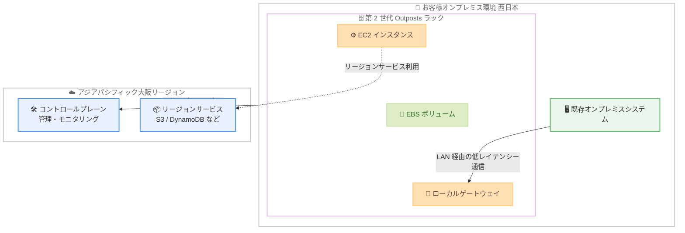

# AWS Outposts - 第 2 世代 Outposts ラックがアジアパシフィック (大阪) リージョンをサポート

**リリース日**: 2026 年 11 月 20 日
**サービス**: AWS Outposts
**機能**: 第 2 世代 AWS Outposts ラックのアジアパシフィック (大阪) リージョン対応

📊 [このアップデートのインフォグラフィックを見る](https://takech9203.github.io/aws-news-summary/20261120-aws-outposts-racks-osaka.html)

## 概要

第 2 世代の AWS Outposts ラックが、新たにアジアパシフィック (大阪) リージョンへの接続をサポートしました。AWS Outposts は、AWS のインフラストラクチャ、サービス、API、ツールをお客様のオンプレミス環境に拡張するフルマネージドなハイブリッドクラウドソリューションです。お客様のデータセンターやコロケーションスペースに AWS のラックを設置し、クラウドと一貫性のある運用体験をオンプレミスで実現できます。

今回のアップデートにより、スタートアップから大企業、公共部門まで、あらゆるお客様が大阪リージョンを親リージョンとして第 2 世代 Outposts ラックを注文できるようになりました。Outposts は親リージョンとの接続 (サービスリンク) を通じて管理されるため、親リージョンの選択肢が増えることは、レイテンシーの最適化とデータレジデンシー要件への対応の両面で重要な意味を持ちます。

特に日本のお客様にとっては、東京リージョンに加えて大阪リージョンを親リージョンとして選択できるようになったことで、西日本に拠点を持つ企業のレイテンシー最適化や、国内でのマルチリージョン構成を前提とした事業継続計画 (BCP) の設計自由度が大きく向上します。

**アップデート前の課題**

第 2 世代 Outposts ラックの導入を検討する日本のお客様には、以下の制約がありました。

- 日本国内では、第 2 世代 Outposts ラックの親リージョンとして東京リージョンなど限られた選択肢しかなかった
- 西日本のデータセンターに Outposts を設置する場合でも、コントロールプレーン通信が遠方のリージョンを経由するため、サービスリンクのレイテンシーが大きくなる可能性があった
- 大阪リージョンを中心にワークロードを構築しているお客様は、Outposts と既存環境の親リージョンを揃えることができなかった

**アップデート後の改善**

今回のアップデートにより、以下が可能になりました。

- 大阪リージョンを親リージョンとして第 2 世代 Outposts ラックを注文・運用できるようになった
- 西日本に設置する Outposts ラックで、より近い大阪リージョンとの接続によりサービスリンクのレイテンシーを最適化できるようになった
- 大阪リージョン上の既存ワークロードと Outposts 上のオンプレミスワークロードを、同一の親リージョン配下で一貫して管理できるようになった
- 東京リージョン接続の Outposts と組み合わせた、国内完結型のハイブリッド DR 構成の設計自由度が向上した

## アーキテクチャ図



お客様拠点に設置した第 2 世代 Outposts ラックが、サービスリンクを通じて大阪リージョンに接続される構成です。コントロールプレーンは大阪リージョンが担い、コンピューティングとストレージはオンプレミスで低レイテンシーに動作します。

## サービスアップデートの詳細

### 主要機能

1. **大阪リージョンを親リージョンとして選択可能**
   - 第 2 世代 Outposts ラックの注文時に、アジアパシフィック (大阪) リージョンを親リージョンとして指定できる
   - Outposts の管理、モニタリング、ソフトウェア更新は大阪リージョン経由で行われる
   - スタートアップ、エンタープライズ、公共部門など、あらゆるお客様が利用可能

2. **レイテンシーの最適化**
   - 西日本の設置拠点から地理的に近い大阪リージョンへ接続することで、サービスリンクの往復レイテンシーを抑制できる
   - Outposts 上のワークロードが大阪リージョンのサービス (S3、DynamoDB など) を利用する際の通信経路も短縮される

3. **データレジデンシー要件への対応**
   - データ処理はオンプレミスの Outposts ラック上で完結させつつ、管理機能のみ国内の大阪リージョンを利用する構成が可能
   - 金融、医療、公共分野など、データの国内保管・拠点内保管が求められるワークロードに適合

4. **第 2 世代 Outposts ラックの特長**
   - 第 1 世代と比較して性能とスケーラビリティが向上した最新のオンプレミス向けラック
   - 詳細な仕様は AWS Blog の第 2 世代 Outposts ラック発表記事およびユーザーガイドを参照

## 技術仕様

### 今回のアップデートの構成要素

| 項目 | 詳細 |
|------|------|
| 対象製品 | 第 2 世代 AWS Outposts ラック |
| 追加された親リージョン | アジアパシフィック (大阪) / ap-northeast-3 |
| 接続方式 | サービスリンク (パブリックインターネットまたは AWS Direct Connect 経由) |
| 管理方法 | AWS マネジメントコンソール、AWS CLI、API (リージョンのコントロールプレーン経由) |
| 対応済みの国・リージョン一覧 | [AWS Outposts ラックの FAQ](https://aws.amazon.com/outposts/rack/faqs/) を参照 |

## 設定方法

### 前提条件

1. Outposts ラックの設置要件 (電源、ネットワーク、スペースなど) を満たすオンプレミス施設があること
2. 大阪リージョンへのネットワーク接続 (インターネットまたは Direct Connect) を用意できること
3. AWS アカウントと Outposts の発注に必要な契約手続きが完了していること

### 手順

#### ステップ1: サイト要件の確認とサイト作成

```bash
aws outposts create-site \
  --name "osaka-dc-site" \
  --notes "西日本データセンター" \
  --region ap-northeast-3
```

Outposts ラックを設置するサイト (物理拠点) を大阪リージョンに登録します。設置要件の確認は AWS とのサイトアセスメントを通じて行います。

#### ステップ2: Outposts の注文

AWS マネジメントコンソールの Outposts 画面から、親リージョンとして「アジアパシフィック (大阪)」を選択し、第 2 世代 Outposts ラックの構成 (EC2 キャパシティ、EBS ストレージなど) を指定して注文します。

#### ステップ3: 設置後の利用開始

```bash
aws outposts list-outposts --region ap-northeast-3
```

AWS による設置・開通後、大阪リージョンのコントロールプレーンから Outposts を確認できます。以降は Outposts 上にサブネットを作成し、通常の VPC リソースと同様に EC2 インスタンスなどを起動できます。

## メリット

### ビジネス面

- **日本国内での選択肢拡大**: 東京に加えて大阪を親リージョンにできることで、国内のハイブリッドクラウド戦略の自由度が向上する
- **データレジデンシー対応**: データをオンプレミスに保持しながら、管理トラフィックも国内リージョンで完結させる構成が取りやすくなる
- **BCP / DR の強化**: 東京・大阪の 2 リージョンと Outposts を組み合わせた国内完結型の災害対策アーキテクチャを設計できる

### 技術面

- **サービスリンクのレイテンシー最適化**: 西日本の設置拠点から地理的に近いリージョンへ接続できる
- **一貫した運用体験**: クラウドと同じ API、ツール、サービスをオンプレミスで利用でき、運用を統一できる
- **既存の大阪リージョン資産との統合**: 大阪リージョン上の VPC やサービスと Outposts 上のワークロードを密に連携できる

## デメリット・制約事項

### 制限事項

- Outposts ラックの設置には、電源、冷却、ネットワークなどの施設要件を満たす必要がある
- Outposts 上で利用できるサービスはリージョンの全サービスではなく、Outposts 対応サービスに限られる
- サービスリンクの接続が長時間切断された場合、一部の管理操作が制限される

### 考慮すべき点

- 親リージョンは注文時に決定するため、既存の第 2 世代 Outposts ラックの親リージョンを後から大阪に変更することはできない点に注意が必要 (新規注文時の選択肢として利用する)
- 大阪リージョンで提供されているサービスは東京リージョンと差異がある場合があるため、連携するリージョンサービスの対応状況を事前に確認することを推奨
- 料金はラック構成 (EC2 キャパシティ、ストレージ、契約期間) によって異なるため、事前の見積もりが必要

## ユースケース

### ユースケース1: 西日本の製造業におけるローカルデータ処理

**シナリオ**: 関西圏の工場で生成される大量のセンサーデータを、低レイテンシーでオンプレミス処理しつつ、集計結果のみ大阪リージョンに送信したい。

**実装例**:
```
工場内 Outposts ラック (EC2 + EBS) でリアルタイム処理
→ ローカルゲートウェイ経由で工場内システムと連携
→ 集計データのみ大阪リージョンの S3 へ転送
```

**効果**: 製造ラインとの通信をミリ秒単位に抑えながら、クラウドの分析基盤と統合できる。

### ユースケース2: 金融機関のデータレジデンシー対応

**シナリオ**: 顧客データを自社データセンター内に保持する必要がある金融機関が、クラウドと同じ運用モデルでアプリケーションを近代化したい。

**実装例**:
```
自社データセンターの Outposts 上にアプリケーションと DB を配置
→ 管理・モニタリングは大阪リージョンのコントロールプレーンを利用
→ 監査ログは国内リージョンに集約
```

**効果**: データの拠点内保管要件を満たしつつ、AWS の API とツールによる統一運用を実現できる。

### ユースケース3: 東京・大阪を組み合わせた国内 DR 構成

**シナリオ**: 東京リージョン接続の Outposts を利用中の企業が、西日本拠点にも Outposts を設置し、国内完結のディザスタリカバリ体制を構築したい。

**実装例**:
```
東日本拠点: 東京リージョン接続の Outposts (プライマリ)
西日本拠点: 大阪リージョン接続の第 2 世代 Outposts (セカンダリ)
→ リージョン間レプリケーションとオンプレミス間のデータ同期を併用
```

**効果**: 広域災害時にもオンプレミス要件を維持したままサービス継続が可能になる。

## 料金

今回の発表に料金に関する記載はありません。AWS Outposts ラックの料金は、選択する構成 (EC2 キャパシティ、EBS ストレージ) と契約期間 (3 年間の All Upfront、Partial Upfront、No Upfront など) によって決まります。詳細は [AWS Outposts ラックの料金ページ](https://aws.amazon.com/outposts/rack/pricing/) を参照してください。

## 利用可能リージョン

第 2 世代 AWS Outposts ラックが、新たにアジアパシフィック (大阪) リージョンを親リージョンとしてサポートしました。サポートされている国・地域および AWS リージョンの最新リストは [AWS Outposts ラックの FAQ](https://aws.amazon.com/outposts/rack/faqs/) を参照してください。

## 関連サービス・機能

- **AWS Outposts サーバー**: ラックよりも小規模な拠点向けの 1U / 2U フォームファクターのオンプレミスオプション
- **AWS Direct Connect**: サービスリンクの専用線接続により、安定した低レイテンシー通信を実現
- **AWS Local Zones**: 自社施設への設置が不要な、都市部向けの低レイテンシーインフラストラクチャの選択肢
- **Amazon EC2 / Amazon EBS**: Outposts 上でオンプレミスのまま利用できる主要なコンピューティング・ストレージサービス

## 参考リンク

- 📊 [インフォグラフィック](https://takech9203.github.io/aws-news-summary/20261120-aws-outposts-racks-osaka.html)
- [公式発表 (What's New)](https://aws.amazon.com/about-aws/whats-new/2026/11/aws-outposts-racks-osaka/)
- [AWS Blog: Announcing second-generation AWS Outposts racks with breakthrough performance and scalability on-premises](https://aws.amazon.com/blogs/aws/announcing-second-generation-aws-outposts-racks-with-breakthrough-performance-and-scalability-on-premises/)
- [AWS Outposts ユーザーガイド](https://docs.aws.amazon.com/outposts/latest/userguide/what-is-outposts.html)
- [AWS Outposts ラックの FAQ](https://aws.amazon.com/outposts/rack/faqs/)
- [料金ページ](https://aws.amazon.com/outposts/rack/pricing/)

## まとめ

第 2 世代 AWS Outposts ラックが大阪リージョンを親リージョンとしてサポートしたことで、日本のお客様は東京・大阪の両リージョンを活用した柔軟なハイブリッドクラウド構成を設計できるようになりました。特に西日本に拠点を持つ企業や、データレジデンシーと国内 DR の両立が求められるお客様は、新規の Outposts 導入時に大阪リージョン接続を検討することを推奨します。
