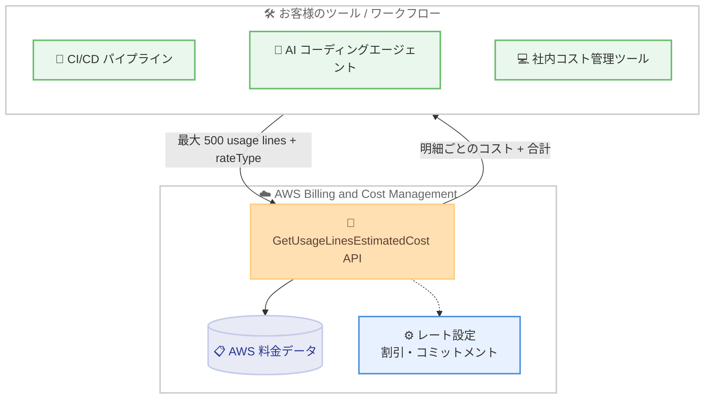

# AWS Pricing Calculator - ワークロードコストを見積もる新 API GetUsageLinesEstimatedCost

**リリース日**: 2026 年 11 月 20 日
**サービス**: AWS Pricing Calculator (AWS Billing and Cost Management)
**機能**: GetUsageLinesEstimatedCost API によるワークロードコストのプログラマティックな見積もり

📊 [このアップデートのインフォグラフィックを見る](https://takech9203.github.io/aws-news-summary/20261120-aws-pricing-calculator-api.html)

## 概要

AWS Pricing Calculator に新しい API「GetUsageLinesEstimatedCost」が追加されました。この API は、計画中のワークロードの見積もりコストを 1 回の API 呼び出しで返します。1 リクエストあたり最大 500 件の使用量明細 (usage lines) を受け付け、見積もりをアカウントに保存することなく、即座にコストを返します。

AWS Pricing Calculator の保存型ワークロード見積もりとは異なり、この API はオンデマンドでコスト算出結果を返すため、お客様自身のツールやワークフローに直接組み込むことができます。レート種別は、パブリックオンデマンド料金、割引適用後の料金、割引と Savings Plans / リザーブドインスタンスのコミットメント適用後の料金の 3 種類から選択でき、明細ごとのコストと合計金額が返されます。

デプロイ前に設計のコストを確認したり、AI コーディングエージェントが設計段階でワークロードの価格を算出したりといった用途に適しており、コスト管理の自動化を進める FinOps チームや開発者に価値のあるアップデートです。

**アップデート前の課題**

このアップデート以前には、以下の課題がありました。

- コスト見積もりを自動化するには、Pricing Calculator でワークロード見積もりを作成・保存する複数ステップの API 操作 (CreateWorkloadEstimate、BatchCreateWorkloadEstimateUsage など) が必要だった
- 一時的な試算のためにも見積もりリソースがアカウントに保存され、後片付けや管理が必要だった
- CI/CD パイプラインや AI エージェントなどから、軽量かつ即時にコストを確認する手段がなかった

**アップデート後の改善**

今回のアップデートにより、以下が可能になりました。

- 1 回の API 呼び出しで最大 500 件の使用量明細のコストを即座に取得できるようになった
- 見積もりをアカウントに保存する必要がなくなり、ステートレスにコスト試算を実行できるようになった
- パブリック料金だけでなく、自社の割引後料金や Savings Plans / リザーブドインスタンス適用後の料金でも試算できるようになった

## アーキテクチャ図



お客様のツールから使用量明細とレート種別を送信すると、API が AWS 料金データとアカウントのレート設定に基づいて即座にコストを算出して返します。見積もりはアカウントに保存されません。

## サービスアップデートの詳細

### 主要機能

1. **単一 API 呼び出しによる即時コスト見積もり**
   - 新 API `GetUsageLinesEstimatedCost` が AWS Billing and Cost Management Pricing Calculator (`bcm-pricing-calculator`) に追加
   - 1 リクエストで最大 500 件の使用量明細を一括して試算可能
   - 見積もり結果はアカウントに保存されず、ステートレスに利用できる

2. **3 種類のレート種別**
   - `BEFORE_DISCOUNTS`: パブリックオンデマンド料金で試算
   - `AFTER_DISCOUNTS`: お客様固有の割引適用後の料金で試算
   - `AFTER_DISCOUNTS_AND_COMMITMENTS`: 割引に加えて Savings Plans とリザーブドインスタンスを考慮した料金で試算
   - 利用できるレート種別は Pricing Calculator のレート設定 (rate preferences) で許可されているものに限られる

3. **明細ごとの結果とエラーの分離**
   - レスポンスには価格算出に成功した各明細のコスト (`lineItems`) と合計 (`totalCost`) が含まれる
   - 価格算出できなかった明細は `errors` に理由 (エラーコードとメッセージ) 付きで返されるため、部分的な失敗をハンドリングしやすい
   - リクエスト時に明細ごとに付与する `key` により、リクエストとレスポンスの明細を突合できる

## 技術仕様

### GetUsageLinesEstimatedCost API

| 項目 | 詳細 |
|------|------|
| API 名 | `GetUsageLinesEstimatedCost` (サービス: `bcm-pricing-calculator`) |
| 使用量明細の上限 | 1 リクエストあたり 1〜500 件 |
| 明細の必須フィールド | `serviceCode` (例: `AmazonEC2`)、`usageType` (例: `BoxUsage:t3.micro`)、`operation` (例: `RunInstances`)、`key` (最大 10 文字の英数字)、`amount` (0 以上の数値) |
| レート種別 | `BEFORE_DISCOUNTS` / `AFTER_DISCOUNTS` / `AFTER_DISCOUNTS_AND_COMMITMENTS` |
| レスポンス | `rateType`、`totalCost`、`currency` (USD)、`lineItems` (明細ごとのコスト)、`errors` (価格算出できなかった明細) |
| 見積もりの性質 | AWS 料金データに基づく見積もり。税金は含まれず、実際の請求額は実使用量に依存 |
| 制約 | 請求転送 (billing transfer) を請求ソースアカウントとして使用している場合は `BEFORE_DISCOUNTS` のみ利用可能 |

### API 変更履歴

| 日付 | サービス | 変更内容 |
|------|----------|----------|
| 2026/11/19 | [bcm-pricing-calculator](https://awsapichanges.com/archive/changes/b8bc94-bcm-pricing-calculator.html) | 1 new api methods - 使用量明細のコスト見積もりを行う `GetUsageLinesEstimatedCost` API を追加 |

### レスポンス例の構造

```json
{
  "rateType": "AFTER_DISCOUNTS_AND_COMMITMENTS",
  "totalCost": 123.0,
  "currency": "USD",
  "lineItems": [
    {
      "key": "ec2line1",
      "serviceCode": "AmazonEC2",
      "usageType": "BoxUsage:t3.micro",
      "operation": "RunInstances",
      "estimatedCost": {
        "usageAmount": 730.0,
        "usageUnit": "Hrs",
        "cost": 7.59,
        "currency": "USD"
      }
    }
  ],
  "errors": [
    {
      "key": "badline1",
      "serviceCode": "AmazonEC2",
      "usageType": "InvalidUsageType",
      "operation": "RunInstances",
      "errorCode": "NOT_FOUND",
      "errorMessage": "..."
    }
  ]
}
```

## 設定方法

### 前提条件

1. AWS CLI または AWS SDK の最新バージョンがインストールされていること
2. `bcm-pricing-calculator` の `GetUsageLinesEstimatedCost` アクションを許可する IAM 権限があること
3. 割引後レートを利用する場合は、Pricing Calculator のレート設定で該当レート種別が許可されていること

### 手順

#### ステップ 1: 使用量明細を定義して API を呼び出す

```bash
aws bcm-pricing-calculator get-usage-lines-estimated-cost \
  --rate-type BEFORE_DISCOUNTS \
  --usage '[
    {
      "serviceCode": "AmazonEC2",
      "usageType": "BoxUsage:t3.micro",
      "operation": "RunInstances",
      "key": "line1",
      "amount": 730
    },
    {
      "serviceCode": "AmazonS3",
      "usageType": "TimedStorage-ByteHrs",
      "operation": "StandardStorage",
      "key": "line2",
      "amount": 100
    }
  ]'
```

EC2 の t3.micro インスタンス 730 時間分と S3 標準ストレージ 100 GB-Mo 分の使用量明細を、パブリックオンデマンド料金で試算しています。各明細には突合用の一意な `key` を付与します。

#### ステップ 2: 割引・コミットメント適用後の料金で試算する

```bash
aws bcm-pricing-calculator get-usage-lines-estimated-cost \
  --rate-type AFTER_DISCOUNTS_AND_COMMITMENTS \
  --usage file://usage-lines.json
```

レート種別を `AFTER_DISCOUNTS_AND_COMMITMENTS` に変更し、自社の割引と Savings Plans / リザーブドインスタンスを考慮した料金で同じ使用量明細を試算しています。使用量明細は JSON ファイルから読み込んでいます。

#### ステップ 3: レスポンスを検証する

```bash
aws bcm-pricing-calculator get-usage-lines-estimated-cost \
  --rate-type BEFORE_DISCOUNTS \
  --usage file://usage-lines.json \
  --query '{total: totalCost, failed: length(errors)}'
```

JMESPath クエリで合計コストと価格算出に失敗した明細数を抽出しています。`errors` に明細が含まれる場合は、`errorCode` と `errorMessage` を確認して `serviceCode` / `usageType` / `operation` の組み合わせを修正します。

## メリット

### ビジネス面

- **デプロイ前のコスト可視化**: 設計段階でワークロードのコストを確認でき、予算超過のリスクを事前に低減できる
- **実効レートでの試算**: 自社の割引やコミットメントを反映した現実的なコスト見積もりが可能で、意思決定の精度が向上する
- **追加料金なし**: API の利用に追加料金は発生しない

### 技術面

- **ステートレスな試算**: 見積もりリソースの作成・保存・削除が不要で、CI/CD パイプラインや自動化ツールに組み込みやすい
- **AI エージェントとの親和性**: AI コーディングエージェントが設計中にワークロードの価格を算出するといった、エージェント型ワークフローに適している
- **堅牢なエラーハンドリング**: 価格算出できた明細とできなかった明細がレスポンス内で分離されるため、部分的な失敗にも対応しやすい

## デメリット・制約事項

### 制限事項

- 1 リクエストあたりの使用量明細は最大 500 件
- 利用できるレート種別は Pricing Calculator のレート設定で許可されているものに限られる
- 請求転送を請求ソースアカウントとして使用している場合は `BEFORE_DISCOUNTS` のみ利用可能
- 通貨は USD のみ
- AWS GovCloud (US) リージョンと中国リージョンでは利用不可

### 考慮すべき点

- 見積もりには税金が含まれず、実際の請求額は実使用量によって変動する
- `serviceCode` / `usageType` / `operation` の正確な組み合わせを把握する必要があり、AWS Price List API や Cost and Usage Report の明細を参照して特定するのが現実的
- 保存型のワークロード見積もり (共有やレビューが必要なケース) には、従来の Pricing Calculator のワークロード見積もり機能が引き続き適している

## ユースケース

### ユースケース 1: CI/CD パイプラインでのデプロイ前コストチェック

**シナリオ**: IaC テンプレートの変更をデプロイする前に、新しい構成の月額コストを自動で試算し、しきい値を超える場合はレビューを必須にしたい。

**実装例**:
```bash
TOTAL=$(aws bcm-pricing-calculator get-usage-lines-estimated-cost \
  --rate-type AFTER_DISCOUNTS \
  --usage file://planned-usage.json \
  --query 'totalCost' --output text)

if (( $(echo "$TOTAL > 1000" | bc -l) )); then
  echo "見積もりコスト $TOTAL USD がしきい値を超えています。承認が必要です。"
  exit 1
fi
```

**効果**: コスト影響の大きい変更を本番反映前に検知でき、予期しないコスト増加を防止できる。

### ユースケース 2: AI コーディングエージェントによる設計時の価格算出

**シナリオ**: AI コーディングエージェントがアーキテクチャを提案する際に、候補となる構成ごとのコストを算出して比較提示したい。

**実装例**:
```text
エージェントのツールとして GetUsageLinesEstimatedCost を登録し、
構成案ごとに usage lines (serviceCode / usageType / operation / amount)
を生成して API を呼び出し、totalCost を比較して提示する。
```

**効果**: 設計段階でコストを考慮したアーキテクチャ選定が可能になり、コスト最適化が設計プロセスに組み込まれる。

### ユースケース 3: 社内コスト管理ツールへの組み込み

**シナリオ**: 社内のワークロード申請システムで、申請者が入力したリソース構成から概算コストを即時に表示したい。

**実装例**:
```python
import boto3

client = boto3.client("bcm-pricing-calculator")
response = client.get_usage_lines_estimated_cost(
    usage=[
        {
            "serviceCode": "AmazonEC2",
            "usageType": "BoxUsage:m5.large",
            "operation": "RunInstances",
            "key": "app1",
            "amount": 730.0,
        }
    ],
    rateType="AFTER_DISCOUNTS_AND_COMMITMENTS",
)
print(response["totalCost"], response["currency"])
```

**効果**: 見積もりリソースを保存せずにリアルタイムで概算コストを表示でき、申請フローの UX とコスト意識が向上する。

## 料金

GetUsageLinesEstimatedCost API は追加料金なしで利用できます。AWS Pricing Calculator 自体も無料で利用可能です。

## 利用可能リージョン

AWS GovCloud (US) リージョンと中国リージョンを除く、すべての AWS リージョンで一般提供されています。

## 関連サービス・機能

- **AWS Pricing Calculator (コンソール / calculator.aws)**: 保存・共有可能なワークロード見積もりを GUI で作成する機能。本 API はこれを補完するプログラマティックな手段
- **AWS Billing and Cost Management Pricing Calculator API**: `CreateWorkloadEstimate` や `GetBillEstimate` など、保存型の見積もりを操作する既存 API 群
- **AWS Price List API**: AWS サービスの公開料金データを取得する API。`usageType` や `operation` の特定に活用できる
- **AWS Cost Explorer**: デプロイ後の実際のコストの分析・可視化。本 API によるデプロイ前見積もりと組み合わせて利用

## 参考リンク

- 📊 [インフォグラフィック](https://takech9203.github.io/aws-news-summary/20261120-aws-pricing-calculator-api.html)
- [公式発表 (What's New)](https://aws.amazon.com/about-aws/whats-new/2026/11/aws-pricing-calculator-api/)
- [get-usage-lines-estimated-cost CLI リファレンス](https://docs.aws.amazon.com/cli/latest/reference/bcm-pricing-calculator/get-usage-lines-estimated-cost.html)
- [AWS Pricing Calculator](https://calculator.aws/#/)
- [API 変更履歴 (awsapichanges.com)](https://awsapichanges.com/archive/changes/b8bc94-bcm-pricing-calculator.html)

## まとめ

GetUsageLinesEstimatedCost API により、ワークロードのコスト見積もりを保存不要のステートレスな API 呼び出しとして自動化ワークフローに組み込めるようになりました。CI/CD でのデプロイ前コストチェックや AI エージェントによる設計時の価格算出など、コストを開発プロセスに組み込みたいチームは、まず `BEFORE_DISCOUNTS` レートでの試算から試し、レート設定を確認のうえ割引・コミットメント適用後レートの活用を検討することを推奨します。
