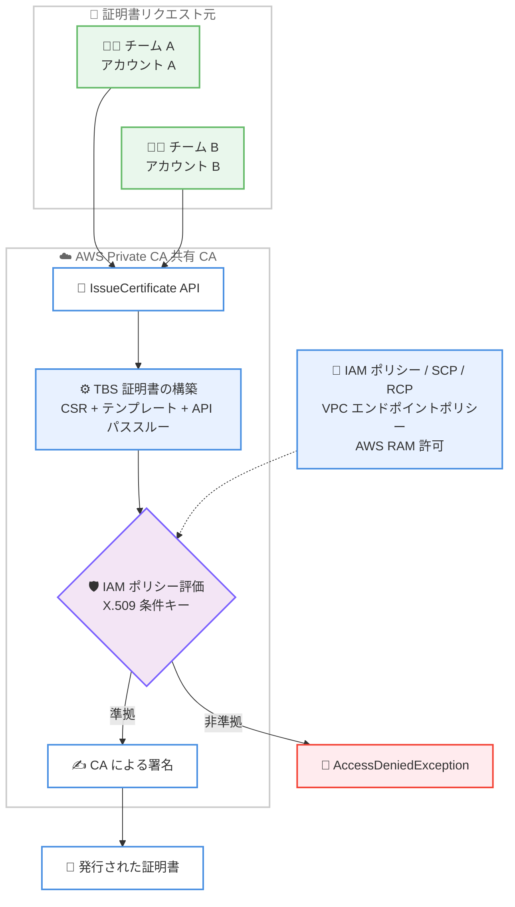

# AWS Private CA - X.509 IAM 条件キーのサポート

**リリース日**: 2026 年 11 月 20 日
**サービス**: AWS Private Certificate Authority (AWS Private CA)
**機能**: X.509 証明書の内容に基づく IAM 条件キー

📊 [このアップデートのインフォグラフィックを見る](https://takech9203.github.io/aws-news-summary/20261120-aws-private-ca-x509-iam-keys.html)

## 概要

AWS Private CA が、発行しようとしている証明書の内容を記述する IAM 条件キーをサポートしました。サブジェクト、サブジェクト代替名 (SAN)、公開鍵、署名アルゴリズム、有効期間、キー使用法 (Key Usage)、拡張キー使用法 (Extended Key Usage)、基本制約 (Basic Constraints) といった X.509 証明書の属性に基づいて、証明書リクエストを許可または拒否する IAM ポリシーを記述できます。

`IssueCertificate` API が呼び出されると、AWS Private CA は CSR、証明書テンプレート、API パススルー値、リクエストパラメータから署名前の証明書 (TBS 証明書) を構築し、その属性に対してポリシーを評価します。ポリシーに準拠しないリクエストは署名前に拒否され、`AccessDeniedException` が返されます。各条件キーの値は最終的な証明書から取得されるため、属性の入力元 (CSR、テンプレート、API パススルー) を変えてもポリシーを回避できません。

この機能により、1 つのプライベート CA を複数のチームやアカウント間で共有しながら、各チームが発行できる証明書をポリシーで細かく制御できるようになります。マルチアカウント環境で PKI を集中管理する組織や、証明書発行のガバナンスを強化したいセキュリティチームに特に有用なアップデートです。

**アップデート前の課題**

このアップデート以前は、証明書の内容に基づくアクセス制御ができませんでした。

- IAM ポリシーで制御できるのは「誰が」「どの CA に対して」「どのテンプレートで」リクエストできるかまでで、発行される証明書の中身 (ドメイン名や有効期間など) は制御できなかった
- チームごとに発行可能な証明書を分離するには、チームごとに別々の CA を運用する必要があり、CA の数だけ月額料金と運用負荷が増加した
- あるいは証明書リクエストを検証する独自の認可レイヤー (申請ワークフローやプロキシ) を構築・維持する必要があった

**アップデート後の改善**

今回のアップデートにより、証明書の内容そのものをポリシーで制御できるようになりました。

- 1 つの CA を共有しつつ、アカウントごとに発行可能な DNS 名を自身のサブドメインに限定できるようになった
- 証明書の有効期間の上限や、組織全体で必須とするキーアルゴリズム・キーサイズをポリシーで強制できるようになった
- CA 証明書 (下位 CA) の発行を PKI チームのみに限定するなど、役割に応じた発行権限の分離が可能になった
- アイデンティティベースポリシーに加えて SCP、RCP、VPC エンドポイントポリシー、AWS RAM のカスタマーマネージド許可でも利用でき、組織全体への一括適用が可能になった

## アーキテクチャ図



署名前に構築された TBS 証明書の属性に対して IAM ポリシーが評価され、非準拠のリクエストは証明書が発行される前に拒否されます。

## サービスアップデートの詳細

### 主要機能

1. **証明書内容に基づくポリシー評価**
   - `acm-pca:IssueCertificate` アクションの実行時に、発行予定の証明書 (TBS 証明書) の属性に対してポリシーを評価する
   - 条件キーは「証明書がどのように構成されたか」ではなく「最終的にどのような証明書になるか」を表すため、CSR・テンプレート・API パススルーのどこで属性を指定してもポリシーを回避できない
   - 非準拠のリクエストには `AccessDeniedException` が返され、証明書は発行されない

2. **幅広い証明書属性のカバレッジ**
   - サブジェクト: CN、C、O、OU、空サブジェクトの判定
   - SAN: DNS 名、IP アドレス、URI (SPIFFE ID など)、メールアドレス、ディレクトリ名、OtherName (OID 指定)、エントリ数、critical フラグ
   - 鍵と署名: 鍵アルゴリズム (RSA、EC、SM2、ML-DSA)、鍵サイズ、楕円曲線、CA の署名アルゴリズム
   - 有効期間: notBefore、notAfter、日数・時間単位の期間
   - 拡張領域: Key Usage、Extended Key Usage、Basic Constraints (CA フラグ、pathLen)

3. **多様なポリシータイプのサポート**
   - アイデンティティベースポリシー
   - サービスコントロールポリシー (SCP)
   - リソースコントロールポリシー (RCP)
   - VPC エンドポイントポリシー
   - AWS RAM のカスタマーマネージド許可 (クロスアカウントで CA を共有する場合の発行制御に有効)

## 技術仕様

### 主な条件キー

すべての条件キーは `acm-pca:` プレフィックスを使用し、署名前の TBS 証明書を記述します。証明書に該当しない属性のキーはリクエストコンテキストに存在しません (例: RSA 鍵の場合 `acm-pca:x509Key/curve` は存在しない)。

| カテゴリ | 条件キーの例 | 型 | 説明 |
|------|------|------|------|
| サブジェクト | `acm-pca:x509Subject/CN` | ArrayOfString | サブジェクトのコモンネーム |
| サブジェクト | `acm-pca:x509Subject/C` / `O` / `OU` | ArrayOfString | 国 (2 文字コード)、組織、組織単位 |
| サブジェクト | `acm-pca:x509Subject/empty` | Bool | サブジェクト DN が空かどうか (常に存在) |
| SAN | `acm-pca:x509SAN/DNS` | ArrayOfString | DNS 名エントリ (小文字、末尾ドットなし) |
| SAN | `acm-pca:x509SAN/IP` | ArrayOfIPAddress | IP アドレスエントリ |
| SAN | `acm-pca:x509SAN/URI` | ArrayOfString | URI エントリ (SPIFFE ワークロード ID など) |
| SAN | `acm-pca:x509SAN/count` | Numeric | SAN エントリの総数 |
| SAN | `acm-pca:x509SAN/OtherName/${OID}` | ArrayOfString | OtherName エントリ (例: Microsoft UPN は `1.3.6.1.4.1.311.20.2.3`) |
| 鍵 | `acm-pca:x509Key/algorithm` | String | 公開鍵アルゴリズム: RSA、EC、SM2、ML-DSA-44/65/87 |
| 鍵 | `acm-pca:x509Key/size` | Numeric | 鍵サイズ (ビット)。RSA はモジュラス長、EC は曲線のフィールドサイズ |
| 鍵 | `acm-pca:x509Key/curve` | String | EC / SM2 鍵の曲線名 (例: prime256v1、secp384r1) |
| 署名 | `acm-pca:x509Signature/algorithm` | String | CA の署名アルゴリズム (例: ecdsa-with-SHA384) |
| 有効期間 | `acm-pca:x509Validity/durationDays` | Numeric | 有効期間の日数 (切り捨て) |
| 有効期間 | `acm-pca:x509Validity/notBefore` / `notAfter` | Date | 有効期間の開始 / 終了 (UTC) |
| 拡張 | `acm-pca:x509Ext/KeyUsage` | ArrayOfString | RFC 5280 の名称によるキー使用法 (digitalSignature など) |
| 拡張 | `acm-pca:x509Ext/ExtendedKeyUsage` | ArrayOfString | 拡張キー使用法 (serverAuth、clientAuth、codeSigning、OID など) |
| 拡張 | `acm-pca:x509Ext/BasicConstraints/CA` | Bool | CA 証明書かどうか |
| 拡張 | `acm-pca:x509Ext/BasicConstraints/pathLen` | Numeric | CA 証明書のパス長制約 |

条件キーの完全な一覧は [ユーザーガイド](https://docs.aws.amazon.com/privateca/latest/userguide/certguard-condition-keys.html) を参照してください。

### ポリシー例: 有効期間を 90 日以内に制限

```json
{
    "Version": "2012-10-17",
    "Statement": [
        {
            "Sid": "DenyLongLivedCertificates",
            "Effect": "Deny",
            "Action": "acm-pca:IssueCertificate",
            "Resource": "*",
            "Condition": {
                "NumericGreaterThan": {
                    "acm-pca:x509Validity/durationDays": "90"
                }
            }
        }
    ]
}
```

## 設定方法

### 前提条件

1. AWS Private CA でプライベート CA が作成済みであること
2. IAM ポリシー、SCP、RCP などを編集する権限があること
3. 本番適用前に非本番アカウントでポリシーをテストできる環境があること

### 手順

#### ステップ 1: 制御したい証明書属性と条件キーを決定する

ユーザーガイドの条件キーリファレンスを確認し、組織のポリシー要件 (許可するドメイン、鍵アルゴリズム、有効期間の上限など) を条件キーにマッピングします。

#### ステップ 2: ポリシーを作成してテスト用プリンシパルにアタッチする

```bash
aws iam put-role-policy \
  --role-name CertificateIssuerRole \
  --policy-name RestrictCertificateContents \
  --policy-document file://certificate-policy.json
```

作成したポリシードキュメントをテスト用の IAM ロールにインラインポリシーとしてアタッチしています。SCP や RCP として組織全体に適用する場合は AWS Organizations で設定します。

#### ステップ 3: 準拠・非準拠のリクエストで動作を検証する

```bash
aws acm-pca issue-certificate \
  --certificate-authority-arn arn:aws:acm-pca:ap-northeast-1:123456789012:certificate-authority/example \
  --csr fileb://test.csr \
  --signing-algorithm SHA256WITHECDSA \
  --validity Value=100,Type=DAYS
```

ポリシーに違反する証明書リクエスト (この例では有効期間 100 日) を実行し、`AccessDeniedException` で拒否されることを確認しています。準拠するリクエストが正常に発行されることも併せて確認します。

#### ステップ 4: 影響範囲を確認してから本番環境へ展開する

新しい `Deny` ステートメントは、AWS サービスやコネクタがユーザーに代わって行う証明書リクエストも拒否する可能性があります。ユーザーガイドの「Before you deploy a policy」を確認し、非本番アカウントでテストしてから段階的に適用します。

## メリット

### ビジネス面

- **CA 統合によるコスト削減**: チームごとに CA を分ける必要がなくなり、CA の月額料金と運用負荷を削減できる
- **独自認可レイヤーの廃止**: 証明書発行を検証する自前の申請ワークフローやプロキシが不要になり、開発・保守コストを削減できる
- **コンプライアンスの強化**: 鍵アルゴリズムや有効期間などの組織標準を IAM ポリシーとして宣言的に強制でき、監査対応が容易になる

### 技術面

- **回避不能な制御**: 条件キーの値は最終的な証明書から取得されるため、CSR・テンプレート・API パススルーのどこで属性を指定してもポリシーを回避できない
- **多層的な適用**: アイデンティティベースポリシー、SCP、RCP、VPC エンドポイントポリシー、AWS RAM 許可と、複数のレイヤーで適用できる
- **きめ細かな制御**: DNS 名のワイルドカードマッチ、IP アドレスの CIDR 範囲、数値比較など IAM の条件演算子をフル活用できる
- **ポスト量子暗号への対応**: ML-DSA 鍵のみを許可するポリシーも記述でき、将来の暗号移行をポリシーで強制できる

## デメリット・制約事項

### 制限事項

- X.509 条件キーは `acm-pca:IssueCertificate` アクションでのみ利用可能。`acm-pca:RevokeCertificate` や `acm-pca:GetCertificate` など他のアクションのステートメントで使用すると、キーが存在しないため意図しない評価結果になる
- 証明書に該当しない属性のキーはリクエストコンテキストに存在しないため、`Null` 条件や `ForAllValues` の評価挙動を正しく理解してポリシーを設計する必要がある
- `acm-pca:x509Subject/CN` は証明書に記載されたとおりに評価され、小文字化されない (大文字小文字を区別しない比較には `StringEqualsIgnoreCase` などが必要)

### 考慮すべき点

- 新しい `Deny` ステートメントは、AWS サービスやコネクタ (AWS Certificate Manager との連携など) が代理で行う証明書リクエストも拒否する可能性がある。本番適用前に非本番アカウントでのテストが推奨される
- `Allow` ステートメントで `ForAllValues` を使う場合、対象キーの値が存在しない証明書も条件を満たすため、`Null` 条件や `acm-pca:x509SAN/count` と組み合わせて抜け道を塞ぐ設計が必要
- SAN の OtherName エントリは OID ごとに個別のキーとなるため、単一の条件ですべての OtherName タイプをカバーすることはできない

## ユースケース

### ユースケース 1: 共有 CA でアカウントごとにサブドメインを制限

**シナリオ**: 組織の PKI チームが 1 つのプライベート CA を AWS RAM で各アカウントに共有し、各アカウントは自身のサブドメインの証明書のみ発行できるようにしたい。

**実装例**:
```json
{
    "Version": "2012-10-17",
    "Statement": [
        {
            "Sid": "DenyUnapprovedDomains",
            "Effect": "Deny",
            "Action": "acm-pca:IssueCertificate",
            "Resource": "*",
            "Condition": {
                "ForAnyValue:StringNotLike": {
                    "acm-pca:x509SAN/DNS": ["team-a.example.com", "*.team-a.example.com"]
                }
            }
        }
    ]
}
```

**効果**: チームごとに CA を分けることなく、他チームのドメイン名を含む証明書の発行を防止できる。

### ユースケース 2: 組織全体で鍵強度と有効期間の標準を強制

**シナリオ**: セキュリティチームが、組織内のすべての証明書に対して RSA 2048 ビット以上または承認済み EC 曲線の使用と、90 日以内の有効期間を義務付けたい。

**実装例**:
```json
{
    "Version": "2012-10-17",
    "Statement": [
        {
            "Sid": "DenyShortRSAKeys",
            "Effect": "Deny",
            "Action": "acm-pca:IssueCertificate",
            "Resource": "*",
            "Condition": {
                "StringEquals": { "acm-pca:x509Key/algorithm": "RSA" },
                "NumericLessThan": { "acm-pca:x509Key/size": "2048" }
            }
        },
        {
            "Sid": "DenyLongLivedCertificates",
            "Effect": "Deny",
            "Action": "acm-pca:IssueCertificate",
            "Resource": "*",
            "Condition": {
                "NumericGreaterThan": { "acm-pca:x509Validity/durationDays": "90" }
            }
        }
    ]
}
```

**効果**: SCP として組織全体に適用することで、どのアカウント・どのツールから発行しても組織標準を満たさない証明書は発行されない。

### ユースケース 3: CA 証明書の発行を PKI チームに限定

**シナリオ**: 下位 CA 証明書の発行は PKI チームのみに許可し、一般の開発者ロールにはエンドエンティティ証明書のみ発行させたい。

**実装例**:
```json
{
    "Version": "2012-10-17",
    "Statement": [
        {
            "Sid": "DenyCACertificatesForEndEntityRoles",
            "Effect": "Deny",
            "Action": "acm-pca:IssueCertificate",
            "Resource": "*",
            "Condition": {
                "Bool": { "acm-pca:x509Ext/BasicConstraints/CA": "true" },
                "StringEquals": { "aws:PrincipalTag/CertificateType": "EndEntityOnly" }
            }
        }
    ]
}
```

**効果**: プリンシパルタグと組み合わせることで、アカウントごとに個別のポリシーを用意せずに役割別の発行権限を実現できる。

## 料金

この機能は追加料金なしで利用できます。AWS Private CA 自体の料金 (CA の月額料金と証明書発行料金) は通常どおり適用されます。詳細は [AWS Private CA 料金ページ](https://aws.amazon.com/private-ca/pricing/) を参照してください。

## 利用可能リージョン

AWS Private CA が利用可能なすべての AWS リージョンで利用できます (東京・大阪リージョンを含む)。

## 関連サービス・機能

- **AWS IAM**: 条件キーを利用するポリシー評価の基盤。アイデンティティベースポリシーで個別のロール・ユーザーを制御
- **AWS Organizations (SCP / RCP)**: 組織・OU 単位で証明書発行のガードレールを一括適用
- **AWS RAM**: プライベート CA のクロスアカウント共有。カスタマーマネージド許可に条件キーを組み込むことで、共有先の発行内容を制御
- **AWS Certificate Manager (ACM)**: Private CA と連携して証明書を発行・管理するサービス。Deny ポリシーが ACM 経由の発行に影響しないか事前確認が必要

## 参考リンク

- 📊 [インフォグラフィック](https://takech9203.github.io/aws-news-summary/20261120-aws-private-ca-x509-iam-keys.html)
- [公式発表 (What's New)](https://aws.amazon.com/about-aws/whats-new/2026/11/aws-private-ca-x509-iam-keys/)
- [ドキュメント: X.509 certificate condition keys](https://docs.aws.amazon.com/privateca/latest/userguide/certguard-condition-keys.html)
- [ドキュメント: Example policies](https://docs.aws.amazon.com/privateca/latest/userguide/certguard-example-policies.html)
- [AWS Private CA 製品ページ](https://aws.amazon.com/private-ca/)
- [料金ページ](https://aws.amazon.com/private-ca/pricing/)

## まとめ

AWS Private CA の X.509 IAM 条件キーにより、証明書の「中身」に対するガバナンスを IAM ポリシーだけで実現できるようになりました。チームごとの CA 分割や独自の認可レイヤーが不要になるため、マルチアカウントで PKI を運用している組織はまず非本番環境でポリシーを検証し、SCP / RCP による組織全体のガードレールとしての適用を検討することを推奨します。
