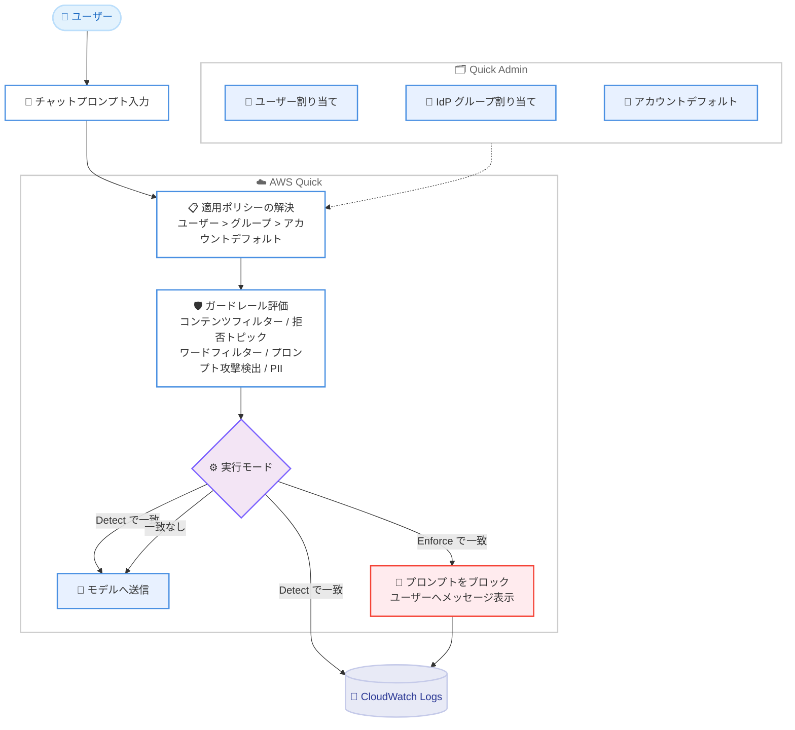

# AWS Quick - Enterprise Guardrails (プレビュー)

**リリース日**: 2026 年 11 月 20 日
**サービス**: AWS Quick
**機能**: Enterprise Guardrails (プレビュー)

📊 [このアップデートのインフォグラフィックを見る](https://takech9203.github.io/aws-news-summary/20261120-aws-quick-enterprise-guardrails-preview.html)

## 概要

AWS Quick に、管理者が設定可能なコンテンツ安全性および機密情報コントロールである Enterprise Guardrails がプレビューとして発表されました。管理者は Quick Admin コンソールでガードレールポリシーを作成し、ユーザーがチャットに入力するプロンプトをスクリーニングできます。ポリシーには、コンテンツフィルター、拒否トピック、ブロックする単語・フレーズ、プロンプト攻撃検出、個人情報 (PII) コントロールが含まれます。

作成したポリシーは、個々のユーザー、エンタープライズ IdP のグループ、またはアカウントデフォルトとして割り当てることができます。ユーザー単位のポリシーはグループポリシーとアカウントデフォルトより優先され、複数のグループポリシーが適用される場合は、コントロールが重複する箇所でより厳格な設定を使用してマージされます。

また、Detect モード (検出のみ) により、実際の本番トラフィックに対してプロンプトフィルタリングルールをブロックせずにテストできます。ポリシーの一致はログに記録されるため、管理者はワークフローへの影響を評価し、Enforce モード (強制) を有効化する前にルールを調整できます。検出・ブロックされたイベントは Amazon CloudWatch Logs で確認できます。

**アップデート前の課題**

このアップデート以前に存在していた課題や制限は以下のとおりです。

- Quick のチャットに対する管理者設定のコントロールは、Web エクスペリエンスでの「ブロックする単語・フレーズ」(最大 50 件、各 36 文字まで) に限られていた
- 有害コンテンツ、機密トピック、PII、プロンプト攻撃に対する組織横断的なポリシーを、ユーザーやグループ単位で一元的に適用する仕組みがなかった
- フィルタリングルールを本番環境に適用する前に、業務への影響を事前評価する手段がなかった

**アップデート後の改善**

今回のアップデートにより可能になったことは以下のとおりです。

- コンテンツフィルター、拒否トピック、ワードフィルター、プロンプト攻撃検出、PII コントロールを組み合わせたガードレールポリシーを作成し、ユーザー・IdP グループ・アカウント単位で割り当て可能になった
- Detect モードで本番トラフィックに対するポリシーの影響を測定してから、Enforce モードで実際のブロックを有効化できるようになった
- 検出・ブロックイベントが Amazon CloudWatch Logs に記録され、ポリシーの効果を監査・分析できるようになった

## アーキテクチャ図



ユーザーのプロンプトは、割り当てられたガードレールポリシー (ユーザー > グループ > アカウントデフォルトの優先順位) に基づいて評価されます。Detect モードでは一致をログに記録するのみでプロンプトは通過し、Enforce モードでは一致したプロンプトがブロックされます。

## サービスアップデートの詳細

### 主要機能

1. **コンテンツフィルター**
   - ヘイト、侮辱、性的、暴力、不正行為の 5 カテゴリでプロンプトをフィルタリング
   - 各カテゴリの強度を None / Low / Medium / High から設定可能
   - 未設定のカテゴリは None (無効) となる

2. **拒否トピック**
   - チャットで議論できないトピックを定義 (例: 未発表製品、競合他社の価格)
   - 各トピックには名前、任意の定義、トピック認識を助ける最大 5 件の例文を設定可能
   - 1 ポリシーあたり最大 30 トピック

3. **ワードフィルター**
   - 機密プロジェクト名やクライアント名など、プロンプト内でブロックする単語・フレーズを登録
   - 1 ポリシーあたり最大 1,000 エントリ (各 1〜50 文字)
   - CSV またはテキストファイルからのインポートに対応

4. **プロンプト攻撃検出**
   - プロンプトインジェクションやジェイルブレイクの試行を検出
   - 強度を None / Low / Medium / High から設定可能 (コンソールでは「Threat detection」配下)

5. **機密情報 (PII) コントロール**
   - 5 グループ 29 種類の PII タイプを検出し、選択したタイプのみをチェック
   - プレビューでは「ブロック」のみが利用可能なアクション

6. **Detect モードによる事前評価**
   - 本番トラフィックに対してポリシーをブロックせずに評価し、一致をログに記録
   - 影響を測定・調整した後に Enforce モードへ切り替え可能
   - 検出・ブロックイベントは Amazon CloudWatch Logs で確認可能

7. **柔軟なポリシー割り当てと解決**
   - 個々のユーザー、IdP グループ、アカウントデフォルトに割り当て可能 (ロールへの割り当ては不可)
   - ユーザー > グループ > アカウントデフォルトの順に最も具体的なレベルが適用される
   - 同一レベルで複数ポリシーが適用される場合は、コントロールごとに厳格な方を採用してマージ
   - 「Check coverage」パネルで、ユーザー・グループ・アカウントに実際に適用されるガードレールを確認可能

## 技術仕様

### ポリシーのベースライン

ポリシー作成時に 3 つのベースラインから開始し、個別のコントロールを調整します。いずれのベースラインも Enforce モードで開始し、ユーザー入力をチェックし、29 種類すべての PII タイプをブロックします (拒否トピックとワードフィルターはなし)。

| ベースライン | コンテンツフィルター / プロンプト攻撃検出の強度 |
|------|------|
| Relaxed | Medium |
| Standard (デフォルト) | High |
| Strict | High (プレビューでは Standard と同一設定) |

### 検出対象の PII タイプ (5 グループ 29 種類)

| グループ | タイプ数 | 主なエンティティタイプ |
|------|------|------|
| 金融 | 7 | クレジット / デビットカード番号、CVV、有効期限、PIN、米国銀行口座番号、IBAN、SWIFT コード |
| 個人 | 10 | 氏名、住所、地理的位置、生年月日、年齢、ユーザー名、パスワード、運転免許証番号、ナンバープレート、VIN |
| 技術 | 3 | IP アドレス、MAC アドレス、デバイス ID |
| ヘルスケア | 6 | 医療記録番号、生体情報、健康状態、投薬、医療提供者、治療 |
| 政府発行 ID | 3 | 米国社会保障番号、米国 ITIN、米国パスポート番号 |

### クォータ

以下のクォータは固定であり、Service Quotas では管理されず、引き上げリクエストもできません。

| リソース | クォータ |
|------|------|
| アカウントあたりのガードレールポリシー数 | 200 |
| ポリシー名 | 1〜100 文字 |
| ポリシー説明 | 最大 200 文字 |
| ポリシーあたりの拒否トピック数 | 30 |
| 拒否トピックあたりの例文 | 5 件 (各最大 160 文字) |
| ポリシーあたりのワードフィルターエントリ数 | 1,000 |
| インポートファイルあたりの割り当て数 | 500 |
| ダウンロードファイルあたりの割り当て数 | 10,000 |

### ポリシー解決の例

同一レベル (例: ユーザーが 2 つのグループに所属) で複数ポリシーが適用される場合の実効ガードレールの例です。

| コントロール | グループ A | グループ B | ユーザーへの実効設定 |
|------|------|------|------|
| モード | Detect | Enforce | Enforce |
| ヘイトフィルター | Low | High | High |
| プロンプト攻撃検出 | None | Medium | Medium |
| PII: 米国社会保障番号 | オフ | オン | オン |
| 拒否トピック | 未発表製品 | 競合価格 | 両方のトピック |

## 設定方法

### 前提条件

1. AWS Quick Enterprise edition を利用しており、プレビューアクセスが有効化されていること (AWS アカウントチームへの連絡が必要)
2. Quick の管理者権限を持っていること
3. グループ単位で割り当てる場合、エンタープライズ IdP のグループが Quick に連携されていること

### 手順

#### ステップ 1: ガードレールポリシーの作成

1. 管理者として Quick にサインインし、Quick Admin を開いて [Guardrails] を選択
2. [Create guardrail] を選択し、名前と説明 (任意) を入力
3. ベースライン ([Relaxed] / [Standard] / [Strict]) を選択

ポリシーの基本情報と初期設定のベースラインを定義します。

#### ステップ 2: コントロールの設定

1. [Content filters and safety] ページで各コンテンツフィルターカテゴリとプロンプト攻撃検出の強度を調整
2. 拒否トピックやワードフィルターを追加 (CSV / テキストファイルからのインポートも可能)
3. [Data protection] ページでブロックする PII タイプを選択
4. [Set coverage] ページで [User input] を選択したまま進む
5. [Review configuration] ページで実行モードを選択 (新規ポリシーのテストには [Detect] を推奨)
6. [Create guardrail] または [Create and assign] を選択

各コントロールの内容と実行モードを設定してポリシーを作成します。

#### ステップ 3: ポリシーの割り当て

1. [Guardrails] ページで対象ポリシーの [Actions] メニューから [Assign] を選択
2. [Find assignees] でユーザーまたはグループを検索し、[Add user] / [Add group] を選択
3. アカウントデフォルトにする場合は [Account] を展開して [Add account] を選択
4. [Confirm assignment changes] で変更内容を確認し、[Confirm & apply] を選択

割り当ては Quick の名前空間ごとに適用されます。CSV ファイルによる割り当てのインポート (1 ファイル最大 500 件) やダウンロード (最大 10,000 件) にも対応しており、AWS Quick API でも管理できます。

#### ステップ 4: Detect モードでの評価と Enforce への切り替え

Detect モードで運用し、Amazon CloudWatch Logs に記録されたポリシー一致を確認してワークフローへの影響を評価します。ルールを調整した後、Enforce モードへ切り替えると、一致したプロンプトはブロックされ、ユーザーにメッセージが表示されます。

## メリット

### ビジネス面

- **ガバナンスの強化**: 組織のポリシーに沿って、機密プロジェクト名や PII を含むプロンプトを組織全体で統制できる
- **段階的な導入によるリスク低減**: Detect モードで業務影響を事前評価してから強制を有効化できるため、過剰ブロックによる生産性低下を回避できる
- **部門ごとの柔軟な統制**: IdP グループ単位の割り当てにより、部門や職務に応じた異なるガードレールを適用できる

### 技術面

- **多層防御の一層として機能**: モデル自体の安全性コントロール、プロンプトレベルの安全指示、外部コンテンツマーキングなどと組み合わせた多層防御を構成できる
- **一元的なポリシー解決**: ユーザー > グループ > アカウントデフォルトの優先順位と、厳格側を採用するマージロジックにより、予測可能な実効ポリシーが得られる
- **監査可能性**: 検出・ブロックイベントが CloudWatch Logs に記録され、「Check coverage」で実効ガードレールを確認できる

## デメリット・制約事項

### 制限事項

- プレビューは Professional および Enterprise プランの一部顧客向けであり、利用には AWS アカウントチームへのアクセスリクエストが必要
- プレビューでの検査対象はユーザー入力のみで、モデルの応答、エージェントがツールと送受信するコンテンツ、添付ファイルの内容 (ファイル名と入力テキストのみチェック) は対象外
- PII に対するアクションは「ブロック」のみで、マスキングや置換は利用不可
- ロール (Author / Reader) へのポリシー割り当てはできない
- クォータは固定で、引き上げリクエストはできない

### 考慮すべき点

- プレビュー機能のため、仕様は今後変更される可能性がある
- ポリシー割り当ては名前空間ごとに適用されるため、複数の名前空間を持つアカウントでは名前空間ごとの管理が必要
- 既存の「ブロックする単語・フレーズ」(Web エクスペリエンスのチャット向け、最大 50 件) とは別の機能であり、使い分けの検討が必要

## ユースケース

### ユースケース 1: 機密プロジェクト名の漏えい防止

**シナリオ**: 未発表製品のコードネームや M&A 案件名など、社外秘情報が AI チャットのプロンプトに入力されることを防ぎたい。

**実装例**:
```
1. ワードフィルターに機密プロジェクト名を登録したポリシーを作成
2. 対象部門の IdP グループにポリシーを割り当て
3. Enforce モードで一致プロンプトをブロック
```

**効果**: 機密情報を含むプロンプトが送信前にブロックされ、情報漏えいリスクを低減できる。

### ユースケース 2: 規制業界における PII 保護

**シナリオ**: 金融・医療分野の企業が、顧客のクレジットカード番号や医療記録番号などの PII が AI チャットに入力されないよう統制したい。

**実装例**:
```
1. Standard ベースライン (29 種類の PII をすべてブロック) でポリシーを作成
2. アカウントデフォルトとして割り当て
3. 特定の分析チームには PII タイプを絞った個別ポリシーをユーザー単位で割り当て
```

**効果**: 全社的に PII 入力を防止しつつ、業務上必要なチームには例外的な設定を適用できる。

### ユースケース 3: 本番導入前の影響評価

**シナリオ**: 新しいガードレールポリシーが正当な業務プロンプトを誤ってブロックしないか、本番適用前に確認したい。

**実装例**:
```
1. ポリシーを Detect モードで作成し、対象グループに割り当て
2. CloudWatch Logs で一定期間のポリシー一致を分析
3. 誤検知が多いルールを調整した後、Enforce モードに切り替え
```

**効果**: 実トラフィックに基づいてルールを調整でき、過剰ブロックによる業務影響を最小化できる。

## 料金

今回の発表では、Enterprise Guardrails に関する追加料金は明示されていません。プレビューは Professional および Enterprise プランの一部の Quick 顧客が利用できます。最新の料金情報は AWS Quick の料金ページを確認してください。

## 利用可能リージョン

Enterprise Guardrails が利用可能な AWS リージョンと、デスクトップ・モバイル・Web の各エクスペリエンスがサポートする機能については、[AWS Quick のリージョンページ](https://docs.aws.amazon.com/quick/latest/userguide/regions.html#regions-qs)を参照してください。

## 関連サービス・機能

- **Amazon CloudWatch Logs**: ガードレールの検出・ブロックイベントの記録と分析に使用
- **エンタープライズ IdP 連携**: IdP グループ単位でのポリシー割り当てに使用
- **Quick のブロックする単語・フレーズ**: Web エクスペリエンスのチャット向けに最大 50 件の単語・フレーズをブロックする既存機能 (リクエストと応答の両方をチェック)
- **Amazon Bedrock Guardrails**: Bedrock 上の生成 AI アプリケーション向けに同様のコンテンツフィルタリングを提供する機能 (Quick の Enterprise Guardrails は Quick のチャット体験に特化)

## 参考リンク

- 📊 [インフォグラフィック](https://takech9203.github.io/aws-news-summary/20261120-aws-quick-enterprise-guardrails-preview.html)
- [公式発表 (What's New)](https://aws.amazon.com/about-aws/whats-new/2026/11/aws-quick-enterprise-guardrails-preview/)
- [ドキュメント: AI guardrails in AWS Quick](https://docs.aws.amazon.com/quick/latest/userguide/guardrails.html)
- [ドキュメント: AWS Quick のリージョン](https://docs.aws.amazon.com/quick/latest/userguide/regions.html#regions-qs)

## まとめ

AWS Quick の Enterprise Guardrails (プレビュー) により、管理者はコンテンツフィルター、拒否トピック、ワードフィルター、プロンプト攻撃検出、PII コントロールを組み合わせたポリシーを、ユーザー・IdP グループ・アカウント単位で適用できるようになりました。Detect モードによる事前評価と CloudWatch Logs での監査により、業務影響を抑えながら段階的に統制を導入できます。Quick を全社展開している組織は、AWS アカウントチームにプレビューアクセスをリクエストし、まず Detect モードでの評価から始めることを推奨します。
