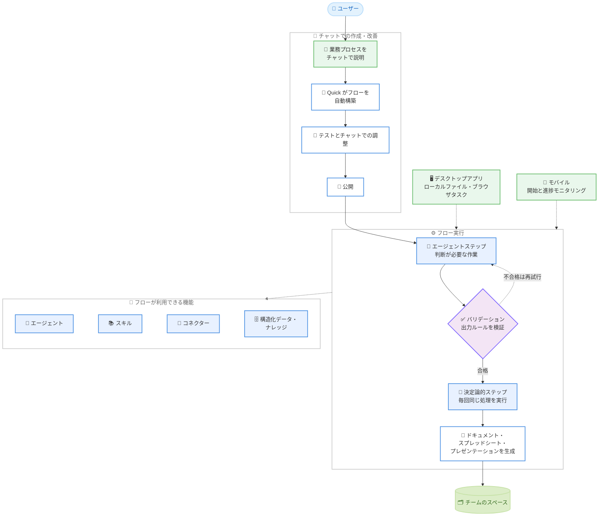

# AWS Quick - チャットによる高度な自動化を実現する Flows の機能強化

**リリース日**: 2026 年 11 月 20 日
**サービス**: AWS Quick
**機能**: Flows (チャットで構築・実行・改善できるマルチステップ自動化ワークフロー)

📊 [このアップデートのインフォグラフィックを見る](https://takech9203.github.io/aws-news-summary/20261120-aws-quick-flows-automations-chat.html)

## 概要

AWS Quick の Flows が強化され、作成・実行・改善のすべてをチャットでの会話だけで行える、より高度な自動化を構築できるようになりました。ユーザーが業務プロセスをチャットで説明すると、Quick がコーディング不要でフローを組み立てます。フローはエージェント、スキル、ツールをオーケストレーションし、構造化データ、ナレッジ、アプリにアクセスできます。既存のビジネスデータから回答を取得し、共有可能なドキュメント・スプレッドシート・プレゼンテーションを生成してチームのスペースに保存することが可能で、より長時間のワークフローとより大きなデータ量にも対応します。

信頼性の面では、毎回同じ結果を返す「決定論的ステップ」が新たに追加され、結果の一貫性を保てるようになりました。また、ユーザー定義の「バリデーション」により、各ステップの出力が条件 (例: レポートにサマリーテーブルが含まれること) を満たしているかを確認してから次のステップへ進められます。たとえば買掛金管理チームであれば、エージェントが請求書を読み取って発注書と照合し、決定論的ステップが合計金額の検証と重複検出を行うフローを構築できます。

さらに、フローはデスクトップ、Web、モバイルのマルチプラットフォームで動作します。デスクトップアプリではローカルファイルの操作やブラウザタスクの実行が可能になり、モバイルでは外出先からフローの開始と進捗のモニタリングができます。対象ユーザーは、定型業務を AI で自動化したいビジネスユーザーと、コードを書かずにチームの業務プロセスを標準化・自動化したいすべての AWS Quick 利用者です。

**アップデート前の課題**

このアップデート以前には、以下の課題がありました。

- 自動化の結果がエージェントの判断に依存し、毎回同じ結果が必要な処理 (金額の検証、重複チェックなど) で一貫性を担保しにくかった
- ステップの出力が期待する品質や形式を満たしているかを自動で確認する仕組みがなく、不十分な中間結果のまま後続ステップへ進むことがあった
- ローカルファイルの操作やブラウザ上のタスクを含む業務を、クラウド上のフローだけでは完結できなかった

**アップデート後の改善**

今回のアップデートにより、以下が可能になりました。

- チャットで業務プロセスを説明するだけで、コーディング不要でフローの作成・実行・改善まで完結できるようになった
- 決定論的ステップにより、毎回同じ方法で実行される正確な処理 (合計の検証、重複検出など) をフローに組み込めるようになった
- ユーザー定義のバリデーションにより、各ステップの出力がルールを満たすまで再試行させ、合格してから次へ進む品質管理ができるようになった
- デスクトップアプリ経由でローカルファイルの操作やブラウザタスクを実行でき、モバイルからフローの開始と進捗確認ができるようになった
- より長時間のワークフローと、より大きなデータ量を扱えるようになった

## アーキテクチャ図



チャットで業務プロセスを説明するとフローが構築され、公開後はエージェントステップと決定論的ステップがバリデーションを通過しながら順に実行される流れを示しています。実行はクラウドで行われ、ローカルファイルやブラウザ操作を含むステップはデスクトップアプリ経由で実行されます。

## サービスアップデートの詳細

### 主要機能

1. **チャットによるフローの作成・実行・改善**
   - 業務プロセスを新しいチームメイトに説明するようにチャットで記述すると、Quick がコーディング不要でフローを構築する
   - 構築されたフローはチャットで調整でき、変更の直後には Undo オプションで取り消せる。ドラフトにはバージョン履歴が保持される
   - 実行もチャットからフロー名を指定して開始でき、編集は所有者のみが可能

2. **決定論的ステップによる一貫した結果**
   - 判断が必要な作業は「エージェントステップ」、毎回同じ方法で実行すべき正確な処理は「決定論的ステップ」と使い分けられる
   - 決定論的ステップのコードは Quick が生成し、コードは読み取り専用。ステップに直接のインターネットアクセスはない
   - 合計金額の検証や重複検出のような、結果の再現性が必要な処理に適している

3. **ユーザー定義のバリデーション**
   - エージェントステップの出力が満たすべきルールを定義し、合格するまで次のステップへ進ませない
   - 「最大再試行回数」(デフォルト 1 回) と「バリデーション失敗時に続行するか」を設定できる
   - 例: レポートにサマリーテーブルが含まれていることを確認してから配布ステップへ進む

4. **豊富なフローロジックと機能へのアクセス**
   - フローロジックとして Condition (条件分岐)、Match (値に基づく経路選択)、Loop (リスト反復)、While (条件付き反復)、Parallel (並列実行) を利用できる
   - フローの各ステップは、エージェント、スキル、コネクター (クラウド・ローカル MCP を含む)、システムツール、スペースとナレッジベース、提供データ、さらに他の公開済みフローを利用できる
   - 入力・出力はそれぞれ最大 50 個まで定義でき、入力にはテキスト・数値・真偽値・リスト・グループ・ファイルの型と必須/任意、デフォルト値を設定できる

5. **マルチプラットフォーム対応**
   - フローの構築と実行は Web とデスクトップアプリで行え、どちらもクラウド上で実行される
   - ローカルファイル、ブラウザ自動化、ローカルコネクターを使うステップはデスクトップアプリでのみ実行される (アプリが起動・接続中であることが必要)
   - モバイルアプリとブラウザ拡張からは、フローの開始と進捗のフォローが可能

6. **実行管理とガバナンス**
   - オンデマンド実行のほか、ルーティンによるスケジュール実行が可能。実行状況はフローの Activity タブと Mission Control で一元監視できる
   - フローは実行したユーザーの権限で動作し、承認が必要なステップでは「Needs input」状態で一時停止する。Smart Approvals が有効な場合は過去の選択に基づく自動承認も可能
   - 管理者はカスタム権限 (「Flows」とその配下の個人共有・全体共有の権限) で利用を制御でき、共有・公開前の承認を必須にすることもできる

## 技術仕様

### Flows の仕様

| 項目 | 詳細 |
|------|------|
| 作成方法 | チャットで業務プロセスを説明 (Flows タブまたはチャットから)。コーディング不要 |
| ステップタイプ | エージェントステップ (判断が必要な作業)、決定論的ステップ (毎回同じ処理、コードは読み取り専用) |
| フローロジック | Condition、Match、Loop、While、Parallel |
| 入力 / 出力 | 各最大 50 個。入力型はテキスト、数値、真偽値、リスト、グループ、ファイル |
| バリデーション | ルール、最大再試行回数 (デフォルト 1 回)、失敗時の続行可否を設定 |
| 利用できる機能 | エージェント、スキル、コネクター (クラウド / ローカル MCP)、システムツール、スペース・ナレッジベース、提供データ、他の公開済みフロー |
| エージェントステップのコアツール | コード実行、ファイル操作、日時、文字起こし、画像生成、ドキュメント作成スキル (Web 検索とブラウザ自動化は明示的な付与が必要) |
| 実行環境 | Web / デスクトップともにクラウドで実行。ローカルファイル・ブラウザ自動化・ローカルコネクターはデスクトップアプリ経由 |
| 実行権限 | 実行したユーザーの権限で動作。メモリーは使用せず、各実行は毎回新規に開始 |
| バージョン管理 | ドラフト版と公開版。公開するとドラフトとその履歴はクリアされる |
| 共有ロール | Viewer (インストール・実行) / Owner (編集・公開・共有も可能) |
| 上限 | 所有フロー最大 100 件、アカウントあたり最大 10,000 件 |
| 実行ステータス | Running、Needs input、Completed、Failed、Canceled、Skipped |
| API | 公開済みフローを対象に CreateFlow、UpdateFlow、DescribeFlow、ListFlows、SearchFlows、DeleteFlow、GetFlowPermissions、UpdateFlowPermissions、GetFlowMetadata を利用可能 |

### スキルとフローの使い分け

| 観点 | スキル | フロー |
|------|--------|--------|
| ステップの決定者 | エージェントが作業しながら決定 | ユーザーが事前に定義 |
| 適する場面 | 進め方は決まっているが手順が実行ごとに変わる作業 | 手順が明確で毎回同じ方法で繰り返す作業 |
| 組み合わせ | フロー内のエージェントステップがスキルを利用可能 | 固定ステップと実行ごとに適応するステップを併用可能 |

## 設定方法

### 前提条件

1. AWS Quick を利用できること (Web、デスクトップアプリ、モバイルアプリのいずれか)
2. フローが外部サービスへ接続する場合、必要なコネクターを設定済みであること
3. ローカルファイルやブラウザタスクを含むフローを実行する場合、デスクトップアプリをインストールし接続状態にしておくこと
4. 組織で利用する場合、管理者のカスタム権限で Flows の利用が制限されていないこと

### 手順

#### ステップ 1: チャットでフローを作成する

[Customize] から [Flows] タブを開いて [Create] を選択するか、通常のチャットで自動化したい業務プロセスを説明します。新しいチームメイトに引き継ぐつもりで、手順・入力・期待する成果物を具体的に記述すると、Quick がフローを構築します。

#### ステップ 2: テストして調整する

構築されたフローを確認し、[Run] でテスト実行します。テスト実行は実際のアクションを伴うため、実行前に各ステップの内容を必ず確認してください。修正したい点はチャットで指示し、必要に応じて Undo やドラフトのバージョン履歴で変更を戻します。

#### ステップ 3: 決定論的ステップとバリデーションを組み込む

毎回同じ結果が必要な処理 (金額の検証、重複チェックなど) は、チャットで「このステップは決定論的に処理して」と指示して決定論的ステップにします。品質を担保したいエージェントステップには、ステップのバリデーション設定から出力が満たすべきルール、最大再試行回数、失敗時の続行可否を設定し、ドラフトに保存します。

#### ステップ 4: 公開して運用する

動作を確認したら [Publish] を選択して公開します。公開はドラフトとそのバージョン履歴をクリアし、以前の公開バージョンには戻せないため、公開前のテストが重要です。公開後は [Share] でチームへ共有 (Viewer / Owner ロールを指定) したり、ルーティンに追加してスケジュール実行したりできます。実行状況は Activity タブと Mission Control で監視します。

## メリット

### ビジネス面

- **自動化の民主化**: コーディング不要で、業務を最もよく知る現場のユーザー自身が自動化を構築・改善できる
- **業務品質の担保**: バリデーションと決定論的ステップにより、請求書照合のような正確性が求められる業務でも AI 自動化を安心して適用できる
- **場所を選ばない運用**: モバイルから外出先でもフローを開始・監視でき、業務のリードタイムを短縮できる

### 技術面

- **一貫性と柔軟性の両立**: 判断が必要な処理はエージェントステップ、再現性が必要な処理は決定論的ステップと、特性に応じて使い分けられる
- **堅牢なエラーハンドリング**: バリデーションの自動再試行、失敗時の続行制御、Condition / Loop / Parallel などのフローロジックにより、複雑な業務プロセスを表現できる
- **ローカル環境との連携**: デスクトップアプリ経由でローカルファイルやブラウザ操作を自動化に組み込め、クラウドだけでは完結しない業務もカバーできる
- **最小権限での実行**: フローは実行ユーザーの権限で動作し、各ステップには付与した機能しか使わせないため、アクセス制御を細かく設計できる

## デメリット・制約事項

### 制限事項

- 所有できるフローは 1 ユーザーあたり最大 100 件、アカウントあたり最大 10,000 件
- 入力・出力はそれぞれ最大 50 個まで
- 決定論的ステップのコードは読み取り専用で、直接のインターネットアクセスはない
- ローカルファイル、ブラウザ自動化、ローカルコネクターを使うステップはデスクトップアプリが起動・接続中の場合のみ実行され、未接続時にルーティンが開始したフローはその回の実行がスキップされる
- 公開するとドラフトとバージョン履歴はクリアされ、以前の公開バージョンには戻せない
- API は公開済みフローのみを対象とする

### 考慮すべき点

- テスト実行も実際のアクション (メール送信、データ更新など) を伴うため、本番データに影響しない形でのテスト設計が必要
- フロー実行はメモリーを使用せず毎回新規に開始されるため、実行間で状態を引き継ぐ設計はできない
- 実行が失敗した場合、再実行は最初のステップからやり直しになる
- フロー実行はエージェント時間 (agent hours) にカウントされるため、長時間ワークフローや高頻度のルーティン実行では消費量の把握が必要
- 組織利用では、管理者によるカスタム権限 (Flows、個人共有、全体共有) と公開・共有の承認ポリシーの設計を事前に行うことが望ましい

## ユースケース

### ユースケース 1: 買掛金の請求書照合の自動化

**シナリオ**: 経理チームで、取引先から届く請求書を発注書と照合し、支払い前に金額の整合性と重複を確認する業務を自動化したい。

**実装例**:
```text
チャットで「受信した請求書をエージェントが読み取り、発注書と照合する
フローを作成して。合計金額の検証と重複請求の検出は決定論的ステップで
行い、照合結果のサマリーテーブルを含むレポートを生成して経理スペースに
保存して」と依頼。レポート生成ステップには「サマリーテーブルを含むこと」
のバリデーションを追加する。
```

**効果**: 判断が必要な読み取り・照合はエージェントが担い、金額検証と重複検出は毎回同じ方法で実行されるため、支払いミスのリスクを抑えながら照合業務を自動化できる。

### ユースケース 2: 定期レポートの自動作成と配布

**シナリオ**: 複数のデータソースから週次で実績データを集計し、サマリー付きのレポートとプレゼンテーション資料を作成してチームに共有したい。

**実装例**:
```text
1. チャットで「毎週、売上データと問い合わせデータを集計し、
   スプレッドシートとプレゼンテーションを生成してチームスペースに
   保存するフローを作成して」と依頼
2. レポート生成ステップにサマリーテーブル必須のバリデーションを設定
3. 公開後、ルーティンに追加して毎週月曜の朝に自動実行
4. Mission Control で実行状況を監視
```

**効果**: データ収集からドキュメント生成、スペースへの保存までが完全自動化され、担当者はバリデーションを通過した品質の揃ったレポートの確認に集中できる。

### ユースケース 3: ローカルファイルとブラウザ操作を含む定型業務

**シナリオ**: ローカル PC 上のファイルを整理し、社内 Web システムへの登録作業 (ブラウザ操作) を含む定型業務を自動化したい。

**実装例**:
```text
デスクトップアプリのチャットで「ダウンロードフォルダーの経費精算
ファイルを読み取り、内容を検証したうえで社内システムにブラウザから
登録するフローを作成して」と依頼。ブラウザ自動化はこのステップにのみ
明示的に付与し、承認が必要な操作では Needs input で一時停止させる。
```

**効果**: クラウドだけでは完結しなかったローカルファイル操作とブラウザタスクを含む業務を自動化できる。ステップ単位の機能付与と承認フローにより、安全性も確保できる。

## 料金

What's New に Flows 固有の追加料金の記載はありません。Flows は AWS Quick の機能として提供され、AWS Quick のプランの範囲内で利用します。なお、ドキュメントによると、フローの実行はエージェント時間 (agent hours) にカウントされます。また、コネクター経由で接続する外部サービス側の料金は別途発生する場合があります。最新の料金は [AWS Quick 製品ページ](https://aws.amazon.com/quick/) を参照してください。

## 利用可能リージョン

AWS Quick が利用可能なすべての AWS リージョンで利用できます。

## 関連サービス・機能

- **AWS Quick のエージェント**: フローのエージェントステップとして判断が必要な作業を実行する。指示・ナレッジソース・ツールを設定可能
- **AWS Quick のスキル**: 進め方をエージェントに教える再利用可能な指示セット。フロー内のエージェントがスキルを使うことで、固定ステップと適応的なステップを組み合わせられる
- **AWS Quick のコネクター / 統合**: クラウドおよびローカル MCP コネクターを含む外部アプリ・データソースへの接続。フローのステップから利用可能
- **ルーティン**: フローをスケジュール実行する仕組み。公開済みフローをルーティンに追加して定期実行できる
- **Mission Control**: エージェントとフローの実行を一元監視・管理する機能。承認リクエストの確認にも使用
- **プラグイン**: フローをエージェント・スキル・コネクターとバンドルして配布する仕組み。チームへの一括展開に利用できる
- **スペース**: フローが生成したドキュメントの保存先となる、チームでのリソース共有・コラボレーション機能

## 参考リンク

- 📊 [インフォグラフィック](https://takech9203.github.io/aws-news-summary/20261120-aws-quick-flows-automations-chat.html)
- [公式発表 (What's New)](https://aws.amazon.com/about-aws/whats-new/2026/11/aws-quick-flows-automations-chat/)
- [ドキュメント: Flows in AWS Quick](https://docs.aws.amazon.com/quick/latest/userguide/using-amazon-quick-flows.html)
- [ドキュメント: AWS Quick User Guide](https://docs.aws.amazon.com/quick/latest/userguide/)
- [AWS Quick 製品ページ](https://aws.amazon.com/quick/)

## まとめ

今回のアップデートにより、AWS Quick の Flows はチャットだけで構築できる手軽さに加え、決定論的ステップとバリデーションによる「結果の一貫性と品質の担保」、デスクトップ・Web・モバイルにまたがる実行環境を備えた、本格的な業務自動化基盤へと進化しました。請求書照合のような正確性が求められる業務にも適用しやすくなった点が特に重要です。まずは定型レポート作成などの繰り返し業務をチャットで記述してフロー化し、バリデーションと決定論的ステップを組み込んだ信頼性の高い自動化の設計を検討することを推奨します。
