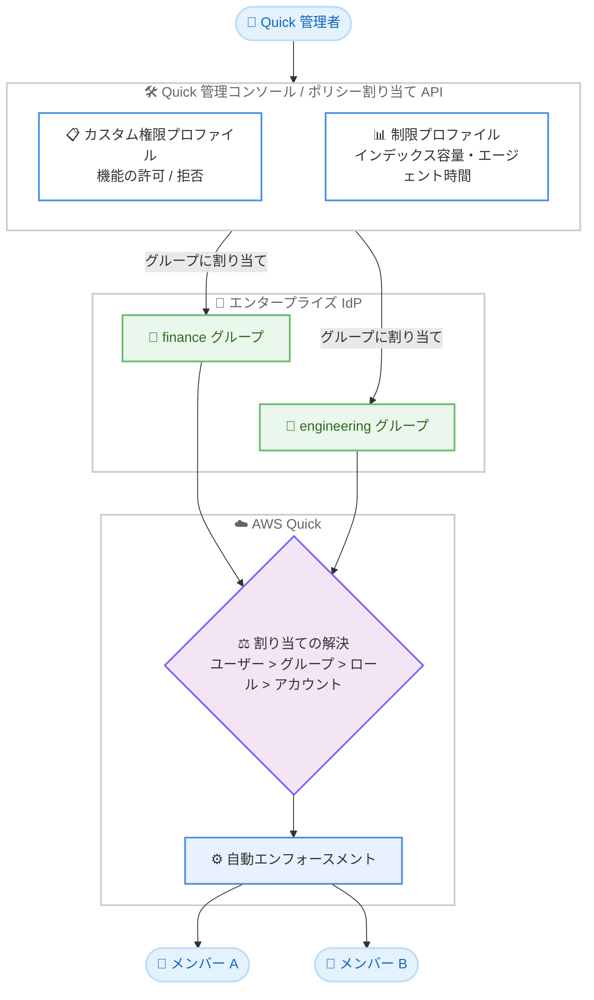

# AWS Quick - カスタム権限と制限プロファイルのグループ割り当てサポート

**リリース日**: 2026 年 11 月 20 日
**サービス**: AWS Quick
**機能**: カスタム権限プロファイルと制限プロファイルの IdP グループへの割り当て

📊 [このアップデートのインフォグラフィックを見る](https://takech9203.github.io/aws-news-summary/20261120-aws-quick-group-assignments-custom-permissions-limit-profiles.html)

## 概要

AWS Quick が、カスタム権限プロファイル (custom permissions) と制限プロファイル (limit profiles) をエンタープライズ ID プロバイダー (IdP) のグループに割り当てる機能をサポートしました。これまでのユーザー、ロール、アカウント単位の割り当てに加えて、管理者は IdP グループ単位で機能制限やユーザーごとのリソース上限を適用できるようになります。

この機能により、組織は個々のユーザーへの割り当てを個別に管理することなく、既存のエンタープライズ ID 構造 (部門やチームを表すグループ) に沿ったガバナンスを実現できます。例えば、財務部門のグループにエージェント作成を禁止するカスタム権限プロファイルを割り当てたり、特定の機能カテゴリで Deny by Default を適用して管理者が明示的に許可した機能のみ利用可能にしたり、グループに制限プロファイルを割り当てて各メンバーのインデックス容量とエージェント時間の上限を設定したりできます。

割り当ては Quick 管理コンソールに加えて、新しいポリシー割り当て API (`PutPolicyAssignment` など) からも管理できます。グループ割り当ては Quick の Professional プランと Enterprise プランで利用できます。

**アップデート前の課題**

- カスタム権限と制限プロファイルの割り当て先はユーザー、ロール、アカウントに限られており、部門やチーム単位で統制を適用するには個々のユーザーへの割り当てを維持する必要があった
- 組織の人事異動や入退社のたびに、個別ユーザーへの割り当てを手動で更新する運用負荷が発生していた
- IdP 側で管理しているグループ構造と Quick 側のガバナンス設定が分離しており、二重管理になりやすかった

**アップデート後の改善**

- IdP グループに対してカスタム権限プロファイルと制限プロファイルを直接割り当て可能になり、メンバー全員に自動的に適用される
- グループのメンバーシップ変更が IdP 側の管理に追従するため、個別ユーザーの割り当てメンテナンスが不要になった
- 管理コンソールに加えて、新しいポリシー割り当て API により割り当て管理を自動化できるようになった
- 複数グループに所属するユーザーの競合解決ルールが明確に定義され、予測可能なガバナンスを実現できる

## アーキテクチャ図



管理者がコンソールまたは API からプロファイルを IdP グループに割り当てると、Quick が割り当ての優先順位と競合解決ルールに基づいて各メンバーへ自動的に適用・強制します。

## サービスアップデートの詳細

### 主要機能

1. **カスタム権限プロファイルのグループ割り当て**
   - IdP グループに対して機能制限 (スコープダウンポリシー) を適用できる
   - 例: finance グループのメンバーによるエージェント作成をブロックする
   - Deny by Default を適用すると、選択した機能カテゴリ内で管理者が明示的に許可した機能のみ利用可能になる
   - カスタム権限はスコープダウンのみで、ユーザーのデフォルトロールを超える権限を付与することはできない

2. **制限プロファイルのグループ割り当て**
   - グループに制限プロファイルを割り当てて、各メンバーのインデックス容量 (index storage) とエージェント時間 (agent hours) の上限を設定できる
   - 制限はグループでプールされず、メンバーごとに個別に適用される (例: 10 GB のストレージ制限を 50 人のグループに割り当てると、各メンバーが最大 10 GB まで利用可能)
   - ユーザーがリソースを消費すると、Quick が自動的に制限を強制する

3. **複数グループ所属時の競合解決**
   - **カスタム権限**: いずれかのグループで拒否 (Deny) された機能は拒否のまま維持される (Deny 優先)
   - **制限プロファイル**: 制限タイプごとに、所属グループ間で最も高い値が適用される
   - 割り当ての優先順位は「ユーザー > グループ > ロール > アカウント」で、最も具体的なレベルが優先される

4. **新しいポリシー割り当て API**
   - `PutPolicyAssignment`、`GetPolicyAssignment`、`DeletePolicyAssignment`、`BatchPutPolicyAssignmentByPolicy`、`BatchDeletePolicyAssignmentByPolicy`、`ListPrincipalsForPolicy` が追加された
   - ポリシータイプ (`PolicyType`) として `CUSTOM_PERMISSIONS` と `LIMITS_PROFILE` を指定し、プリンシパルタイプとして `USER`、`GROUP`、`ACCOUNT` を指定できる
   - `Revision` や `ExistingPolicyArn` による楽観的同時実行制御 (compare-and-set) をサポートし、同時更新による意図しない上書きを防止できる

5. **一括割り当て管理**
   - 管理コンソールから CSV またはテキストファイルで割り当てを一括インポート可能 (1 ファイルあたり最大 500 件)
   - 割り当て一覧のダウンロードは 1 ファイルあたり最大 10,000 件
   - バッチ API では 1 回の呼び出しで 1〜50 プリンシパルを割り当て・削除できる

## 技術仕様

### ポリシー割り当て API の操作一覧

| 操作 | 説明 |
|------|------|
| `PutPolicyAssignment` | 1 つのユーザー、グループ、アカウントにプロファイルを割り当てる。既存の同タイプの割り当ては置き換えられる |
| `BatchPutPolicyAssignmentByPolicy` | 1 つのプロファイルを 1〜50 のプリンシパルに一括割り当てる。非アトミックで、レスポンスの `Success` / `Errors` を確認する |
| `GetPolicyAssignment` | プリンシパルに現在割り当てられているプロファイルを強整合性読み取りで返す |
| `DeletePolicyAssignment` | プリンシパルの割り当てを削除する。冪等で、別プロファイルが割り当て済みの場合は競合エラーになる |
| `BatchDeletePolicyAssignmentByPolicy` | 1〜50 のプリンシパルの割り当てを一括削除する |
| `ListPrincipalsForPolicy` | プロファイルに割り当てられたプリンシパルを逆引きで一覧する。`PrincipalType` でのフィルタとページネーションに対応 |

### 主要パラメータ

| パラメータ | 説明 |
|-----------|------|
| `PolicyArn` | 割り当てるプロファイルの ARN (例: `arn:aws:quicksight:region:account-id:limits-profile/profile-id`) |
| `PrincipalArn` | 割り当て対象のユーザー、グループ、アカウントの ARN |
| `PolicyType` | `CUSTOM_PERMISSIONS` または `LIMITS_PROFILE` |
| `PrincipalType` | `USER`、`GROUP`、`ACCOUNT` |
| `ExistingPolicyArn` | (オプション) 現在割り当てられていると想定するプロファイル。一致した場合のみ書き込みが実行される |
| `Revision` | (オプション) 直近の読み取りで返されたトークン。一致した場合のみ変更が適用される |

### API 変更履歴

| 日付 | サービス | 変更内容 |
|------|----------|----------|
| 2026/11/21 | [quicksight](https://awsapichanges.com/archive/changes/b75654-quicksight.html) | 26 new 17 updated api methods - `PutPolicyAssignment`、`GetPolicyAssignment`、`ListPrincipalsForPolicy` などのガバナンスポリシー割り当て API を含む SDK リリース |

### 割り当ての優先順位

| 優先度 | レベル | 説明 |
|--------|--------|------|
| 1 (最優先) | ユーザー | ユーザーに直接割り当てられたプロファイル |
| 2 | グループ | IdP グループへの割り当て。複数グループ所属時は競合解決ルールで統合 |
| 3 | ロール | Admin、Author、Reader などのロールへの割り当て |
| 4 | アカウント | アカウントデフォルト。より具体的な割り当てがないユーザー全員に適用 |

## 設定方法

### 前提条件

1. AWS Quick の Professional プランまたは Enterprise プランを利用していること (カスタム権限は Enterprise edition)
2. エンタープライズ IdP と連携したグループが Quick に存在すること
3. Quick 管理者権限と、`quicksight:PutPolicyAssignment` などポリシー割り当て関連の IAM 権限を持っていること

### 手順

#### ステップ 1: 管理コンソールでプロファイルをグループに割り当てる

1. 管理者として Quick にサインインし、Quick Admin を開いて [Limit profiles] (または custom permissions) を選択する
2. 割り当てるプロファイルを選択し、[Assign profile] の [Manage assignment] を選択する
3. [Find assignees] でグループ名を検索し、[Add group] を選択する
4. [Confirm assignment changes] で変更内容を確認し、[Confirm & apply] を選択する

複数の namespace があるアカウントでは、パネル上部のリストから管理対象の namespace を選択します。割り当ては namespace 単位で適用されます。

#### ステップ 2: API でグループに制限プロファイルを割り当てる

```bash
aws quicksight put-policy-assignment \
  --aws-account-id 123456789012 \
  --policy-arn arn:aws:quicksight:us-east-1:123456789012:limits-profile/profile-id \
  --principal-arn arn:aws:quicksight:us-east-1:123456789012:group/default/finance-group \
  --policy-type LIMITS_PROFILE
```

このコマンドは、指定した制限プロファイルを IdP グループに割り当てます。既に同タイプのプロファイルが割り当てられている場合は置き換えられ、レスポンスには置き換え前のプロファイルが `ReplacedPolicyArn` として返されます。

#### ステップ 3: 割り当て状況を確認する

```bash
aws quicksight list-principals-for-policy \
  --aws-account-id 123456789012 \
  --policy-arn arn:aws:quicksight:us-east-1:123456789012:limits-profile/profile-id \
  --principal-type GROUP
```

このコマンドは、プロファイルに割り当てられたプリンシパルを逆引きで一覧します。カスタム権限については、管理コンソールの Check permissions 機能で、どのプロファイルがどのレベル (ユーザー、グループ、ロール、アカウント) で有効かを確認できます。

## メリット

### ビジネス面

- **運用負荷の削減**: 個別ユーザーへの割り当てメンテナンスが不要になり、IdP 側のグループ管理に運用を一本化できる
- **組織構造に沿ったガバナンス**: 部門やチームなどのエンタープライズ ID 構造をそのまま Quick の統制に反映できる
- **コスト管理の強化**: グループ単位で各メンバーのインデックス容量とエージェント時間を制御し、共有プールの枯渇や想定外の消費を防止できる

### 技術面

- **API による自動化**: 新しいポリシー割り当て API により、割り当ての作成・削除・監査を IaC や運用スクリプトに組み込める
- **安全な同時更新**: `Revision` と `ExistingPolicyArn` による compare-and-set で、並行運用時の意図しない上書きを防げる
- **予測可能な競合解決**: カスタム権限は Deny 優先、制限プロファイルは最大値適用という明確なルールで、複数グループ所属時の動作を予測できる

## デメリット・制約事項

### 制限事項

- グループ割り当ては Professional プランと Enterprise プランで利用可能 (カスタム権限自体は Enterprise edition の機能)
- カスタム権限はスコープダウンポリシーであり、ユーザーのデフォルトロールを超える権限は付与できない
- ポリシー割り当て API ではロールへの割り当ては管理できず、ロール割り当ては Quick Admin から行う必要がある
- 割り当ては namespace 単位で、別の namespace のユーザーやグループには適用されない
- 一括インポートは 1 ファイルあたり最大 500 件、ダウンロードは最大 10,000 件
- バッチ API は非アトミックであり、呼び出し後に `Errors` の確認が必要

### 考慮すべき点

- 親機能 (parent capability) を Deny すると子機能もすべて Deny される。親を Deny したまま子機能を Allow に設定してもエラーにならず子機能は制限されたままになるため、適用後にコンソールで結果を確認する必要がある
- 複数グループ所属ユーザーの制限プロファイルは「最も高い値」が適用されるため、厳格な上限を課したい場合はユーザーレベルの割り当て (最優先) の利用を検討する
- ユーザーレベルの許可プロファイルはアカウントレベルの Deny by Default より優先されるため、Deny by Default は要件に応じた適切なレベルに割り当てる
- `ListPrincipalsForPolicy` の結果は結果整合性であり、直近の変更が反映されていない場合がある

## ユースケース

### ユースケース 1: 部門単位での機能制限

**シナリオ**: 財務部門ではデータ閲覧と分析のみを許可し、エージェントの作成は情報システム部門に限定したい。

**実装例**:
```bash
# エージェント作成をブロックするカスタム権限プロファイルを
# finance グループに割り当てる
aws quicksight put-policy-assignment \
  --aws-account-id 123456789012 \
  --policy-arn arn:aws:quicksight:us-east-1:123456789012:custom-permissions/no-agent-creation \
  --principal-arn arn:aws:quicksight:us-east-1:123456789012:group/default/finance-group \
  --policy-type CUSTOM_PERMISSIONS
```

**効果**: 財務部門のメンバー全員にエージェント作成禁止が自動適用され、人事異動時も IdP グループの更新だけで統制が維持される。

### ユースケース 2: Deny by Default による段階的な機能開放

**シナリオ**: 全社導入の初期段階では、選択した機能カテゴリについて明示的に許可した機能のみを利用可能にし、検証が完了した機能から順次開放したい。

**実装例**:
```
1. Deny by Default を有効にしたカスタム権限プロファイルを作成
2. 許可する機能 (例: チャット、ドキュメント検索) のみ Allow に設定
3. 全社ユーザーが所属するグループにプロファイルを割り当て
4. 検証完了した機能を順次 Allow に変更
```

**効果**: 新機能が追加されてもデフォルトで拒否されるため、ガバナンス審査を経た機能のみを安全に展開できる。

### ユースケース 3: チームごとのリソース上限管理

**シナリオ**: データ分析チームは大量のドキュメントをインデックスするため、一般ユーザーよりも大きいインデックス容量とエージェント時間を割り当てたい。

**実装例**:
```
1. アカウントデフォルトとして標準制限プロファイル (例: 5 GB、20 時間) を割り当て
2. 分析チーム用の拡張制限プロファイル (例: 50 GB、100 時間) を作成
3. 拡張プロファイルを analytics グループに割り当て
```

**効果**: 分析チームのメンバーは拡張された上限を利用でき、その他のユーザーはアカウントデフォルトの上限で保護される。一人のヘビーユーザーが共有プールを使い切るリスクを抑制できる。

## 料金

グループ割り当て機能自体に追加料金はなく、AWS Quick の Professional プランおよび Enterprise プランで利用できます。カスタム権限は Enterprise edition の機能です。インデックス容量やエージェント時間は各プランのサブスクリプションに基づいて割り当てられ、制限プロファイルはその消費をユーザー単位で制御する仕組みです。

詳細は [AWS Quick の料金ページ](https://aws.amazon.com/quick/pricing/) を参照してください。

## 利用可能リージョン

リージョンごとの機能提供状況は [AWS Quick Regions](https://docs.aws.amazon.com/quick/latest/userguide/regions.html#regions-qs) を参照してください。

## 関連サービス・機能

- **エンタープライズ IdP 連携 (IAM Identity Center、Okta、Microsoft Entra ID など)**: グループ割り当ての前提となる ID 連携。IdP 側のグループ構造がそのまま Quick のガバナンス単位になる
- **Amazon QuickSight**: Quick のポリシー割り当て API は `quicksight` API 名前空間で提供され、`quicksight:PutPolicyAssignment` などの IAM アクションで制御される
- **AWS IAM**: 管理者がポリシー割り当て操作を実行するための IAM 権限管理

## 参考リンク

- 📊 [インフォグラフィック](https://takech9203.github.io/aws-news-summary/20261120-aws-quick-group-assignments-custom-permissions-limit-profiles.html)
- [公式発表 (What's New)](https://aws.amazon.com/about-aws/whats-new/2026/11/aws-quick-group-assignments-custom-permissions-limit-profiles/)
- [AWS Blog: Establishing enterprise governance in Amazon Quick using custom permissions](https://aws.amazon.com/blogs/business-intelligence/establishing-enterprise-governance-in-amazon-quick-using-custom-permissions/)
- [ドキュメント: Custom permissions](https://docs.aws.amazon.com/quick/latest/userguide/custom-permissions.html)
- [ドキュメント: Limit profiles](https://docs.aws.amazon.com/quick/latest/userguide/limit-profiles.html)
- [ドキュメント: AWS Quick Regions](https://docs.aws.amazon.com/quick/latest/userguide/regions.html#regions-qs)
- [API 変更履歴 (awsapichanges.com)](https://awsapichanges.com/archive/changes/b75654-quicksight.html)

## まとめ

AWS Quick のカスタム権限と制限プロファイルが IdP グループへの割り当てに対応したことで、組織は既存のエンタープライズ ID 構造に沿ったガバナンスを低い運用負荷で実現できるようになりました。全社展開を進めている組織は、個別ユーザーへの割り当てをグループ割り当てに移行し、Deny by Default と制限プロファイルを組み合わせた段階的な機能開放とリソース管理の設計を検討することを推奨します。
