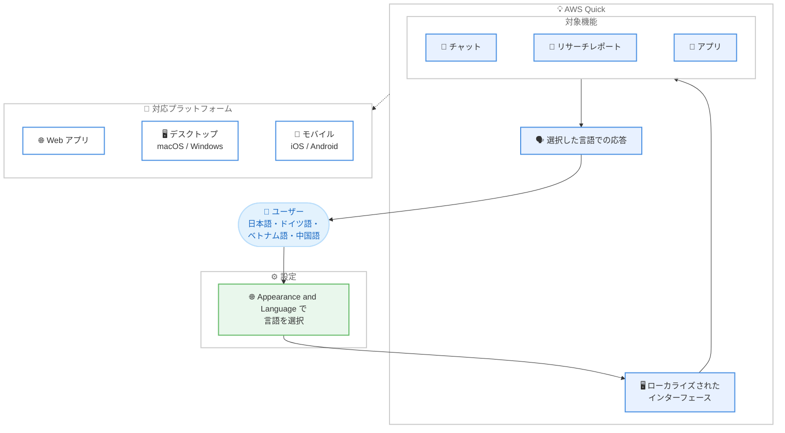

# AWS Quick - 日本語・ドイツ語・ベトナム語・中国語のサポート

**リリース日**: 2026 年 11 月 20 日
**サービス**: AWS Quick
**機能**: 多言語サポート (日本語、ドイツ語、ベトナム語、中国語の追加)

📊 [このアップデートのインフォグラフィックを見る](https://takech9203.github.io/aws-news-summary/20261120-aws-quick-japanese-german-chinese-vietnamese.html)

## 概要

ビジネスユーザー向けの AI ワークスペースである AWS Quick が、新たに日本語、ドイツ語、ベトナム語、中国語 (簡体字・繁体字) をサポートしました。インターフェースがこれらの言語で表示されるようになり、Quick はユーザーが選択した言語で応答します。これにより、これらの言語で業務を行うチームは、英語に切り替えることなく Quick を利用できます。

言語サポートの対象範囲は、チャット、リサーチレポート、アプリにまたがります。たとえば、日本の財務チームは日本語でビジネスデータに問い合わせて日本語の回答を受け取ることができ、ドイツのマーケティングチームはドイツ語でリサーチレポートを生成できます。

今回のサポートは、Web アプリ、デスクトップアプリ (macOS および Windows)、モバイルアプリ (iOS および Android) のすべてのプラットフォームで利用できます。対象ユーザーは、日本語・ドイツ語・ベトナム語・中国語を日常業務で使用するビジネスユーザーと、これらの言語圏のチームに AI ワークスペースを展開したい組織です。

**アップデート前の課題**

このアップデート以前には、以下の課題がありました。

- 日本語、ドイツ語、ベトナム語、中国語で業務を行うチームは、AWS Quick を利用する際に英語へ切り替える必要があった
- チャットやリサーチレポートの応答を母国語で受け取る体験が提供されておらず、非英語圏のチームへの展開に言語の壁があった
- インターフェースの言語が業務言語と一致せず、組織全体での利用定着の妨げになっていた

**アップデート後の改善**

今回のアップデートにより、以下が可能になりました。

- インターフェースが日本語、ドイツ語、ベトナム語、中国語 (簡体字・繁体字) で表示されるようになった
- チャット、リサーチレポート、アプリにおいて、ユーザーが選択した言語で Quick が応答するようになった
- 日本語でビジネスデータに問い合わせて日本語で回答を得る、ドイツ語でリサーチレポートを生成するなど、英語への切り替えなしに業務を完結できるようになった
- Web、デスクトップ、モバイルのすべてのプラットフォームで同じ言語体験を利用できるようになった

## アーキテクチャ図



ユーザーが設定で言語を選択すると、インターフェースがその言語で表示され、チャット・リサーチレポート・アプリの応答も選択した言語で返される流れを示しています。この言語体験は Web、デスクトップ、モバイルのすべてのプラットフォームで共通です。

## サービスアップデートの詳細

### 主要機能

1. **4 言語 (5 バリアント) の新規サポート**
   - 日本語、ドイツ語、ベトナム語、中国語が新たにサポートされた
   - 中国語は簡体字と繁体字の両方に対応している
   - これらの言語で業務を行うチームは、英語に切り替えることなく Quick を利用できる

2. **インターフェースのローカライズと選択言語での応答**
   - インターフェースの表示が選択した言語に切り替わる
   - Quick はユーザーごとに選択された言語で応答するため、同じ組織内でもユーザーごとに異なる言語を利用できる
   - 日本語でビジネスデータに問い合わせて日本語の回答を得る、ドイツ語でリサーチレポートを生成するといった利用が可能

3. **チャット・リサーチレポート・アプリをカバー**
   - 言語サポートの対象は、チャット、リサーチレポート、アプリにまたがる
   - データへの問い合わせからレポート生成まで、主要なワークフローを母国語で完結できる

4. **マルチプラットフォーム対応**
   - Web アプリ、デスクトップアプリ (macOS および Windows)、モバイルアプリ (iOS および Android) のすべてで利用できる
   - どのデバイスからアクセスしても一貫した言語体験が提供される

## 技術仕様

### 多言語サポートの仕様

| 項目 | 詳細 |
|------|------|
| 追加言語 | 日本語、ドイツ語、ベトナム語、中国語 (簡体字・繁体字) |
| 対象範囲 | インターフェース表示、チャット、リサーチレポート、アプリでの応答 |
| 設定単位 | ユーザーごと (各ユーザーが自分の言語を選択) |
| 設定場所 | [Settings] > [Appearance and Language] |
| 対応プラットフォーム | Web アプリ、デスクトップアプリ (macOS / Windows)、モバイルアプリ (iOS / Android) |

### 関連する設定項目

ドキュメントによると、AWS Quick の [Settings] には言語に関連する以下の設定があります。

| 設定タブ | 設定項目 | 説明 |
|----------|----------|------|
| Appearance and language | Language | インターフェースの言語を選択する |
| Appearance and language | Timezone | スケジュール、タイムスタンプ、カレンダーで使用するタイムゾーンを設定する |
| Chat | Instructions | すべてのエージェントとのチャットで毎回送信されるグローバル指示。希望する言語、フォーマット、スタイルなどを指定できる |

## 設定方法

### 前提条件

1. AWS Quick を利用できること (Web アプリ、デスクトップアプリ、モバイルアプリのいずれか)
2. AWS アカウントまたは組織から付与された AWS Quick へのアクセス権があること

### 手順

#### ステップ 1: 設定を開く

AWS Quick のナビゲーションパネル左下にあるアカウントメニューから [Settings] を開きます。設定はユーザーごとに行うため、管理者による一括設定は不要です。

#### ステップ 2: 言語を選択する

[Appearance and Language] タブを開き、[Language] から利用したい言語 (日本語、ドイツ語、ベトナム語、中国語など) を選択します。インターフェースの表示が選択した言語に切り替わります。

#### ステップ 3: 選択した言語で利用する

チャットでビジネスデータへの問い合わせやリサーチレポートの生成を行うと、Quick は選択した言語で応答します。必要に応じて [Chat] タブの [Instructions] に希望する言語やスタイルを指定し、応答の形式をさらに調整できます。

## メリット

### ビジネス面

- **非英語圏チームへの展開**: 日本語、ドイツ語、ベトナム語、中国語で業務を行うチームに、言語の壁なく AI ワークスペースを展開できる
- **業務効率の向上**: 英語への切り替えや翻訳の手間がなくなり、母国語のまま問い合わせからレポート作成までを完結できる
- **利用定着の促進**: インターフェースと応答の両方が業務言語に揃うことで、組織全体での利用ハードルが下がる

### 技術面

- **ユーザー単位の言語設定**: 言語はユーザーごとに選択できるため、多国籍チームでも同じ環境を共有しながら各自の言語で利用できる
- **追加開発が不要**: 設定画面での言語選択のみで有効になり、管理者側の構成変更やカスタマイズは不要
- **プラットフォーム間で一貫**: Web、デスクトップ、モバイルのすべてで同じ言語体験が提供される

## デメリット・制約事項

### 制限事項

- サポート対象として発表されたのは日本語、ドイツ語、ベトナム語、中国語 (簡体字・繁体字) であり、すべての言語に対応しているわけではない
- 言語サポートの対象範囲として明示されているのはチャット、リサーチレポート、アプリであり、それ以外の機能での対応状況は公式発表に記載がない

### 考慮すべき点

- 接続しているデータソース内のデータ自体 (テーブル名、列名、データ値など) は翻訳されないため、データの言語と問い合わせの言語が異なる場合の挙動は事前に検証することが望ましい
- 組織内でユーザーごとに異なる言語を選択できるため、共有するレポートやアプリの言語ポリシーをチームで取り決めておくとよい

## ユースケース

### ユースケース 1: 日本の財務チームによるデータ問い合わせ

**シナリオ**: 日本の財務チームが、売上や費用などのビジネスデータに日本語で問い合わせ、日本語で回答を得たい。

**実装例**:
```text
1. 各メンバーが [Settings] > [Appearance and Language] で日本語を選択
2. チャットで「今四半期の部門別費用の推移を教えて」と日本語で質問
3. Quick が接続されたビジネスデータをもとに日本語で回答
```

**効果**: 英語への切り替えや質問の英訳が不要になり、財務チーム全員が母国語のままデータドリブンな意思決定を行える。

### ユースケース 2: ドイツのマーケティングチームによるリサーチレポート生成

**シナリオ**: ドイツのマーケティングチームが、市場調査レポートをドイツ語で生成し、そのまま社内に共有したい。

**実装例**:
```text
1. 各メンバーが [Settings] > [Appearance and Language] でドイツ語を選択
2. チャットからドイツ語でリサーチレポートの生成を依頼
3. 生成されたドイツ語のレポートをチームのスペースで共有
```

**効果**: レポートの翻訳工程が不要になり、調査から共有までのリードタイムを短縮できる。

### ユースケース 3: 多言語チームでの共同利用

**シナリオ**: 日本、ドイツ、ベトナム、中国のメンバーで構成されるグローバルチームが、同じ AWS Quick 環境を各自の言語で利用したい。

**実装例**:
```text
1. 言語設定はユーザーごとのため、各メンバーが自分の言語を選択
2. 各メンバーは自分の言語でチャット・リサーチレポート・アプリを利用
3. チームで共有する成果物の言語は、必要に応じて [Chat] タブの
   Instructions で指定して統一
```

**効果**: 単一の環境を維持しながら、メンバーごとに最適な言語体験を提供でき、グローバルチーム全体での利用を促進できる。

## 料金

What's New に多言語サポートに伴う追加料金の記載はありません。多言語サポートは AWS Quick の機能として提供され、AWS Quick のプランの範囲内で利用します。最新の料金は [AWS Quick 製品ページ](https://aws.amazon.com/quick/) を参照してください。

## 利用可能リージョン

AWS Quick が利用可能なすべての AWS リージョンで利用できます。

## 関連サービス・機能

- **AWS Quick のチャット**: 選択した言語で応答する対象機能のひとつ。ビジネスデータへの問い合わせやエージェントとの対話に使用する
- **AWS Quick のリサーチレポート**: 選択した言語で生成できる対象機能。市場調査などのレポート作成に使用する
- **AWS Quick のアプリ**: 選択した言語でのサポート対象となる機能。業務用アプリの利用に使用する
- **AWS Quick の設定 (Settings)**: [Appearance and Language] タブで言語とタイムゾーンを、[Chat] タブのグローバル指示で希望する言語・フォーマット・スタイルを設定できる

## 参考リンク

- 📊 [インフォグラフィック](https://takech9203.github.io/aws-news-summary/20261120-aws-quick-japanese-german-chinese-vietnamese.html)
- [公式発表 (What's New)](https://aws.amazon.com/about-aws/whats-new/2026/11/aws-quick-japanese-german-chinese-vietnamese/)
- [ドキュメント: Settings (AWS Quick User Guide)](https://docs.aws.amazon.com/quick/latest/userguide/settings.html)
- [ドキュメント: AWS Quick User Guide](https://docs.aws.amazon.com/quick/latest/userguide/)
- [AWS Quick 製品ページ](https://aws.amazon.com/quick/)

## まとめ

今回のアップデートにより、AWS Quick は日本語、ドイツ語、ベトナム語、中国語 (簡体字・繁体字) に対応し、インターフェース表示からチャット・リサーチレポート・アプリでの応答まで、母国語で完結する AI ワークスペース体験を提供するようになりました。特に日本のユーザーにとっては、英語への切り替えなしに Quick を業務に組み込める大きな一歩です。まずは [Settings] の [Appearance and Language] で日本語を選択し、チャットでのデータ問い合わせやリサーチレポート生成を日本語で試すことを推奨します。
