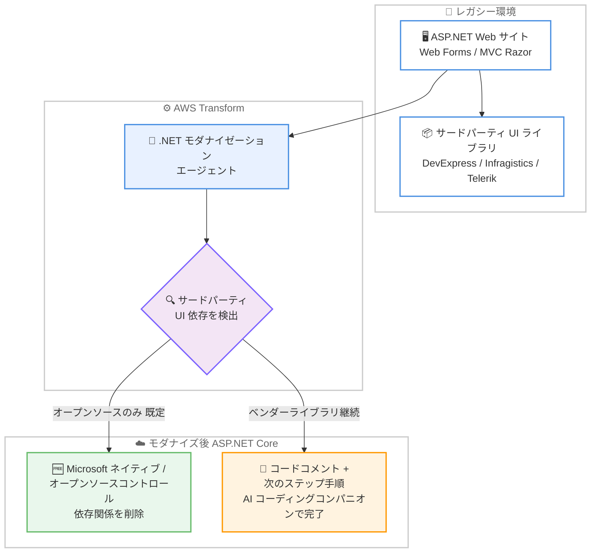

# AWS Transform - Windows Web アプリケーション向け UI コンポーネントモダナイゼーション

**リリース日**: 2026 年 11 月 20 日
**サービス**: AWS Transform
**機能**: ASP.NET Web サイトモダナイゼーションにおけるサードパーティ UI コンポーネントの移植

📊 [このアップデートのインフォグラフィックを見る](https://takech9203.github.io/aws-news-summary/20261120-aws-transform-ui-windows.html)

## 概要

AWS Transform において、ASP.NET Web サイトのモダナイゼーションにおけるサードパーティ UI コンポーネント移植機能が一般提供 (GA) されました。AWS Transform はレガシー ASP.NET サイトを ASP.NET Core 対応の UI フレームワークに変換するサービスですが、今回のアップデートにより、サイトが DevExpress、Infragistics、Telerik by Progress などのサードパーティ UI コンポーネントライブラリに依存している場合でも、変換作業を継続できるようになりました。

.NET モダナイゼーションエージェントがサードパーティ UI ライブラリへの依存を検出すると、2 つの選択肢が提示されます。1 つ目は、ライセンス不要の Microsoft ネイティブまたはオープンソースのコンポーネントに置き換えるオプションです。2 つ目は、ベンダー製 UI ライブラリを継続利用するオプションで、この場合エージェントは移行先フレームワーク上の同等なベンダーライブラリへ移行するためのコードコメントと次のステップの手順を挿入します。

このアップデートは、ベンダー製 UI コントロールを多用するエンタープライズ ASP.NET アプリケーションを ASP.NET Core へ移行し、Linux 上での稼働やライセンスコスト削減を目指す組織にとって重要な機能強化です。

**アップデート前の課題**

このアップデート以前は、サードパーティ UI コンポーネントがモダナイゼーションの障壁となっていました。

- サードパーティ UI ライブラリに依存する ASP.NET サイトは、UI 層の変換時に当該コンポーネントの移植を手動で行う必要があった
- 独自コントロールを Microsoft ネイティブやオープンソースのコントロールに置き換える作業は、個々のコントロールごとに調査と書き換えが必要だった
- ベンダーライブラリを継続利用する場合も、移行先フレームワーク向けの対応方針を自力で整理する必要があった

**アップデート後の改善**

今回のアップデートにより、サードパーティ UI コンポーネントの扱いが自動化・体系化されました。

- エージェントがサードパーティ UI ライブラリへの依存を自動検出し、対応方針を選択できるようになった
- オープンソースのみのオプションでは、独自コントロールが移行先 UI フレームワークの Microsoft ネイティブまたはオープンソースコントロールに自動的に置き換えられ、元の依存関係が削除される
- ベンダーライブラリ継続オプションでは、コードコメントと次のステップの手順が挿入され、AI コーディングコンパニオンで移植を完了できる
- モダナイゼーションプランに各ベンダーコントロールの変換先とステータスが一覧表示される

## アーキテクチャ図



AWS Transform の .NET モダナイゼーションエージェントがサードパーティ UI ライブラリへの依存を検出し、オープンソースコントロールへの置き換え、またはベンダーライブラリ継続のための移行ガイド挿入のいずれかを実行するフローです。

## サービスアップデートの詳細

### 主要機能

1. **サードパーティ UI ライブラリの自動検出**
   - .NET モダナイゼーションエージェントが、ASP.NET サイトの変換時に DevExpress、Infragistics、Telerik by Progress などの独自 UI コンポーネントへの依存を検出する
   - モダナイゼーションプランに各ベンダーコントロールと変換先、ステータスが一覧表示される
   - 既定の動作はモダナイゼーションプランの編集で変更できる

2. **ネイティブコントロールへの変換 (既定)**
   - 各独自コントロールを、移行先 UI フレームワーク上の Microsoft ネイティブまたはオープンソースのコントロールに置き換える
   - 元のサードパーティ依存関係はプロジェクトから削除される
   - ライセンス費用が不要な構成でモダナイゼーションを完了できる

3. **ベンダーライブラリ継続オプション**
   - 移行先フレームワーク向けの同等なベンダーライブラリへ移行するためのコードコメントと次のステップ (Next Steps) の手順をエージェントが挿入する
   - 移行先 UI ライブラリのライセンスはベンダーと別途契約し、AI コーディングコンパニオンを使用して移植を完了する

4. **Next Steps ファイル**
   - AWS Transform が移植または検証できなかった UI コンポーネントについて、AI コーディングコンパニオンでフォローアップするためのタスクが Markdown ファイルに記録される

## 技術仕様

### UI 層の変換マトリクス

| 変換元 (ASP.NET) | 変換先 (ASP.NET Core) |
|------|------|
| MVC Razor ビュー (C#、VB.NET) | MVC Razor ビュー (既定)、Blazor、Razor Pages (C#) |
| Web Forms (C#、VB.NET) | Blazor (既定)、MVC Razor ビュー、Razor Pages (C#) |

ASP.NET Core は VB.NET をサポートしないため、フロントエンド UI 層プロジェクトが VB.NET の場合は自動的に C# に変換されます。

### Web Forms から Blazor へのファイル変換マッピング

| 変換元 | 変換先 | 説明 |
|------|------|------|
| *.aspx、*.ascx | *.razor | ページとカスタムコントロールが Razor コンポーネントになる |
| Web.config | appsettings.json | 設定が appsettings.json に移行される |
| Global.asax | Program.cs | アプリケーション初期化コードが Program.cs になる |
| *.master | *layout.razor | マスターページがレイアウトファイルになる |

### サードパーティ UI コンポーネントの対応オプション

| オプション | 動作 | ライセンス |
|------|------|------|
| ネイティブコントロールへ変換 (既定) | Microsoft ネイティブ / オープンソースコントロールに置換し、元の依存関係を削除 | 不要 |
| ベンダーライブラリ継続 | コードコメントと Next Steps 手順を挿入し、AI コーディングコンパニオンで移植を完了 | ベンダーと別途契約 |

## 設定方法

### 前提条件

1. AWS Transform が利用可能なリージョンでジョブを実行できること
2. 対象が Web Application プロジェクト (.csproj ファイルを含む) であること (Web Site プロジェクトは非対応)
3. ベンダーライブラリ継続オプションを選択する場合、移行先 UI ライブラリのライセンスをベンダーと手配すること

### 手順

#### ステップ 1: .NET モダナイゼーションジョブの作成

AWS Transform で .NET モダナイゼーションジョブを作成し、対象の ASP.NET Web サイトを含むリポジトリを指定します。エージェントがコードベースを解析し、UI 層の構成とサードパーティ UI ライブラリへの依存を検出します。

#### ステップ 2: モダナイゼーションプランの確認と調整

生成されたモダナイゼーションプランで、検出された各ベンダーコントロールの変換先とステータスを確認します。既定ではネイティブ / オープンソースコントロールへの変換が選択されています。ベンダーライブラリを継続利用する場合や、変換先 UI フレームワーク (MVC Razor、Blazor、Razor Pages) を変更する場合は、チャットでの指示、モダナイゼーションプランの編集、またはステアリングドキュメントのアップロードで調整します。

#### ステップ 3: 変換の実行と Next Steps の対応

変換を実行すると、UI 層が ASP.NET Core 対応フレームワークに移植されます。AWS Transform が移植または検証できなかったコンポーネントは Next Steps ファイルにタスクとして記録されるため、AI コーディングコンパニオンを使用して残作業を完了します。

## メリット

### ビジネス面

- **ライセンスコストの削減**: 既定のオープンソースのみのオプションを選択することで、サードパーティ UI ライブラリのライセンス費用を削減した構成に移行できる
- **モダナイゼーションの加速**: 従来は手作業だったベンダーコントロールの置き換えが自動化され、移行プロジェクトの期間を短縮できる
- **追加コストなし**: 本機能は AWS Transform の追加料金なしで利用できる

### 技術面

- **柔軟な移行パス**: オープンソース置換とベンダーライブラリ継続の 2 つの選択肢から、プロジェクトの要件に応じて選択できる
- **可視性の向上**: モダナイゼーションプランに各ベンダーコントロールの変換先とステータスが一覧表示され、移行範囲を事前に把握できる
- **Linux 対応への道筋**: ASP.NET Core への移行により、Windows Server への依存を減らし Linux 上での稼働が可能になる

## デメリット・制約事項

### 制限事項

- .svc ファイル (サービスファイル) および .ashx ファイル (汎用ハンドラーファイル) は非対応
- サービス参照と Web 参照 (reference.map、reference.cs、.wsdl ファイル) は非対応
- 同一プロジェクト内での .aspx (Web Forms) と .cshtml (Razor) の混在は非対応
- Web Site プロジェクトは非対応 (Web Application プロジェクトへの事前変換が必要)

### 考慮すべき点

- ベンダーライブラリ継続オプションでは、AWS Transform は移植を完了せず、コードコメントと手順の挿入までを行う。残りの移植作業は AI コーディングコンパニオンなどで実施する必要がある
- 移行先 UI ライブラリのライセンス手配はユーザーがベンダーと直接行う必要がある
- オープンソースコントロールへの置換後は、独自コントロール固有の機能や外観の差異を検証する必要がある

## ユースケース

### ユースケース 1: ベンダー UI コントロール依存の Web Forms アプリの脱 Windows 化

**シナリオ**: Telerik のグリッドコントロールを多用する ASP.NET Web Forms の社内業務アプリケーションを、Windows Server のサポート終了に合わせて ASP.NET Core (Blazor) へ移行し、Linux コンテナで稼働させたい。

**実装例**:
```text
1. AWS Transform で .NET モダナイゼーションジョブを作成
2. モダナイゼーションプランで検出された Telerik コントロールの一覧を確認
3. 既定のネイティブコントロールへ変換オプションを選択
4. Web Forms から Blazor Server への変換を実行
5. Next Steps ファイルの残タスクを AI コーディングコンパニオンで対応
```

**効果**: ベンダーライセンス費用を削減しつつ、Linux 上で稼働する Blazor アプリケーションへ移行できる。

### ユースケース 2: ベンダーライブラリの最新版を継続利用する移行

**シナリオ**: DevExpress コンポーネントの高度な機能に依存した ASP.NET MVC アプリケーションを ASP.NET Core に移行するが、UI の機能性を維持するためベンダーライブラリは継続利用したい。

**実装例**:
```text
1. モダナイゼーションプランでベンダーライブラリ継続オプションを選択
2. AWS Transform が ASP.NET Core 向け DevExpress ライブラリへの
   移行用コードコメントと Next Steps 手順を挿入
3. ベンダーと移行先ライブラリのライセンスを契約
4. AI コーディングコンパニオンで Next Steps に従い移植を完了
```

**効果**: UI の機能性を維持したまま、体系的な手順に沿って ASP.NET Core への移行を完了できる。

### ユースケース 3: VB.NET 製レガシーサイトの一括モダナイゼーション

**シナリオ**: VB.NET で記述された ASP.NET Web Forms サイトが複数あり、サードパーティ UI コントロールも含まれている。これらを C# の ASP.NET Core アプリケーションに統一したい。

**実装例**:
```text
1. AWS Transform で各サイトのモダナイゼーションジョブを作成
2. VB.NET の UI 層は自動的に C# へ変換される
3. サードパーティコントロールはオープンソースコントロールへ置換
4. 変換後のプロジェクト構造 Components フォルダ配下を確認し、
   動作検証を実施
```

**効果**: 言語変換 (VB.NET から C#)、フレームワーク変換 (Web Forms から Blazor)、UI コンポーネント置換を 1 つのワークフローで実施できる。

## 料金

本機能は追加コストなしで提供されます。AWS Transform が利用可能なすべてのリージョンで、追加料金なく利用できます。

なお、ベンダーライブラリ継続オプションを選択した場合、移行先 UI ライブラリのライセンス費用はベンダーとの契約に基づき別途発生します。

## 利用可能リージョン

AWS Transform が提供される以下の 8 リージョンで利用可能です。

- 米国東部 (バージニア北部)
- カナダ (中部)
- アジアパシフィック (ムンバイ)
- アジアパシフィック (ソウル)
- アジアパシフィック (シドニー)
- アジアパシフィック (東京)
- 欧州 (フランクフルト)
- 欧州 (ロンドン)

## 関連サービス・機能

- **AWS Transform for .NET**: .NET Framework アプリケーションを .NET (ASP.NET Core) へ変換するエージェント型モダナイゼーション機能。本アップデートはその UI 層移植機能の強化
- **Amazon Q Developer**: AI コーディングコンパニオンとして、Next Steps ファイルに記載された残作業の移植を支援できる
- **AWS Transform for VMware / メインフレーム**: AWS Transform が提供する他のモダナイゼーション領域。Windows 以外のレガシーワークロードにも対応

## 参考リンク

- 📊 [インフォグラフィック](https://takech9203.github.io/aws-news-summary/20261120-aws-transform-ui-windows.html)
- [公式発表 (What's New)](https://aws.amazon.com/about-aws/whats-new/2026/11/aws-transform-ui-windows/)
- [ドキュメント: Porting UI layer code](https://docs.aws.amazon.com/transform/latest/userguide/dotnet-porting-ui.html)
- [AWS Transform 製品ページ](https://aws.amazon.com/transform/)

## まとめ

AWS Transform のサードパーティ UI コンポーネント移植機能により、DevExpress、Infragistics、Telerik などのベンダー UI ライブラリに依存する ASP.NET サイトのモダナイゼーションにおける大きな障壁が解消されました。ライセンス不要のオープンソースコントロールへの置換と、ベンダーライブラリ継続の 2 つの移行パスから選択できるため、コスト削減と機能維持のいずれの方針にも対応できます。ASP.NET Web サイトの ASP.NET Core 移行を検討している場合は、モダナイゼーションプランでベンダーコントロールの検出結果を確認することから始めることを推奨します。
