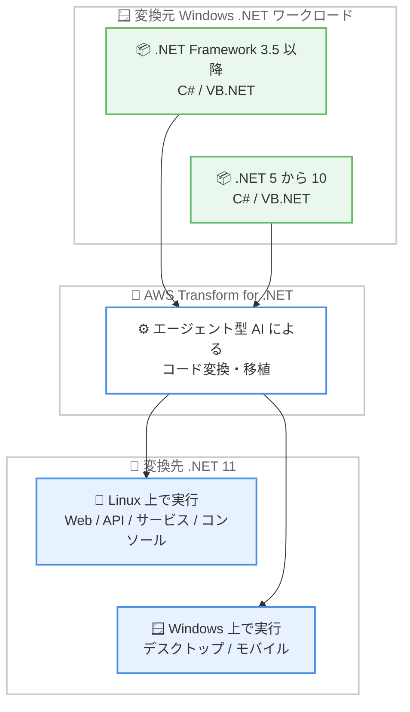

# AWS Transform - .NET 11 サポートおよび対応プロジェクトタイプの拡大

**リリース日**: 2026 年 11 月 20 日
**サービス**: AWS Transform
**機能**: AWS Transform for .NET における .NET 11 サポートと VB.NET・デスクトップ・モバイルプロジェクト対応の一般提供

📊 [このアップデートのインフォグラフィックを見る](https://takech9203.github.io/aws-news-summary/20261120-aws-transform-windows-dotnet-11.html)

## 概要

AWS Transform for .NET が、モダナイゼーションのターゲットとして .NET 11 をサポートしました。あわせて、これまでプレビュー機能として提供されていた VB.NET、デスクトップアプリケーション、モバイルアプリケーションのプロジェクトタイプ対応が一般提供 (GA) となりました。

AWS Transform for .NET は、エージェント型 AI を活用して Windows 上のレガシー .NET アプリケーションをクロスプラットフォームの最新 .NET へ変換するサービスです。今回のアップデートにより、.NET Framework 3.5 以降のレガシーアプリケーションと .NET 5 から 10 のモダンアプリケーションの両方を、C# と VB.NET のいずれのコードベースからでも最新の .NET 11 へ移行できるようになりました。変換後のアプリケーションは .NET 11 のパフォーマンス改善、新しい C# 言語機能、強化された診断機能の恩恵を受けられます。

デスクトップとモバイルを除くすべての変換済みアプリケーションは Linux 上で実行でき、Windows ライセンスコストの削減により運用コストを最大 40% 削減できる可能性があります。Windows ワークロードのモダナイゼーションとコスト最適化を検討しているお客様に有用なアップデートです。

**アップデート前の課題**

- 変換ターゲットが従来の .NET バージョンに限られており、最新の .NET 11 が持つパフォーマンスや言語機能を変換と同時に活用できなかった
- VB.NET プロジェクトの変換はプレビュー段階であり、本番用途での採用判断が難しかった
- WinForms、WPF などのデスクトップアプリケーションや Xamarin ベースのモバイルアプリケーションの変換もプレビュー段階だった

**アップデート後の改善**

- 変換ターゲットとして .NET 11 を選択できるようになり、最新ランタイムへの移行を一度のモダナイゼーションで完了できるようになった
- VB.NET プロジェクトの変換が GA となり、C# と VB.NET の両方のコードベースを本番前提で移行できるようになった
- デスクトップ (WinForms、WPF) およびモバイル (Xamarin) プロジェクトの変換が GA となり、対応プロジェクトタイプが大幅に拡大した

## アーキテクチャ図

レガシー .NET Framework と .NET 5 から 10 のアプリケーションを AWS Transform for .NET が .NET 11 へ変換するフローを示しています。デスクトップとモバイルを除く変換後のアプリケーションは Linux 上で実行でき、コスト削減につながります。

## サービスアップデートの詳細

### 主要機能

1. **.NET 11 への変換サポート**
   - モダナイゼーションのターゲットバージョンとして .NET 11 を選択可能
   - .NET 11 のパフォーマンス改善、新しい C# 言語機能、強化された診断機能を変換後すぐに活用可能
   - レガシーな .NET Framework 3.5 以降と、.NET 5 から 10 のモダンアプリケーションの両方が変換元として対象

2. **VB.NET サポートの一般提供**
   - プレビューとして提供されていた VB.NET コードベースの変換が GA に移行
   - C# と VB.NET の両言語で記述されたアプリケーションをモダナイズ可能

3. **デスクトップ・モバイルプロジェクトの一般提供**
   - WinForms および WPF によるデスクトップアプリケーションの変換が GA に移行
   - Xamarin によるモバイルアプリケーションの変換が GA に移行

4. **幅広いプロジェクトタイプへの対応**
   - クラスライブラリ、コンソールアプリケーション
   - ASP.NET Web プロジェクト (MVC、Web API、Web Forms)
   - Web サービス (ASMX、WCF)
   - 単体テスト (MSTest、NUnit、xUnit)
   - Windows サービス

## 技術仕様

### 対応範囲

| 項目 | 詳細 |
|------|------|
| 変換元 (レガシー) | .NET Framework 3.5 以降 |
| 変換元 (モダン) | .NET 5、6、7、8、9、10 |
| 変換先 | .NET 11 を含む最新のクロスプラットフォーム .NET |
| 対応言語 | C#、VB.NET |
| Web 系プロジェクト | ASP.NET MVC、Web API、Web Forms、ASMX、WCF |
| デスクトップ | WinForms、WPF |
| モバイル | Xamarin |
| テスト | MSTest、NUnit、xUnit |
| その他 | クラスライブラリ、コンソールアプリケーション、Windows サービス |
| 実行環境 | デスクトップ・モバイルを除き Linux 上で実行可能 |

## 設定方法

### 前提条件

1. AWS アカウントと AWS Transform へのアクセス権限
2. 変換対象の .NET アプリケーションのソースコード (C# または VB.NET)
3. ソースコードリポジトリへの接続設定 (AWS Transform が参照できること)

### 手順

#### ステップ 1: AWS Transform でジョブを作成

AWS Transform のコンソールから .NET モダナイゼーションのジョブを作成し、変換対象のリポジトリとプロジェクトを指定します。エージェント型 AI がコードベースを解析し、変換計画を提示します。

#### ステップ 2: ターゲットバージョンの選択

変換先として .NET 11 を選択します。対象プロジェクトタイプ (Web、デスクトップ、モバイル、テストなど) ごとに変換内容を確認します。

#### ステップ 3: 変換の実行と検証

変換を実行し、生成されたコードの差分とビルド結果を確認します。デスクトップ・モバイル以外のアプリケーションは Linux 環境へのデプロイを検証し、コスト削減効果を確認します。

詳細な手順は [AWS Transform ユーザーガイド](https://docs.aws.amazon.com/transform/latest/userguide/dotnet.html) を参照してください。

## メリット

### ビジネス面

- **運用コストの削減**: 変換後のアプリケーションを Linux で実行することで、Windows ライセンス費用を含む運用コストを最大 40% 削減できる可能性がある
- **モダナイゼーションの加速**: エージェント型 AI による自動変換で、手作業による移行と比較してプロジェクト期間を短縮できる
- **追加費用なし**: AWS Transform の .NET 変換機能は追加費用なしで利用できる

### 技術面

- **最新ランタイムの活用**: .NET 11 のパフォーマンス改善、新しい C# 言語機能、強化された診断機能を利用できる
- **対応範囲の拡大**: VB.NET、デスクトップ、モバイルを含む幅広いプロジェクトタイプが GA となり、エンタープライズの多様な資産を一貫したワークフローで移行できる
- **レガシーとモダンの両対応**: .NET Framework 3.5 以降のレガシー資産に加え、.NET 5 から 10 のアプリケーションのバージョンアップにも利用できる

## デメリット・制約事項

### 制限事項

- デスクトップ (WinForms、WPF) およびモバイル (Xamarin) アプリケーションは、変換後も Linux 上では実行できない
- AWS Transform が利用可能なリージョンは 8 リージョンに限られる (東京リージョンは利用可能)

### 考慮すべき点

- 自動変換後もビルド確認やテストによる動作検証は必要であり、検証工程を移行計画に含める必要がある
- サードパーティ製ライブラリへの依存など、アプリケーションの構成によっては追加の手動対応が発生する可能性がある

## ユースケース

### ユースケース 1: レガシー ASP.NET アプリケーションの Linux 移行

**シナリオ**: .NET Framework 4.x で構築された ASP.NET MVC / Web Forms アプリケーションを Windows Server 上で運用しており、ライセンスコストと EOL 対応が課題となっている。

**実装例**: AWS Transform for .NET でアプリケーションを .NET 11 へ変換し、Amazon ECS や AWS Fargate 上の Linux コンテナとしてデプロイする。

**効果**: Windows ライセンス費用の削減により運用コストを最大 40% 削減しつつ、最新ランタイムでパフォーマンスと保守性を向上できる。

### ユースケース 2: VB.NET 資産のモダナイゼーション

**シナリオ**: 長年運用してきた VB.NET の業務アプリケーションが残っており、開発者の確保や保守が年々難しくなっている。

**実装例**: GA となった VB.NET サポートを利用して、AWS Transform for .NET でコードベースを最新の .NET 11 へ変換する。

**効果**: レガシーな VB.NET 資産を本番前提のワークフローでモダナイズし、技術的負債と属人化リスクを低減できる。

### ユースケース 3: .NET 5 から 10 アプリケーションのバージョンアップ

**シナリオ**: .NET 6 や .NET 8 で稼働中のアプリケーションを、サポートライフサイクルに合わせて最新バージョンへ継続的に更新したい。

**実装例**: AWS Transform for .NET の変換ジョブで .NET 11 をターゲットに指定し、依存関係の更新を含むバージョンアップを自動化する。

**効果**: 手作業によるアップグレード工数を削減し、最新の言語機能と診断機能を迅速に取り込める。

## 料金

AWS Transform の .NET 変換機能は追加費用なしで利用できます。

## 利用可能リージョン

AWS Transform が利用可能な以下の 8 リージョンで提供されます。

- 米国東部 (バージニア北部)
- カナダ (中部)
- アジアパシフィック (ムンバイ)
- アジアパシフィック (ソウル)
- アジアパシフィック (シドニー)
- アジアパシフィック (東京)
- 欧州 (フランクフルト)
- 欧州 (ロンドン)

## 関連サービス・機能

- **AWS Transform for VMware / メインフレーム**: AWS Transform ファミリーの他のモダナイゼーション機能。VMware ワークロードやメインフレーム資産の移行に対応
- **Amazon ECS / AWS Fargate**: 変換後の .NET 11 アプリケーションを Linux コンテナとして実行するホスティング先
- **AWS Migration Hub**: 移行プロジェクト全体の進捗管理と計画に活用可能

## 参考リンク

- 📊 [インフォグラフィック](https://takech9203.github.io/aws-news-summary/20261120-aws-transform-windows-dotnet-11.html)
- [公式発表 (What's New)](https://aws.amazon.com/about-aws/whats-new/2026/11/aws-transform-windows-dotnet-11/)
- [ドキュメント: Modernizing .NET with AWS Transform](https://docs.aws.amazon.com/transform/latest/userguide/dotnet.html)

## まとめ

AWS Transform for .NET が .NET 11 への変換に対応し、VB.NET・デスクトップ・モバイルのプロジェクトタイプも GA となったことで、Windows .NET 資産のモダナイゼーション対象が大きく広がりました。追加費用なしで利用でき、Linux 移行により最大 40% のコスト削減が見込めるため、レガシー .NET ワークロードを持つお客様はまず対象アプリケーションの棚卸しと変換の試行から着手することを推奨します。
