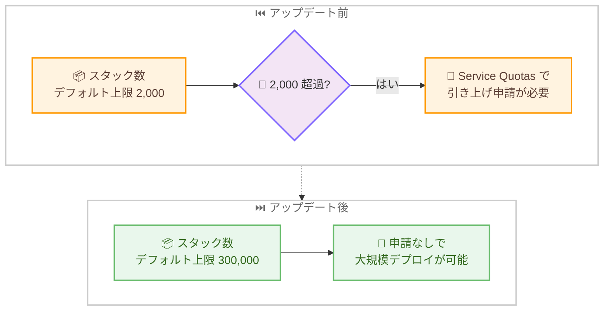

# AWS CloudFormation - アカウントあたりのデフォルトスタック数クォータを 300,000 に引き上げ

**リリース日**: 2026 年 11 月 20 日
**サービス**: AWS CloudFormation
**機能**: スタック数のデフォルトクォータ引き上げ (2,000 → 300,000)

📊 [このアップデートのインフォグラフィックを見る](https://takech9203.github.io/aws-news-summary/20261120-cloudformation-stacks-per-account-quota.html)

## 概要

AWS CloudFormation は、1 つの AWS アカウント・リージョンあたりのスタック数のデフォルトクォータを、従来の 2,000 から 300,000 に引き上げました。これにより、クォータ引き上げ申請を行うことなく、大規模なスタック運用が可能になります。

CloudFormation は関連する AWS リソースをスタックとしてグループ化し、1 つの単位として管理するサービスです。顧客ごと、環境ごと、開発者ごとに個別のスタックをデプロイするようなマルチテナント型・大規模運用のチームにとって、単一アカウント内でのスケールの上限が大幅に緩和される重要なアップデートです。

**アップデート前の課題**

- デフォルトのスタック数クォータは 2,000 であり、大規模な運用ではすぐに上限に達していた
- 2,000 を超えるスタックが必要な場合、Service Quotas を通じてクォータ引き上げ申請を行う必要があった
- SaaS プロバイダーなどが顧客ごとにスタックをデプロイする場合、アカウント分割などの回避策を検討する必要があった

**アップデート後の改善**

- デフォルトクォータが 300,000 に引き上げられ、ほとんどのユースケースで申請が不要になった
- 例えば、顧客ごとに 1 スタックをデプロイするソフトウェアプロバイダーは、単一アカウント・リージョンで 2,000 から 300,000 顧客分までスタックを拡大できる
- 既存のスタックへの変更は一切不要で、自動的に新しいクォータが適用される

## アーキテクチャ図



アップデート前はデフォルト上限 2,000 を超える場合にクォータ引き上げ申請が必要でしたが、アップデート後はデフォルトで 300,000 スタックまで申請なしにデプロイできます。

## サービスアップデートの詳細

### 主要機能

1. **デフォルトクォータの大幅引き上げ**
   - アカウント・リージョンあたりのスタック数のデフォルト上限が 2,000 から 300,000 に引き上げ (150 倍)
   - クォータ引き上げ申請 (Service Quotas 経由) が不要に
   - 既存アカウントにも自動的に適用され、既存スタックへの変更は不要

2. **すべてのインターフェイスで利用可能**
   - CloudFormation コンソール、AWS CLI、AWS SDK で新しいクォータが適用
   - AWS CDK、AWS SAM を使用したデプロイにも適用
   - 現在のクォータ値は Service Quotas コンソールで確認可能

3. **大規模なマルチテナント運用への対応**
   - 顧客ごと、環境ごと、開発者ごとにスタックを分離するアーキテクチャを単一アカウントで大規模に実現可能
   - アカウント分割などの回避策を減らし、運用をシンプル化

## 技術仕様

### クォータの変更内容

| 項目 | アップデート前 | アップデート後 |
|------|----------------|----------------|
| スタック数のデフォルトクォータ | 2,000 / アカウント / リージョン | 300,000 / アカウント / リージョン |
| 上限超過時の対応 | Service Quotas で引き上げ申請 | 申請不要 (デフォルトで対応) |
| 既存スタックへの影響 | - | なし (変更不要) |
| 追加料金 | - | なし |

## 設定方法

### 前提条件

1. AWS アカウントを保有していること
2. CloudFormation または Service Quotas を参照できる IAM 権限があること

### 手順

#### ステップ 1: 現在のクォータ値を確認する

```bash
aws service-quotas list-service-quotas \
  --service-code cloudformation \
  --query "Quotas[?contains(QuotaName, 'Stack count')]"
```

Service Quotas API を使用して、CloudFormation のスタック数クォータ (Stack count) の現在値を確認します。Service Quotas コンソールからも同じ情報を確認できます。

#### ステップ 2: 現在のスタック数を確認する

```bash
aws cloudformation list-stacks \
  --stack-status-filter CREATE_COMPLETE UPDATE_COMPLETE \
  --query "length(StackSummaries)"
```

アカウント・リージョン内の有効なスタック数を集計し、クォータに対する現在の使用状況を把握します。

#### ステップ 3: 特別な作業は不要

新しいデフォルトクォータは自動的に適用されるため、既存スタックや新規スタックの作成フローに変更を加える必要はありません。

## メリット

### ビジネス面

- **スケールの制約緩和**: 顧客数の増加に合わせてスタックを追加するビジネスモデル (SaaS など) で、単一アカウントのまま 300,000 顧客分まで拡張できる
- **運用コストの削減**: クォータ引き上げ申請の手続きや、承認待ちによるリードタイムが不要になる
- **追加料金なし**: 引き上げられたクォータは追加料金なしで利用できる

### 技術面

- **アーキテクチャのシンプル化**: スタック数上限を理由としたアカウント分割や、スタック統合といった回避策が不要になる
- **テナント分離の徹底**: 顧客・環境・開発者単位でスタックを細かく分離する設計を、上限を気にせず採用できる
- **既存環境への影響なし**: 既存スタックの変更やテンプレートの修正は不要で、自動的に新クォータが適用される

## デメリット・制約事項

### 制限事項

- クォータはアカウント・リージョン単位で適用される (複数リージョンを使用する場合はリージョンごとに 300,000)
- スタック数以外のクォータ (スタックあたりのリソース数、テンプレートサイズなど) は従来どおり適用される

### 考慮すべき点

- スタック数が数万〜数十万規模になると、スタックの命名規則、タグ付け、検索・一覧化の戦略がより重要になる
- 大量のスタック操作を自動化する場合、CloudFormation API のスロットリング (レートリミット) を考慮した設計が必要
- スタック数の増加に伴い、ドリフト検出や更新オペレーションの運用設計 (バッチ処理、並列度) を見直すことを推奨

## ユースケース

### ユースケース 1: SaaS プロバイダーの顧客ごとスタック分離

**シナリオ**: SaaS プロバイダーが顧客ごとに専用リソース一式を 1 スタックとしてデプロイするマルチテナントアーキテクチャを採用している。従来は 2,000 顧客で上限に達し、アカウント分割を検討していた。

**実装例**:
```bash
# 顧客ごとにパラメータを変えて同一テンプレートからスタックを作成
aws cloudformation create-stack \
  --stack-name tenant-customer-12345 \
  --template-url https://s3.amazonaws.com/example-bucket/tenant-template.yaml \
  --parameters ParameterKey=TenantId,ParameterValue=customer-12345
```

**効果**: 単一アカウント・リージョンのまま 300,000 顧客分までスタックを拡張でき、アカウント管理の複雑さを回避できる。

### ユースケース 2: 開発者ごとの個別環境プロビジョニング

**シナリオ**: 大規模な開発組織で、開発者ごと・フィーチャーブランチごとに独立した検証環境をスタックとしてプロビジョニングしたいが、スタック数上限により環境の払い出しを制限していた。

**実装例**:
```bash
# CI/CD パイプラインからブランチごとの環境を作成
aws cloudformation deploy \
  --stack-name dev-env-feature-xyz \
  --template-file env-template.yaml \
  --parameter-overrides BranchName=feature-xyz
```

**効果**: 環境数の上限を実質的に意識することなく、開発者やブランチ単位のエフェメラル環境を払い出せる。

### ユースケース 3: 環境・マイクロサービス単位のスタック分割

**シナリオ**: マイクロサービスアーキテクチャで、サービス × 環境 (dev / staging / prod) の組み合わせごとにスタックを分割したいが、サービス数の増加によりスタック数上限が懸念されていた。

**実装例**:
```bash
# AWS CDK でサービス・環境ごとにスタックを定義してデプロイ
cdk deploy "service-*-prod" --require-approval never
```

**効果**: 変更の影響範囲を小さく保つ細粒度のスタック分割戦略を、上限を気にせず採用できる。

## 料金

追加料金はありません。引き上げられたデフォルトクォータは、AWS CloudFormation がサポートされるすべての AWS リージョンで無料で利用できます。CloudFormation 自体の料金体系 (AWS リソースのプロビジョニングは無料、サードパーティリソースタイプのハンドラーオペレーションは有料) に変更はありません。

## 利用可能リージョン

AWS CloudFormation がサポートされるすべての AWS リージョンで利用可能です。詳細は [AWS リージョン別サービス一覧](https://aws.amazon.com/about-aws/global-infrastructure/regional-product-services/) を参照してください。

## 関連サービス・機能

- **Service Quotas**: 現在のクォータ値の確認に使用。今回の引き上げにより、スタック数に関する引き上げ申請は多くの場合不要になった
- **AWS CDK / AWS SAM**: CloudFormation を基盤とするデプロイツールにも新しいクォータが適用される
- **AWS CloudFormation StackSets**: 複数アカウント・リージョンへの大規模デプロイを行う場合の選択肢。単一アカウント内の大量スタック運用と組み合わせて設計できる

## 参考リンク

- 📊 [インフォグラフィック](https://takech9203.github.io/aws-news-summary/20261120-cloudformation-stacks-per-account-quota.html)
- [公式発表 (What's New)](https://aws.amazon.com/about-aws/whats-new/2026/11/cloudformation-stacks-per-account-quota/)
- [ドキュメント: AWS CloudFormation quotas](https://docs.aws.amazon.com/AWSCloudFormation/latest/UserGuide/cloudformation-limits.html)
- [AWS リージョン別サービス一覧](https://aws.amazon.com/about-aws/global-infrastructure/regional-product-services/)

## まとめ

アカウント・リージョンあたりのスタック数のデフォルトクォータが 2,000 から 300,000 へと 150 倍に引き上げられ、クォータ引き上げ申請なしで大規模なスタック運用が可能になりました。顧客ごと・環境ごと・開発者ごとにスタックを分離するアーキテクチャを採用しているチームは、アカウント分割などの回避策を見直す良い機会です。まずは Service Quotas コンソールで現在のクォータ値と使用状況を確認することを推奨します。
