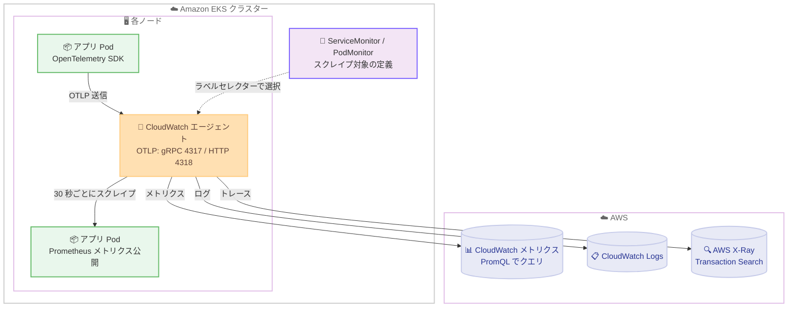

# Amazon CloudWatch - Observability EKS アドオンのカスタム OpenTelemetry / Prometheus テレメトリ対応

**リリース日**: 2026 年 11 月 20 日
**サービス**: Amazon CloudWatch (CloudWatch Observability EKS アドオン)
**機能**: カスタム OpenTelemetry テレメトリの OTLP 取り込みと ServiceMonitor / PodMonitor による Prometheus スクレイピング

📊 [このアップデートのインフォグラフィックを見る](https://takech9203.github.io/aws-news-summary/20261120-cloudwatch-eks-addon-custom-telemetry.html)

## 概要

Amazon CloudWatch Observability EKS アドオンが、ユーザー独自のアプリケーションテレメトリの取り込みに対応しました。クラスター内で既に稼働している CloudWatch エージェントが、アプリケーションのメトリクス、トレース、ログを直接受け付けるようになり、CloudWatch へデータを転送するための別のコレクターを運用する必要がなくなります。

OpenTelemetry SDK で計装されたアプリケーションは、各ノード上のエージェントが公開する OTLP エンドポイント (デフォルトで有効) にデータを送信できます。メトリクスは CloudWatch メトリクスとして取り込まれ PromQL でクエリでき、トレースは AWS X-Ray と Transaction Search に、ログは CloudWatch Logs に送信されます。また、標準の ServiceMonitor / PodMonitor オブジェクトで定義された Prometheus ターゲットをエージェントがスクレイプできるようになり、Prometheus オペレーターの導入やスクレイプ設定の書き換えは不要です。

本機能は EKS アドオンおよび Helm チャートのバージョン 8.0.0 以降で利用可能で、Container Insights や Application Signals を利用中の EKS ユーザー、既存の Prometheus 資産を持つプラットフォームチームが主な対象です。

**アップデート前の課題**

- アプリケーション独自のテレメトリを CloudWatch に送るには、ADOT Collector など別のコレクターを構築・運用する必要があった
- ServiceMonitor / PodMonitor で定義済みの Prometheus スクレイプ設定を活用するには、Prometheus オペレーターや別の Prometheus 環境が必要だった
- アプリケーションテレメトリとインフラメトリクスで付与される属性が異なり、相関分析が難しかった

**アップデート後の改善**

- クラスター内の CloudWatch エージェントが OTLP エンドポイント (gRPC 4317 / HTTP 4318) を公開し、追加コレクターなしでメトリクス、トレース、ログを取り込めるようになった
- 標準の ServiceMonitor / PodMonitor をそのまま利用して Prometheus ターゲットをスクレイプでき、各チームがアプリケーションと一緒にスクレイプ対象を定義できるようになった
- 両方のソースのテレメトリに、送信元 Pod と同じ Kubernetes、ホスト、クラウド、サービス属性が自動付与され、クラスターメトリクスとの結合分析が可能になった

## アーキテクチャ図



各ノードの CloudWatch エージェントが OTLP エンドポイントでアプリケーションテレメトリを受信し、ServiceMonitor / PodMonitor で定義された Prometheus ターゲットをスクレイプして、メトリクス、ログ、トレースをそれぞれの CloudWatch 送信先へ転送します。

## サービスアップデートの詳細

### 主要機能

1. **OTLP 取り込みエンドポイント**
   - 各ノードの CloudWatch エージェントが OTLP エンドポイントを公開 (デフォルトで有効)
   - gRPC はポート 4317、HTTP はポート 4318 で平文の OTLP を受け付け、HTTP の場合はリクエストボディ最大 20 MiB まで対応
   - 送信先は `amazon-cloudwatch` 名前空間の `cloudwatch-agent` Service で、リクエストは送信元と同じノード上のエージェントにルーティングされる
   - メトリクスは OpenTelemetry メトリクスとして CloudWatch に送信され、PromQL でクエリ可能
   - トレースは X-Ray と Transaction Search に送信され、スパンメトリクスが有効な場合はリクエスト数、エラー、レイテンシのメトリクスも自動計算される
   - ログはロググループ `/aws/cwagent/{cluster-name}/otlp` に送信され、`aws.log.group.name` / `aws.log.stream.name` リソース属性で送信先を変更可能

2. **ServiceMonitor / PodMonitor による Prometheus スクレイピング**
   - `monitoring.coreos.com/v1` の標準 ServiceMonitor / PodMonitor オブジェクトで定義されたターゲットを CloudWatch エージェントがスクレイプ (デフォルトで有効)
   - Prometheus オペレーターは不要で、既存のスクレイプ設定の書き換えも不要
   - デフォルトではクラスター内のすべてのモニターを 30 秒間隔でスクレイプし、ラベルセレクターで対象を絞り込み可能
   - CRD が存在しない場合のみ CloudWatch エージェントオペレーターが作成し、既存の CRD には変更を加えない
   - ターゲットごとに `up` メトリクスを保持し、`up == 0` でスクレイプ失敗を検知可能

3. **テレメトリの属性エンリッチメント**
   - 両ソースのテレメトリに、送信元 Pod の Kubernetes 属性 (`k8s.*`)、ホスト・クラウド属性、サービスアイデンティティ属性 (`service.name` など) を自動付与
   - OTLP 取り込みでは Pod / ノードラベルも `k8s.pod.label.*` / `k8s.node.label.*` として付与され、`otelFilters` 設定で対象ラベルを制御可能
   - Container Insights が収集するインフラメトリクスと同じ属性体系のため、相関分析が容易

## 技術仕様

### OTLP エンドポイントの設定値

| 設定値 | デフォルト | 説明 |
|------|------|------|
| `otlp.enabled` | `true` | エンドポイントの有効 / 無効 |
| `otlp.grpc.enabled` | `true` | gRPC での OTLP 受信 |
| `otlp.grpc.port` | `4317` | gRPC 用ノードポート |
| `otlp.http.enabled` | `true` | HTTP での OTLP 受信 |
| `otlp.http.port` | `4318` | HTTP 用ノードポート |
| `otlp.spanMetrics.enabled` | `true` | 受信トレースからのスパンメトリクス計算 |

少なくとも 1 つのプロトコルを有効にする必要があり、2 つのポートは異なる値にする必要があります。エージェントが既に使用しているポート (2000、4311、4314、4315、4316、8125、25826、25888) は指定できません。

### Prometheus スクレイピングの設定値

| 設定値 | デフォルト | 説明 |
|------|------|------|
| `otelPrometheusMonitor.enabled` | `true` | スクレイピングの有効 / 無効 |
| `otelPrometheusMonitor.scrapeInterval` | `30s` | スクレイプ間隔 |
| `otelPrometheusMonitor.serviceMonitorSelector` | 空 | スクレイプ対象の ServiceMonitor を選択するラベルセレクター (空はすべて選択) |
| `otelPrometheusMonitor.podMonitorSelector` | 空 | スクレイプ対象の PodMonitor を選択するラベルセレクター (空はすべて選択) |
| `otelPrometheusMonitor.readSecrets` | `false` | モニターが参照する Secret (basicAuth、authorization、oauth2、tlsConfig) の読み取り許可 |

### スクレイプ対象を絞り込む設定例

```json
{
  "otelPrometheusMonitor": {
    "readSecrets": true,
    "scrapeInterval": "60s",
    "serviceMonitorSelector": {
      "matchLabels": {
        "cloudwatch": "true"
      }
    },
    "podMonitorSelector": {
      "matchExpressions": [
        {
          "key": "team",
          "operator": "In",
          "values": ["payments", "checkout"]
        }
      ]
    }
  }
}
```

ラベル `cloudwatch: "true"` を持つ ServiceMonitor と、`team` ラベルが `payments` または `checkout` の PodMonitor のみを 60 秒間隔でスクレイプし、それらのモニターが参照する Secret の読み取りを許可する設定です。

## 設定方法

### 前提条件

1. Amazon CloudWatch Observability EKS アドオンまたは Helm チャートのバージョン 8.0.0 以降
2. CloudWatch エージェントがメトリクス、ログ、トレースを書き込むための IAM 権限 (`CloudWatchAgentServerPolicy` マネージドポリシー)
3. トレースを利用する場合は、対象アカウント・リージョンで Transaction Search を有効化

### 手順

#### ステップ 1: アドオンをバージョン 8.0.0 以降に更新

```bash
aws eks update-addon \
  --cluster-name my-cluster \
  --addon-name amazon-cloudwatch-observability \
  --addon-version v8.0.0-eksbuild.1
```

EKS クラスターの CloudWatch Observability アドオンをバージョン 8.0.0 以降に更新します。OTLP エンドポイントと Prometheus スクレイピングはデフォルトで有効になります。

#### ステップ 2: アプリケーションから OTLP エンドポイントへ送信

```yaml
env:
  - name: OTEL_EXPORTER_OTLP_ENDPOINT
    value: http://cloudwatch-agent.amazon-cloudwatch:4318
  - name: OTEL_EXPORTER_OTLP_PROTOCOL
    value: http/protobuf
```

OpenTelemetry SDK を使用するコンテナに環境変数を設定し、`amazon-cloudwatch` 名前空間の `cloudwatch-agent` Service に OTLP over HTTP で送信します。SDK がシグナルごとのパス (`/v1/metrics`、`/v1/traces` など) を自動的に付加します。

#### ステップ 3: ServiceMonitor でスクレイプ対象を定義

```yaml
apiVersion: monitoring.coreos.com/v1
kind: ServiceMonitor
metadata:
  name: orders
  namespace: shop
  labels:
    cloudwatch: "true"
spec:
  selector:
    matchLabels:
      app: orders
  endpoints:
    - port: metrics
      path: /metrics
```

ラベル `app: orders` を持つ Service の背後の Pod から、`metrics` という名前のポートの `/metrics` パスをスクレイプする ServiceMonitor を作成します。デフォルト設定ではすべてのモニターがスクレイプ対象になるため、作成するだけでメトリクスが CloudWatch に送信されます。

## メリット

### ビジネス面

- **運用コストの削減**: 別のコレクター (ADOT Collector や独自の Prometheus サーバーなど) の構築・運用・パッチ適用が不要になり、運用負荷を削減できる
- **既存資産の活用**: 既存の ServiceMonitor / PodMonitor 定義をそのまま利用でき、CloudWatch への移行コストを最小化できる
- **チームの自律性向上**: 中央のアドオン設定ではなく、各チームがアプリケーションと一緒にスクレイプ対象を定義できる

### 技術面

- **統一された属性体系**: アプリケーションテレメトリとインフラメトリクスに同じ Kubernetes / クラウド属性が付与され、PromQL での結合分析や障害の相関分析が容易になる
- **デフォルト有効で即利用可能**: バージョン 8.0.0 以降では OTLP エンドポイントとスクレイピングがデフォルトで有効であり、追加のデプロイ作業なしで利用を開始できる
- **柔軟な制御**: ラベルセレクターによるモニターの絞り込み、ポート変更、スパンメトリクスの無効化、OpenTelemetry フィルターによる送信テレメトリの制御が可能

## デメリット・制約事項

### 制限事項

- EKS アドオンおよび Helm チャートのバージョン 8.0.0 以降が必要
- OTLP エンドポイントは平文での受信であり、HTTP エンドポイントのリクエストボディは最大 20 MiB
- エージェント Pod はホストネットワークを使用するため、ノード上の別のコレクターがポート 4317 / 4318 を使用していると Pod が `Pending` になる (ポート変更で回避可能)
- Prometheus スクレイピングで取得したメトリクスにはノードラベルは付与されない
- トレースの利用には Transaction Search の有効化が必要

### 考慮すべき点

- 旧バージョンの Helm チャートの `default:otel` エージェント設定は無視されるようになり、`otlp.enabled` のみがエンドポイントの有効 / 無効を決定する
- 同じ Pod に ServiceMonitor と PodMonitor の両方を定義すると二重にスクレイプされ、重複した系列が送信される
- `readSecrets` を有効にすると、エージェントの Target Allocator にすべての名前空間の Secret への `get` 権限が付与されるため、セキュリティ要件を確認する必要がある
- アドオンをアンインストールしても ServiceMonitor / PodMonitor の CRD とオブジェクトはクラスターに残る。CRD を削除すると、他の Prometheus が使用しているものを含むすべてのモニターが削除される点に注意
- カスタムテレメトリの取り込みは Amazon EKS の OpenTelemetry 取り込み料金 (USD 0.08/GB) で課金されるため、送信量を OpenTelemetry フィルターなどで制御することが望ましい

## ユースケース

### ユースケース 1: 追加コレクターなしでのアプリケーション計装

**シナリオ**: OpenTelemetry SDK で計装済みのマイクロサービスを EKS 上で運用しており、ADOT Collector を別途運用せずにメトリクス、トレース、ログを CloudWatch に送信したい。

**実装例**:
```yaml
env:
  - name: OTEL_EXPORTER_OTLP_ENDPOINT
    value: http://cloudwatch-agent.amazon-cloudwatch:4318
  - name: OTEL_EXPORTER_OTLP_PROTOCOL
    value: http/protobuf
```

**効果**: コレクターの運用が不要になり、トレースは X-Ray と Transaction Search で分析でき、スパンメトリクスによりリクエスト数、エラー、レイテンシを自動取得できる。

### ユースケース 2: 既存の Prometheus 定義を利用した CloudWatch への移行

**シナリオ**: kube-prometheus-stack で ServiceMonitor / PodMonitor を利用してきたが、Prometheus サーバーの運用をやめて CloudWatch にメトリクスを集約したい。

**実装例**:
```json
{
  "otelPrometheusMonitor": {
    "serviceMonitorSelector": {
      "matchLabels": {
        "cloudwatch": "true"
      }
    }
  }
}
```

**効果**: スクレイプ設定を書き換えずに段階的に移行でき、ラベルセレクターにより一部のモニターを既存の Prometheus に残したまま並行運用できる。

### ユースケース 3: アプリケーションメトリクスとインフラメトリクスの相関分析

**シナリオ**: アプリケーションのカスタムメトリクスの異常が、Pod のリソース不足やノード障害と関係しているかを迅速に切り分けたい。

**実装例**:
```
# PromQL でアプリケーションメトリクスとコンテナメトリクスを k8s 属性で結合して分析
sum by (k8s_workload_name) (rate(orders_processed_total[5m]))
```

**効果**: 両方のテレメトリに同じ Kubernetes / クラウド属性が付与されているため、PromQL でワークロード単位の結合分析が可能になり、障害の切り分け時間を短縮できる。

## 料金

カスタムテレメトリの取り込みは、Amazon EKS の OpenTelemetry 取り込みレートである USD 0.08/GB で課金されます。詳細は [CloudWatch 料金ページ](https://aws.amazon.com/cloudwatch/pricing/) を参照してください。

### 料金例

| 使用量 | 月額料金 (概算) |
|--------|------------------|
| カスタムテレメトリ 100 GB/月 | USD 8.00 |
| カスタムテレメトリ 1,000 GB/月 | USD 80.00 |

## 利用可能リージョン

CloudWatch が OpenTelemetry メトリクスをサポートするすべての AWS リージョンで利用可能です。

## 関連サービス・機能

- **Amazon EKS**: 本アドオンの対象となるマネージド Kubernetes サービス
- **CloudWatch Container Insights**: クラスターのインフラメトリクスを収集する機能。カスタムテレメトリと同じ属性体系で相関分析が可能
- **CloudWatch Application Signals**: アプリケーションのパフォーマンス監視機能。本アップデートで独自テレメトリも同じエージェントで取り込み可能に
- **AWS X-Ray / Transaction Search**: OTLP で送信されたトレースの送信先となる分散トレーシング機能
- **AWS Distro for OpenTelemetry (ADOT)**: 従来、独自テレメトリの転送に利用されていたコレクター。本アップデートにより用途によっては不要になる

## 参考リンク

- 📊 [インフォグラフィック](https://takech9203.github.io/aws-news-summary/20261120-cloudwatch-eks-addon-custom-telemetry.html)
- [公式発表 (What's New)](https://aws.amazon.com/about-aws/whats-new/2026/11/cloudwatch-eks-addon-custom-telemetry/)
- [ドキュメント: Custom telemetry](https://docs.aws.amazon.com/AmazonCloudWatch/latest/monitoring/eks-observability-addon-custom-telemetry.html)
- [ドキュメント: OTLP ingestion](https://docs.aws.amazon.com/AmazonCloudWatch/latest/monitoring/eks-observability-addon-otlp-endpoint.html)
- [ドキュメント: Scraping ServiceMonitor and PodMonitor targets](https://docs.aws.amazon.com/AmazonCloudWatch/latest/monitoring/eks-observability-addon-prometheus-monitors.html)
- [料金ページ](https://aws.amazon.com/cloudwatch/pricing/)

## まとめ

CloudWatch Observability EKS アドオンのバージョン 8.0.0 以降では、既存の CloudWatch エージェントだけで OpenTelemetry と Prometheus のカスタムテレメトリを取り込めるようになり、別コレクターの運用が不要になりました。既存の ServiceMonitor / PodMonitor 資産を活用しながら、アプリケーションとインフラのテレメトリを統一された属性体系で相関分析できる点が大きな価値です。EKS で独自テレメトリを収集しているチームは、アドオンの更新と取り込み料金 (USD 0.08/GB) の試算から検討を始めることを推奨します。
