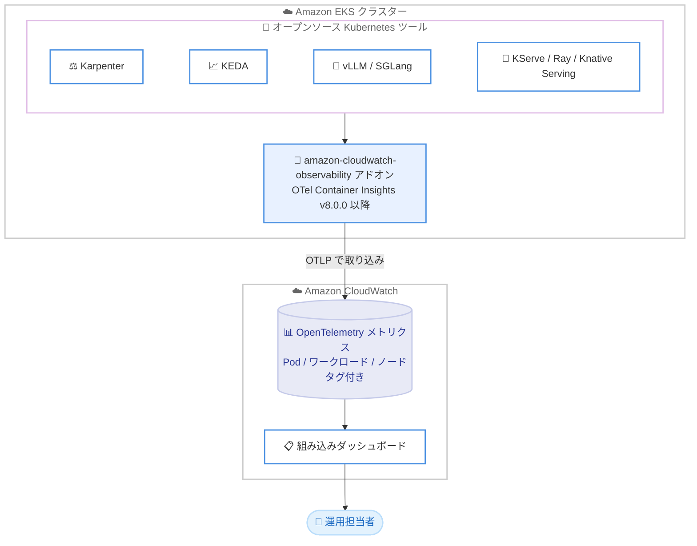

# Amazon CloudWatch - EKS Container Insights によるオープンソース Kubernetes ツールの組み込みモニタリング

**リリース日**: 2026 年 11 月 20 日
**サービス**: Amazon CloudWatch (EKS Container Insights)
**機能**: オープンソース Kubernetes ツール向け組み込みモニタリング

📊 [このアップデートのインフォグラフィックを見る](https://takech9203.github.io/aws-news-summary/20261120-cloudwatch-eks-kubernetes-tools.html)

## 概要

Amazon CloudWatch の EKS Container Insights が、Amazon EKS クラスター上で稼働するオープンソース Kubernetes ツールの組み込みモニタリングを提供するようになりました。対象は Karpenter、KEDA、vLLM、KServe、SGLang、Ray、Knative Serving の 7 つのツールで、OTel Container Insights を有効化するだけで自動的にモニタリングが開始され、専用のダッシュボードが利用できます。

このアップデートの最大の価値は、「すでに使用しているツールのダッシュボードを、Prometheus や Grafana を自前で運用することなく入手できる」点です。AI 推論ワークロードでは、モデルサーバーごとのキュー内リクエスト数、最初のトークンまでの時間 (Time to First Token)、KV キャッシュ使用率を確認できます。オートスケーリングでは、失敗しているスケーラーやスケールループの所要時間がダッシュボードに表示されます。すべてのメトリクスには Pod、ワークロード、ノードのタグが付与されるため、遅延しているモデルサーバーを基盤となるノードまで遡って追跡できます。

利用にはアドオンおよび Helm チャートのバージョン 8.0.0 以降が必要です。EKS 上で LLM 推論基盤やイベント駆動型オートスケーリングを運用するプラットフォームチームや SRE チームが主な対象ユーザーです。

**アップデート前の課題**

このアップデート以前には、以下の課題がありました。

- Karpenter や KEDA、vLLM などのオープンソースツールのメトリクスを可視化するには、Prometheus と Grafana を自前で構築・運用する必要があった
- ツールごとにスクレイプ設定やダッシュボードを個別に作成・保守する必要があり、運用負荷が高かった
- 推論の遅延やスケーリングの失敗が発生した際、ツールのメトリクスとノード・Pod の情報が分離しており、原因の切り分けに時間がかかった

**アップデート後の改善**

今回のアップデートにより、以下が可能になりました。

- OTel Container Insights を有効化するだけで、7 つのオープンソースツールのモニタリングが自動的に開始される
- Prometheus や Grafana を自前で運用することなく、CloudWatch の組み込みダッシュボードでツールの状態を確認できる
- すべてのメトリクスに Pod、ワークロード、ノードのタグが付与されるため、遅いモデルサーバーを基盤のノードまでトレースできる

## アーキテクチャ図



EKS クラスター上の各ツールのメトリクスを amazon-cloudwatch-observability アドオン (OTel Container Insights) が収集し、OTLP で CloudWatch に取り込んで組み込みダッシュボードとして可視化する流れを示しています。

## サービスアップデートの詳細

### 主要機能

1. **オープンソースツールの自動モニタリング**
   - OTel Container Insights を有効化すると、対象ツールのモニタリングが自動的に開始される
   - Karpenter、KEDA、vLLM、KServe、SGLang、Ray、Knative Serving の 7 つのツールに対応
   - ツールごとの組み込みダッシュボードが提供され、個別のダッシュボード作成が不要

2. **AI 推論ワークロードの可視化**
   - モデルサーバーごとのキュー内リクエスト数を確認できる
   - 最初のトークンまでの時間 (Time to First Token) を可視化できる
   - KV キャッシュ使用率をモデルサーバー単位で把握できる

3. **オートスケーリングの可視化**
   - 失敗しているスケーラーをダッシュボードで特定できる
   - スケールループの所要時間を確認できる

4. **Pod・ワークロード・ノードによるメトリクスのタグ付け**
   - すべてのメトリクスに Pod、ワークロード、ノードのタグが付与される
   - 遅延しているモデルサーバーを、稼働している基盤ノードまで遡って追跡できる

## 技術仕様

### 対応ツールと主な用途

| ツール | 分類 | 主な用途 |
|------|------|------|
| Karpenter | オートスケーリング | ノードのプロビジョニングとスケーリング |
| KEDA | オートスケーリング | イベント駆動型の Pod オートスケーリング |
| vLLM | AI 推論 | LLM の高スループット推論サービング |
| SGLang | AI 推論 | LLM の高速推論サービング |
| KServe | AI 推論 | Kubernetes 上のモデルサービングプラットフォーム |
| Ray | AI / 分散処理 | 分散コンピューティングと ML ワークロード |
| Knative Serving | サーバーレス | リクエスト駆動型のサーバーレスコンテナ実行 |

### OTel Container Insights の特徴

| 項目 | 詳細 |
|------|------|
| 必要バージョン | アドオンおよび Helm チャート v8.0.0 以降 |
| アドオン名 | amazon-cloudwatch-observability |
| メトリクス収集 | OpenTelemetry Protocol (OTLP) による 30 秒粒度の収集 |
| メトリクス名 | ソース元のオリジナルのメトリクス名を保持し、PromQL でクエリ可能 |
| ラベル付与 | テレメトリソースのネイティブラベル、OTel リソース属性、Kubernetes の Pod / ノードラベルで最大 150 ラベル |
| 有効化設定 | アドオン設定で `otelContainerInsights.enabled` を `true` に設定 |

## 設定方法

### 前提条件

1. Amazon EKS クラスターが稼働していること
2. amazon-cloudwatch-observability アドオンまたは Helm チャートのバージョン 8.0.0 以降を使用すること
3. モニタリング対象のオープンソースツール (Karpenter、KEDA、vLLM など) がクラスターにデプロイされていること

### 手順

#### ステップ 1: 現在のアドオンバージョンを確認する

```bash
aws eks describe-addon \
  --cluster-name <cluster-name> \
  --addon-name amazon-cloudwatch-observability \
  --query addon.addonVersion --output text
```

EKS クラスターにインストールされている amazon-cloudwatch-observability アドオンの現在のバージョンを表示します。v8.0.0 以降でない場合はアップグレードが必要です。

#### ステップ 2: OTel Container Insights を有効化する

```bash
aws eks update-addon \
  --cluster-name <cluster-name> \
  --addon-name amazon-cloudwatch-observability \
  --configuration-values '{"otelContainerInsights":{"enabled":true}}'
```

アドオンの設定で OTel Container Insights を有効化します。このコマンドはアドオン設定全体を置き換えるため、他の設定値を使用している場合は既存の設定にマージして指定します。有効化すると、対象のオープンソースツールのモニタリングが自動的に開始されます。

#### ステップ 3: CloudWatch コンソールでダッシュボードを確認する

CloudWatch コンソールの Container Insights から、クラスター上で稼働するツールの組み込みダッシュボードを確認します。AI 推論ワークロードではキュー内リクエスト数、Time to First Token、KV キャッシュ使用率を、オートスケーリングでは失敗しているスケーラーとスケールループ所要時間を確認できます。

## メリット

### ビジネス面

- **運用コストの削減**: Prometheus や Grafana を自前で構築・運用する必要がなくなり、モニタリング基盤の運用工数を削減できる
- **障害対応の迅速化**: 推論の遅延やスケーリングの失敗を組み込みダッシュボードで即座に特定でき、MTTR の短縮につながる
- **AI 基盤の信頼性向上**: LLM 推論サーバーの健全性を標準的な方法で可視化でき、AI サービスの品質管理が容易になる

### 技術面

- **自動セットアップ**: OTel Container Insights を有効化するだけでモニタリングが開始され、ツールごとのスクレイプ設定が不要
- **コンテキストの紐付け**: すべてのメトリクスに Pod、ワークロード、ノードのタグが付与され、アプリケーション層からインフラ層まで一貫して追跡できる
- **PromQL 互換**: メトリクスはオリジナルのソース名を保持するため、コミュニティの既存 PromQL クエリやナレッジを活用できる

## デメリット・制約事項

### 制限事項

- アドオンおよび Helm チャートのバージョン 8.0.0 以降が必要
- 対応ツールは Karpenter、KEDA、vLLM、KServe、SGLang、Ray、Knative Serving の 7 つに限定される
- CloudWatch が OpenTelemetry メトリクスをサポートするリージョンでのみ利用可能

### 考慮すべき点

- メトリクスは Amazon EKS の OpenTelemetry 取り込みレート (1 GB あたり 0.08 USD) で課金されるため、取り込み量の増加によるコストを見積もる必要がある
- 既存バージョン (6.x / 7.x) からのアップグレード時は、メトリクスの系列やラベルの変更に伴い、既存のクエリ・ダッシュボード・アラームへの影響を事前に確認することが推奨される

## ユースケース

### ユースケース 1: vLLM による LLM 推論基盤のパフォーマンス監視

**シナリオ**: EKS 上で vLLM を使用して LLM 推論 API を提供しており、応答遅延の原因特定に時間がかかっている。

**実装例**:
```bash
aws eks update-addon \
  --cluster-name llm-inference-cluster \
  --addon-name amazon-cloudwatch-observability \
  --configuration-values '{"otelContainerInsights":{"enabled":true}}'
```

**効果**: モデルサーバーごとのキュー内リクエスト数、Time to First Token、KV キャッシュ使用率が組み込みダッシュボードで可視化され、遅延しているモデルサーバーを基盤ノードまで遡って特定できる。

### ユースケース 2: KEDA によるイベント駆動オートスケーリングの健全性監視

**シナリオ**: KEDA でキューの深さに応じた Pod オートスケーリングを構成しているが、スケーラーの失敗に気づくのが遅れ、処理遅延が発生することがある。

**実装例**:
```text
CloudWatch コンソール → Container Insights →
対象クラスターの KEDA ダッシュボードで
失敗しているスケーラーとスケールループ所要時間を確認
```

**効果**: 失敗しているスケーラーをダッシュボードで即座に特定でき、スケーリング不全による処理遅延を未然に防止できる。

### ユースケース 3: Prometheus / Grafana 自前運用からの移行

**シナリオ**: Karpenter と Knative Serving の監視のために Prometheus と Grafana を自前で運用しており、監視基盤自体の保守 (バージョンアップ、ストレージ管理、可用性確保) が負担になっている。

**実装例**:
```text
1. アドオンを v8.0.0 以降にアップグレード
2. OTel Container Insights を有効化
3. 組み込みダッシュボードで監視項目を検証
4. 自前運用の Prometheus / Grafana を段階的に廃止
```

**効果**: 監視基盤の自前運用が不要になり、マネージドな CloudWatch ダッシュボードに集約することで運用負荷とインフラコストを削減できる。

## 料金

メトリクスは Amazon EKS の OpenTelemetry 取り込みレートである 1 GB あたり 0.08 USD で課金されます。詳細は CloudWatch の料金ページを参照してください。

### 料金例

| 使用量 | 月額料金 (概算) |
|--------|------------------|
| 取り込み量 10 GB / 月 | 0.80 USD |
| 取り込み量 100 GB / 月 | 8.00 USD |

## 利用可能リージョン

CloudWatch が OpenTelemetry メトリクスをサポートするすべての AWS リージョンで利用可能です。

## 関連サービス・機能

- **Amazon EKS**: モニタリング対象の Kubernetes クラスターを提供するマネージドサービス。amazon-cloudwatch-observability アドオンを通じて本機能を利用する
- **CloudWatch Container Insights**: コンテナワークロードのメトリクスとログを収集・可視化する機能。本アップデートは OTel Container Insights の拡張にあたる
- **AWS Distro for OpenTelemetry**: OpenTelemetry の AWS ディストリビューション。OTel Container Insights は OpenTelemetry Collector を基盤としている

## 参考リンク

- 📊 [インフォグラフィック](https://takech9203.github.io/aws-news-summary/20261120-cloudwatch-eks-kubernetes-tools.html)
- [公式発表 (What's New)](https://aws.amazon.com/about-aws/whats-new/2026/11/cloudwatch-eks-kubernetes-tools/)
- [ドキュメント: OTel Container Insights (Amazon CloudWatch User Guide)](https://docs.aws.amazon.com/AmazonCloudWatch/latest/monitoring/container-insights-eks-otel.html)
- [料金ページ: Amazon CloudWatch pricing](https://aws.amazon.com/cloudwatch/pricing/)

## まとめ

EKS 上で広く使われるオープンソースツールのモニタリングが、OTel Container Insights の有効化だけで利用できるようになり、Prometheus / Grafana の自前運用が不要になる重要なアップデートです。特に vLLM や SGLang などで LLM 推論基盤を運用するチームにとって、Time to First Token や KV キャッシュ使用率を標準ダッシュボードで確認できる価値は大きいといえます。まずはアドオンを v8.0.0 以降にアップグレードし、検証環境で組み込みダッシュボードの内容を確認することを推奨します。
