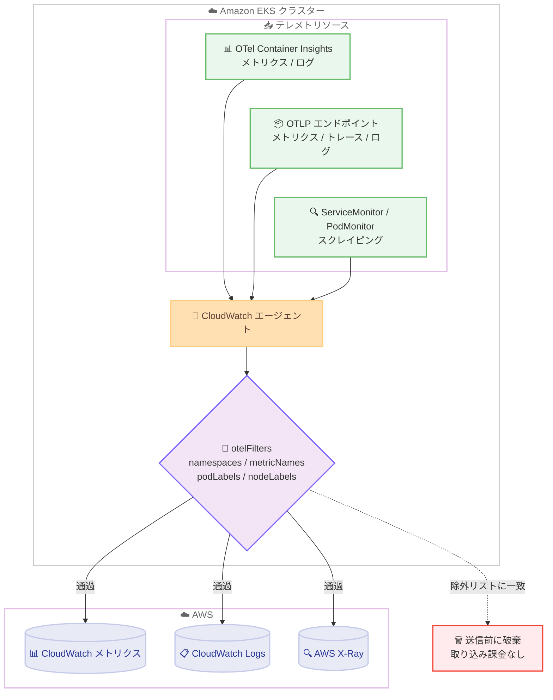

# Amazon CloudWatch - Observability EKS アドオンのテレメトリフィルタリング対応

**リリース日**: 2026 年 11 月 20 日
**サービス**: Amazon CloudWatch (CloudWatch Observability EKS アドオン)
**機能**: OpenTelemetry フィルター (otelFilters) によるクラスター全体のテレメトリフィルタリング

📊 [このアップデートのインフォグラフィックを見る](https://takech9203.github.io/aws-news-summary/20261120-cloudwatch-eks-otel-addon-filtering.html)

## 概要

Amazon CloudWatch Observability EKS アドオンが、テレメトリフィルタリングに対応しました。名前空間、メトリクス名、Pod / ノードラベルに対するクラスター全体の include / exclude リストを定義することで、利用していないテレメトリの取り込みを送信前に停止し、取り込みコストを削減できます。

CloudWatch の OpenTelemetry テレメトリは取り込み量 (GB) に応じて課金されるため、監視していない非本番の名前空間の除外、高カーディナリティメトリクスの名前指定での破棄、グルーピングに実際に使用するラベルのみの収集といったフィルタリングが、そのままコスト削減につながります。フィルターはアドオン設定の `otelFilters` として定義され、クラスターの要件が変化しても 1 回のアドオン設定更新だけで変更できます。

本機能は EKS アドオンおよび Helm チャートのバージョン 8.0.0 以降で利用可能で、OTel Container Insights や OTLP 取り込み、ServiceMonitor / PodMonitor スクレイピングを利用する EKS ユーザーのうち、特にテレメトリの取り込みコストを最適化したいプラットフォームチームが主な対象です。

**アップデート前の課題**

- 監視していない名前空間や使用していないメトリクスも含めて取り込まれ、不要なテレメトリにも取り込み料金が発生していた
- 最大 150 のラベルがメトリクスに付与されるため、使用しない高カーディナリティラベルが保存・クエリ対象のデータ量を増やしていた
- 取り込み量を制御するには、アプリケーション側の計装変更やコレクター設定の個別調整が必要だった

**アップデート後の改善**

- 名前空間、メトリクス名、Pod / ノードラベルの include / exclude リストをクラスター全体で定義し、不要なテレメトリを送信前に破棄できるようになった
- 取り込み課金の対象となるデータ量が減少し、取り込みコストを直接削減できるようになった
- 1 回のアドオン設定更新でフィルターを変更でき、クラスターの要件変化に追随しやすくなった

## アーキテクチャ図



CloudWatch エージェントが収集した各ソースのテレメトリは、`otelFilters` で定義した include / exclude リストで評価され、除外対象は CloudWatch へ送信される前に破棄されるため、取り込み課金の対象になりません。

## サービスアップデートの詳細

### 主要機能

1. **名前空間フィルター (`otelFilters.namespaces`)**
   - 除外した名前空間の Pod / コンテナテレメトリを破棄する
   - OTel Container Insights のメトリクスとログ、OTLP エンドポイントで受信するメトリクス・トレース・ログ、ServiceMonitor / PodMonitor スクレイピングに適用される
   - ノードレベルのメトリクス、ホストログ、Karpenter や KEDA などコントロールプレーンコンポーネントのメトリクスには適用されず、Kubernetes 名前空間を持たないレコードは常に通過する
   - GPU、AWS Trainium / Inferentia、EFA のデバイスメトリクスは破棄されない。除外対象の名前空間の Pod がデバイスを使用している場合、デバイスメトリクスは保持され、Pod・名前空間・コンテナ属性のみが除去される

2. **メトリクス名フィルター (`otelFilters.metricNames`)**
   - CloudWatch へ送信される時点のメトリクス名に対して大文字小文字を区別してマッチングする
   - OTel Container Insights のメトリクス、OTLP エンドポイントで受信するメトリクス (スパンメトリクス含む)、ServiceMonitor / PodMonitor スクレイピングに適用される。ログには適用されない
   - 空でない `include` リストを指定すると、リストにあるメトリクスのみが保持され、スパンメトリクスを含む他のすべてのメトリクスが破棄される
   - `include` リストに `up` を含めない場合、スクレイプ対象の `up` メトリクスも破棄される点に注意

3. **Pod / ノードラベルフィルター (`otelFilters.podLabels` / `otelFilters.nodeLabels`)**
   - エージェントが `k8s.pod.label.*` / `k8s.node.label.*` 属性として付与するラベルを制御する
   - `include` (収集するラベル)、`exclude` (収集後に除去するラベル)、`recommendedExclusions` (高カーディナリティラベルの組み込み除外リスト、デフォルト `true`) の 3 つの設定を持つ
   - 組み込み除外リストには、トポロジー、ホスト名、インスタンスタイプのラベル、Karpenter / EKS Auto Mode のインスタンスラベル、`pod-template-hash` などのコントローラーリビジョンマーカーが含まれる
   - 優先順位は exclude > 名前指定の include エントリ > 組み込みリストの順で、組み込みリストの特定ラベルだけ残したい場合は `include` に名前を指定する

4. **シンプルなマッチングルール**
   - エントリは完全一致の名前、`prod-*` のようなプレフィックス + `*`、または `*` 単独のいずれか
   - 空の `include` リスト、または `*` を含む `include` リストはすべてを含める
   - exclude が include より優先され、マッチングは大文字小文字を区別する

## 技術仕様

### フィルターの適用範囲

| フィルター | 適用対象 |
|------|------|
| `otelFilters.namespaces` | OTel Container Insights のメトリクス / ログ、OTLP 受信のメトリクス / トレース / ログ、ServiceMonitor / PodMonitor スクレイピング |
| `otelFilters.metricNames` | OTel Container Insights のメトリクス、OTLP 受信のメトリクス (スパンメトリクス含む)、ServiceMonitor / PodMonitor スクレイピング (ログは対象外) |
| `otelFilters.podLabels` / `otelFilters.nodeLabels` | OTel Container Insights のメトリクス / ログ、OTLP 受信のメトリクス / トレース / ログ、ServiceMonitor / PodMonitor スクレイピング |

### マッチングルール

| 項目 | 詳細 |
|------|------|
| エントリ形式 | 完全一致の名前、プレフィックス + `*` (例: `prod-*`)、または `*` 単独 |
| 空の include | すべてを含める (`*` を含む場合も同様) |
| 優先順位 | exclude が include より優先 |
| 大文字小文字 | 区別する (`dcgm_fi_dev_gpu_util` は `DCGM_FI_DEV_GPU_UTIL` にマッチしない) |
| ラベルフィルターの優先順位 | exclude > 名前指定の include エントリ > `recommendedExclusions` の組み込みリスト |

### 設定例

```json
{
  "otelFilters": {
    "namespaces": {
      "exclude": [
        "kube-system",
        "test-*"
      ]
    },
    "metricNames": {
      "exclude": [
        "container_network_*"
      ]
    },
    "podLabels": {
      "include": [
        "app",
        "team"
      ]
    },
    "nodeLabels": {
      "include": [
        "node.kubernetes.io/instance-type",
        "topology.kubernetes.io/zone"
      ]
    }
  }
}
```

`kube-system` 名前空間と `test-` で始まる名前空間のテレメトリを破棄し、`container_network_*` メトリクスを除外し、Pod ラベルは `app` と `team`、ノードラベルは指定した 2 つのみを収集する設定です。

## 設定方法

### 前提条件

1. Amazon CloudWatch Observability EKS アドオンまたは Helm チャートのバージョン 8.0.0 以降
2. OTel Container Insights、OTLP 取り込み、ServiceMonitor / PodMonitor スクレイピングのいずれかを利用していること
3. アドオン設定を更新するための IAM 権限 (`eks:UpdateAddon` など)

### 手順

#### ステップ 1: アドオンのバージョンを確認

```bash
aws eks describe-addon \
  --cluster-name my-cluster \
  --addon-name amazon-cloudwatch-observability \
  --query addon.addonVersion --output text
```

現在のアドオンバージョンを確認します。8.0.0 未満の場合は `aws eks update-addon` の `--addon-version` でバージョン 8.0.0 以降に更新します。

#### ステップ 2: otelFilters を含むアドオン設定を適用

```bash
aws eks update-addon \
  --cluster-name my-cluster \
  --addon-name amazon-cloudwatch-observability \
  --configuration-values '{
    "otelFilters": {
      "namespaces": {
        "exclude": ["kube-system", "test-*"]
      },
      "metricNames": {
        "exclude": ["container_network_*"]
      }
    }
  }'
```

アドオン設定に `otelFilters` を追加して適用します。`--configuration-values` はアドオン設定全体を置き換えるため、既存の設定値がある場合はマージした JSON を指定します。フィルターを変更すると、影響を受けるエージェント Pod が再起動されます。

#### ステップ 3: 取り込み量の変化を確認

CloudWatch の請求メトリクスや Cost Explorer で、フィルター適用前後の取り込み量 (GB) を比較します。除外しすぎた場合は、`include` / `exclude` リストを調整して再度アドオン設定を更新します。ダッシュボードやアラームが参照しているメトリクス・ラベルを誤って除外していないかも確認します。

## メリット

### ビジネス面

- **取り込みコストの直接削減**: OpenTelemetry テレメトリは取り込み量 (GB) 課金のため、不要なテレメトリの破棄がそのままコスト削減になる
- **運用の一元化**: アプリケーションごとの計装変更ではなく、クラスター全体のアドオン設定 1 か所でコスト制御を実施できる
- **変化への追随が容易**: クラスターの要件が変わっても、1 回のアドオン設定更新でフィルターを変更できる

### 技術面

- **複数ソースへの一貫した適用**: OTel Container Insights、OTLP 取り込み、ServiceMonitor / PodMonitor スクレイピングのすべてに同じフィルターが適用される
- **ラベルのカーディナリティ制御**: `recommendedExclusions` により高カーディナリティラベルがデフォルトで除外され、保存・クエリ対象のデータ量を抑制できる
- **シンプルなルール体系**: 完全一致とプレフィックスワイルドカードのみの明快なマッチングルールで、意図しないフィルタリングを避けやすい

## デメリット・制約事項

### 制限事項

- EKS アドオンおよび Helm チャートのバージョン 8.0.0 以降が必要
- マッチングは大文字小文字を区別し、プレフィックス + `*` と `*` 単独以外のパターン (正規表現など) は使用できない
- 名前空間フィルターはノードレベルメトリクス、ホストログ、コントロールプレーンコンポーネントのメトリクスには適用されない
- GPU / Trainium / Inferentia / EFA のデバイスメトリクスは名前空間フィルターでは破棄されない (Pod・名前空間・コンテナ属性のみ除去)
- メトリクス名フィルターはログには適用されない

### 考慮すべき点

- フィルターを変更すると影響を受けるエージェント Pod が再起動される (エージェントは起動時にのみ設定を読み込むため)
- `metricNames` に空でない `include` リストを指定すると、スパンメトリクスを含むリスト外のすべてのメトリクスが破棄される。スクレイプ失敗検知に使う `up` メトリクスも `include` に含めないと破棄される
- エージェントは `topology.kubernetes.io/zone` など一部のラベルを内部処理用に常に読み取り、フィルターで除外されている場合は使用後に除去する
- ダッシュボード、アラーム、PromQL クエリが参照しているメトリクスやラベルを除外すると、データ欠落によりアラームが意図しない状態になる可能性があるため、適用前に影響範囲の確認が必要

## ユースケース

### ユースケース 1: 非本番名前空間のテレメトリ除外

**シナリオ**: 開発・検証用の名前空間が多数存在するが、CloudWatch で実際に監視しているのは本番の名前空間のみで、非本番分の取り込みコストを削減したい。

**実装例**:
```json
{
  "otelFilters": {
    "namespaces": {
      "exclude": ["dev-*", "staging-*", "test-*"]
    }
  }
}
```

**効果**: 非本番名前空間の Pod / コンテナテレメトリが送信前に破棄され、取り込み量と料金を削減できる。本番の監視には影響しない。

### ユースケース 2: 高カーディナリティメトリクスの破棄

**シナリオ**: cAdvisor のネットワーク系メトリクスなど、系列数が多いわりにダッシュボードやアラームで使用していないメトリクスが取り込み量を押し上げている。

**実装例**:
```json
{
  "otelFilters": {
    "metricNames": {
      "exclude": ["container_network_*", "node_scrape_*"]
    }
  }
}
```

**効果**: 使用していない高カーディナリティメトリクスを名前 (プレフィックス) 指定で破棄し、取り込み量を削減できる。必要になったら設定更新だけで復元できる。

### ユースケース 3: グルーピングに使うラベルのみの収集

**シナリオ**: メトリクスに最大 150 のラベルが付与されるが、PromQL でのグルーピングに使うのは `app` と `team` のみで、残りのラベルはデータ量を増やしているだけになっている。

**実装例**:
```json
{
  "otelFilters": {
    "podLabels": {
      "include": ["app", "team"]
    },
    "nodeLabels": {
      "include": ["topology.kubernetes.io/zone"]
    }
  }
}
```

**効果**: 必要なラベルのみが `k8s.pod.label.*` / `k8s.node.label.*` 属性として付与され、各データポイントのサイズが減少して保存・クエリ対象のデータ量を抑制できる。

## 料金

テレメトリフィルタリング機能自体に追加料金はありません。アドオン経由で送信されるテレメトリは Amazon EKS の OpenTelemetry 取り込みレートである USD 0.08/GB で課金されるため、フィルタリングによる取り込み量の削減がそのまま料金の削減になります。詳細は [CloudWatch 料金ページ](https://aws.amazon.com/cloudwatch/pricing/) を参照してください。

### 料金例

| 使用量 | 月額料金 (概算) |
|--------|------------------|
| フィルタリングなし: 取り込み 1,000 GB/月 | USD 80.00 |
| フィルタリングで 40% 削減: 取り込み 600 GB/月 | USD 48.00 |

## 利用可能リージョン

CloudWatch が OpenTelemetry メトリクスをサポートするすべての AWS リージョンで利用可能です。

## 関連サービス・機能

- **Amazon EKS**: 本アドオンの対象となるマネージド Kubernetes サービス
- **CloudWatch OTel Container Insights**: クラスターのメトリクス / ログを収集する構成。本フィルターの主な適用対象
- **OTLP 取り込み / ServiceMonitor・PodMonitor スクレイピング**: 同じバージョン 8.0.0 で追加されたカスタムテレメトリ取り込み機能。本フィルターで送信量を制御できる
- **AWS X-Ray**: OTLP で受信したトレースの送信先。名前空間・ラベルフィルターの適用対象
- **AWS Cost Explorer / CloudWatch 請求メトリクス**: フィルター適用前後の取り込み量・コストの効果測定に利用

## 参考リンク

- 📊 [インフォグラフィック](https://takech9203.github.io/aws-news-summary/20261120-cloudwatch-eks-otel-addon-filtering.html)
- [公式発表 (What's New)](https://aws.amazon.com/about-aws/whats-new/2026/11/cloudwatch-eks-otel-addon-filtering/)
- [ドキュメント: OpenTelemetry filters](https://docs.aws.amazon.com/AmazonCloudWatch/latest/monitoring/eks-observability-addon-telemetry-filters.html)
- [ドキュメント: Optimizing costs](https://docs.aws.amazon.com/AmazonCloudWatch/latest/monitoring/eks-observability-addon-cost-controls.html)
- [ドキュメント: OTel Container Insights](https://docs.aws.amazon.com/AmazonCloudWatch/latest/monitoring/container-insights-eks-otel.html)
- [料金ページ](https://aws.amazon.com/cloudwatch/pricing/)

## まとめ

CloudWatch Observability EKS アドオンのバージョン 8.0.0 以降では、`otelFilters` による名前空間、メトリクス名、Pod / ノードラベルのクラスター全体フィルタリングで、利用していないテレメトリの取り込みを送信前に停止できるようになりました。OpenTelemetry テレメトリは取り込み量課金のため、不要データの破棄が直接的なコスト削減につながります。OTel Container Insights やカスタムテレメトリ取り込みを利用しているチームは、非本番名前空間と未使用メトリクス・ラベルの棚卸しから始め、アドオン設定更新によるフィルター適用を検討することを推奨します。
