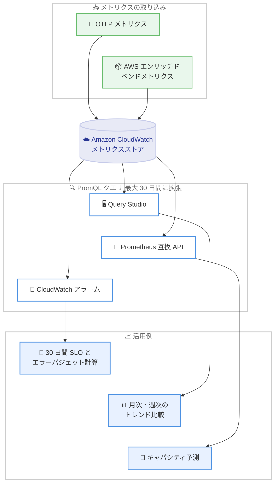

# Amazon CloudWatch - PromQL クエリウィンドウを 30 日間に拡張

**リリース日**: 2026 年 11 月 20 日
**サービス**: Amazon CloudWatch
**機能**: PromQL クエリの最大時間範囲の 30 日間への拡張

📊 [このアップデートのインフォグラフィックを見る](https://takech9203.github.io/aws-news-summary/20261120-cloudwatch-promql-query-30days.html)

## 概要

Amazon CloudWatch は、OpenTelemetry メトリクスに対する PromQL クエリの時間範囲 (クエリウィンドウ) を、従来の 7 日間から 30 日間に拡張したことを発表しました。1 回のリクエストで 1 か月分のデータを取得できるようになり、月次・週次のトレンド比較を単一のダッシュボードで可視化したり、30 日間のベースラインに基づくアラームを設定したりできます。

多くのチームは SLO (Service Level Objective) をローリング 30 日間のウィンドウで定義しています。今回の拡張により、SLO 期間全体の可用性と残りのエラーバジェットを 1 つのクエリで計算し、エラーバジェットの枯渇が予測される場合にアラートを受け取ることが可能になりました。また、キャパシティ予測においても、より長い履歴データを参照できるため、特定の繁忙期に偏らない精度の高い予測が可能になります。

**アップデート前の課題**

このアップデート以前は、PromQL クエリの時間範囲に制約がありました。

- 1 回のクエリで指定できる時間範囲 (`start` と `end` の間隔) が最大 7 日間に制限されていた
- ローリング 30 日間で定義される SLO の可用性やエラーバジェットを 1 つのクエリで計算できず、複数のクエリ結果を組み合わせる必要があった
- 7 日間のベースラインでは、単一の繁忙な週末などの影響を受けやすく、キャパシティ予測が偏る可能性があった

**アップデート後の改善**

今回のアップデートにより、以下が可能になりました。

- 1 回のリクエストで最大 30 日間 (1 か月分) のメトリクスデータを取得できるようになった
- 月次比較 (month-over-month) や週次比較 (week-over-week) のトレンドを単一のダッシュボードで可視化できるようになった
- 30 日間のベースラインを使用した CloudWatch アラームを設定できるようになった
- SLO 期間全体の可用性と残りのエラーバジェットを 1 つのクエリで計算できるようになった

## アーキテクチャ図



OTLP で取り込まれたメトリクスに対し、Query Studio、Prometheus 互換 API、CloudWatch アラームの各インターフェイスから最大 30 日間の PromQL クエリを実行できるようになった構成を示しています。

## サービスアップデートの詳細

### 主要機能

1. **クエリウィンドウの 30 日間への拡張**
   - 1 回のリクエストにおける `start` と `end` パラメータの間隔が、従来の 7 日間から 30 日間に拡張された
   - `[5m]` のようなレンジセレクタはこの制限にカウントされない
   - ウィンドウはメトリクスの保持期間内であれば任意の位置に設定でき、直近 30 日間に限定されない
   - 30 日間を超える期間をカバーする場合は、連続した複数のリクエストを発行して結果を結合する

2. **30 日間ベースラインによるアラーム**
   - 30 日間のベースラインを使用した CloudWatch アラームを設定できる
   - SLO 期間全体のエラーバジェット消費を監視し、枯渇が予測される場合に通知を受け取れる

3. **長期トレンドの可視化**
   - 月次比較や週次比較のトレンドを単一のダッシュボードで表示できる
   - 7 日間のベースラインでは単一の繁忙な週末に偏っていたキャパシティ予測を、1 か月分の履歴に基づいて精度高く実施できる

## 技術仕様

### PromQL クエリの制限事項

CloudWatch ユーザーガイドに記載されている主な制限は以下のとおりです。

| 項目 | 値 | 補足 |
|------|------|------|
| リクエストあたりの最大時間範囲 | **30 日間** | 今回のアップデートで 7 日間から拡張。`start` と `end` の間隔に適用 |
| クエリリクエストの最大 TPS | 300/アカウント | `/query`、`/query_range` が対象 |
| ディスカバリリクエストの最大 TPS | 10/アカウント | `/series`、`/labels`、`/label_values` が対象 |
| 同時実行クエリ数 | 30/アカウント | 超過時は 429 エラー |
| クエリあたりの最大返却系列数 | 500 | 超過分は切り捨て |
| 24 時間あたりの最大スキャン系列数 | 100,000 | |
| 24 時間あたりの最大スキャンサンプル数 | 300,000,000 | |
| クエリ実行タイムアウト | 20 秒 | キュー待ちとストレージ取得時間を除く |

クエリウィンドウ内で利用できるデータの解像度は、データの経過時間に依存します。CloudWatch のメトリクス保持ポリシーに従い、古いデータポイントは集約されます。

### IAM 権限

PromQL クエリの実行には、`cloudwatch:GetMetricData` と `cloudwatch:ListMetrics` の両方の権限が必要です。

| API エンドポイントパス | HTTP メソッド | 必要なアクション |
|------|------|------|
| `/api/v1/query` | GET、POST | `cloudwatch:GetMetricData`、`cloudwatch:ListMetrics` |
| `/api/v1/query_range` | GET、POST | `cloudwatch:GetMetricData`、`cloudwatch:ListMetrics` |
| `/api/v1/series` | GET、POST | `cloudwatch:ListMetrics` |
| `/api/v1/labels` | GET、POST | `cloudwatch:ListMetrics` |
| `/api/v1/label/{label_name}/values` | GET | `cloudwatch:ListMetrics` |

```json
{
  "Version": "2012-10-17",
  "Statement": [
    {
      "Effect": "Allow",
      "Action": [
        "cloudwatch:GetMetricData",
        "cloudwatch:ListMetrics"
      ],
      "Resource": "*"
    }
  ]
}
```

## 設定方法

### 前提条件

1. PromQL クエリがサポートされているリージョンで CloudWatch を利用していること
2. OTLP (OpenTelemetry Protocol) 経由でメトリクスを CloudWatch に取り込んでいる、または AWS エンリッチドベンドメトリクスを利用していること
3. 実行者に `cloudwatch:GetMetricData` と `cloudwatch:ListMetrics` の IAM 権限が付与されていること

### 手順

#### ステップ 1: Query Studio で 30 日間のクエリを実行する

CloudWatch コンソールの Query Studio を開き、時間範囲として過去 30 日間を選択したうえで PromQL クエリを実行します。

```text
sum(rate({"http.server.requests", "@resource.service.name"="myservice"}[5m]))
```

サービス `myservice` のリクエストレートを 5 分間のレンジセレクタで計算するクエリです。時間範囲を 30 日間に設定することで、1 か月分のトレンドを単一のグラフで確認できます。

#### ステップ 2: Prometheus 互換 API でレンジクエリを実行する

Grafana などの外部ツールやスクリプトからは、Prometheus 互換 API の `/api/v1/query_range` エンドポイントを使用します。

```bash
# start と end の間隔を最大 30 日間まで指定できる
POST /api/v1/query_range
  query=sum(rate({"http.server.requests"}[5m]))
  start=2026-10-21T00:00:00Z
  end=2026-11-20T00:00:00Z
  step=1h
```

2026 年 10 月 21 日から 11 月 20 日までの 30 日間について、1 時間間隔でリクエストレートを取得するレンジクエリです。従来はこの間隔が最大 7 日間に制限されていました。

#### ステップ 3: 30 日間ベースラインのアラームを作成する

CloudWatch アラームの作成時に PromQL クエリをデータソースとして指定し、30 日間のウィンドウに基づく条件を設定します。SLO のエラーバジェット消費率をしきい値としてアラームを構成することで、バジェット枯渇の予兆を検知できます。

## メリット

### ビジネス面

- **SLO 運用の効率化**: ローリング 30 日間で定義された SLO の可用性と残りのエラーバジェットを 1 つのクエリで計算でき、SLO レポーティングの運用負荷を削減できる
- **追加コストなし**: 本機能拡張に追加料金は発生しない
- **意思決定の精度向上**: 1 か月分のデータに基づくトレンド分析により、キャパシティ計画やリソース投資の判断材料が充実する

### 技術面

- **クエリの簡素化**: 従来は 7 日間ごとに分割して発行・結合していたクエリを単一リクエストに統合できる
- **アラーム精度の向上**: 単一の繁忙な週末などの短期的な偏りに左右されない、30 日間ベースラインのアラームを設定できる
- **ウィンドウ位置の柔軟性**: クエリウィンドウはメトリクス保持期間内の任意の位置に設定でき、過去の特定の 30 日間を対象とした分析も可能

## デメリット・制約事項

### 制限事項

- 1 回のリクエストの最大時間範囲は 30 日間であり、それを超える期間は複数のリクエストに分割して結果を結合する必要がある
- クエリあたりの最大返却系列数 (500)、24 時間あたりのスキャン系列数・サンプル数などの制限は引き続き適用される
- クエリ実行タイムアウトは 20 秒であり、広い時間範囲と多数の系列を組み合わせた重いクエリはタイムアウトする可能性がある

### 考慮すべき点

- クエリウィンドウ内のデータ解像度はデータの経過時間に依存するため、古い期間を対象とするクエリでは CloudWatch のメトリクス保持ポリシーによる集約の影響を考慮する必要がある
- 30 日間のクエリはスキャン対象のサンプル数が増加するため、24 時間あたりのスキャン上限 (系列数 100,000、サンプル数 3 億) に達しないようクエリの実行頻度や対象系列数を設計する必要がある
- PromQL クエリは OTLP 取り込みメトリクスと AWS エンリッチドベンドメトリクスが対象であり、利用にはこれらの取り込み設定が前提となる

## ユースケース

### ユースケース 1: 30 日間 SLO のエラーバジェット監視

**シナリオ**: ローリング 30 日間で可用性 99.9% の SLO を定義しているサービスで、SLO 期間全体の可用性と残りのエラーバジェットを継続的に監視したい。

**実装例**:
```text
# 過去 30 日間の可用性 成功率 を 1 つのクエリで計算
1 - (
  sum(rate({"http.server.errors", "@resource.service.name"="myservice"}[5m]))
  /
  sum(rate({"http.server.requests", "@resource.service.name"="myservice"}[5m]))
)
```

**効果**: SLO 期間全体を単一クエリでカバーでき、エラーバジェットの枯渇が予測される場合にアラームで早期に検知できる。

### ユースケース 2: 月次・週次のトレンド比較ダッシュボード

**シナリオ**: サービスのリクエスト数やレイテンシーについて、前月比や前週比のトレンドを経営層向けダッシュボードで可視化したい。

**実装例**:
```text
# 過去 30 日間のリクエストレートの推移を 1 時間解像度で取得
# /api/v1/query_range で start と end を 30 日間に設定
sum by ("@resource.service.name") (
  rate({"http.server.requests"}[1h])
)
```

**効果**: 従来は複数クエリの結果を結合して作成していた月次トレンドを、単一のクエリとダッシュボードで表示できる。

### ユースケース 3: 30 日間ベースラインによるキャパシティ予測

**シナリオ**: ピークトラフィックに備えたキャパシティ計画のため、直近 1 か月の利用傾向からリソース需要を予測したい。

**実装例**:
```text
# 過去 30 日間の同時アクティブリクエスト数の最大値を日次で把握
max_over_time({"http.server.active_requests", "@resource.service.name"="myservice"}[1d])
```

**効果**: 7 日間のベースラインでは単一の繁忙な週末に偏っていた予測を、1 か月分のデータに基づいて平準化し、精度の高いキャパシティ計画を立案できる。

## 料金

今回のクエリウィンドウ拡張に追加料金はありません。PromQL クエリの利用自体には、CloudWatch の標準的な料金体系が適用されます。詳細は CloudWatch の料金ページを参照してください。

## 利用可能リージョン

CloudWatch で OpenTelemetry メトリクスに対する PromQL クエリがサポートされているすべての AWS リージョンで利用できます。ドキュメントに記載されている対応リージョンは以下のとおりです (東京・大阪リージョンを含む)。

| 地域 | リージョン |
|------|------|
| 米国 | us-east-1、us-east-2、us-west-1、us-west-2 |
| カナダ | ca-central-1、ca-west-1 |
| 南米 | sa-east-1 |
| 欧州 | eu-west-1、eu-west-2、eu-west-3、eu-central-1、eu-central-2、eu-north-1、eu-south-1、eu-south-2 |
| アジアパシフィック | ap-northeast-1 (東京)、ap-northeast-2、ap-northeast-3 (大阪)、ap-south-1、ap-south-2、ap-east-1、ap-east-2、ap-southeast-1、ap-southeast-2、ap-southeast-3、ap-southeast-4、ap-southeast-5、ap-southeast-6、ap-southeast-7 |
| アフリカ | af-south-1 |
| メキシコ | mx-central-1 |

## 関連サービス・機能

- **CloudWatch Query Studio**: PromQL クエリをインタラクティブに実行できるコンソール上のクエリ環境。今回の拡張により 30 日間の分析が可能になった
- **CloudWatch アラーム**: PromQL クエリをデータソースとしたアラームを作成でき、30 日間ベースラインの監視に活用できる
- **Amazon Managed Service for Prometheus**: Prometheus 互換のフルマネージドモニタリングサービス。Prometheus ネイティブなワークロードにはこちらも選択肢となる
- **Amazon Managed Grafana**: Prometheus 互換 API 経由で CloudWatch の PromQL クエリ結果を可視化できる

## 参考リンク

- 📊 [インフォグラフィック](https://takech9203.github.io/aws-news-summary/20261120-cloudwatch-promql-query-30days.html)
- [公式発表 (What's New)](https://aws.amazon.com/about-aws/whats-new/2026/11/cloudwatch-promql-query-30days/)
- [ドキュメント: Query metrics with PromQL](https://docs.aws.amazon.com/AmazonCloudWatch/latest/monitoring/CloudWatch-PromQL.html)
- [料金ページ](https://aws.amazon.com/cloudwatch/pricing/)

## まとめ

CloudWatch の PromQL クエリウィンドウが 7 日間から 30 日間に拡張され、ローリング 30 日間の SLO 監視やエラーバジェット計算、月次トレンド分析を単一のクエリで実現できるようになりました。追加料金なしで利用できるため、OpenTelemetry メトリクスを CloudWatch に取り込んでいるチームは、SLO ダッシュボードやキャパシティ予測のクエリを 30 日間ウィンドウへ見直すことを推奨します。
