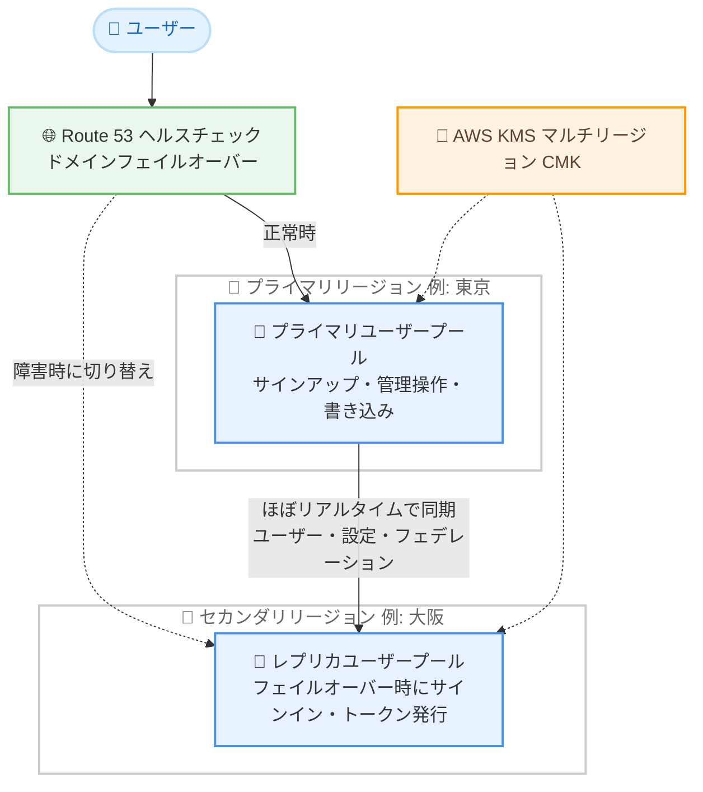

# Amazon Cognito - マルチリージョンレプリケーションの対象リージョン拡大

**リリース日**: 2026 年 11 月 20 日
**サービス**: Amazon Cognito
**機能**: マルチリージョンレプリケーション (MRR) の追加 AWS リージョン対応

📊 [このアップデートのインフォグラフィックを見る](https://takech9203.github.io/aws-news-summary/20261120-cognito-mrr-opt-in-regions.html)

## 概要

Amazon Cognito のマルチリージョンレプリケーション (MRR) が、新たに 16 の AWS リージョンで利用可能になりました。MRR は、ユーザーおよびマシン ID のデータ (認証情報、ユーザープール設定、フェデレーション設定を含む) を、指定したスタンバイリージョンのセカンダリユーザープールへほぼリアルタイムで同期する機能です。プライマリリージョンで障害が発生した場合でも、トラフィックをスタンバイリージョンへ切り替えることで、アプリケーションの認証機能を継続して提供できます。

これまで MRR は 16 の商用リージョンと AWS GovCloud (US) リージョンで利用可能でしたが、今回のアップデートにより、大阪、香港、ジャカルタなどのアジアパシフィックの各リージョンや、欧州、中東、アフリカ、中南米のオプトインリージョンを含む幅広いリージョンに拡大されました。これにより、レジリエンス要件に加えて、データレジデンシーやコンプライアンス要件を満たす必要がある各地域のお客様が、最適なリージョンの組み合わせで認証基盤の災害対策を構築できるようになります。

**アップデート前の課題**

今回のアップデート以前には、以下の課題がありました。

- MRR を利用できるリージョンが 16 の商用リージョンと AWS GovCloud (US) に限定されており、大阪リージョンやオプトインリージョンではレプリカユーザープールを作成できなかった
- データレジデンシー要件により特定の国・地域内でデータを保持する必要があるワークロードでは、MRR による認証基盤の DR 構成を採用できなかった
- 対象外リージョンを利用するワークロードでは、認証基盤のリージョン障害対策を独自に設計・実装する必要があった

**アップデート後の改善**

今回のアップデートにより、以下が可能になりました。

- アジアパシフィック、欧州、中東、アフリカ、中南米の追加リージョンでレプリカユーザープールを作成し、認証基盤のマルチリージョン構成を実現できるようになった
- 国内・地域内のリージョンペア (例: 東京 - 大阪) によるデータレジデンシー要件に対応した DR 構成が構築できるようになった
- より多くの地域のお客様が、レジリエンス、データレジデンシー、コンプライアンス要件を満たしながら認証機能の可用性を高められるようになった

## アーキテクチャ図



プライマリユーザープールがユーザーディレクトリと設定をセカンダリリージョンのレプリカへほぼリアルタイムに同期し、Route 53 ヘルスチェックによるフェイルオーバーで障害時もサインインとトークン発行を継続する構成です。

## サービスアップデートの詳細

### 主要機能

1. **対象リージョンの拡大**
   - MRR を利用できるリージョンが、従来の 16 の商用リージョンと AWS GovCloud (US) に加えて 16 リージョン追加された
   - アジアパシフィック (大阪、香港、ジャカルタ、ハイデラバード、マレーシア、メルボルン、ニュージーランド、台北、タイ) が追加された
   - 欧州 (ミラノ、スペイン、チューリッヒ)、カナダ西部 (カルガリー)、イスラエル (テルアビブ)、メキシコ (中部)、アフリカ (ケープタウン) が追加された

2. **ほぼリアルタイムのデータ同期**
   - ユーザーおよびマシン ID のデータ (認証情報を含む)、ユーザープール設定、フェデレーション設定をセカンダリユーザープールへ同期する
   - プライマリユーザープールが管理操作と書き込み操作 (サインアップ、パスワードリセットなど) の正となるソースとして機能する
   - 同期は結果整合性であり、リージョン間のレプリケーションにはわずかな遅延が発生する場合がある

3. **リージョン障害時のフェイルオーバー**
   - Route 53 ヘルスチェックとユーザープールドメインの `Routing` 設定により、マネージドログイン、フェデレーション、OAuth 2.0 エンドポイントのトラフィックを自動的にセカンダリリージョンへ切り替えられる
   - `ACTIVE` 状態のレプリカユーザープールは、`InitiateAuth` や `GetTokensFromRefreshToken` などの認証・セッション管理操作を処理できる
   - ヘルスチェックが正常に戻ると、トラフィックは自動的にプライマリリージョンへ戻る

## 技術仕様

### MRR の主な仕様

| 項目 | 詳細 |
|------|------|
| 対象プラン | Essentials または Plus フィーチャープラン (Lite では利用不可) |
| 料金体系 | ベースプランに追加するアドオン料金 (MAU 単位) |
| 必須要件 | AWS KMS のマルチリージョンカスタマーマネージドキー (CMK)。レプリカを配置するすべてのリージョンで利用可能であること |
| レプリカ数 | 1 つのユーザーディレクトリにつき、追加リージョンのセカンダリレプリカは最大 1 つ |
| ユーザープール ID | プライマリとレプリカで同一の ID を共有 |
| 同期方式 | プライマリからセカンダリへの一方向同期 (結果整合性) |
| レプリカの初期状態 | `INACTIVE` で作成され、本番利用時に `ACTIVE` へ変更 |
| リージョン個別設定 | E メール設定、SMS 設定、Lambda トリガー、タグ、ログエクスポート設定、AWS WAF Web ACL などはレプリカ側で個別に設定可能 |

### セカンダリリージョンで利用できる主な操作

| レプリカの状態 | 利用できる操作の例 |
|------|------|
| `INACTIVE` | `AdminGetUser`、`ListUsers`、`DescribeUserPool`、`CreateUserPoolDomain`、`UpdateUserPoolReplica` などの読み取り・設定操作 |
| `ACTIVE` | 上記に加えて `InitiateAuth`、`RespondToAuthChallenge`、`GetTokensFromRefreshToken`、`GlobalSignOut`、`RevokeToken` などの認証・セッション管理操作 |

### レプリカ作成の API リクエスト例

```json
{
  "UserPoolId": "us-east-1_EXAMPLE",
  "RegionName": "ap-northeast-3",
  "UserPoolTags": {
    "Environment": "Production",
    "Application": "MyApp"
  }
}
```

`CreateUserPoolReplica` オペレーションにレプリカを作成するリージョンを指定します。レスポンスには `PENDING_CREATE` 状態のレプリカ情報が返されます。

## 設定方法

### 前提条件

1. ユーザープールが Essentials または Plus フィーチャープランであること
2. AWS KMS のマルチリージョンカスタマーマネージドキー (CMK) を作成し、レプリカを配置するすべてのリージョンでレプリカキーを利用可能にしていること
3. フェイルオーバーを自動化する場合は、Route 53 ヘルスチェックを作成できること

### 手順

#### ステップ 1: レプリカユーザープールの作成

```bash
aws cognito-idp create-user-pool-replica \
  --user-pool-id "ap-northeast-1_EXAMPLE" \
  --region-name "ap-northeast-3"
```

プライマリユーザープールに対して、指定したリージョン (この例では大阪) にレプリカユーザープールを作成します。コンソールの場合は、ユーザープールの [Settings] タブから [Multi-Region replication] を選択し、[Create a replica user pool] でリージョンを指定します。

#### ステップ 2: ドメインのフェイルオーバー設定

```bash
aws cognito-idp update-user-pool-domain \
  --user-pool-id "ap-northeast-1_EXAMPLE" \
  --domain "auth.example.com" \
  --managed-login-version 2 \
  --custom-domain-config CertificateArn="arn:aws:acm:us-east-1:111122223333:certificate/EXAMPLE" \
  --routing '{"Failover":{"SecondaryRegion":"ap-northeast-3","PrimaryRoute53HealthCheckId":"a1b2c3d4-EXAMPLE"}}'
```

ユーザープールドメインに Route 53 ヘルスチェック ID とセカンダリリージョンを設定します。ヘルスチェックが異常を検知すると、マネージドログインと認証操作がセカンダリレプリカから提供され、正常に戻るとプライマリへ復帰します。

#### ステップ 3: レプリカの有効化

```bash
aws cognito-idp update-user-pool-replica \
  --user-pool-id "ap-northeast-1_EXAMPLE" \
  --region-name "ap-northeast-3" \
  --status "ACTIVE"
```

レプリカのステータスを `INACTIVE` から `ACTIVE` に変更し、本番トラフィックを処理できる状態にします。有効化の前に、E メール設定、SMS 設定、Lambda トリガーなどのリージョン個別設定を確認してください。

## メリット

### ビジネス面

- **ビジネス継続性の向上**: リージョン障害時もユーザー認証を継続でき、アプリケーション全体の可用性を高められる
- **データレジデンシー・コンプライアンス対応**: 国内や特定地域内のリージョンペアで DR 構成を組めるため、規制要件を満たしながらレジリエンスを確保できる
- **運用負荷の削減**: 認証基盤の DR を独自に設計・実装する必要がなくなり、マネージド機能として利用できる

### 技術面

- **ほぼリアルタイムの同期**: 認証情報を含むユーザーデータ、ユーザープール設定、フェデレーション設定が自動的にセカンダリへ同期される
- **柔軟なフェイルオーバー**: Route 53 ヘルスチェックによるマネージドログイン・フェデレーションの自動切り替えに加え、API/SDK 利用時はアプリケーション側でルーティングを制御できる
- **同一ユーザープール ID**: プライマリとレプリカが同じユーザープール ID を共有するため、アプリケーション側の切り替えロジックを簡素化できる

## デメリット・制約事項

### 制限事項

- セカンダリユーザープールでは新規ユーザーの作成 (サインアップ、管理者によるユーザー作成) ができない
- セカンダリユーザープールでは、ユーザーによるパスワードリセットやプロファイル変更ができない (フェイルオーバー中は UI 側で該当操作を無効化する必要がある)
- セカンダリレプリカは TOTP MFA をサポートしない (TOTP MFA を設定したユーザーはプライマリリージョン稼働時に認証する必要がある)
- フェデレーションユーザーは、プライマリで一度サインインしたことがある場合のみ、フェイルオーバー時にセカンダリでサインインできる
- パスワード認証の失敗回数カウントはリージョン間で同期されず、各レプリカが独自に保持する

### 考慮すべき点

- MRR は Essentials または Plus プランのアドオンであり、追加の MAU 課金が発生する (Lite プランでは利用不可)
- AWS KMS のマルチリージョン CMK の事前準備が必須であり、キー管理の運用設計が必要になる
- レプリケーションは結果整合性であり、同期にわずかな遅延が発生する可能性がある
- リージョン間で一貫したトークン検証を行うために、更新された issuer 設定の利用が推奨される

## ユースケース

### ユースケース 1: 東京 - 大阪の国内 DR 構成

**シナリオ**: 日本国内でデータを保持する要件がある金融・公共系アプリケーションで、認証基盤のリージョン障害対策を実現したい。

**実装例**:
```bash
aws cognito-idp create-user-pool-replica \
  --user-pool-id "ap-northeast-1_EXAMPLE" \
  --region-name "ap-northeast-3"
```

**効果**: 大阪リージョンが MRR に対応したことで、国内リージョンペアによる認証基盤の DR 構成が可能になり、データレジデンシー要件と可用性要件を両立できる。

### ユースケース 2: オプトインリージョンを利用する地域ワークロードのレジリエンス強化

**シナリオ**: マレーシアやタイなどのオプトインリージョンでサービスを提供しており、現地のコンプライアンス要件を満たしながら認証機能の障害対策を行いたい。

**実装例**:
```bash
aws cognito-idp create-user-pool-replica \
  --user-pool-id "ap-southeast-3_EXAMPLE" \
  --region-name "ap-southeast-7"
```

**効果**: 地理的に近いリージョン間でレプリカを構成することで、レイテンシーを抑えつつ、地域内でのレジリエンスとコンプライアンス要件を満たせる。

### ユースケース 3: マネージドログインの自動フェイルオーバー

**シナリオ**: OAuth 2.0 / OIDC のマネージドログインを利用する Web アプリケーションで、リージョン障害時に利用者が意識することなく認証を継続させたい。

**実装例**:
```bash
aws cognito-idp update-user-pool-domain \
  --user-pool-id "eu-south-1_EXAMPLE" \
  --domain "auth.example.com" \
  --managed-login-version 2 \
  --custom-domain-config CertificateArn="arn:aws:acm:us-east-1:111122223333:certificate/EXAMPLE" \
  --routing '{"Failover":{"SecondaryRegion":"eu-south-2","PrimaryRoute53HealthCheckId":"a1b2c3d4-EXAMPLE"}}'
```

**効果**: Route 53 ヘルスチェックの状態に応じて、authorize / token エンドポイントとマネージドログインページがセカンダリリージョンから自動的に提供され、障害復旧後はプライマリへ自動復帰する。

## 料金

MRR は Essentials または Plus フィーチャープランのユーザープールに対するアドオンとして提供され、ベースプランの MAU 料金に追加で課金されます。ユニークユーザーはプライマリ・セカンダリ両リージョンを通じてグローバルに 1 回のみカウントされます。

### 料金例 (米国東部リージョンの場合)

| 項目 | 料金 (概算) |
|--------|------------------|
| Essentials プランの MRR アドオン | $0.0045 / MAU (例: 500,000 MAU で月額 $2,250) |
| M2M トークンリクエスト (MRR 有効時) | $0.002925 / リクエスト (MRR 無効時は $0.00225) |

最新の料金は [Amazon Cognito 料金ページ](https://aws.amazon.com/cognito/pricing/) を参照してください。

## 利用可能リージョン

今回のアップデートで、以下の 16 リージョンが新たに追加されました。

- アジアパシフィック: ハイデラバード、香港、ジャカルタ、マレーシア、メルボルン、ニュージーランド、大阪、台北、タイ
- カナダ西部 (カルガリー)
- 欧州: ミラノ、スペイン、チューリッヒ
- イスラエル (テルアビブ)
- メキシコ (中部)
- アフリカ (ケープタウン)

既存の 16 の商用リージョンおよび AWS GovCloud (US) リージョンと合わせて利用できます。最新の対応状況は [AWS Capabilities by Region](https://aws.amazon.com/about-aws/global-infrastructure/regional-product-services/) を参照してください。

## 関連サービス・機能

- **AWS KMS**: MRR の有効化にはマルチリージョンカスタマーマネージドキー (CMK) が必須であり、レプリカを配置する全リージョンでキーを利用可能にする必要がある
- **Amazon Route 53**: ヘルスチェックを利用して、マネージドログイン・フェデレーションのトラフィックをプライマリとセカンダリの間で自動的に切り替える
- **AWS WAF**: レプリカユーザープールごとに Web ACL を個別に関連付けられるため、リージョンごとのセキュリティ要件に対応できる

## 参考リンク

- 📊 [インフォグラフィック](https://takech9203.github.io/aws-news-summary/20261120-cognito-mrr-opt-in-regions.html)
- [公式発表 (What's New)](https://aws.amazon.com/about-aws/whats-new/2026/11/cognito-mrr-opt-in-regions/)
- [ドキュメント: Multi-Region replication for user pools](https://docs.aws.amazon.com/cognito/latest/developerguide/user-pool-multi-region.html)
- [料金ページ](https://aws.amazon.com/cognito/pricing/)
- [Amazon Cognito 製品ページ](https://aws.amazon.com/cognito/)

## まとめ

Amazon Cognito のマルチリージョンレプリケーションが大阪を含む 16 リージョンに拡大され、データレジデンシーやコンプライアンス要件を持つワークロードでも認証基盤のマルチリージョン DR 構成を採用しやすくなりました。東京 - 大阪のような国内リージョンペアでの構成が可能になった点は、日本のお客様にとって特に重要なアップデートです。対象リージョンで Cognito を利用している場合は、Essentials / Plus プランとマルチリージョン CMK の準備を確認のうえ、MRR による認証基盤のレジリエンス強化を検討することをお勧めします。
