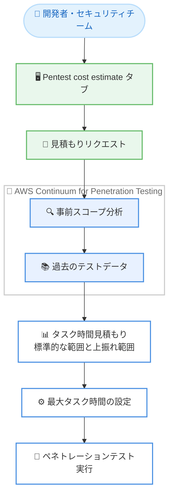

# AWS Continuum for Penetration Testing - テスト実行前のタスク時間見積もり機能

**リリース日**: 2026 年 11 月 20 日
**サービス**: AWS Continuum for Penetration Testing
**機能**: ペネトレーションテスト実行前のタスク時間 (task hours) 見積もり

📊 [このアップデートのインフォグラフィックを見る](https://takech9203.github.io/aws-news-summary/20261120-continuum-pentest-cost-estimates.html)

## 概要

AWS Continuum for Penetration Testing (旧称: AWS Security Agent) が、ペネトレーションテストを実行する前にタスク時間 (task hours) の見積もりを提供する機能を発表しました。AWS Continuum for Penetration Testing は、Web アプリケーションや API に対してオンデマンドで AI 駆動のペネトレーションテストを実行するサービスです。今回のアップデートにより、開発者やセキュリティチームは、テスト実行前に課金対象となるタスク時間を予測し、タスク時間の上限を適切に設定できるようになります。

見積もりを取得するには、テストを開いて「Pentest cost estimate」タブを選択し、見積もりをリクエストします。AWS Continuum は簡易的な事前スコープ分析を実施し、過去のテストデータを活用してタスク時間を予測します。見積もり結果には、類似アプリケーションの大半が収まる標準的な範囲と、一部のアプリケーションで必要となるより高い範囲の両方が表示されます。

見積もりは無料で利用でき、「見積もりであって、確定料金や制限ではない」点に注意が必要です。実際の使用量は変動する可能性があり、消費量の上限として機能するのは設定済みの最大タスク時間のみです。

**アップデート前の課題**

このアップデート以前には、以下の課題がありました。

- テストの所要時間を知る唯一の方法は、実際にテストを実行することだった
- テスト実行前に課金額を予測できず、予算計画が困難だった
- タスク時間の上限を設定する際に、適切な値を判断する根拠がなかった

**アップデート後の改善**

今回のアップデートにより、以下が可能になりました。

- テスト実行前にタスク時間の見積もりを無料で取得できるようになった
- 過去のテストデータに基づく標準的な範囲と上振れの範囲の両方を確認できるようになった
- 見積もりを根拠として、最大タスク時間の上限を適切に設定できるようになった

## アーキテクチャ図



見積もりリクエストを受けた AWS Continuum が事前スコープ分析と過去のテストデータに基づいてタスク時間を予測し、ユーザーはその結果をもとに上限を設定してからテストを実行する流れを示しています。

## サービスアップデートの詳細

### 主要機能

1. **テスト実行前のタスク時間見積もり**
   - テストを開いて「Pentest cost estimate」タブから見積もりをリクエストできる
   - AWS Continuum が対象アプリケーションの簡易的な事前スコープ分析を実施する
   - 過去のテストデータを活用してタスク時間を予測する

2. **2 種類の予測範囲の提示**
   - 類似アプリケーションの大半のテストが収まる標準的な範囲を表示する
   - 一部のアプリケーションで必要となる、より高い範囲も併せて表示する
   - 予算計画や上限設定の判断材料として活用できる

3. **無料で利用可能な見積もり**
   - 見積もりの取得自体には料金がかからない
   - 見積もりはあくまで目安であり、確定料金や消費の制限ではない
   - 消費量を制限するのは、ユーザーが設定した最大タスク時間のみ

## 技術仕様

### 見積もり機能の概要

| 項目 | 詳細 |
|------|------|
| 対象サービス | AWS Continuum for Penetration Testing (旧称: AWS Security Agent) |
| テスト対象 | Web アプリケーション、API |
| 見積もり方法 | 事前スコープ分析 + 過去のテストデータに基づく予測 |
| 表示内容 | 標準的なタスク時間の範囲、上振れ時の範囲 |
| 見積もり料金 | 無料 |
| 見積もりの性質 | 目安 (確定料金や制限ではない) |
| 消費の上限 | 設定済みの最大タスク時間のみが上限として機能 |

## 設定方法

### 前提条件

1. AWS Continuum for Penetration Testing が利用可能なリージョンを使用していること
2. ペネトレーションテストの対象となる Web アプリケーションまたは API が設定済みであること
3. テストの作成・閲覧に必要な権限を持っていること

### 手順

#### ステップ 1: テストを開く

AWS Continuum for Penetration Testing のコンソールで、見積もりを取得したいテストを開きます。

#### ステップ 2: 見積もりをリクエストする

「Pentest cost estimate」タブを選択し、見積もりをリクエストします。AWS Continuum が簡易的な事前スコープ分析を実行し、過去のテストデータと組み合わせてタスク時間を予測します。

#### ステップ 3: 見積もり結果を確認して上限を設定する

表示された標準的な範囲と上振れの範囲を確認し、予算に応じて最大タスク時間の上限を設定したうえでテストを実行します。実際の使用量は見積もりから変動する可能性があるため、上限設定による制御が重要です。

## メリット

### ビジネス面

- **予算計画の精度向上**: テスト実行前に課金対象のタスク時間を予測できるため、セキュリティテストの予算を事前に見積もれる
- **コストの透明性**: 標準的な範囲と上振れの範囲の両方が提示されるため、コストの振れ幅を踏まえた意思決定ができる
- **追加費用なし**: 見積もりの取得は無料のため、気軽にコスト感を確認できる

### 技術面

- **データに基づく予測**: 事前スコープ分析と過去のテストデータを組み合わせた、根拠のある見積もりが得られる
- **上限設定の判断材料**: 最大タスク時間の設定値を、見積もりを根拠に決定できる
- **運用の簡素化**: コンソールのタブ操作のみで見積もりを取得でき、追加のツールや手順が不要

## デメリット・制約事項

### 制限事項

- 見積もりは目安であり、確定料金 (quote) や消費の制限 (limit) ではない
- 実際の使用量は見積もりから変動する可能性がある
- 消費量を制限できるのは、設定済みの最大タスク時間のみ

### 考慮すべき点

- 見積もりの上振れ範囲も考慮して予算を確保することが望ましい
- 確実にコストを制御したい場合は、最大タスク時間の上限設定を必ず行う必要がある

## ユースケース

### ユースケース 1: セキュリティテストの予算申請

**シナリオ**: セキュリティチームが四半期ごとのペネトレーションテスト予算を申請する際、これまでは実績がないアプリケーションのテストコストを根拠を持って見積もれなかった。

**実装例**:
```text
1. 対象アプリケーションごとにテストを作成
2. Pentest cost estimate タブで見積もりを取得
3. 標準的な範囲と上振れ範囲をもとに予算案を作成
```

**効果**: データに基づいた予算申請が可能になり、承認プロセスがスムーズになる。

### ユースケース 2: コスト上限を設けたテスト運用

**シナリオ**: 開発チームがリリース前のアプリケーションに対してペネトレーションテストを実施したいが、コストが予算を超過しないように制御したい。

**実装例**:
```text
1. テスト実行前に見積もりを取得
2. 標準的な範囲の上限値を参考に最大タスク時間を設定
3. 上限設定済みの状態でテストを実行
```

**効果**: 見積もりを根拠とした上限設定により、予算超過のリスクを抑えながらテストを実施できる。

### ユースケース 3: 複数アプリケーションのテスト優先順位付け

**シナリオ**: 多数の Web アプリケーションを運用する組織が、限られた予算内でどのアプリケーションからテストするかを決めたい。

**実装例**:
```text
1. 各アプリケーションのテストで見積もりを取得
2. 見積もり結果とアプリケーションのリスク評価を突き合わせる
3. 費用対効果の高い順にテストを計画
```

**効果**: 限られた予算の中で、リスクとコストのバランスを考慮したテスト計画を立案できる。

## 料金

見積もりの取得は無料です。ペネトレーションテスト自体はタスク時間 (task hours) に基づいて課金されます。見積もりは目安であり確定料金ではないため、実際の課金額は変動する可能性があります。詳細な料金体系は製品ページを参照してください。

## 利用可能リージョン

AWS Continuum for Penetration Testing が利用可能なすべての AWS リージョンで、見積もり機能を利用できます。

## 関連サービス・機能

- **AWS Continuum**: AI を活用したセキュリティサービス群。コード脆弱性の検出・修正を行う AWS Continuum for code vulnerabilities なども提供されている
- **最大タスク時間の上限設定**: ペネトレーションテストの消費量を制御する既存機能。今回の見積もり機能と組み合わせることで、根拠のある上限設定が可能

## 参考リンク

- 📊 [インフォグラフィック](https://takech9203.github.io/aws-news-summary/20261120-continuum-pentest-cost-estimates.html)
- [公式発表 (What's New)](https://aws.amazon.com/about-aws/whats-new/2026/11/continuum-pentest-cost-estimates/)
- [ドキュメント: Task hour estimates](https://docs.aws.amazon.com/securityagent/latest/userguide/perform-penetration-test.html#task-hour-estimate)
- [製品ページ: AWS Continuum](https://aws.amazon.com/continuum/)

## まとめ

AWS Continuum for Penetration Testing のタスク時間見積もり機能により、これまで「実行してみないと分からなかった」ペネトレーションテストのコストを事前に予測できるようになりました。見積もりは無料で取得できるため、テスト実行前に必ず見積もりを確認し、その結果をもとに最大タスク時間の上限を設定する運用を推奨します。
