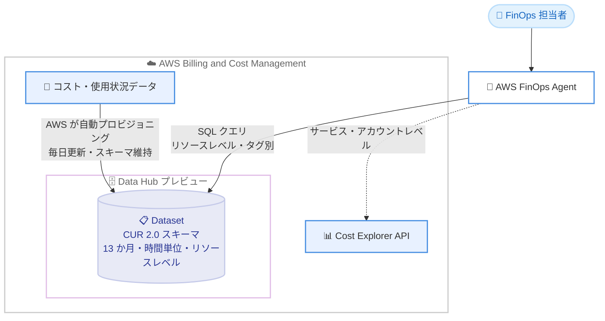

# AWS Billing and Cost Management - Data Hub (プレビュー)

**リリース日**: 2026 年 11 月 20 日
**サービス**: AWS Billing and Cost Management
**機能**: Data Hub (preview)

📊 [このアップデートのインフォグラフィックを見る](https://takech9203.github.io/aws-news-summary/20261120-data-hub-billing-cost-management-preview.html)

## 概要

AWS は、AWS Billing and Cost Management の新機能である Data Hub のパブリックプレビューを発表しました。Data Hub は、コスト・使用状況データに対する SQL ベースのマネージドデータレイヤーで、エージェントがコストデータを直接クエリできるようにします。プレビュー期間中は AWS FinOps Agent 向けに提供され、エージェントがコスト変動の原因となった個々のリソースの特定、チームやコスト配分タグ別の支出の内訳、リソース単位のコスト・使用状況の時間単位での推移の把握といった質問に回答できるようになります。

利用者は Data Hub 上にコスト・使用状況データのデータセットを作成し、AWS FinOps Agent をそのデータセットに接続するだけで利用を開始できます。データのプロビジョニング、毎日の更新、AWS マネージドストレージへの保存、新しいサービス・コミットメント・課金タイプが請求に登場した際のスキーマ維持は、すべて AWS が行います。データセットは 13 か月分の時間単位・リソースレベルのコスト・使用状況データを保持し、リソース識別子とコスト配分タグを含む公開済みの CUR 2.0 スキーマに準拠します。

本機能は、データエクスポートの設定やコストデータパイプラインの構築・保守なしにリソースレベルのコスト分析を実現したい FinOps チーム、経理・財務部門、クラウド管理者を対象としています。

**アップデート前の課題**

このアップデート以前は、リソースレベルのコスト分析を行うために以下の作業が必要でした。

- AWS FinOps Agent は AWS Cost Explorer API を使用するため、サービス・アカウントレベルの質問にしか回答できず、個々のリソースや時間単位の詳細、コスト配分タグに基づく質問には対応できなかった
- リソースレベルの分析には AWS Data Exports (CUR 2.0) を Amazon S3 にエクスポートし、Amazon Athena や独自のデータウェアハウスで分析基盤を構築・保守する必要があった
- 新しいサービスや課金タイプが請求に追加されるたびに、スキーマやパイプラインのメンテナンスが利用者側の負担となっていた

**アップデート後の改善**

今回のアップデートにより、以下が可能になりました。

- データエクスポートの設定やコストデータパイプラインの構築・保守なしに、AWS FinOps Agent がリソースレベル・時間単位のコストに関する質問に回答できるようになった
- データのプロビジョニング・毎日の更新・スキーマの維持を AWS が行うマネージドなデータレイヤーが利用可能になった
- 管理アカウントでセットアップすることで、AWS Organizations 配下の全アカウントのデータを単一のデータセットでカバーできるようになった

## アーキテクチャ図



AWS FinOps Agent は、リソースレベルや時間単位の詳細が必要な質問には Data Hub のデータセットを SQL でクエリし、サービス・アカウントレベルの質問には従来どおり Cost Explorer API を使用します。データセットへのデータ投入と更新は AWS が自動的に行います。

## サービスアップデートの詳細

### 主要機能

1. **SQL ベースのマネージドデータレイヤー**
   - エージェント向けにコスト・使用状況データへの SQL クエリアクセスを提供
   - 13 か月分の時間単位・リソースレベルのコスト・使用状況データを保持
   - リソース識別子とコスト配分タグを含む公開済みの CUR 2.0 スキーマ (`cost_usage`) に準拠

2. **フルマネージドなデータ運用**
   - AWS がデータのプロビジョニングと毎日の更新を実施
   - データは AWS マネージドストレージに保存
   - 新しいサービス・コミットメント・課金タイプが請求に登場しても、AWS がスキーマを維持

3. **AWS FinOps Agent との連携 (プレビュー期間中)**
   - エージェントがコスト変動の背後にある個々のリソースを特定
   - チームやコスト配分タグ別に支出を内訳表示
   - リソースのコストと使用状況が時間単位でどのように変化したかを提示

4. **AWS Organizations 対応**
   - 管理アカウントで作成したデータセットは組織内の全アカウントのデータをカバー
   - メンバーアカウントで作成したデータセットはそのアカウントのみをカバー
   - 委任管理者アカウントで組織全体のエージェントを実行でき、FinOps チームが管理アカウントの権限を持つ必要がない

5. **データセットのリソース管理**
   - データセットは固有の ARN を持つ AWS リソースとして扱われる
   - タグ付け、アクセススコープの設定、削除が可能

## 技術仕様

### Data Hub の主要概念

| 項目 | 詳細 |
|------|------|
| Dataset | AWS がプロビジョニングし最新に保つコスト・使用状況データ。固有の ARN を持つ AWS リソース |
| Dataset schema | プレビューでは `cost_usage` の 1 スキーマのみ提供。CUR 2.0 データディクショナリに準拠 |
| データ粒度 | 時間単位、リソースレベル |
| データ保持期間 | 13 か月 |
| 更新頻度 | 毎日 (AWS が自動更新) |
| Billing view | データセットがカバーするアカウント範囲を決定するリソース。作成アカウントのプライマリ billing view に従う |
| Management account | プレビュー期間中、組織全体をカバーするデータセットを作成できる唯一のアカウント |
| Delegated administrator account | 組織全体のエージェントを実行するために登録するメンバーアカウント |

### 必要な権限

Data Hub では 2 つの ID に権限が必要です。

| ID | 必要な権限 |
|------|------|
| データセットを作成するユーザー | `bcm-data-hub:CreateDataset` などのデータセット作成権限 |
| エージェントロール | データセットの読み取り権限 |

メンバーアカウントのユーザーは、サービスコントロールポリシー (SCP) で `bcm-data-hub:CreateDataset` が拒否されていない限り、自身のアカウント用のデータセットを作成できます。

### 既存の AWS Data Exports との関係

- Data Hub は既存の AWS Data Exports を読み取らず、変更もしない
- 既存の Data Exports は同じフィールド・値・配信方法で動作し続ける
- S3 へのエクスポート、独自変換、AWS 外のデータとの結合、データウェアハウスや BI ツールへのロードには、引き続き AWS Data Exports を使用する

## 設定方法

### 前提条件

1. データセットを作成するユーザーに `bcm-data-hub:CreateDataset` を含む Data Hub の権限があること
2. エージェントロールにデータセットの読み取り権限があること
3. 組織全体をカバーする場合は、AWS Organizations の管理アカウントでデータセットを作成すること

### 手順

#### ステップ 1: データセットを作成する

AWS Billing and Cost Management コンソールの Data Hub ページ、または AWS FinOps Agent のウィザードでデータセットを作成します。

- 組織全体のエージェント向け: 管理アカウントでデータセットを作成する
- 単一アカウントのエージェント向け: エージェントを実行するアカウントでデータセットを作成する

エージェントを作成してもデータセットは自動では作成されない点に注意してください。

#### ステップ 2: エージェントをデータセットに接続する

エージェントの Data Hub 設定を有効にします。

- 新規エージェント作成時: ウィザードで [Use Data Hub for this agent] を選択する
- 既存エージェント: エージェントの Data Hub タブで [Connect] を選択する

#### ステップ 3: 組織全体で利用する場合のセットアップ

組織全体のエージェントを利用する場合は、以下の順序でセットアップします。

1. 管理アカウントで組織全体のエージェント向けのセットアップを行い、データセットを作成する
2. 委任管理者アカウントで組織全体のエージェントを作成し、Data Hub 設定を有効にする
3. エージェントが管理アカウントのデータセットをクエリし、組織内の全アカウントのデータに回答できるようになる

## メリット

### ビジネス面

- **パイプライン構築・保守コストの削減**: データエクスポートの設定や Athena などによる分析基盤の構築・運用が不要になり、FinOps チームはデータ基盤ではなくコスト最適化そのものに集中できる
- **コスト変動への迅速な対応**: コスト増加の原因リソースを自然言語の質問から特定でき、調査時間を短縮できる
- **チャージバックの精緻化**: コスト配分タグやリソース所有チーム別の支出内訳を容易に把握でき、部門別のコスト配賦を正確に行える

### 技術面

- **マネージドなスキーマ維持**: 新しいサービス・コミットメント・課金タイプが請求に追加されても、AWS がスキーマを自動で維持する
- **標準スキーマへの準拠**: 公開済みの CUR 2.0 データディクショナリに準拠しているため、既存の CUR 2.0 の知識をそのまま活用できる
- **最小権限での組織運用**: 委任管理者アカウントでエージェントを実行することで、FinOps チームのメンバーが管理アカウントの権限を持たずに組織全体のコストを分析できる

## デメリット・制約事項

### 制限事項

- プレビュー期間中、Data Hub をクエリできるのは AWS FinOps Agent のみ
- プレビューで提供されるスキーマは `cost_usage` の 1 種類のみ
- 組織全体をカバーするデータセットを作成できるのは管理アカウントのみ (プレビュー期間中)
- 機能の利用は米国東部 (バージニア北部) リージョンのみ (データは全リージョンのコスト・使用状況をカバー)

### 考慮すべき点

- プレビュー機能のため、一般提供 (GA) 時に仕様や料金が変更される可能性がある
- データ保持期間は 13 か月であり、それより長期の履歴分析には引き続き AWS Data Exports などの利用が必要
- 独自の変換処理、AWS 外のデータとの結合、BI ツールへの取り込みが必要な場合は、従来どおり AWS Data Exports を使用する必要がある
- SCP で `bcm-data-hub:CreateDataset` を制御している場合は、ポリシーの見直しが必要になることがある

## ユースケース

### ユースケース 1: コスト急増の原因リソースの特定

**シナリオ**: 前月比で Amazon EC2 のコストが大幅に増加した。どのリソースが原因かを迅速に特定したい。

**実装例**:
```text
AWS FinOps Agent への質問例:
「先月 EC2 のコストが増加した原因となったリソースを特定して、
時間単位の使用状況の変化を教えてください」
```

**効果**: Data Hub の時間単位・リソースレベルのデータにより、エージェントがコスト変動の背後にある個々のリソースと増加のタイミングを特定し、調査時間を大幅に短縮できる。

### ユースケース 2: コスト配分タグによるチーム別チャージバック

**シナリオ**: 複数チームが共有する AWS アカウントで、コスト配分タグに基づいてチームごとの支出を把握し、月次のチャージバックを行いたい。

**実装例**:
```text
AWS FinOps Agent への質問例:
「コスト配分タグ team 別に今月の支出を内訳表示して、
各チームで最もコストの高いリソースを教えてください」
```

**効果**: CUR 2.0 スキーマに含まれるコスト配分タグを利用して、データパイプラインを構築することなくチーム別の支出内訳とチャージバックの根拠データを取得できる。

### ユースケース 3: 組織全体のコスト分析を最小権限で実現

**シナリオ**: AWS Organizations で多数のアカウントを運用しており、FinOps チームに管理アカウントの権限を付与せずに組織全体のリソースレベルのコスト分析を行いたい。

**実装例**:
```text
1. 管理アカウントで組織全体をカバーするデータセットを作成
2. メンバーアカウントを委任管理者として登録
3. 委任管理者アカウントで組織全体のエージェントを作成し、
   Data Hub 設定を有効化
```

**効果**: FinOps チームは委任管理者アカウントのエージェント経由で組織内全アカウントのコストデータに質問でき、管理アカウントへのアクセス権限を最小化しつつガバナンスを維持できる。

## 料金

プレビュー期間中、Data Hub は追加料金なしで利用できます。一般提供 (GA) 時の料金体系は現時点では公表されていません。

## 利用可能リージョン

Data Hub は米国東部 (バージニア北部) リージョンで利用できます。ただし、データセットは全リージョンのコスト・使用状況データをカバーします。

## 関連サービス・機能

- **AWS FinOps Agent**: プレビュー期間中に Data Hub をクエリできるエージェント。Data Hub なしではサービス・アカウントレベルの質問に Cost Explorer API で回答する
- **AWS Data Exports (CUR 2.0)**: コスト・使用状況データを S3 にエクスポートする既存機能。独自変換や BI ツール連携には引き続きこちらを使用する。Data Hub は既存の Data Exports に影響しない
- **AWS Cost Explorer**: サービス・アカウントレベルのコスト可視化と分析を提供する機能
- **AWS Organizations**: 管理アカウントと委任管理者アカウントを利用した組織全体のデータセット運用の基盤

## 参考リンク

- 📊 [インフォグラフィック](https://takech9203.github.io/aws-news-summary/20261120-data-hub-billing-cost-management-preview.html)
- [公式発表 (What's New)](https://aws.amazon.com/about-aws/whats-new/2026/11/data-hub-billing-cost-management-preview/)
- [AWS Blog: Ask AWS FinOps Agent resource-level cost questions with AWS Billing and Cost Management Data Hub (preview)](https://aws.amazon.com/blogs/aws-cloud-financial-management/ask-aws-finops-agent-resource-level-cost-questions-with-aws-billing-and-cost-management-data-hub-preview)
- [ドキュメント: Data Hub (preview)](https://docs.aws.amazon.com/awsaccountbilling/latest/aboutv2/data-hub.html)
- [ドキュメント: CUR 2.0 データディクショナリ](https://docs.aws.amazon.com/cur/latest/userguide/table-dictionary-cur2.html)
- [AWS FinOps Agent](https://aws.amazon.com/finops-agent/)

## まとめ

Data Hub は、コストデータパイプラインの構築・保守なしに、リソースレベル・時間単位のコスト分析を AWS FinOps Agent 経由で実現するマネージドデータレイヤーです。プレビュー期間中は無料で利用できるため、FinOps の実践に取り組む組織は、米国東部 (バージニア北部) リージョンでデータセットを作成し、エージェントによるリソースレベルのコスト分析を試すことを推奨します。既存の AWS Data Exports には影響しないため、現行の分析基盤と並行して安全に評価できます。
