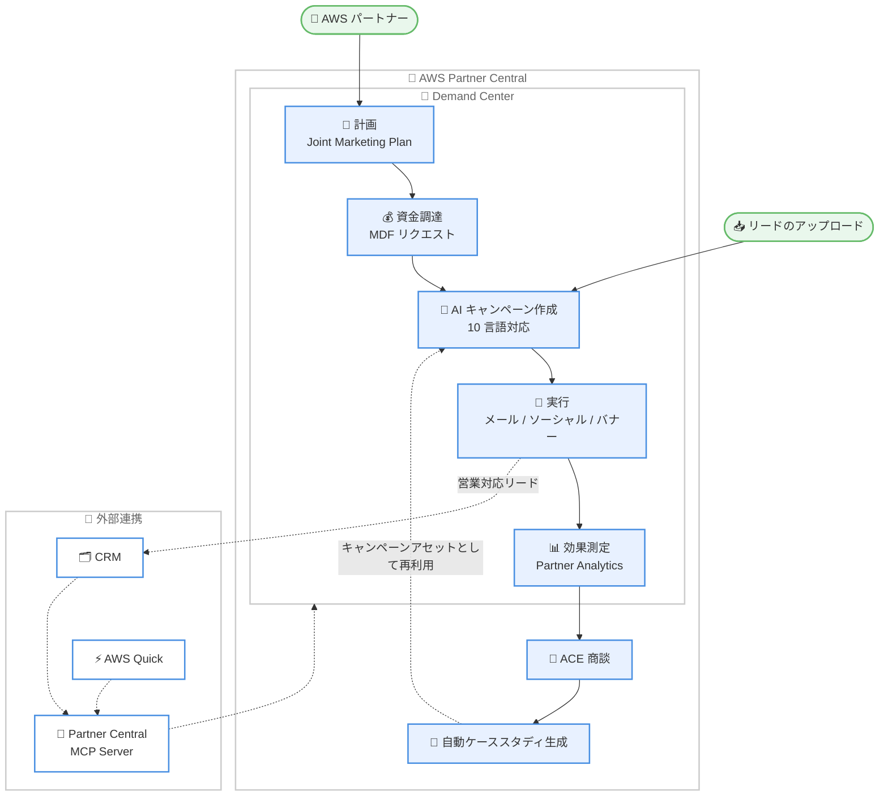

# AWS Partner Central - Demand Center の提供開始

**リリース日**: 2026 年 11 月 20 日
**サービス**: AWS Partner Central
**機能**: Demand Center

📊 [このアップデートのインフォグラフィックを見る](https://takech9203.github.io/aws-news-summary/20261120-demand-center-partner-central.html)

## 概要

AWS Partner Central で Demand Center の提供が開始されました。Demand Center は、AWS パートナーがデマンドジェネレーション (需要創出) キャンペーンの計画、作成、資金調達、実行、効果測定というライフサイクル全体を、単一の AI 搭載エクスペリエンスで管理できる新しい機能です。従来の Marketing Central を置き換えるものであり、Marketing Central の機能と MDF (Marketing Development Funds) の機能を 1 つに統合しています。

パートナーは Partner Central の画面に加えて、自社の CRM や AI エージェントからも Demand Center を利用できます。AI によるキャンペーン作成機能により、参考資料、URL、または説明文からコンテンツを生成し、メール、ソーシャルメディア、バナー広告など複数チャネル向けのアセットを多言語で数分以内に作成できます。アップロードしたリードは購買傾向シグナル (propensity signals) で自動的にエンリッチされ、推奨される次のアクションが提示されます。

本アップデートの対象ユーザーは、AWS との共同マーケティングや共同販売 (co-sell) を行うすべての AWS パートナーです。特に、専任のマーケティングリソースを持たない中小規模のパートナーにとって、キャンペーン立ち上げの工数を大幅に削減できる価値があります。

**アップデート前の課題**

- マーケティングキャンペーンの計画、コンテンツ作成、MDF 申請、効果測定が別々のツールに分かれており、ツール間の切り替えや手動でのセグメンテーションが必要だった
- キャンペーン用のヒーローアセット (ケーススタディ、ソリューション概要など) から各チャネル向けの派生アセットを作成するには、専任のコンテンツ制作リソースと長い期間 (数週間) が必要だった
- リードの質や購買意欲を判断する客観的なシグナルがなく、マーケティング投資がどれだけパイプラインや売上につながったかを追跡しにくかった

**アップデート後の改善**

- 計画、作成、資金調達 (MDF)、実行、測定を Demand Center の単一ワークフローで完結できるようになり、アイデアからマルチチャネルキャンペーンの立ち上げまでを 10 分以内で実施できるようになった
- ヒーローアセットを起点に、メール、ソーシャル、バナー向けアセットを AI が自動生成し、10 言語で展開できるようになった
- アップロードしたリードが AWS と同じシグナルで自動的にスコアリングされ、マーケティング対応リードは Demand Center のキャンペーンオーディエンスへ、営業対応リードは CRM へ自動ルーティングされるようになった
- キャンペーンからリード、ACE 商談、売上までを Partner Analytics で一気通貫に追跡できるようになった

## アーキテクチャ図



Demand Center はキャンペーンの計画から効果測定までを単一のワークフローとして統合し、Partner Central MCP Server を通じて CRM や AWS Quick などの外部ツールとも連携します。

## サービスアップデートの詳細

### 主要機能

1. **AI キャンペーン作成**
   - 参考資料、URL、または説明文を入力すると、AI がヒーローアセットと配信用アセットを数分で生成
   - ヒーローアセット (ケーススタディ、ソリューション概要、ホワイトペーパーなど) を起点に、対応するメール、ソーシャル、バナー広告のアセットを自動作成
   - すべてのアセットは 10 言語で利用可能で、ローカル市場向けにすぐに展開できる

2. **リードのエンリッチメントと自動ルーティング**
   - アップロードしたリードは、AWS が利用するものと同じシグナルで購買準備度と購買傾向がスコアリングされる
   - エンリッチされたリードはソリューション領域ごとに自動でバッチ化され、マーケティング対応リードは Demand Center のキャンペーンオーディエンスへ、営業対応リードは CRM へルーティングされる
   - 各リードには購買傾向インサイト、プログラムや資金調達の対象可否、カスタマイズされたセールスメッセージが付与される

3. **Partner Ready Campaign キットと Agency Connect**
   - AWS 承認済みメッセージングを含む事前構築済みの Partner Ready Campaign キットを選択し、自社ブランドでカスタマイズして利用できる
   - Agency Connect を通じて、AWS が審査したマーケティングエージェンシーに支援を依頼できる

4. **MDF と Joint Marketing Plan の統合**
   - Partner Business Plan を持つパートナーは、Demand Center 内で Joint Marketing Plan を作成し、そのまま MDF リクエストに引き継げる
   - 従来 Marketing Central と別管理だった MDF 機能が Demand Center に統合された

5. **AI によるケーススタディ自動生成**
   - ACE のクローズ済み商談 (closed-won) や既存アセット (ブログなど) からケーススタディを自動生成
   - 生成したケーススタディは AWS Marketplace のソリューションリスティングに直接公開でき、Demand Center のキャンペーンアセットとしても再利用できる

6. **AI エージェント・外部ツール連携**
   - Partner Central MCP Server を通じて、AWS Quick などの AI エージェントから Demand Center の機能を利用できる
   - CRM やマーケティングオートメーションツールとのエージェント間 (agent-to-agent) 連携に対応

7. **キャンペーンから売上までのトラッキング**
   - Partner Analytics により、各キャンペーンをリードから ACE 商談まで追跡し、創出されたパイプラインと投資対効果を可視化できる

## 技術仕様

### Demand Center の主な構成要素

| 項目 | 詳細 |
|------|------|
| 位置づけ | Marketing Central の後継。MDF 機能を統合 |
| アクセス方法 | Partner Central、CRM 連携、AI エージェント (AWS Quick など) |
| コンテンツ生成の入力 | 参考資料、URL、説明文、ACE クローズ済み商談 |
| 配信チャネル | メール、ソーシャルメディア、バナー広告 |
| 対応言語 | 10 言語 |
| キャンペーン作成時間 | アイデアからマルチチャネルキャンペーンまで 10 分以内 |
| リードスコアリング | AWS と同一のシグナルによる購買準備度・購買傾向スコア |
| 外部連携 | Partner Central MCP Server、API 経由の CRM 連携 |
| 効果測定 | Partner Analytics によるキャンペーンから売上までの追跡 |

## 設定方法

### 前提条件

1. AWS Partner Network (APN) に参加していること
2. AWS Partner Central のアカウントを持ち、サインインできること
3. MDF や Joint Marketing Plan を利用する場合は、Partner Business Plan を保有していること

### 手順

#### ステップ 1: Partner Central にサインイン

AWS Partner Central (https://partnercentral.aws.amazon.com/) にサインインし、[Go to Market] メニューから Demand Center を選択します。

#### ステップ 2: キャンペーンの作成

以下のいずれかの方法でキャンペーンを開始します。

- 参考資料、URL、または説明文を入力して AI にアセットを生成させる
- 事前構築済みの Partner Ready Campaign キットを選択し、自社ブランドでカスタマイズする
- Agency Connect から AWS 審査済みエージェンシーに支援を依頼する

#### ステップ 3: リードのアップロードとキャンペーンの実行

ターゲットリードをアップロードすると、購買傾向シグナルによるエンリッチメントと推奨アクションの提示が自動的に行われます。マーケティング対応リードをオーディエンスとしてキャンペーンを実行し、営業対応リードは CRM に連携して直接のアウトリーチに活用します。

#### ステップ 4: 効果測定

Partner Analytics でキャンペーンごとのリード、ACE 商談、パイプラインを追跡し、投資対効果を確認します。

## メリット

### ビジネス面

- **キャンペーン立ち上げの高速化**: 従来数週間かかっていたキャンペーン立ち上げが 10 分以内で可能になり、市場投入までの時間を大幅に短縮できる
- **マーケティング投資の可視化**: キャンペーンからリード、ACE 商談、売上までを一気通貫で追跡でき、MDF を含むマーケティング投資の ROI を定量的に把握できる
- **質の高いリードへの集中**: AWS と同じシグナルでスコアリングされたリードにより、購買意欲の高い顧客に営業リソースを集中できる

### 技術面

- **単一プラットフォームへの統合**: 計画、作成、MDF、実行、測定が 1 つのワークフローに統合され、ツール間のデータ連携や手動作業が不要になる
- **MCP Server による拡張性**: Partner Central MCP Server を通じて、AWS Quick や自社の CRM、マーケティングオートメーションツールとエージェント間連携ができる
- **多言語コンテンツの自動生成**: 10 言語対応の AI コンテンツ生成により、ローカライズ作業なしでグローバル・ローカル市場向けキャンペーンを展開できる

## デメリット・制約事項

### 制限事項

- AWS Partner Central へのアクセス権を持つ AWS パートナーのみが利用できる (一般の AWS アカウントでは利用不可)
- Joint Marketing Plan の作成と MDF リクエストへの連携は、Partner Business Plan を持つパートナーに限定される
- Marketing Central は Demand Center に置き換えられるため、既存の Marketing Central 利用者は移行手順の確認が必要

### 考慮すべき点

- AI が生成するキャンペーンアセットは、公開前に自社ブランドガイドラインや法務要件との整合性を確認することが推奨される
- リードデータのアップロードにあたっては、自社のプライバシーポリシーや各国の個人情報保護規制 (GDPR など) への準拠を確認する必要がある
- CRM 連携やエージェント間連携を行う場合は、Partner Central MCP Server や API の設定が別途必要になる

## ユースケース

### ユースケース 1: 新ソリューションの多言語キャンペーンを短期間で立ち上げる

**シナリオ**: SaaS パートナーが新しいソリューションのローンチに合わせて、日本を含む複数市場で同時にデマンドジェネレーションキャンペーンを実施したい。

**実装例**:
```text
1. Demand Center でソリューション概要資料 (ヒーローアセット) をアップロード
2. AI がメール、ソーシャル、バナー向けアセットを 10 言語で自動生成
3. 各市場向けにアセットを確認・調整してキャンペーンを実行
```

**効果**: 従来は翻訳・制作に数週間かかっていた多言語キャンペーンを数分で準備でき、グローバル同時ローンチが現実的になる。

### ユースケース 2: MDF を活用した共同マーケティングの一元管理

**シナリオ**: Partner Business Plan を持つパートナーが、AWS との共同マーケティング計画を立案し、MDF を申請してキャンペーンを実行したい。

**実装例**:
```text
1. Demand Center で Joint Marketing Plan を作成
2. 計画をそのまま MDF リクエストに引き継いで申請
3. 承認後にキャンペーンを実行し、Partner Analytics で成果を AWS と共有
```

**効果**: 計画、資金調達、実行、報告が単一ワークフローで完結し、MDF 申請の工数と管理コストを削減できる。

### ユースケース 3: クローズ済み商談からケーススタディを生成してリード獲得につなげる

**シナリオ**: パートナーが過去の成功事例を営業・マーケティング資産として活用したいが、ケーススタディ制作のリソースがない。

**実装例**:
```text
1. ACE のクローズ済み商談を選択してケーススタディを AI で自動生成
2. AWS Marketplace のソリューションリスティングに公開
3. 同じケーススタディをヒーローアセットとして Demand Center のキャンペーンに再利用
```

**効果**: 専任のコンテンツ制作リソースなしで成功事例を資産化し、購買検討中の顧客への訴求とリード獲得の両方に活用できる。

## 料金

Demand Center は AWS Partner Central の機能として、AWS パートナー向けに提供されます。What's New およびパートナー向けページに追加料金の記載はありません。キャンペーン資金としては、対象パートナーが MDF (Marketing Development Funds) を活用できます。

## 利用可能リージョン

Demand Center は AWS Partner Central の機能として提供され、特定の AWS リージョンに依存しません。AWS Partner Central にアクセスできるパートナーが利用できます。

## 関連サービス・機能

- **AWS Partner Central**: パートナー向けポータル。Demand Center はこの中の [Go to Market] メニューから利用する
- **ACE (APN Customer Engagements)**: 共同販売の商談管理。クローズ済み商談からのケーススタディ生成や、キャンペーンから商談への追跡に連携
- **AWS Quick**: AWS の AI エージェント。Partner Central MCP Server 経由で Demand Center の機能をエージェントから利用できる
- **Partner Analytics**: キャンペーンから売上までのトラッキングを提供する分析機能
- **AWS Marketplace**: 自動生成したケーススタディをソリューションリスティングに直接公開できる

## 参考リンク

- 📊 [インフォグラフィック](https://takech9203.github.io/aws-news-summary/20261120-demand-center-partner-central.html)
- [公式発表 (What's New)](https://aws.amazon.com/about-aws/whats-new/2026/11/demand-center-partner-central/)
- [AWS Blog (APN Blog)](https://aws.amazon.com/blogs/apn/new-ai-powered-capabilities-in-aws-partner-central/)
- [AWS パートナーマーケティング (Demand Center 紹介ページ)](https://aws.amazon.com/partners/marketing/)
- [AWS Partner Central](https://partnercentral.aws.amazon.com/)

## まとめ

Demand Center は、AWS パートナーのマーケティング活動を計画から効果測定まで単一の AI 搭載ワークフローに統合する大きなアップデートであり、Marketing Central からの置き換えとなります。特にマーケティングリソースの限られたパートナーにとって、キャンペーン立ち上げの高速化とリードの質向上による効果が期待できます。Marketing Central を利用中のパートナーは移行手順を確認し、Partner Central の [Go to Market] メニューから Demand Center を試すことを推奨します。
