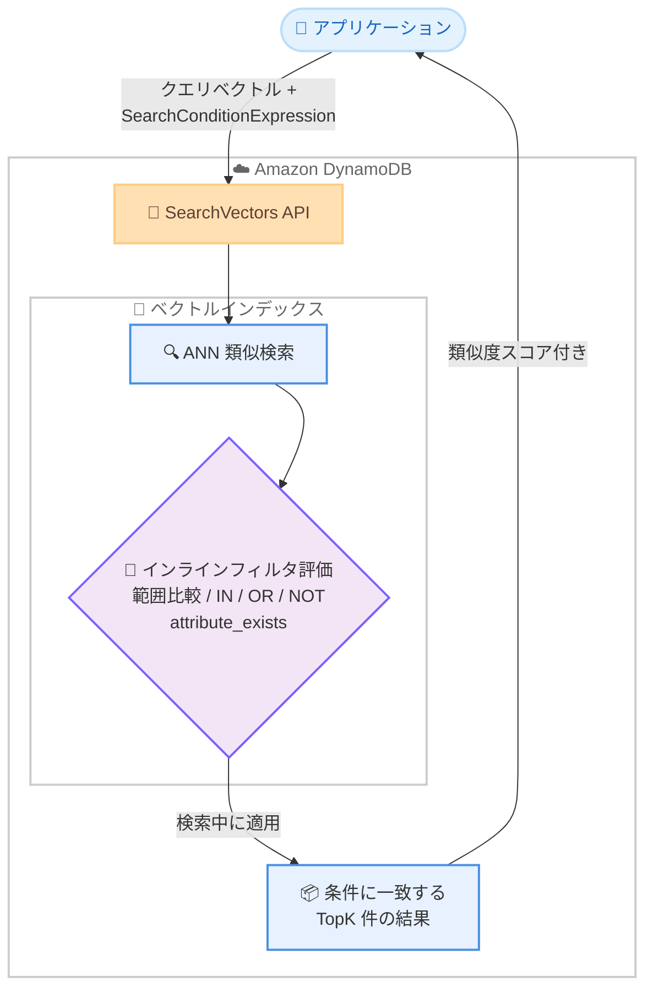

# Amazon DynamoDB - ベクトル検索インラインフィルタの新演算子サポート

**リリース日**: 2026 年 11 月 20 日
**サービス**: Amazon DynamoDB
**機能**: ベクトル検索インラインフィルタにおける範囲比較・値リスト・論理演算子のサポート

📊 [このアップデートのインフォグラフィックを見る](https://takech9203.github.io/aws-news-summary/20261120-dynamodb-vector-filters.html)

## 概要

Amazon DynamoDB のベクトル検索 (SearchVectors API) で使用するインラインフィルタが、従来の等価演算子 (=) に加えて、範囲比較、値リスト、論理演算子をサポートするようになりました。`SearchConditionExpression` に `<`、`<=`、`>`、`>=`、`BETWEEN` による数値の範囲条件、`IN` による値リストとの照合、`attribute_exists` / `attribute_not_exists` による属性の存在チェック、そして `OR` / `NOT` を含む論理演算子の組み合わせを記述できます。

フィルタは検索の実行中にストレージレイヤーで適用されるため、返却されるすべての結果が条件に一致します。アプリケーション側で検索結果を後処理でフィルタリングする必要がなく、価格帯やレーティング、公開日などの条件で絞り込んだ類似検索を 1 回の API 呼び出しで実現できます。

EC サイトの商品類似検索や RAG (検索拡張生成) アプリケーションなど、「意味的に類似し、かつ特定の条件を満たすアイテム」を取得したいユースケースで、クエリの表現力が大幅に向上する実用的なアップデートです。

**アップデート前の課題**

2026 年 8 月のベクトル検索 GA 時点では、インラインフィルタは等価条件のみをサポートしていました。

- `SearchConditionExpression` で使用できる演算子は等価 (=) のみで、価格帯やレーティングなどの範囲条件を検索時に適用できなかった
- 複数のブランドやカテゴリに一致させるには、値ごとに個別の検索を実行するか、アプリケーション側で結果をフィルタリングする必要があった
- `OR` や `NOT` による柔軟な条件の組み合わせができず、複雑な絞り込みはアプリケーションコードでの後処理が必要だった
- 後処理によるフィルタリングでは、TopK で取得した結果から条件に合わないアイテムが除外され、必要な件数を確保しにくかった

**アップデート後の改善**

- `<`、`<=`、`>`、`>=`、`BETWEEN` により、Number 属性に対する範囲条件を検索時に適用できるようになった
- `IN` 演算子により、最大 100 個の値リストとの照合を 1 つの条件で記述できるようになった
- `attribute_exists` / `attribute_not_exists` により、属性の有無を条件にできるようになった
- `AND` に加えて `OR` と `NOT` が使用可能になり、括弧によるグループ化と組み合わせて複雑な条件を表現できるようになった
- フィルタが検索中に適用されるため、返却される結果はすべて条件に一致し、後処理が不要になった

## アーキテクチャ図



アプリケーションはクエリベクトルとともに `SearchConditionExpression` を渡し、DynamoDB は ANN 類似検索の実行中にインラインフィルタを評価します。今回のアップデートで、この評価に範囲比較・値リスト・論理演算子が使えるようになり、返却結果はすべて条件に一致します。

## サービスアップデートの詳細

### 主要機能

1. **範囲比較演算子 (Number 属性のみ)**
   - `<`、`<=`、`>`、`>=` による比較と、両端を含む `BETWEEN :lo AND :hi` をサポート
   - 範囲演算子は Number (N) 型のインラインフィルタ属性にのみ適用可能で、String や Binary に対する使用は拒否される
   - `BETWEEN` は 1 つの条件としてカウントされ、両端が等しい場合は = と同等に扱われる

2. **IN 演算子による値リスト照合**
   - `IN (:a, :b, ...)` で値リストへの所属を判定。String、Number、Binary のすべての型に適用可能
   - リストには 1〜100 個の式属性値プレースホルダーを指定可能
   - リスト内の値の個数にかかわらず、1 つの条件としてカウントされる

3. **属性存在チェック関数**
   - `attribute_exists(#name)` と `attribute_not_exists(#name)` により、アイテムが属性を持つかどうかを条件にできる
   - =、範囲、`BETWEEN`、`IN` の各条件は属性を持たないアイテムに一致しない。一方 `<>` と `NOT` は属性を持たないアイテムにも一致するため、除外したい場合は `attribute_exists` を組み合わせる
   - `begins_with`、`contains`、`attribute_type`、`size` などの他の条件関数は引き続き未サポート

4. **論理演算子 OR / NOT と括弧によるグループ化**
   - 従来の `AND` に加えて `OR` と `NOT` が使用可能になり、`Query` / `Scan` の `FilterExpression` と同じ優先順位で括弧によるグループ化ができる
   - `OR` と `NOT` はインラインフィルタ条件に対してのみ使用可能で、ベクトルインデックスのパーティションキー条件には使用できない

## 技術仕様

### サポートされる演算子

| 演算子 / 関数 | 意味 | 適用可能な属性型 |
|------|------|------|
| `=` | 等価 | S、N、B |
| `<>` | 不等価 | S、N、B |
| `IN (:a, :b, ...)` | 値リストへの所属 (最大 100 個) | S、N、B |
| `<`、`<=`、`>`、`>=` | 範囲比較 | N のみ |
| `BETWEEN :lo AND :hi` | 両端を含む範囲 | N のみ |
| `attribute_exists(#name)` | 属性が存在する | - |
| `attribute_not_exists(#name)` | 属性が存在しない | - |
| `AND` | 論理積 | 常に使用可能 |
| `OR` | 論理和 | インラインフィルタ条件のみ |
| `NOT` | 否定 | インラインフィルタ条件のみ |

### パーティションキー条件のルール

ベクトルインデックスの SearchSchema がパーティションキー (HASH) を宣言している場合、`SearchConditionExpression` には以下のルールが適用されます。

| ルール | 詳細 |
|------|------|
| 条件の個数 | パーティションキー属性に対する条件はちょうど 1 つ |
| 使用可能な演算子 | = のみ (`<>`、範囲、`BETWEEN`、`IN`、存在チェック関数は不可) |
| 配置 | 式のトップレベルに `AND` で結合して配置。`OR` や `NOT` の内側には置けない |
| 複数値の検索 | 1 回の SearchVectors は 1 つのパーティションキー値のみを対象とする。複数値を検索する場合は値ごとに呼び出す |

### 条件数の制限とカウント方法

- 比較 (`=`、`<>`、`<`、`<=`、`>`、`>=`)、`BETWEEN` 句、`IN` 句、関数呼び出しはそれぞれ 1 条件としてカウントされる
- `AND`、`OR`、`NOT`、括弧は条件数にカウントされない
- 条件数が上限を超えると `ValidationException` が返される。条件数とは別に演算子数の上限もある
- パーティションキー条件も条件数にカウントされる

### Number 比較の精度

- `SearchVectors` の条件式における Number 値の比較は IEEE 754 倍精度 (64 ビット浮動小数点) で行われる
- `Query` / `Scan` は最大 38 桁の正確な比較を行うのに対し、`SearchVectors` は有効数字 16 桁以上で丸めが発生する可能性がある (有効数字 15 桁以内であれば両者の結果は一致)
- 64 ビット ID やナノ秒エポックタイムスタンプなど 16 桁以上の精度が必要な値は String 属性として保存し、= / `<>` / `IN` で比較することが推奨される
- 丸めは比較時のみに適用され、返却されるアイテムの Number 属性値は保存されたままの値

### API 変更履歴

今回のアップデートは `SearchVectors` API の `SearchConditionExpression` パラメータで受け付ける式の拡張であり、新しい API オペレーションやパラメータの追加はありません (直近の AWS API Changes に DynamoDB の関連エントリなし)。

### 式の記述例

```json
{
  "TableName": "Products",
  "IndexName": "ProductCatalogIndex",
  "TopK": 5,
  "SearchConditionExpression": "#category = :category AND ( #brand IN (:brand1, :brand2, :brand3) OR #price BETWEEN :lo AND :hi )",
  "ExpressionAttributeNames": {
    "#category": "Category",
    "#brand": "Brand",
    "#price": "Price"
  },
  "ExpressionAttributeValues": {
    ":category": { "S": "Shoes" },
    ":brand1": { "S": "AcmeRun" },
    ":brand2": { "S": "BravoStep" },
    ":brand3": { "S": "CirqueFit" },
    ":lo": { "N": "49.99" },
    ":hi": { "N": "99.99" }
  }
}
```

## 設定方法

### 前提条件

1. ベクトルインデックスを作成済みの DynamoDB テーブル (オンデマンドキャパシティモード)
2. フィルタ対象の属性がベクトルインデックスの SearchSchema にインラインフィルタとして宣言されていること (属性の追加はインデックス作成時のみ可能)
3. `dynamodb:SearchVectors` を許可する IAM 権限

### 手順

#### ステップ1: SearchSchema にインラインフィルタ属性を宣言する

```bash
# ベクトルインデックス作成時にインラインフィルタ属性を宣言
aws dynamodb update-table \
  --table-name Products \
  --vector-index-updates '[{
    "Create": {
      "IndexName": "ProductCatalogIndex",
      "VectorConfiguration": {
        "AttributeName": "descriptionEmbedding",
        "Dimensions": 1024,
        "DistanceFunction": "COSINE"
      },
      "SearchSchema": [
        {"AttributeName": "Category", "SearchKeyType": "HASH"},
        {"AttributeName": "Brand", "SearchKeyType": "INLINE_FILTER"},
        {"AttributeName": "Price", "SearchKeyType": "INLINE_FILTER"},
        {"AttributeName": "Rating", "SearchKeyType": "INLINE_FILTER"}
      ],
      "Projection": {"ProjectionType": "ALL"}
    }
  }]'
```

ベクトルインデックスの SearchSchema に、フィルタ対象の属性をインラインフィルタとして宣言します。範囲条件を使用する属性 (Price、Rating など) は Number 型で定義します。SearchSchema に宣言していない属性は `SearchConditionExpression` で参照できません。

#### ステップ2: 範囲条件と IN を組み合わせて検索する

```bash
# 価格帯とブランドリストで絞り込んだ類似検索
aws dynamodb search-vectors \
  --table-name Products \
  --index-name ProductCatalogIndex \
  --search-vector '[{"N": "0.14"}, {"N": "-0.27"}, {"N": "0.42"}]' \
  --top-k 5 \
  --search-condition-expression \
    "#category = :category AND ( #brand IN (:b1, :b2) OR #price BETWEEN :lo AND :hi )" \
  --expression-attribute-names \
    '{"#category": "Category", "#brand": "Brand", "#price": "Price"}' \
  --expression-attribute-values '{
    ":category": {"S": "Shoes"},
    ":b1": {"S": "AcmeRun"},
    ":b2": {"S": "BravoStep"},
    ":lo": {"N": "49.99"},
    ":hi": {"N": "99.99"}
  }'
```

パーティションキー条件 (`#category = :category`) をトップレベルに `AND` で配置し、インラインフィルタ条件を `IN`、`BETWEEN`、`OR` で組み合わせます。条件は `Query` / `Scan` と同じプレースホルダー方式 (`#name` / `:value`) で記述します。

#### ステップ3: 属性の存在チェックを組み合わせる

```bash
# Brand 属性を持ち、かつ指定ブランド以外のアイテムに限定する
aws dynamodb search-vectors \
  --table-name Products \
  --index-name ProductCatalogIndex \
  --search-vector '[{"N": "0.14"}, {"N": "-0.27"}, {"N": "0.42"}]' \
  --top-k 5 \
  --search-condition-expression \
    "#category = :category AND #brand <> :b AND attribute_exists(#brand)" \
  --expression-attribute-names '{"#category": "Category", "#brand": "Brand"}' \
  --expression-attribute-values '{":category": {"S": "Shoes"}, ":b": {"S": "AcmeRun"}}'
```

`<>` や `NOT` は属性を持たないアイテムにも一致するため、属性を持つアイテムに限定したい場合は `attribute_exists` を組み合わせます。

## メリット

### ビジネス面

- **検索体験の向上**: 価格帯・レーティング・公開日などビジネス上重要な条件で絞り込んだ類似検索を提供でき、EC サイトやレコメンデーションの精度と関連性が向上する
- **開発工数の削減**: アプリケーション側の後処理フィルタリングや複数回の検索呼び出しが不要になり、実装がシンプルになる
- **追加コストなし**: 既存の `SearchVectors` API の式拡張であり、新しい料金体系や追加設定は不要

### 技術面

- **結果の確実性**: フィルタが検索中に適用されるため、返却される TopK 件はすべて条件に一致し、後処理による件数不足が発生しない
- **使い慣れた式構文**: `Query` / `Scan` の `FilterExpression` と同じプレースホルダー方式・優先順位ルールを踏襲しており、学習コストが低い
- **表現力の向上**: 範囲、値リスト、存在チェック、OR / NOT の組み合わせにより、1 回の API 呼び出しで複雑な条件を表現できる

## デメリット・制約事項

### 制限事項

- 範囲演算子 (`<`、`<=`、`>`、`>=`、`BETWEEN`) は Number (N) 属性にのみ適用可能。String や Binary への範囲条件は不可
- `IN` リストは最大 100 個の値プレースホルダーまで。リスト内に属性名は指定できない
- 条件式はトップレベル属性のみ参照可能。ネストした属性パス (`a.b` や `a[0]`) は使用できない
- `begins_with`、`contains`、`attribute_type`、`size` などの条件関数は未サポート
- パーティションキー条件には = のみ使用可能で、`OR` / `NOT` の内側に置けない
- 条件数と演算子数には上限があり、超過すると `ValidationException` が返される
- 属性どうしの比較 (右辺に属性名を指定する条件) は不可

### 考慮すべき点

- Number の比較は倍精度浮動小数点で行われるため、有効数字 16 桁以上の値では `Query` / `Scan` と結果が異なる場合がある。高精度が必要な ID やタイムスタンプは String として保存するか、バケット属性を事前計算する
- `<>` と `NOT` は属性を持たないアイテムにも一致する。意図しない一致を避けるには `attribute_exists` を併用する
- フィルタ対象の属性はインデックス作成時に SearchSchema へ宣言しておく必要があり、後から追加できない。将来のフィルタ要件を見越したスキーマ設計が重要
- 複数のパーティションキー値をまたぐ検索は、値ごとに `SearchVectors` を呼び出す必要がある

## ユースケース

### ユースケース1: EC サイトの価格帯・ブランド絞り込み付き類似商品検索

**シナリオ**: 「このスニーカーに似た商品」を、ユーザーが指定した価格帯と好みのブランドリストで絞り込んで表示する。

**実装例**:
```
SearchConditionExpression:
  "#category = :cat AND #brand IN (:b1, :b2, :b3) AND #price BETWEEN :lo AND :hi"

1. 商品画像または説明文の埋め込みでベクトルインデックスを作成
   (Category を HASH、Brand と Price をインラインフィルタに宣言)
2. 表示中の商品のベクトルをクエリとして SearchVectors を実行
3. 価格帯とブランドリストに一致する類似商品 TopK 件を取得
```

**効果**: ユーザーの予算と好みに合致した類似商品のみを 1 回の API 呼び出しで提示でき、後処理による件数不足や無駄な読み取りがなくなる。

### ユースケース2: RAG におけるドキュメントカテゴリと公開日による絞り込み

**シナリオ**: 社内ナレッジ検索で、特定のドキュメントカテゴリに属し、かつ一定の日付以降に公開されたチャンクのみを LLM のコンテキストとして取得する。

**実装例**:
```
SearchConditionExpression:
  "#dept = :dept AND #docCategory IN (:c1, :c2) AND #publishedAt >= :since"

1. ドキュメントチャンクの埋め込みとともに、docCategory (String) と
   publishedAt (Number 形式の日付、例: 20260101) を保存
2. ユーザーの質問をベクトル化して SearchVectors を実行
3. 指定カテゴリかつ指定日以降のチャンクのみを取得し、LLM に渡す
```

**効果**: 古い情報や対象外カテゴリのドキュメントが LLM のコンテキストに混入することを防ぎ、回答の正確性と鮮度を向上できる。

### ユースケース3: レビュー属性の有無を考慮したレコメンデーション

**シナリオ**: レーティングが一定以上の商品を優先しつつ、レーティング未設定の新商品も候補に含めるレコメンデーションを実現する。

**実装例**:
```
SearchConditionExpression:
  "#category = :cat AND ( #rating >= :minRating OR attribute_not_exists(#rating) )"

1. Rating (Number) をインラインフィルタとして宣言
2. OR と attribute_not_exists を組み合わせ、高評価商品と
   レーティング未設定の新商品の両方を検索対象にする
```

**効果**: 属性が欠落しているアイテムの扱いを式の中で明示的に制御でき、新商品の露出機会を確保しながら品質基準を維持できる。

## 料金

今回のアップデートによる追加料金はありません。ベクトル検索は DynamoDB の既存の従量課金モデルに従い、`SearchVectors` の使用量に応じて課金されます。詳細は DynamoDB の料金ページを参照してください。

## 利用可能リージョン

DynamoDB ベクトル検索が提供されているすべての AWS リージョンで利用可能です。

## 関連サービス・機能

- **DynamoDB ベクトル検索 (2026 年 8 月 GA)**: 今回のアップデートの基盤機能。GA 時点ではインラインフィルタは等価条件のみだったが、本アップデートで表現力が大幅に拡張された
- **Amazon Bedrock**: Amazon Titan Text Embeddings などの埋め込みモデルでベクトルを生成し、DynamoDB に保存する典型的な組み合わせ
- **Amazon S3 Vectors**: S3 ベースのベクトルストレージ。2026 年 9 月にメタデータ事前フィルタリングを導入しており、リアルタイム性が必要な場合は DynamoDB、低コスト大容量は S3 Vectors と使い分けられる
- **DynamoDB Query / Scan の FilterExpression**: `SearchConditionExpression` は同じプレースホルダー方式と演算子優先順位を踏襲しているが、サポートされる関数や Number 比較の精度に差異がある

## 参考リンク

- 📊 [インフォグラフィック](https://takech9203.github.io/aws-news-summary/20261120-dynamodb-vector-filters.html)
- [公式発表 (What's New)](https://aws.amazon.com/about-aws/whats-new/2026/11/dynamodb-vector-filters/)
- [ドキュメント: SearchConditionExpression reference for vector indexes](https://docs.aws.amazon.com/amazondynamodb/latest/developerguide/VectorSearchFilterReference.html)
- [ドキュメント: Using vector indexes in DynamoDB](https://docs.aws.amazon.com/amazondynamodb/latest/developerguide/VectorSearch.html)
- [API リファレンス: SearchVectors](https://docs.aws.amazon.com/amazondynamodb/latest/APIReference/API_SearchVectors.html)
- [料金ページ](https://aws.amazon.com/dynamodb/pricing/)

## まとめ

DynamoDB ベクトル検索のインラインフィルタが範囲比較・値リスト・論理演算子に対応したことで、GA 時点の大きな制約だった「等価条件のみ」が解消され、実用的な絞り込み付き類似検索を 1 回の API 呼び出しで実現できるようになりました。既にベクトル検索を利用している場合はアプリケーション側の後処理フィルタの置き換えを、これから導入する場合は将来のフィルタ要件を見越した SearchSchema の設計 (範囲条件を使う属性の Number 型での宣言など) を検討することをお勧めします。
