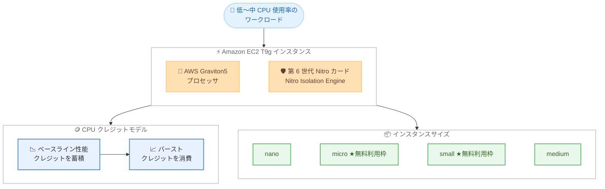

# Amazon EC2 - Graviton5 搭載 T9g インスタンスの一般提供開始

**リリース日**: 2026 年 11 月 20 日
**サービス**: Amazon EC2
**機能**: Amazon EC2 T9g インスタンス (Graviton5 ベースのバースト可能インスタンス)

📊 [このアップデートのインフォグラフィックを見る](https://takech9203.github.io/aws-news-summary/20261120-ec2-t9g-instances-ga.html)

## 概要

AWS は、AWS Graviton5 プロセッサを搭載した低コストのバースト可能 (burstable) 汎用インスタンスである Amazon EC2 T9g インスタンスの一般提供を開始しました。T9g は第 6 世代の AWS Nitro カード上に構築されており、AWS は「汎用 EC2 インスタンスの中で最高のプライスパフォーマンス」を提供するとしています。

前世代の T4g インスタンスと比較して、最大 45% 優れたプライスパフォーマンス、最大 2.3 倍のコンピューティング性能、1.5 倍のネットワーク帯域幅、2.8 倍の EBS 帯域幅を実現します。CPU クレジットの仕組みは T4g と同じ Standard モードと Unlimited モードを採用しているため、既存の T 系インスタンスのユーザーは運用モデルを変えずにアップグレードし、TCO を削減できます。

対象ユーザーは、CPU 使用率が低〜中程度のワークロードを運用するすべてのユーザーです。micro と small サイズは AWS 無料利用枠に含まれるため、AWS を使い始めるユーザーやオンプレミスからの移行の入り口としても位置づけられています。

**アップデート前の課題**

このアップデート以前には、以下の課題がありました。

- バースト可能な Graviton インスタンスは Graviton2 ベースの T4g が最新であり、最新世代 Graviton の性能向上をバースト可能インスタンスで利用できなかった
- 小規模ワークロードで高いネットワーク帯域幅や EBS 帯域幅が必要な場合、より大きな固定性能インスタンスへの移行が必要だった
- 低コスト帯のインスタンスで最新のセキュリティ分離機構を利用する選択肢が限られていた

**アップデート後の改善**

今回のアップデートにより、以下が可能になりました。

- Graviton5 の性能をバースト可能インスタンスで利用でき、T4g 比で最大 2.3 倍のコンピューティング性能と最大 45% 優れたプライスパフォーマンスを実現
- T4g と同じ CPU クレジットモデル (Standard / Unlimited) のため、既存の T 系ワークロードをそのまま移行可能
- 形式検証 (formal verification) を活用した Nitro Isolation Engine により、ワークロード間および AWS オペレーターからの分離を数学的に証明されたレベルで提供

## アーキテクチャ図



T9g インスタンスは Graviton5 プロセッサと第 6 世代 Nitro カードで構成され、T4g と同じ CPU クレジットモデルで低〜中 CPU 使用率のワークロードに低コストのバースト性能を提供します。

## サービスアップデートの詳細

### 主要機能

1. **Graviton5 プロセッサによる性能向上**
   - T4g と比較して最大 2.3 倍のコンピューティング性能
   - T4g と比較して最大 45% 優れたプライスパフォーマンス
   - 1.5 倍のネットワーク帯域幅と 2.8 倍の EBS 帯域幅

2. **第 6 世代 Nitro カードと Nitro Isolation Engine**
   - 第 6 世代の AWS Nitro カード上に構築
   - Nitro Isolation Engine は形式検証を活用し、数学的に証明されたセキュリティ分離を提供
   - ワークロード間の分離に加え、AWS オペレーターからの分離も実現

3. **T4g と同一の CPU クレジットモデル**
   - Standard モードと Unlimited モードをサポート
   - 既存の T 系インスタンスユーザーは運用を変えずに直接アップグレード可能
   - ベースラインを下回る使用時にクレジットを蓄積し、必要時にバースト

4. **AWS 無料利用枠への対応**
   - micro および small サイズが AWS 無料利用枠の対象
   - 新規ユーザーやオンプレミス移行のコスト効率の高い入り口として利用可能

## 技術仕様

### インスタンス概要

| 項目 | 詳細 |
|------|------|
| プロセッサ | AWS Graviton5 (Arm ベース) |
| 基盤 | 第 6 世代 AWS Nitro カード |
| インスタンスサイズ | nano、micro、small、medium の 4 サイズ |
| CPU クレジットモード | Standard / Unlimited (T4g と同一) |
| ネットワーク帯域幅 | T4g 比 1.5 倍 |
| EBS 帯域幅 | T4g 比 2.8 倍 |
| 無料利用枠 | micro、small サイズが対象 |
| 購入オプション | オンデマンド、Savings Plans、スポットインスタンス |

## 設定方法

### 前提条件

1. AWS アカウントを保有していること
2. 利用するリージョンが T9g の提供リージョンであること
3. ワークロードが Arm アーキテクチャ (aarch64) に対応していること

### 手順

#### ステップ1: 利用可能なインスタンスタイプの確認

```bash
aws ec2 describe-instance-type-offerings \
  --location-type region \
  --filters "Name=instance-type,Values=t9g.*" \
  --region ap-northeast-1
```

対象リージョン (例: 東京リージョン) で T9g インスタンスタイプが提供されているかを確認します。

#### ステップ2: T9g インスタンスの起動

```bash
aws ec2 run-instances \
  --image-id ami-xxxxxxxxxxxxxxxxx \
  --instance-type t9g.micro \
  --key-name my-key-pair \
  --subnet-id subnet-xxxxxxxx \
  --credit-specification CpuCredits=unlimited
```

Arm64 対応の AMI を指定して t9g.micro インスタンスを起動します。`--credit-specification` で CPU クレジットモードを unlimited または standard に設定できます。

#### ステップ3: CPU クレジットの監視

```bash
aws cloudwatch get-metric-statistics \
  --namespace AWS/EC2 \
  --metric-name CPUCreditBalance \
  --dimensions Name=InstanceId,Value=i-xxxxxxxxxxxxxxxxx \
  --start-time 2026-11-20T00:00:00Z \
  --end-time 2026-11-21T00:00:00Z \
  --period 3600 \
  --statistics Average
```

CloudWatch の CPUCreditBalance メトリクスで CPU クレジットの残高を監視し、バーストの発生状況やクレジット枯渇のリスクを把握します。

## メリット

### ビジネス面

- **コスト削減**: T4g 比で最大 45% 優れたプライスパフォーマンスにより、小規模ワークロードの TCO を削減
- **無料利用枠**: micro と small サイズが無料利用枠の対象であり、検証や学習、新規導入のハードルが低い
- **移行の容易さ**: T4g と同じクレジットモデルのため、既存 T 系ユーザーは運用変更なしでアップグレード可能

### 技術面

- **性能向上**: 最大 2.3 倍のコンピューティング性能、1.5 倍のネットワーク帯域幅、2.8 倍の EBS 帯域幅
- **セキュリティ強化**: 形式検証を活用した Nitro Isolation Engine による数学的に証明された分離
- **柔軟な購入オプション**: オンデマンド、Savings Plans、スポットインスタンスに対応

## デメリット・制約事項

### 制限事項

- インスタンスサイズは nano、micro、small、medium の 4 サイズのみで、large 以上のサイズは発表時点で提供されていない
- Arm アーキテクチャのため、x86 専用のソフトウェアやバイナリは再ビルドまたは代替が必要
- 提供リージョンは発表時点で 12 リージョンに限定されている

### 考慮すべき点

- バースト可能インスタンスのため、持続的に高い CPU 使用率が必要なワークロードには M 系や C 系などの固定性能インスタンスが適している
- Standard モードではクレジット枯渇時にベースライン性能に制限されるため、ワークロード特性に応じて Unlimited モードの利用を検討する
- Unlimited モードではベースラインを超える持続的な使用に追加料金が発生する可能性がある

## ユースケース

### ユースケース1: 低トラフィックの Web サイト・マイクロサービス

**シナリオ**: アクセスが断続的で、通常時は CPU 使用率が低い Web サイトや小規模なマイクロサービスを低コストで運用したい。

**実装例**:
```bash
aws ec2 run-instances \
  --image-id ami-xxxxxxxxxxxxxxxxx \
  --instance-type t9g.small \
  --credit-specification CpuCredits=standard
```

**効果**: 通常時にクレジットを蓄積し、アクセス増加時にバーストすることで、低コストと応答性を両立できます。

### ユースケース2: 開発・ステージング環境

**シナリオ**: 本番環境と同じ Arm アーキテクチャで開発・ステージング環境を構築し、環境コストを最小化したい。

**実装例**:
```bash
aws ec2 run-instances \
  --image-id ami-xxxxxxxxxxxxxxxxx \
  --instance-type t9g.micro \
  --tag-specifications 'ResourceType=instance,Tags=[{Key=Env,Value=staging}]'
```

**効果**: 無料利用枠対象の micro サイズを活用し、開発・検証コストを大幅に抑制できます。

### ユースケース3: バッチ処理・CI/CD パイプライン

**シナリオ**: 短時間で完了するバッチ処理や CI/CD のビルドジョブを、必要なときだけ高い性能で実行したい。

**実装例**:
```bash
aws ec2 run-instances \
  --image-id ami-xxxxxxxxxxxxxxxxx \
  --instance-type t9g.medium \
  --credit-specification CpuCredits=unlimited \
  --instance-market-options 'MarketType=spot'
```

**効果**: Unlimited モードとスポットインスタンスを組み合わせることで、短時間のジョブを低コストかつ高速に処理できます。

## 料金

T9g インスタンスは、オンデマンド、Savings Plans、スポットインスタンスの購入オプションで利用できます。micro および small サイズは AWS 無料利用枠の対象です。

Unlimited モードでは、ベースラインを超える CPU 使用が持続した場合に追加の vCPU 料金が発生する可能性があります。最新の料金は [Amazon EC2 料金ページ](https://aws.amazon.com/ec2/pricing/) および [T9g インスタンスページ](https://aws.amazon.com/ec2/instance-types/t9g/) を参照してください。

## 利用可能リージョン

発表時点で以下の 12 リージョンで利用可能です。

- 米国東部 (バージニア北部、オハイオ)
- 米国西部 (北カリフォルニア、オレゴン)
- カナダ (中部)
- 南米 (サンパウロ)
- 欧州 (フランクフルト、スペイン)
- アジアパシフィック (マレーシア、シンガポール、シドニー、東京)

## 関連サービス・機能

- **AWS Graviton**: AWS が設計する Arm ベースのプロセッサファミリー。T9g は最新世代の Graviton5 を搭載
- **AWS Nitro System**: EC2 の基盤となる仮想化インフラストラクチャ。T9g は第 6 世代 Nitro カードと Nitro Isolation Engine を採用
- **Amazon EC2 T4g インスタンス**: 前世代の Graviton2 ベースのバースト可能インスタンス。T9g への直接アップグレードが可能
- **Amazon CloudWatch**: CPUCreditBalance や CPUCreditUsage メトリクスによる CPU クレジットの監視に使用

## 参考リンク

- 📊 [インフォグラフィック](https://takech9203.github.io/aws-news-summary/20261120-ec2-t9g-instances-ga.html)
- [公式発表 (What's New)](https://aws.amazon.com/about-aws/whats-new/2026/11/ec2-t9g-instances-ga/)
- [Amazon EC2 T9g インスタンス](https://aws.amazon.com/ec2/instance-types/t9g/)
- [AWS Nitro System](https://aws.amazon.com/ec2/nitro/)
- [AWS 無料利用枠](https://aws.amazon.com/free/)
- [Amazon EC2 料金ページ](https://aws.amazon.com/ec2/pricing/)

## まとめ

T9g インスタンスは、Graviton5 の性能と第 6 世代 Nitro のセキュリティを低コストのバースト可能インスタンスで利用できるアップデートであり、東京リージョンでも初日から利用可能です。T4g と同じ CPU クレジットモデルを採用しているため、既存の T 系インスタンスを利用中のユーザーはまず開発・検証環境で T9g への移行を試し、プライスパフォーマンスの改善を確認することを推奨します。
