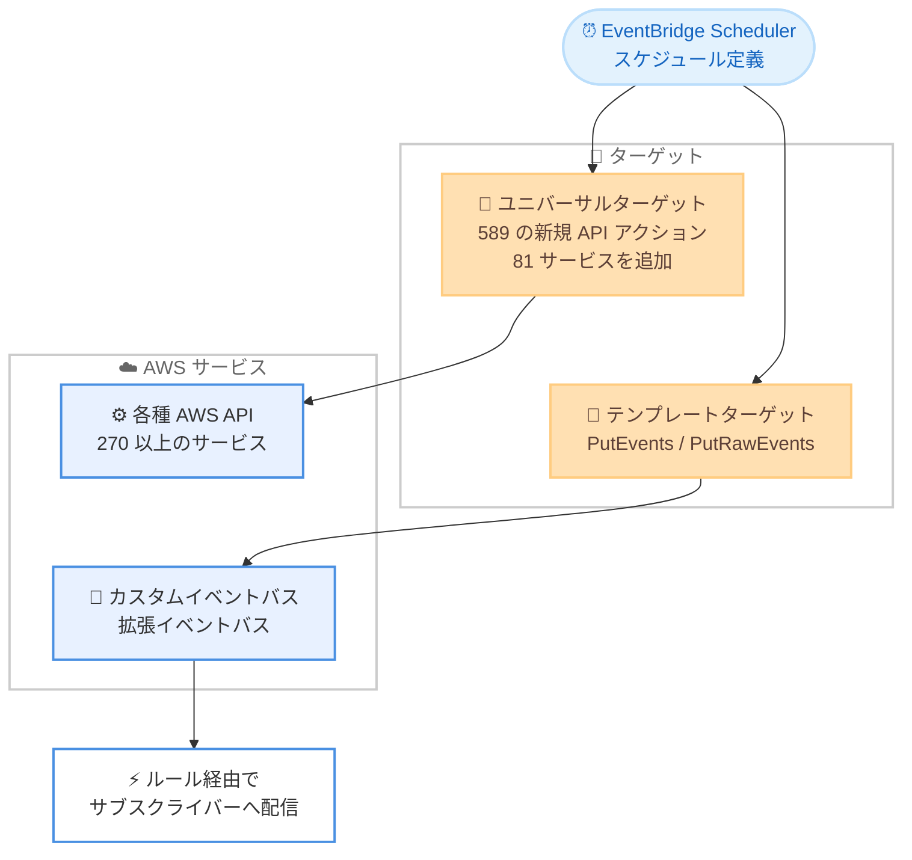

# Amazon EventBridge Scheduler - 589 の新規 API アクションとイベントバスターゲットの追加

**リリース日**: 2026 年 11 月 20 日
**サービス**: Amazon EventBridge Scheduler
**機能**: AWS SDK 統合の拡張 (589 の新規 API アクション) とカスタムイベントバス向けテンプレートターゲット

📊 [このアップデートのインフォグラフィックを見る](https://takech9203.github.io/aws-news-summary/20261120-eventbridge-scheduler-new-api-actions.html)

## 概要

Amazon EventBridge Scheduler が、AWS SDK 統合 (ユニバーサルターゲット) に 81 の AWS サービスにまたがる 589 の新規 API アクションを追加しました。あわせて、拡張されたカスタムイベントバス向けのテンプレートターゲットが導入され、PutEvents または PutRawEvents API を通じてスケジュールイベントをカスタムイベントバスへ直接配信できるようになりました。

EventBridge Scheduler はサーバーレスのスケジューリングサービスであり、インフラストラクチャのプロビジョニングや管理を行うことなく、270 を超える AWS サービスに対して数十億規模のスケジュールイベントやタスクを作成・管理できます。今回の拡張により、カスタムの統合コードを書くことなく、より広範な AWS サービスを直接呼び出すスケジュールを作成できるようになります。

定期的なバッチ処理、リソースの自動起動・停止、ワークフローの定時トリガーなどを運用するユーザーにとって、中間層の Lambda 関数を削減し、アーキテクチャをシンプルに保てる重要なアップデートです。

**アップデート前の課題**

- ユニバーサルターゲットが対応していない API アクションを呼び出す場合、スケジューラと対象サービスの間に Lambda 関数などの中間コードを実装する必要があった
- カスタムイベントバスへのイベント送信に専用のテンプレートターゲットがなく、メタデータの付与などに追加の実装が必要だった
- 中間層の実装・運用により、コスト、レイテンシー、保守負担が増加していた

**アップデート後の改善**

- 81 の AWS サービスにまたがる 589 の API アクションを、中間コードなしでスケジュールから直接呼び出せるようになった
- テンプレートターゲットにより、PutEvents / PutRawEvents API 経由でカスタムイベントバスへスケジュールイベントを直接配信できるようになった
- 各イベントへのメタデータフィールドの追加が簡素化された

## アーキテクチャ図



EventBridge Scheduler のスケジュールから、ユニバーサルターゲット経由で AWS サービスの API を直接呼び出すフローと、テンプレートターゲット経由でカスタムイベントバスへイベントを配信するフローを示しています。

## サービスアップデートの詳細

### 主要機能

1. **589 の新規 API アクションの追加 (ユニバーサルターゲット)**
   - 81 の AWS サービスにまたがる 589 の API アクションが新たにスケジュールのターゲットとして利用可能になった
   - 中間の Lambda 関数などを実装せずに、対象サービスの API を直接呼び出すスケジュールを作成できる
   - これにより、EventBridge Scheduler がサポートするサービスは 270 以上に拡大

2. **カスタムイベントバス向けテンプレートターゲット**
   - 拡張されたカスタムイベントバスに対し、PutEvents または PutRawEvents API でスケジュールイベントを直接配信できる
   - テンプレートターゲットにより、各イベントへのメタデータフィールドの追加が簡素化される
   - イベントバス上のルールを通じて、複数のサブスクライバーへのファンアウトが可能

3. **サーバーレスでの大規模スケジューリング**
   - インフラストラクチャのプロビジョニングや管理は不要
   - 数十億規模のスケジュールイベント・タスクを作成・管理できる

## 技術仕様

### ターゲットの種類

| 項目 | 詳細 |
|------|------|
| ユニバーサルターゲット | `arn:aws:scheduler:::aws-sdk:{service}:{apiAction}` 形式の ARN で任意の対応 API を呼び出し |
| テンプレートターゲット | 代表的な API 操作向けの事前定義ターゲット。今回カスタムイベントバス (PutEvents / PutRawEvents) が追加 |
| 対応サービス数 | 270 以上 (今回 81 サービス・589 API アクションを追加) |
| スケジュール種別 | 1 回限り、cron 式、rate 式 (既存機能) |

### IAM 権限の例

スケジューラの実行ロールには、呼び出す対象 API に応じた権限が必要です。カスタムイベントバスへ配信する場合の例を示します。

```json
{
  "Version": "2012-10-17",
  "Statement": [
    {
      "Effect": "Allow",
      "Action": "events:PutEvents",
      "Resource": "arn:aws:events:us-east-1:123456789012:event-bus/my-custom-bus"
    }
  ]
}
```

## 設定方法

### 前提条件

1. EventBridge Scheduler を利用できる AWS アカウント
2. 呼び出し対象の API アクションに対する権限を持つスケジューラ実行用 IAM ロール
3. テンプレートターゲットを使用する場合は、拡張されたカスタムイベントバス

### 手順

#### ステップ1: 実行ロールの準備

```bash
aws iam create-role \
  --role-name SchedulerExecutionRole \
  --assume-role-policy-document '{
    "Version": "2012-10-17",
    "Statement": [{
      "Effect": "Allow",
      "Principal": {"Service": "scheduler.amazonaws.com"},
      "Action": "sts:AssumeRole"
    }]
  }'
```

EventBridge Scheduler がターゲットを呼び出す際に引き受ける IAM ロールを作成しています。このロールに、呼び出す API アクションの権限をアタッチします。

#### ステップ2: ユニバーサルターゲットでスケジュールを作成

```bash
aws scheduler create-schedule \
  --name nightly-reconciliation \
  --schedule-expression "cron(0 2 * * ? *)" \
  --flexible-time-window Mode=OFF \
  --target '{
    "Arn": "arn:aws:scheduler:::aws-sdk:events:putEvents",
    "RoleArn": "arn:aws:iam::123456789012:role/SchedulerExecutionRole",
    "Input": "{\"Entries\": [{\"EventBusName\": \"my-custom-bus\", \"Source\": \"scheduler.batch\", \"DetailType\": \"NightlyReconciliation\", \"Detail\": \"{}\"}]}"
  }'
```

毎日 2:00 (UTC) にカスタムイベントバスへイベントを送信するスケジュールを作成しています。中間の Lambda 関数を介さず、スケジュールから直接 API を呼び出せます。

#### ステップ3: 動作確認

```bash
aws scheduler get-schedule --name nightly-reconciliation
```

作成したスケジュールの設定内容 (スケジュール式、ターゲット、ロール) を確認しています。イベントバス側ではルールとターゲットを設定し、イベントが配信されることを確認します。

## メリット

### ビジネス面

- **運用コストの削減**: 中間層の Lambda 関数が不要になり、実装・保守・実行コストを削減できる
- **開発スピードの向上**: カスタム統合コードを書かずに、スケジュール定義のみで広範なサービスを呼び出せる
- **拡張性**: サーバーレスで数十億規模のスケジュールを管理でき、ビジネスの成長に追従できる

### 技術面

- **アーキテクチャの簡素化**: スケジューラから対象 API への直接呼び出しにより、障害点と依存関係が減少する
- **イベント駆動設計との統合**: テンプレートターゲットでカスタムイベントバスへ直接配信し、ルールによるファンアウトを活用できる
- **メタデータ付与の簡素化**: テンプレートターゲットにより各イベントへのメタデータフィールド追加が容易になる

## デメリット・制約事項

### 制限事項

- 新規 API アクションの利用は、各リージョンで対象サービスが利用可能であることが前提となる
- テンプレートターゲットによるカスタムイベントバス配信は、拡張されたカスタムイベントバスが提供されているリージョンに限定される
- 呼び出せるのはスケジューラがサポートする API アクションに限られるため、利用前に対象 API の対応状況を確認する必要がある

### 考慮すべき点

- 直接 API を呼び出す構成では、リトライ戦略やデッドレターキュー (DLQ) の設定など、失敗時のハンドリングを設計する必要がある
- 複雑な条件分岐や変換処理が必要な場合は、引き続き Lambda や Step Functions を組み合わせる方が適切なケースがある
- 実行ロールに付与する権限は最小権限の原則に従って設計する必要がある

## ユースケース

### ユースケース1: 夜間の照合ワークフローの起動

**シナリオ**: 毎晩決まった時刻に照合 (リコンサイル) ワークフローを開始したいが、API を呼び出すためだけの Lambda 関数は持ちたくない。

**実装例**:
```
スケジュール: cron(0 2 * * ? *)
ターゲット: カスタムイベントバスへの PutEvents (テンプレートターゲット)
イベントバスのルール: 照合ワークフロー (Step Functions など) を起動
```

**効果**: 中間の関数なしでイベントを配信でき、実装・運用コストが削減される。

### ユースケース2: 定期的なリソース管理の自動化

**シナリオ**: 開発環境のリソースを営業時間外に停止し、コストを最適化したい。

**実装例**:
```
スケジュール: cron(0 20 ? * MON-FRI *)
ターゲット: ユニバーサルターゲットで対象サービスの停止系 API を直接呼び出し
```

**効果**: カスタムコードなしでリソースのライフサイクル管理を自動化し、クラウドコストを削減できる。

### ユースケース3: 複数システムへの定時イベント配信

**シナリオ**: 日次バッチの開始通知を、複数の下流システムに同時に伝えたい。

**実装例**:
```
スケジュール: rate(1 day)
ターゲット: カスタムイベントバスへの PutEvents
イベントバスのルール: SQS キュー、Lambda、SNS トピックなど複数ターゲットへファンアウト
```

**効果**: イベントバスのルーティング機能を活用し、疎結合なファンアウト構成を定時トリガーで実現できる。

## 料金

今回のアップデートに伴う料金変更は発表されていません。EventBridge Scheduler の既存の料金体系 (スケジュールされた呼び出し数に基づく課金) が適用されます。テンプレートターゲットでカスタムイベントバスへ配信する場合は、EventBridge 側の料金もあわせて確認してください。詳細は料金ページを参照してください。

## 利用可能リージョン

- **新規 API アクション**: EventBridge Scheduler が利用可能なすべての商用 AWS リージョン (各ターゲットサービスのリージョン対応状況に依存)
- **カスタムイベントバス向けテンプレートターゲット**: 拡張されたカスタムイベントバスが提供されているすべてのリージョン

## 関連サービス・機能

- **Amazon EventBridge (カスタムイベントバス)**: テンプレートターゲットの配信先。ルールによるイベントルーティングとファンアウトを提供
- **AWS Lambda**: 従来は中間層として利用されることが多かったが、今回の拡張により単純な API 呼び出しでは不要になる
- **AWS Step Functions**: 複雑なワークフローのオーケストレーションが必要な場合に、スケジュールから起動する構成で併用

## 参考リンク

- 📊 [インフォグラフィック](https://takech9203.github.io/aws-news-summary/20261120-eventbridge-scheduler-new-api-actions.html)
- [公式発表 (What's New)](https://aws.amazon.com/about-aws/whats-new/2026/11/eventbridge-scheduler-new-api-actions/)
- [ドキュメント: テンプレートターゲットの使用](https://docs.aws.amazon.com/scheduler/latest/UserGuide/managing-targets-templated.html)
- [ドキュメント: ユニバーサルターゲットの使用](https://docs.aws.amazon.com/scheduler/latest/UserGuide/managing-targets-universal.html)
- [料金ページ](https://aws.amazon.com/eventbridge/pricing/)

## まとめ

EventBridge Scheduler のユニバーサルターゲットが 589 の API アクション・81 サービス分拡張され、カスタムイベントバス向けテンプレートターゲットも追加されたことで、中間コードなしに直接サービスを呼び出すスケジュール設計が大きく広がりました。現在 Lambda 関数を単純な API 呼び出しの中継に使っている場合は、スケジューラからの直接呼び出しへの置き換えを検討することを推奨します。
