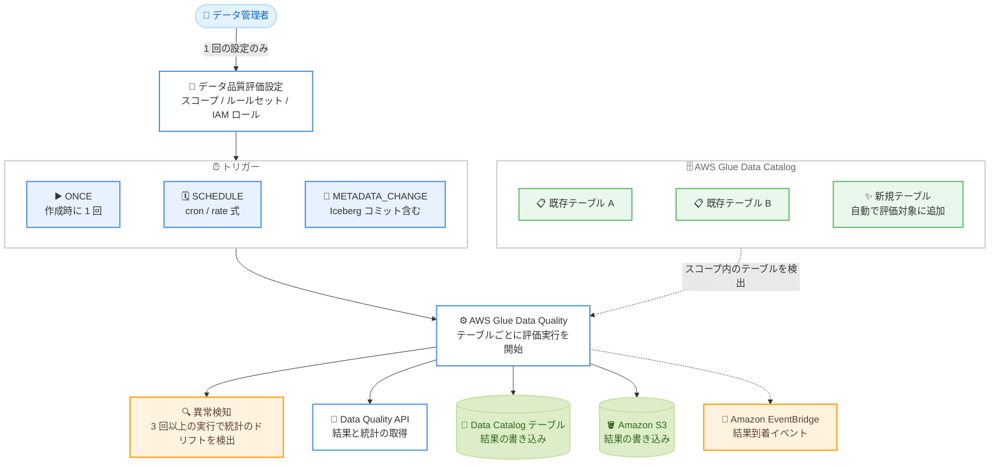

# AWS Glue Data Catalog - カタログ / データベースレベルのデータ品質モニタリング

**リリース日**: 2026 年 11 月 20 日
**サービス**: AWS Glue (AWS Glue Data Catalog / AWS Glue Data Quality)
**機能**: カタログおよびデータベースレベルのデータ品質モニタリング (Data Quality Monitoring for Catalogs and Databases)

📊 [このアップデートのインフォグラフィックを見る](https://takech9203.github.io/aws-news-summary/20261120-glue-catalog-data-quality-monitoring.html)

## 概要

AWS Glue Data Catalog に、カタログおよびデータベースレベルでのデータ品質モニタリング機能が追加されました。AWS Glue Data Quality を基盤とするこの機能により、1 つの「データ品質評価設定 (Data Quality Evaluation Configuration)」を作成するだけで、カタログまたはデータベース内のすべてのテーブルをプロファイリング・評価できます。後から追加されたテーブルも自動的に評価対象となるため、テーブルごとの個別セットアップや手動実行は不要です。

評価には、ベースライン統計を収集する組み込みルールセット (SIMPLE / ADVANCED) と、独自の Data Quality Definition Language (DQDL) ルールセットの両方を利用できます。トリガーは「作成時に 1 回」「スケジュール」「テーブルメタデータ変更時 (Apache Iceberg のコミットを含む)」から組み合わせて選択可能です。さらに、テーブルごとに 3 回以上評価を実行すると、異常検知が期待範囲を外れた統計値を自動的にフラグします。

データレイクやレイクハウスを運用するデータエンジニア、データガバナンス担当者にとって、組織全体のデータ品質標準を少ない運用負荷で適用し、不正なデータが下流の利用者に到達する前に検出できる点が大きな価値となります。

**アップデート前の課題**

このアップデート以前は、以下の課題がありました。

- データ品質評価はテーブル単位で設定する必要があり、数百〜数千テーブル規模のデータレイクでは設定・運用の負荷が大きかった
- 新しいテーブルが追加されるたびに、誰かが忘れずに品質チェックを設定する必要があった
- データ変更のたびに評価を実行するには、スケジューラーやイベント連携を自前で構築する必要があった

**アップデート後の改善**

今回のアップデートにより、以下が可能になりました。

- カタログ / データベース / テーブルの各レベルで 1 つの設定を作成するだけで、スコープ内のすべてのテーブルを一括評価できるようになった
- 後から追加されたテーブルも自動的に評価対象に含まれ、設定漏れを防げるようになった
- メタデータ変更 (Iceberg コミットを含む) やスケジュールをトリガーとして、データの変化に追従した継続的なモニタリングが可能になった
- 3 回以上の評価実行後、明示的なルールでカバーされていない統計の変化も異常検知で自動的に検出できるようになった

## アーキテクチャ図



1 つのデータ品質評価設定が、選択したトリガーに応じてスコープ内のすべてのテーブル (新規テーブルを含む) に対して評価実行を開始し、結果を API・Data Catalog テーブル・Amazon S3 で利用できる流れを示しています。

## サービスアップデートの詳細

### 主要機能

1. **カタログ / データベース / テーブルレベルの一括設定**
   - `CATALOG`、`DATABASE`、`TABLE` の 3 レベルで評価設定を作成可能
   - `TableNamePattern` (glob パターン、例: `orders_*`) でスコープ内のテーブルを絞り込み可能
   - トリガー発火のたびにスコープを再評価するため、後から追加されたテーブルは自動的に対象へ、削除されたテーブルは自動的に対象外になる
   - 設定が重複した場合は、より具体的なレベルの設定が優先される (テーブル > データベース > カタログ)

2. **柔軟なトリガー**
   - **ONCE**: 設定作成の約 1 分後にスコープ内の全テーブルを 1 回評価。以後、新規作成されたテーブルも作成時に 1 回評価
   - **SCHEDULE**: cron 式 (例: `cron(0 6 * * ? *)`) または rate 式 (例: `rate(12 hours)`) で定期実行。UTC 基準で、最短 1 時間に 1 回。`StartAt` / `EndAt` で期間を限定可能
   - **METADATA_CHANGE**: スキーマ変更、テーブルプロパティ更新、ストレージ形式変更、Apache Iceberg のコミットなど、Data Catalog 上のメタデータ変更をトリガーに評価
   - 複数トリガーの組み合わせが可能。各テーブルの評価は全設定・全トリガーを通じて最大 1 時間に 1 回に制限される

3. **組み込みルールセットと独自 DQDL ルールセット**
   - **SIMPLE (デフォルト)**: `RowCount`、`ColumnCount`、`Completeness`、最小値 / 最大値、`ColumnLength`、`Mean`、`Sum`、`StandardDeviation` などの統計を収集。データのシャッフルが不要で最も低コスト
   - **ADVANCED**: SIMPLE の統計に加えて `Uniqueness`、`Entropy`、`DistinctValuesCount`、`Distribution` を収集
   - **独自ルールセット**: `CreateDataQualityRuleset` で作成した DQDL ルールセット (ルール、アナライザー、またはその両方) を指定可能。「すべてのテーブルは 1 行以上」のような組織標準を一律適用できる

4. **異常検知との連携**
   - テーブルごとに 3 回以上評価を実行すると、統計値が期待範囲を外れた場合に異常としてフラグ
   - 明示的なルールで定義していない変化も検出可能。異常検知はデフォルトで有効 (`ObservationScope` を `NONE` にすると無効化可能)

5. **結果の活用**
   - 評価結果は各テーブルに紐づけて保存され、`GetDataQualityResult`、`BatchGetDataQualityResult`、`ListDataQualityResults` で取得可能
   - `EvaluationRunMode` (`EVALUATION_CONFIG` / `ON_DEMAND`) と `DataQualityEvaluationConfig` フィールドで、設定由来の結果とオンデマンド実行の結果を区別できる
   - 結果を Data Catalog 内の Apache Iceberg テーブルまたは Amazon S3 に書き出すことも可能
   - 各実行の結果到着時に Amazon EventBridge へイベントが発行され、アラートや通知を構築できる

6. **Amazon SageMaker Unified Studio 統合**
   - カタログページから、カタログまたはデータベース単位のプロファイリングを直接有効化可能

## 技術仕様

### 評価設定の構成要素

| 項目 | 詳細 |
|------|------|
| スコープ | `CATALOG` / `DATABASE` / `TABLE` の 3 レベル + `TableNamePattern` (glob、大文字小文字を区別しない) |
| ルールセット | 組み込み (`SIMPLE` / `ADVANCED`) または独自 DQDL ルールセット (`RulesetName`) |
| トリガー | `ONCE` (デフォルト)、`SCHEDULE`、`METADATA_CHANGE` の組み合わせ |
| IAM ロール | AWS Glue Data Quality がテーブル検出と評価実行時に引き受けるロール |
| 実行設定 | ワーカー数、タイムアウト、`PreProcessingQuery`、結果の書き込みや異常検知オプションなど (オンデマンド実行と同じ) |
| 評価対象 | Amazon S3 上の Apache Hive テーブル、Amazon S3 / Amazon S3 Tables 上の Apache Iceberg テーブル、Amazon Athena ビュー |
| 対象外 | JDBC 経由のフェデレーテッドカタログ (Snowflake、Google BigQuery、Amazon Redshift フェデレーションなど)、JDBC 接続テーブル、Athena ビュー以外のビュー |
| クォータ | 評価設定はアカウント・リージョンごとに最大 1,000 件。評価実行は同時実行クォータ・統計保存クォータにカウント |

### 主要 API オペレーション

| オペレーション | 用途 |
|------|------|
| `CreateDataQualityEvaluationConfig` | 評価設定の作成 |
| `GetDataQualityEvaluationConfig` | 評価設定の取得 |
| `ListDataQualityEvaluationConfigs` | 評価設定の一覧 (レベルでフィルタ可能) |
| `UpdateDataQualityEvaluationConfig` | 評価設定の更新、`PauseRuns` による一時停止 / 再開 |
| `DeleteDataQualityEvaluationConfig` | 評価設定の削除 (既存の結果は各テーブルに残る) |
| `ListDataQualityResults` | 結果の一覧 (`EvaluationRunMode` や設定名でフィルタ可能) |
| `ListDataQualityStatistics` | 収集された統計の一覧 |

## 設定方法

### 前提条件

1. AWS Glue Data Catalog に、Amazon S3 または Amazon S3 Tables のデータを持つテーブルが 1 つ以上存在すること
2. 評価設定のオペレーションを含む最新バージョンの AWS CLI または AWS SDK を使用すること
3. 評価設定の管理権限と、設定用 IAM ロールの `iam:PassRole` 権限があること。Lake Formation 使用時は対象カタログ / データベース / テーブルへの Lake Formation 権限も必要 (ロールが `DESCRIBE` できないテーブルはスキップされ、データ読み取りには列・行フィルタなしの `SELECT` 権限が必要)

### 手順

#### ステップ 1: 設定用 IAM ロールの作成

```bash
aws iam create-role \
  --role-name DataQualityEvaluationConfigRole \
  --assume-role-policy-document file://trust-policy.json

aws iam put-role-policy \
  --role-name DataQualityEvaluationConfigRole \
  --policy-name DataQualityEvaluationConfigPolicy \
  --policy-document file://permissions-policy.json
```

AWS Glue が引き受ける信頼ポリシーと、スコープ内のテーブル検出・評価実行・データ読み取りに必要な権限ポリシーを持つロールを作成します。ポリシーの内容は公式ドキュメントのテンプレートを使用します。

#### ステップ 2: データ品質評価設定の作成

```bash
aws glue create-data-quality-evaluation-config \
  --name my-database-config \
  --level DATABASE \
  --data-source '{
    "GlueTables": {
      "CatalogId": "111122223333",
      "DatabaseName": "my_database"
    }
  }' \
  --role DataQualityEvaluationConfigRole
```

データベースレベルの評価設定を作成します。ルールセットとトリガーを省略した場合、`SIMPLE` 組み込みルールセットと `ONCE` トリガーが使用され、約 1 分後にデータベース内の全テーブルの評価が開始されます。カタログ全体を毎日プロファイリングする場合は、`--level CATALOG` と `--triggers SCHEDULE --schedule-expression "rate(24 hours)"` を指定します。

#### ステップ 3: 結果の確認

```bash
aws glue list-data-quality-results \
  --filter '{
    "DataSource": {
      "GlueTable": {
        "DatabaseName": "my_database",
        "TableName": "my_table"
      }
    },
    "EvaluationRunMode": "EVALUATION_CONFIG",
    "DataQualityEvaluationConfig": "my-database-config"
  }'
```

テーブル・実行モード・設定名でフィルタして、評価設定が生成した結果を一覧します。組み込みルールセットの場合は、結果の `ProfileId` を取得して `aws glue list-data-quality-statistics --profile-id <profile-id>` で収集された統計を確認します。

#### ステップ 4: 設定の管理 (必要に応じて)

```bash
# 一時停止
aws glue update-data-quality-evaluation-config \
  --name my-database-config --pause-runs

# 再開
aws glue update-data-quality-evaluation-config \
  --name my-database-config --no-pause-runs
```

`SCHEDULE` または `METADATA_CHANGE` トリガーを含む設定は、削除せずに一時停止・再開できます。一時停止中は新規テーブルを含めて評価されず、停止中に逃した評価が後から実行されることはありません。

## メリット

### ビジネス面

- **運用負荷の大幅な削減**: テーブルごとの個別設定が不要になり、数千テーブル規模のデータレイクでも 1 つの設定でデータ品質を監視できる
- **ガバナンスの標準化**: 「すべてのテーブルは 1 行以上」「キー列は 99% 以上 complete」のような組織全体の品質基準を一律に適用できる
- **データ信頼性の向上**: 不正なデータが下流の分析・ML・レポートに到達する前に検出し、意思決定への悪影響を防止できる

### 技術面

- **新規テーブルの自動カバレッジ**: トリガー発火時にスコープを再評価するため、プロデューサーが追加したテーブルも設定変更なしで監視対象になる
- **Iceberg との親和性**: `METADATA_CHANGE` トリガーにより、Apache Iceberg の各コミットを契機とした評価が可能
- **既存エコシステムとの統合**: 結果は既存の Data Quality API、EventBridge 連携、Data Catalog テーブル / S3 への書き出し、異常検知とそのまま連携できる
- **柔軟な優先順位制御**: カタログ全体は低コストな SIMPLE で日次評価しつつ、重要テーブルだけテーブルレベル設定で高頻度・厳格なルール評価にするといった使い分けが可能

## デメリット・制約事項

### 制限事項

- 各テーブルの評価は全設定・全トリガーを通じて最大 1 時間に 1 回 (ユーザー自身が開始するオンデマンド実行には影響しない)
- 評価設定はアカウント・リージョンごとに最大 1,000 件。評価実行は同時実行クォータに、統計は保存クォータにカウントされる
- JDBC 経由のフェデレーテッドカタログのテーブル、JDBC 接続テーブル、Amazon Athena ビュー以外のビューはスキップされる
- 評価は保存後のデータ (data at rest) に対して実行され、データを書き込むジョブをブロック・停止するものではない (書き込み前のチェックには AWS Glue ETL ジョブのデータ品質機能を使用)
- 設定の名前・レベル・カタログは後から変更できない (変更するには新しい設定を作成)

### 考慮すべき点

- 書き込み頻度が高い Iceberg テーブルで `METADATA_CHANGE` トリガーを使うと評価回数が増えコストがかさむため、`SCHEDULE` トリガーの利用を検討する
- カタログ / データベースレベルで独自ルールセットを使う場合、存在しない列を参照するルールはそのテーブルで失敗するため、`RowCount > 0` のような汎用ルールを使い、テーブル固有のルールはテーブルレベル設定に分離する
- 組み込みルールセットはアナライザーのみで構成されるため、ルールの合否結果や行レベル結果は生成されない (必要な場合は独自ルールセットを使用)
- ADVANCED ルールセットはデータのシャッフルを伴うため、特に distinct 値の多い列では SIMPLE よりコストが高くなる

## ユースケース

### ユースケース 1: カタログ全体のベースラインプロファイリング

**シナリオ**: データレイク全体のテーブルについて、行数・欠損率・値の範囲などの基礎統計を毎日自動収集し、データの健全性を可視化したい。

**実装例**:
```bash
aws glue create-data-quality-evaluation-config \
  --name my-catalog-config \
  --level CATALOG \
  --data-source '{"GlueTables": {"CatalogId": "111122223333"}}' \
  --managed-ruleset-name SIMPLE \
  --triggers SCHEDULE \
  --schedule-expression "rate(24 hours)" \
  --role DataQualityEvaluationConfigRole
```

**効果**: 新規テーブルを含むカタログ内の全テーブルが毎日プロファイリングされ、統計の履歴が蓄積されて異常検知の学習データにもなる。

### ユースケース 2: 重要テーブルの厳格な監視

**シナリオ**: カタログ全体は日次の軽量プロファイリングで監視しつつ、課金処理に使う重要テーブルだけは毎時、独自ルールで厳格にチェックしたい。

**実装例**:
```bash
aws glue create-data-quality-ruleset \
  --name billing-ruleset \
  --ruleset 'Rules = [
    RowCount > 0,
    IsComplete "customer_id",
    IsUnique "transaction_id"
  ]'

aws glue create-data-quality-evaluation-config \
  --name billing-table-config \
  --level TABLE \
  --data-source '{
    "GlueTables": {
      "CatalogId": "111122223333",
      "DatabaseName": "finance",
      "TableNamePattern": "billing_transactions"
    }
  }' \
  --ruleset-name billing-ruleset \
  --triggers SCHEDULE \
  --schedule-expression "cron(0 * * * ? *)" \
  --role DataQualityEvaluationConfigRole
```

**効果**: テーブルレベル設定がカタログレベル設定より優先され、重要テーブルのみ高頻度・厳格なルールで評価される。他のテーブルはカタログレベル設定で引き続き評価される。

### ユースケース 3: Iceberg テーブルの変更追従モニタリング

**シナリオ**: ストリーミングやバッチで更新される Apache Iceberg テーブル群について、スキーマ変更やデータ更新のたびに品質を評価し、統計の異常なドリフトを検出したい。

**実装例**:
```bash
aws glue create-data-quality-evaluation-config \
  --name iceberg-monitoring-config \
  --level DATABASE \
  --data-source '{
    "GlueTables": {
      "CatalogId": "111122223333",
      "DatabaseName": "lakehouse_db",
      "TableNamePattern": "events_*"
    }
  }' \
  --managed-ruleset-name ADVANCED \
  --triggers SCHEDULE METADATA_CHANGE \
  --schedule-expression "rate(12 hours)" \
  --role DataQualityEvaluationConfigRole
```

**効果**: Iceberg のコミットを含むメタデータ変更のたびに評価が実行され、3 回以上の実行後は異常検知が期待範囲外の統計値を自動でフラグする。EventBridge 連携でアラートも構築できる。

## 料金

評価設定自体に料金はかかりません。設定が開始する各評価実行は、標準の AWS Glue Data Quality の DPU 時間課金で請求されます。

コストを制御するには、以下の方法があります。

- `TableNamePattern` でスコープ内のテーブルを限定する
- `PreProcessingQuery` で各テーブルの一部 (例: 直近 7 日分) のみを評価する
- 広いスコープの設定には低コストな `SIMPLE` ルールセットを選択する
- データの変更頻度に合ったトリガーを選択する (更新頻度の高い Iceberg テーブルには `METADATA_CHANGE` ではなく `SCHEDULE` を検討)

詳細は [AWS Glue 料金ページ](https://aws.amazon.com/glue/pricing/) を参照してください。

## 利用可能リージョン

すべての AWS 商用リージョン、AWS GovCloud (US) リージョン、および AWS 中国リージョンで利用可能です。

## 関連サービス・機能

- **AWS Glue Data Quality**: 本機能の評価エンジン。DQDL ルールセット、アナライザー、異常検知、オンデマンド評価実行を提供
- **Amazon SageMaker Unified Studio**: カタログページからカタログ / データベース単位のプロファイリングを有効化できる UI を提供
- **Apache Iceberg / Amazon S3 Tables**: `METADATA_CHANGE` トリガーによるコミット単位の評価や、S3 Tables 名前空間単位の監視に対応
- **Amazon EventBridge**: 評価結果の到着イベントを受信し、アラートや後続ワークフローを構築可能
- **AWS Lake Formation**: 権限管理との統合。設定のロールが `DESCRIBE` できるテーブルのみ評価され、結果の参照もテーブル権限で制御される

## 参考リンク

- 📊 [インフォグラフィック](https://takech9203.github.io/aws-news-summary/20261120-glue-catalog-data-quality-monitoring.html)
- [公式発表 (What's New)](https://aws.amazon.com/about-aws/whats-new/2026/11/glue-catalog-data-quality-monitoring/)
- [ドキュメント: Data quality monitoring at the catalog and database level](https://docs.aws.amazon.com/glue/latest/dg/data-quality-catalog-monitoring.html)
- [ドキュメント: Getting started with data quality monitoring](https://docs.aws.amazon.com/glue/latest/dg/data-quality-catalog-monitoring-getting-started.html)
- [ドキュメント: SageMaker Unified Studio でのカタログ / データベースのプロファイリング](https://docs.aws.amazon.com/sagemaker-unified-studio/latest/userguide/dq-profile-catalogs-databases.html)
- [料金ページ](https://aws.amazon.com/glue/pricing/)

## まとめ

AWS Glue Data Catalog のカタログ / データベースレベルのデータ品質モニタリングにより、テーブルごとの個別設定なしで、データレイク全体の品質監視を 1 つの設定で実現できるようになりました。新規テーブルの自動カバレッジ、Iceberg コミット連動のトリガー、異常検知との統合により、大規模環境でのデータガバナンスの運用負荷が大きく下がります。まずは低コストな SIMPLE ルールセットと日次スケジュールでカタログ全体のベースラインプロファイリングを開始し、重要テーブルには独自 DQDL ルールによるテーブルレベル設定を追加することを推奨します。
