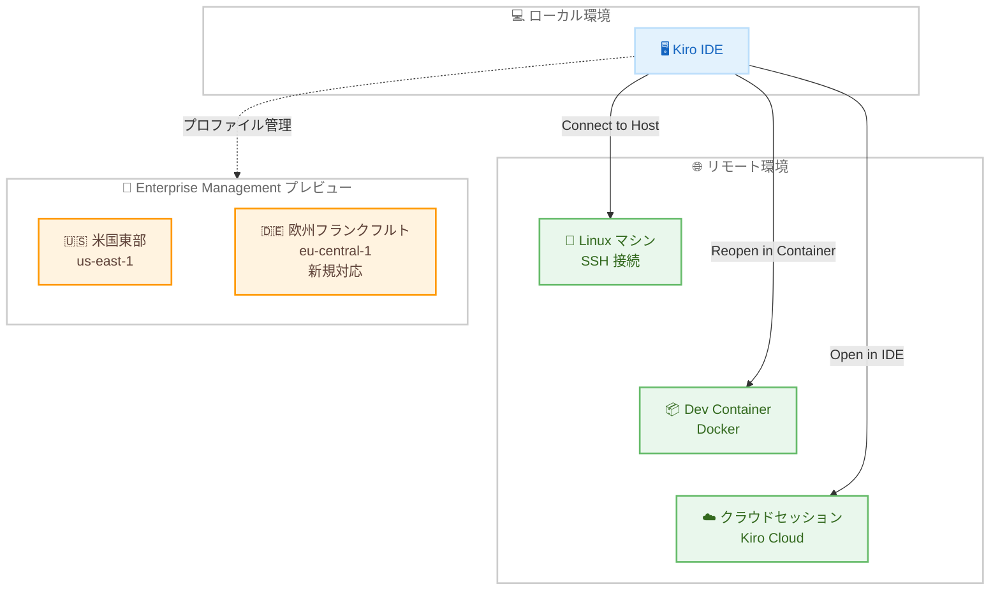

# Kiro - リモート開発機能の IDE 統合と Enterprise Management プレビューの欧州 (フランクフルト) 対応

**リリース日**: 2026 年 11 月 20 日
**サービス**: Kiro
**機能**: Remote SSH / Dev Containers / Cloud Sessions の IDE 統合 (v1.5.11)、Enterprise Management プレビューの欧州 (フランクフルト) 対応

📊 [このアップデートのインフォグラフィックを見る](https://takech9203.github.io/aws-news-summary/20261120-kiro-changelog-2026-11-20.html)

## 概要

2026 年 11 月 20 日付の Kiro Changelog で、2 つのアップデートが発表されました。

1 つ目は Kiro IDE v1.5.11 におけるリモート開発機能の統合です。Kiro IDE から SSH 経由で自身の Linux マシンに接続する、プロジェクトを Dev Container 内で開く、クラウドセッションを専用の Kiro ウィンドウで開く、という 3 つのリモート環境での作業が可能になりました。なお、この機能の詳細は公式ブログ記事 [Remote Workspaces](https://kiro.dev/blog/remote-workspaces/) で解説されており、別途レポートを作成しているため、本レポートでは要点のみを紹介します。

2 つ目は Enterprise Management プレビューの欧州 (フランクフルト) リージョン対応です。エンタープライズ管理者は、従来の米国東部 (バージニア北部) (us-east-1) に加えて、欧州 (フランクフルト) (eu-central-1) でも Kiro プロファイルを使った Enterprise Management プレビューを利用できるようになりました。欧州のデータレジデンシー要件を持つ組織にとって重要なアップデートです。

**アップデート前の課題**

- Kiro IDE はローカル環境での作業が前提で、リモートマシン上のプロジェクトを直接編集するには別のツールが必要だった
- リポジトリが定義する開発環境 (Dev Container) を利用するには、依存関係をローカルにインストールするか手動でコンテナを管理する必要があった
- クラウドセッションの成果を確認するには、リポジトリをローカルにコピーする必要があった
- Enterprise Management プレビューは米国東部 (バージニア北部) (us-east-1) のみで提供されており、欧州リージョンでプロファイルを管理したい組織は利用できなかった

**アップデート後の改善**

- Connect to Host により、エディタはローカルのまま、ファイル・ターミナル・エージェントをリモートの Linux マシン上で実行できるようになった (切断後もエージェントは作業を継続)
- Reopen in Container により、リポジトリの dev container を Docker でビルドし、その中でプロジェクトを開けるようになった (ローカルまたは SSH ホスト上)
- Open in IDE により、クラウドセッションをリポジトリのコピーなしで新しい Kiro ウィンドウで開き、実行中のエージェントとチャットを継続できるようになった
- 欧州 (フランクフルト) (eu-central-1) で Kiro プロファイルを作成し、Enterprise Management プレビューの Controls を利用できるようになった

## アーキテクチャ図

Kiro IDE から 3 種類のリモート環境 (SSH ホスト、Dev Container、クラウドセッション) に接続できるようになり、Enterprise Management プレビューは us-east-1 に加えて eu-central-1 でも利用可能になりました。

## サービスアップデートの詳細

### 1. Remote SSH / Dev Containers / Cloud Sessions の IDE 統合 (v1.5.11)

本機能の詳細は公式ブログ記事 [Remote Workspaces](https://kiro.dev/blog/remote-workspaces/) で解説されています (別レポートで詳述)。Changelog に記載された要点は以下のとおりです。

1. **Connect to Host による SSH 接続**
   - Kiro ウィンドウを自身の Linux マシンに接続できる
   - エディタはローカルに残り、ファイル・ターミナル・エージェントはリモートマシン上で実行される
   - 切断後もエージェントはリモート側で作業を継続できる

2. **Reopen in Container による Dev Container 対応**
   - リポジトリが定義するツールや依存関係を、ローカルにインストールせずに利用できる
   - リポジトリの dev container を Docker でビルドし、その中でプロジェクトを開く
   - ローカルマシン上でも SSH ホスト上でも利用可能

3. **Open in IDE によるクラウドセッションの操作**
   - クラウドセッションの作業内容を、リポジトリをローカルにコピーせずにレビュー・継続できる
   - 新しい Kiro ウィンドウでクラウドセッションのファイルを開き、実行中のエージェントにチャットが接続される

### 2. Enterprise Management プレビューの欧州 (フランクフルト) 対応

1. **対応リージョンの拡大**
   - Enterprise Management プレビューが、米国東部 (バージニア北部) (us-east-1) に加えて欧州 (フランクフルト) (eu-central-1) で利用可能になった
   - エンタープライズ管理者は eu-central-1 で Kiro プロファイルを管理できる

2. **新規プロファイルの扱い**
   - 欧州 (フランクフルト) で新規作成される Kiro プロファイルは、最初から Controls が有効な状態で作成される

3. **既存プロファイルの移行**
   - IAM Identity Center または外部 ID プロバイダーを利用している既存プロファイルは、Kiro Settings ページに「Migrate to the new experience」が表示された時点で Controls に移行できる
   - **移行は一方向 (one-way) であり、元に戻せない**点に注意が必要

## 技術仕様

| 項目 | 詳細 |
|------|------|
| IDE バージョン | Kiro IDE v1.5.11 (リモート開発機能) |
| SSH 接続対象 | Linux マシン |
| Dev Container | Docker を使用してビルド (ローカルまたは SSH ホスト上) |
| クラウドセッション | Kiro Cloud 上のセッションを IDE で直接オープン |
| Enterprise Management 対応リージョン | us-east-1、eu-central-1 (プレビュー) |
| 新規プロファイル (eu-central-1) | Controls が最初から有効 |
| 既存プロファイルの移行 | 一方向のみ (ロールバック不可) |

## 設定方法

### 前提条件

1. Kiro IDE v1.5.11 以降 (リモート開発機能)
2. SSH 接続の場合: 接続先 Linux マシンへの SSH アクセス
3. Dev Container の場合: Docker 実行環境と `.devcontainer` 定義を含むリポジトリ
4. Enterprise Management の場合: エンタープライズ管理者権限

### 手順

#### ステップ 1: SSH ホストへの接続

Kiro IDE のリモートメニューから「Connect to Host」を選択し、SSH ホストを追加または選択します。新しい Kiro ウィンドウがリモートホスト上で開きます。

#### ステップ 2: Dev Container でのオープン

`.devcontainer` フォルダを含むプロジェクトで、リモートメニューから「Reopen in Container」を選択します。Kiro が dev container をビルドし、コンテナ内でプロジェクトを開きます。

#### ステップ 3: クラウドセッションの IDE オープン

Sessions ビューからクラウドセッションを選択し、「Open in IDE」を実行します。新しい Kiro ウィンドウでセッションのファイルが開き、実行中のエージェントとのチャットが接続されます。

#### ステップ 4: Enterprise Management の欧州 (フランクフルト) 利用

エンタープライズ管理者は eu-central-1 で Kiro プロファイルを作成します。既存プロファイルの場合は、Kiro Settings ページに「Migrate to the new experience」が表示されたら移行を実行できます (移行は一方向のため、事前に影響を確認してください)。

## メリット

### ビジネス面

- **欧州データレジデンシー対応**: eu-central-1 での Enterprise Management により、欧州のコンプライアンス要件を持つ組織が Kiro のガバナンス機能を採用しやすくなる
- **オンボーディングの迅速化**: Dev Container により、新規メンバーが依存関係をローカルに構築せずに開発を開始できる
- **ガバナンスの標準化**: 新規プロファイルで Controls が最初から有効になるため、統制の抜け漏れを防げる

### 技術面

- **非同期エージェント実行**: SSH 接続では切断後もエージェントがリモートで作業を継続するため、長時間タスクを任せられる
- **環境の分離**: Dev Container により、プロジェクトごとのツールチェーンをローカル環境から分離できる
- **シームレスなクラウド連携**: クラウドセッションをコピーなしで IDE から直接レビュー・継続できる

## デメリット・制約事項

### 制限事項

- Enterprise Management は現時点でプレビュー提供であり、対応リージョンは us-east-1 と eu-central-1 の 2 つ
- 既存プロファイルの Controls への移行は一方向であり、元に戻すことはできない
- SSH 接続の対象は Linux マシン

### 考慮すべき点

- 既存プロファイルの移行は「Migrate to the new experience」が表示されるまで実行できないため、表示タイミングを確認する必要がある
- Dev Container の利用には Docker 実行環境が必要

## ユースケース

### ユースケース 1: 欧州企業でのエンタープライズガバナンス

**シナリオ**: 欧州に拠点を置く企業が、データレジデンシー要件を満たしながら開発者の Kiro 利用を統制したい。

**効果**: eu-central-1 で Kiro プロファイルを作成することで、欧州リージョン内で Enterprise Management プレビューの Controls を利用でき、コンプライアンス要件と開発者の生産性を両立できる。

### ユースケース 2: 高性能リモートマシンでのエージェント実行

**シナリオ**: ローカル PC のスペックが不足しているため、ビルドやエージェントの長時間タスクを社内の Linux サーバーで実行したい。

**効果**: Connect to Host でリモートマシンに接続すれば、エージェントがリモート側で実行され、切断後も作業が継続されるため、ローカル PC のリソースを消費せずに大規模タスクを進められる。

### ユースケース 3: クラウドセッションの成果レビュー

**シナリオ**: Kiro のクラウドセッションに委任したタスクの成果物を、ローカルにリポジトリをコピーせずに確認・修正したい。

**効果**: Open in IDE により、クラウドセッションのファイルを IDE で直接開き、実行中のエージェントとチャットしながらレビューと追加指示を行える。

## 料金

Changelog に料金に関する記載はありません。リモート開発機能は Kiro IDE の機能として提供されます。

## 利用可能リージョン

- **Kiro IDE のリモート開発機能**: グローバル (Kiro IDE v1.5.11 以降)
- **Enterprise Management プレビュー**: 米国東部 (バージニア北部) (us-east-1)、欧州 (フランクフルト) (eu-central-1)

## 関連サービス・機能

- **Kiro Cloud Sessions**: クラウド上でエージェントを実行するセッション機能。今回のアップデートで IDE から直接オープン可能になった
- **IAM Identity Center**: Enterprise Management の既存プロファイルで利用される ID 基盤。Controls への移行対象
- **Kiro for VS Code**: 2026 年 11 月 19 日に発表された VS Code 拡張。Kiro の利用形態の選択肢を広げる関連アップデート

## 参考リンク

- 📊 [インフォグラフィック](https://takech9203.github.io/aws-news-summary/20261120-kiro-changelog-2026-11-20.html)
- [Kiro Changelog](https://kiro.dev/changelog/)
- [Changelog: Enterprise Management Preview in Europe (Frankfurt)](https://kiro.dev/changelog/general/enterprise-management-europe-frankfurt/)
- [Blog: Remote Workspaces](https://kiro.dev/blog/remote-workspaces/) (リモート開発機能の詳細)
- [ドキュメント: Remote Development - SSH](https://kiro.dev/docs/ide/remote-development/ssh/)
- [ドキュメント: Remote Development - Dev Containers](https://kiro.dev/docs/ide/remote-development/dev-containers/)
- [ドキュメント: Remote Development - Cloud Sessions](https://kiro.dev/docs/ide/remote-development/cloud-sessions/)
- [ドキュメント: Enterprise Management - Availability](https://kiro.dev/docs/enterprise/enterprise-management/#availability)

## まとめ

Kiro IDE v1.5.11 のリモート開発機能により、SSH ホスト・Dev Container・クラウドセッションという 3 つのリモート環境をローカルの IDE から統一的に扱えるようになりました。あわせて、Enterprise Management プレビューが欧州 (フランクフルト) に拡大し、欧州の組織がリージョン内でガバナンス機能を利用できるようになりました。欧州でプロファイルを管理する組織は、既存プロファイルの Controls への移行が一方向である点を踏まえ、計画的な移行を検討することを推奨します。
