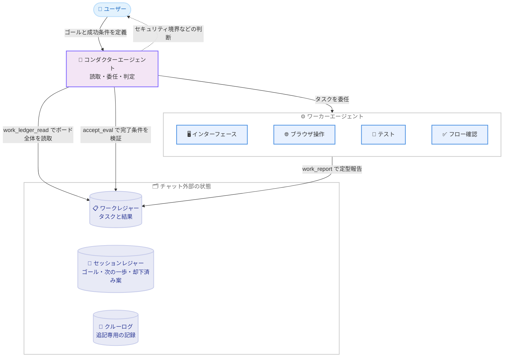

# Kiro - Kiro Crew のコンダクターモード

**リリース日**: 2026 年 11 月 20 日
**サービス**: Kiro (Kiro Crew)
**機能**: コンダクターモード (Conductor mode)

📊 [このアップデートのインフォグラフィックを見る](https://takech9203.github.io/aws-news-summary/20261120-kiro-conductor-mode.html)

## 概要

Kiro Crew に、1 つのゴールを複数のワーカーエージェントに分解して並列に進めるための新機能「コンダクターモード」が導入されました。コンダクターエージェントは、ユーザーが定義したゴールを受け取ると、必要なタスクを自ら切り出し、各タスクをワーカーエージェントに委任し、方向転換があればコンテキストを一元管理して全タスクに反映し、結果をゴールと照らし合わせてレビューし、進捗を 1 つのボードで報告します。

コンダクターモードは、「単一の集中タスクのための独立したチャットセッション」と「期限のない継続的な責務を担う Kiro bot」の中間に位置づけられます。Bot と同様にワーカーエージェントへ委任できますが、繰り返しのジョブではなく、ユーザーが引き渡した 1 つのゴールの完了を目指して、デフォルトの Kiro Crew エージェントとグローバルメモリによって駆動される点が異なります。開発チームが自らのブラウザ操作機能 (browser usage) の開発で直面した、複数チャットセッション間のコンテキスト分断と調整コストの課題から生まれた機能です。

**アップデート前の課題**

複数の関連タスクを並行して進める際、以下の課題がありました。

- 機能開発が複数のチャットセッションに分散し、各セッションでの変更の背景コンテキストも分断されていた
- 新しい要件 (例: エージェント操作の引き継ぎ機能) を追加する際、どのセッションでどの決定がなされたかを人間が覚えておき、セッション間でコンテキストを手動で運ぶ必要があった
- 短期プロジェクトでは、再利用しない Kiro bot をセットアップするコストに見合わなかった

**アップデート後の改善**

コンダクターモードにより、以下が可能になりました。

- ゴールを 1 つ定義するだけで、コンダクターエージェントがタスクの分解、ワーカーエージェントへの委任、進捗確認、結果の検証までを自律的に調整する
- 方向転換 (新しい決定) が、関係するすべてのタスクのブリーフに一元的に反映される
- 進捗とレビュー待ちの項目を単一のチャットと 1 つのボードで確認できる

## アーキテクチャ図



コンダクターエージェントはユーザーのゴールを受け取り、ワークレジャーを介してワーカーエージェントにタスクを委任・監督します。状態はチャットの外部に保持されるため、接続断やコンテキストリセット後も保存済みの計画から再開できます。

## サービスアップデートの詳細

### 主要機能

1. **ゴール駆動のタスク調整**
   - ユーザーはチャットのコンポーザーでコンダクターモードのスイッチをオンにし、ゴールと成功条件を記述するだけでよい
   - コンダクターエージェントがタスクを切り出し、各ワーカーエージェントに委任する
   - 進捗とユーザーの判断が必要な質問は 1 つのボードに表示される

2. **コンダクターエージェントは自ら作業しない設計**
   - 当初はコンダクターに小さな修正を許可していたが、修正にターンを使うと他のワーカーエージェントのチェック品質が低下した
   - このためデフォルトのコンダクターエージェントは直接のファイル編集ツールを持たず、すべての変更をワーカーエージェントに委任する

3. **定型フォーマットによるワーカーの報告**
   - 各ワーカーエージェントは 1 つのタスクに紐づき、`work_report` で progress / done / blocked / question のステータスと、プルリクエストなどの証跡リンクを報告する
   - コンダクターエージェントは `work_ledger_read` の 1 回の呼び出しでボード全体を読み取る

4. **チャット外部での状態管理**
   - 追記専用のクルーログを信頼できる唯一の情報源 (source of truth) とし、タスクと結果を保持するワークレジャー、ゴール・次のステップ・却下済みアプローチを保持するセッションレジャーで構成される
   - コンダクターエージェントは数日間動作することがあり、接続断やチャット要約による情報欠落があっても、保存済みの状態から再開できる

5. **効率的なパトロールチェック**
   - コンダクターエージェントは初回のキックオフ後も、タスクがゴールに沿って進んでいるかを定期的に確認する (パトロールチェック)
   - 小さなコードが先にワークレジャーを読み、注意が必要な変化がない場合はモデルのターンをスキップするため、コスト効率がよい
   - ワーカーが done / blocked / question を報告すると次のパトロールチェックが前倒しされ、報告を早く確認できる

6. **コンテキストの自動リセット**
   - コンダクターモードのセッションが長くなりアイドル状態になると、Kiro Crew がレジャーのスナップショットと直近のメッセージを使って次のターンを新しいモデルセッションで再開する
   - エージェント自身の指示遵守に依存しない、仕組みとしてのリセットを実現

7. **検証を伴う完了判定**
   - 結果は独立した検証を通過して初めて完了とみなされる。コンダクターエージェントは `accept_eval` プロシージャを呼び出し、プルリクエストのチェック結果、存在すべきファイル、人間の承認待ちリクエストなど、タスクごとに合意された完了条件に対して証跡をコードで検証する
   - チェックに 3 回失敗したタスクは rejected としてクローズされる

8. **人間が保持すべき判断の明確化**
   - 実運用のテストでは、セキュリティ境界を緩める修正についてコンダクターエージェントは変更を行わず、トレードオフを文書化して人間のレビューに回した
   - セキュリティ境界に関わる決定などは人間がコントロールを保持する設計

## 技術仕様

### コンダクターモードの構成要素

| 項目 | 詳細 |
|------|------|
| 駆動エージェント | デフォルトの Kiro Crew エージェントとグローバルメモリ |
| ワーカーの報告 | `work_report` (progress / done / blocked / question + 証跡リンク) |
| ボードの読み取り | `work_ledger_read` (1 回の呼び出しでボード全体を取得) |
| 完了判定 | `accept_eval` (完了条件に対する証跡のコード検証、3 回失敗で rejected) |
| 状態管理 | クルーログ (追記専用)、ワークレジャー、セッションレジャー |
| オープンタスク数 | デフォルトで最大 32 (同時実行数はリソースと設定した上限に依存) |
| パトロールチェック | コードが先に変化を検出し、必要な場合のみモデルを呼び出す |
| オープンソース | コンダクターエージェント、スキル、設計ドキュメントは Kiro Crew リポジトリで公開 |

### チャット・コンダクターモード・Bot の使い分け

| 作業の性質 | 適した選択肢 |
|------|------|
| 単一の集中タスク | チャットセッション |
| 並列実行できる項目に分割できるゴール | コンダクターモード |
| 繰り返し発生する、または終わりのない責務 | Kiro bot |

## 設定方法

### 前提条件

1. Kiro Crew を利用できる環境であること
2. 達成したいゴールと、成功とみなす条件を定義できること

### 手順

#### ステップ 1: コンダクターモードを有効化する

チャットセッションのコンポーザーで、コンダクターモードのスイッチをオンにします。

#### ステップ 2: ゴールと成功条件を記述する

通常であれば複数の別々のタスクとして進めるようなゴールを記述し、成功した結果がどのようなものかを定義します。コンダクターエージェントがタスクを分解し、ワーカーエージェントに委任します。

#### ステップ 3: ボードで進捗を確認する

ボードには進捗と、ユーザーの判断が必要な質問が表示されます。方向転換が必要な場合は、同じチャットでコンダクターエージェントに伝えるだけで、関係するすべてのタスクのブリーフに反映されます。

## メリット

### ビジネス面

- **調整コストの削減**: セッション間のコンテキスト運搬や決定事項の追跡といった人間の調整作業をコンダクターエージェントが肩代わりし、開発者はゴールと判断に集中できる
- **可視性の向上**: 進捗とレビュー待ち項目が 1 つのボードに集約され、全体状況の把握が容易になる
- **短期プロジェクトへの適合**: 再利用しない Bot をセットアップすることなく、期限のあるゴールに対して並列作業の調整を利用できる

### 技術面

- **一元化されたコンテキスト**: 新しい決定が関係するすべてのタスクに一貫して伝搬し、タスク間の不整合 (例: ボタンは表示されるが機能しない) を防げる
- **堅牢な状態管理**: 状態をチャット外部のレジャーに保持するため、接続断、長時間実行、コンテキストリセットに耐性がある
- **検証に基づく完了判定**: 「done」という自己申告ではなく、合意された完了条件に対する独立した検証を通過した結果のみを受け入れる

## デメリット・制約事項

### 制限事項

- ワーカーエージェント同士は直接メッセージをやり取りできず、すべてコンダクターエージェントを経由するため、調整オーバーヘッドが残る (今後の改善領域)
- コンダクターエージェントが保持できるオープンタスクはデフォルトで最大 32 であり、同時実行数は利用可能なリソースと設定した上限に依存する
- ゴールのコストをタスク単位で分解したり、調整コストと作業コストを分離したりすることはまだできない

### 考慮すべき点

- セキュリティ境界の緩和など、重要な判断はコンダクターエージェントに委ねず人間がレビューする運用が推奨される
- 継続的な責務 (例: CI の健全性維持) には、コンダクターモードではなく Kiro bot が適している
- コンダクターエージェントの判断が誤る場合もあるため (例: ブランチ間のテスト構成差異による誤判定)、証跡の確認は引き続き重要

## ユースケース

### ユースケース 1: 複数コンポーネントにまたがる機能開発

**シナリオ**: ブラウザ操作機能に「エージェントからの操作引き継ぎ」を追加する。インターフェースへのボタン追加、エージェントループの一時停止、テストの更新という 3 つのタスクに影響する。

**実装例**:
```text
コンダクターモードをオンにして以下を依頼:
「エージェントのブラウザ操作中に Take over ボタンで人間が操作を引き継ぎ、
終了後にエージェントへ返却できるようにする。
成功条件: ボタンをクリックするとエージェントが動作を停止すること」
```

**効果**: コンダクターエージェントが 3 つのタスクのブリーフをすべて更新し、ボタンの表示・エージェントの停止・フロー全体の検証が整合した状態で完成する。

### ユースケース 2: オープンチケットのキューの一括処理

**シナリオ**: リポジトリのオープンチケットのキューをまとめて処理したいが、自分でコードを書く作業はすべてワーカーに任せたい。

**実装例**:
```text
コンダクターモードをオンにして以下を依頼:
「このリポジトリのオープンチケットを処理する。
ルール: コンダクター自身はコードを書かないこと。
成功条件: 各チケットに対応するプルリクエストのチェックがすべて通過すること」
```

**効果**: コンダクターエージェントがワーカーエージェントにタスクを調整・委任し、報告を読み、`accept_eval` で結果を検証する。判断が必要なトレードオフ (セキュリティ境界の緩和など) は人間にエスカレーションされる。

### ユースケース 3: 独自のコンダクターエージェント構築への応用

**シナリオ**: Kiro Crew 以外の環境で、自前のオーケストレーションエージェントを設計したい。

**実装例**:
```text
ブログで共有された設計原則を適用する。
- コンダクターにはコードを書かせない
- ワーカーは構造化された記録で報告する
- 計画と状態はチャットの外に保持する
- コードが変化を監視し、変化があったときのみモデルを呼び出す
- 常に守るべきルールはエージェントの指示の外側で強制する
- 独立した検証を通過するまで結果を完了とみなさない
```

**効果**: 実運用で検証された設計判断を再利用し、堅牢なマルチエージェント構成を構築できる。コンダクターエージェント、スキル、設計ドキュメントは Kiro Crew リポジトリでオープンソースとして公開されている。

## 利用可能リージョン

グローバル (Kiro Crew の機能として提供)

## 関連サービス・機能

- **Kiro Crew**: コンダクターモードが提供されるエージェント実行基盤。チャット、Bot、コンダクターモードを作業の性質に応じて使い分けられる
- **Kiro bot**: 繰り返し発生する、または終わりのない責務を担うエージェント。コンダクターモードと同じレジャーを通じてワーカーエージェントに作業を委任する
- **Kiro IDE / CLI**: Kiro のエージェント機能を利用する開発環境

## 参考リンク

- 📊 [インフォグラフィック](https://takech9203.github.io/aws-news-summary/20261120-kiro-conductor-mode.html)
- [公式ブログ: Introducing conductor mode in Kiro Crew](https://kiro.dev/blog/conductor-mode/)
- [Kiro Crew](https://kiro.dev/crew)
- [Kiro ドキュメント](https://kiro.dev/docs/)
- [Kiro Blog](https://kiro.dev/blog/)
- [Kiro Changelog](https://kiro.dev/changelog/)

## まとめ

コンダクターモードは、単発タスクのチャットと継続責務の Bot の間を埋める、ゴール駆動のマルチエージェント調整機能です。コンテキストの一元管理、チャット外部での状態保持、独立した検証による完了判定といった実運用から得られた設計原則に基づいており、複数タスクにまたがる機能開発の調整コストを大幅に削減します。Kiro Crew を利用している場合は、複数の並列タスクに分割できる次のプロジェクトでコンダクターモードを試し、オープンソース化された設計ドキュメントにも目を通すことをおすすめします。
