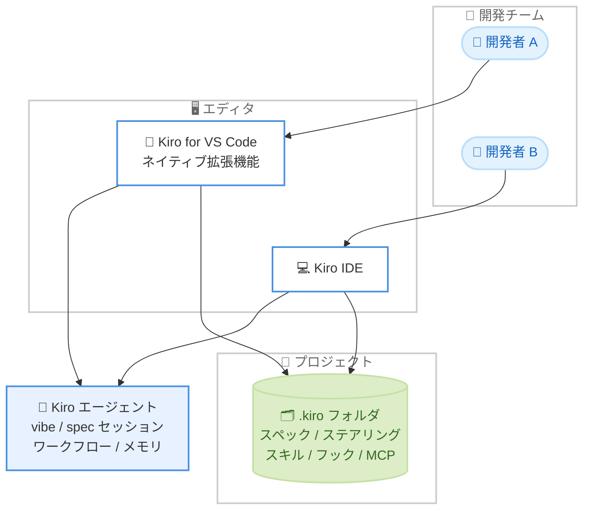

# Kiro - Kiro for VS Code の一般提供開始

**リリース日**: 2026 年 11 月 20 日
**サービス**: Kiro
**機能**: Kiro for VS Code (VS Code 向けネイティブ拡張機能)

📊 [このアップデートのインフォグラフィックを見る](https://takech9203.github.io/aws-news-summary/20261120-kiro-for-vs-code.html)

## 概要

Kiro は、VS Code 向けのネイティブ拡張機能「Kiro for VS Code」の一般提供を開始しました。macOS、Windows、Linux に対応し、VS Code Marketplace または Open VSX からインストールできます。サインインするだけで、使い慣れた VS Code を離れることなく Kiro エージェントを利用でき、すべての Kiro プランで追加料金なしに使用できます。

多くのチームにとって VS Code は標準のエディタであり、キーバインド、テーマ、設定、拡張機能など長年の積み重ねがあるため、新しいエージェントを試すためにエディタを切り替えることは現実的ではありませんでした。Kiro はこれまでも Agent Client Protocol (ACP) を通じて VS Code、JetBrains IDE、Zed、Neovim などで動作していましたが、今回ネイティブ拡張機能として提供されることで、approve for me、スペック、ステアリング、MCP、ワークフロー、メモリといった Kiro の主要機能が VS Code に組み込まれた形で利用できるようになりました。

Kiro for VS Code と Kiro IDE は同じ Kiro エージェントを実行し、同じ `.kiro` フォルダの設定を読み取るため、同一プロジェクトでチームメンバーごとに好みのエディタを選択しながら、プロジェクト設定を共有できます。

**アップデート前の課題**

このアップデート以前には、以下の課題がありました。

- Kiro の全機能を利用するには Kiro IDE へのエディタ切り替えが必要で、長年カスタマイズした VS Code 環境を手放す必要があった
- ACP 経由での VS Code 利用は可能だったが、スペックのタスクボタンや CodeLens などのネイティブな統合体験は得られなかった
- チーム内でエディタが異なると、Kiro のスペックやステアリングなどのプロジェクト設定を共有しにくかった

**アップデート後の改善**

今回のアップデートにより、以下が可能になりました。

- VS Code のサイドバー、コマンドパレット、CodeLens、差分ビューに統合されたネイティブな Kiro 体験が得られるようになった
- Kiro IDE と同じ `.kiro` フォルダを読み取るため、スペック、ステアリングファイル、スキル、フック、パワー、MCP サーバーの設定が変更なしでそのまま利用できるようになった
- スペックは双方向に互換性があり、Kiro IDE で作成したスペックを VS Code で開いても、その逆でも、そのまま動作するようになった
- すべての Kiro プランに含まれ、プランや請求の変更なしで利用できるようになった

## アーキテクチャ図



Kiro for VS Code と Kiro IDE は同じ Kiro エージェントを実行し、同じ `.kiro` フォルダを共有するため、チームメンバーごとに異なるエディタを使いながらプロジェクト設定を統一できます。

## サービスアップデートの詳細

### 主要機能

1. **`.kiro` 設定の完全互換**
   - Kiro IDE で使用している `.kiro` フォルダをそのまま読み取り、スペック、ステアリングファイル、スキル、フック、パワー、MCP サーバーが変更なしで動作する
   - スペックは双方向互換で、Kiro IDE で開始したスペックは VS Code でタスクボタン付きで開き、VS Code で作成したスペックも Kiro IDE でそのまま開ける
   - Kiro が回答する際、どのステアリングファイルを参照したかが表示され、クリックしてソースファイルを開き、必要に応じてルールを調整できる

2. **サイドバーでの vibe / spec セッション**
   - VS Code のサイドバーに Kiro 専用のハブが追加され、質問や軽微な変更には vibe セッション、計画が必要な作業には spec セッションを開始できる
   - 応答とツールのアクティビティがリアルタイムにストリーミング表示され、ターンはいつでも停止可能。ウィンドウをリロードしてもセッションは保持される
   - `#` によるコンテキスト指定 (ファイル、フォルダ、開いているファイル、診断情報、スペック、ステアリングファイル、ターミナル出力) や、コード選択後のコマンドパレットからの `Kiro: Ask Kiro` に対応

3. **スペック駆動開発のフルサポート**
   - 機能を記述すると、Kiro が要件、設計、両者にトレースされたタスクリストを順に作成する
   - バグ修正では、コード変更の前に「何が壊れているか」「何を維持すべきか」を bugfix チャットで整理する
   - エディタタイトルバーのボタンと各タスク上の CodeLens ラベルから、タスクを 1 つずつ実行することも、残りすべてを一括実行することもできる

4. **ワークフローとメモリ**
   - 計画、実装、レビューが必要な大きなタスクを渡すと、ワークフローエージェントが各ステップを個別のセッションで処理し、その間もメインチャットで作業を継続できる (ワークフローはオプトインのため、初回実行前に設定で有効化が必要)
   - メモリを有効にすると、リポジトリのコマンドや規約、過去の修正指示、除外済みのアプローチなどを記憶し、以降のセッションに引き継がれる

5. **承認・レビュー・取り消しのコントロール**
   - アクションを 1 つずつ手動承認するか、approve for me を有効にして定型的なアクションは自動承認、安全でないと判断したものはブロック、不確かな場合のみ確認を求める動作を選択できる
   - ターン終了時に変更されたすべてのファイルが表示され、ターン全体の差分の確認、ファイル単位での承認・却下、最新チェックポイントへの復元が可能
   - VS Code の Workspace Trust に準拠し、信頼されていないフォルダではワークスペース定義の MCP サーバーを起動しない

## 技術仕様

### 動作要件

| 項目 | 詳細 |
|------|------|
| 対応 OS | macOS、Windows、Linux |
| VS Code バージョン | 1.147 以降 |
| 入手方法 | VS Code Marketplace または Open VSX |
| サインイン方法 | GitHub、Google、AWS Builder ID、組織の ID プロバイダー |
| 対象プラン | すべての Kiro プラン (プラン・請求の変更なし) |

### Kiro for VS Code と Kiro IDE の使い分け

| 観点 | Kiro for VS Code | Kiro IDE |
|------|------------------|----------|
| 位置づけ | VS Code に溶け込む体験。サイドバー、コマンドパレット、CodeLens、既存の差分ビューを使用 | エージェント時代の IDE のあり方を再考するフラッグシップ。継続的に進化 |
| エージェント | 同一の Kiro エージェント | 同一の Kiro エージェント |
| プロジェクト設定 | 同じ `.kiro` フォルダを読み取り | 同じ `.kiro` フォルダを読み取り |
| 推奨ユーザー | VS Code を長年カスタマイズして使い込んでいる開発者 | Kiro のネイティブ体験を最大限活用したい開発者 |

同一プロジェクトで両者を切り替えて使用できます。

## 設定方法

### 前提条件

1. VS Code 1.147 以降がインストールされていること (macOS、Windows、Linux)
2. Kiro アカウント (GitHub、Google、AWS Builder ID、または組織の ID プロバイダーでサインイン可能なもの)

### 手順

#### ステップ 1: 拡張機能のインストール

```text
VS Code Marketplace: kiro.kiro-for-vscode を検索してインストール
または Open VSX: kiro/kiro-for-vscode をインストール
```

VS Code の拡張機能ビューから Kiro 拡張機能を検索してインストールします。Open VSX にも公開されているため、VSCodium などの互換エディタでも利用できます。

#### ステップ 2: サインイン

Kiro IDE と同じ方法でサインインします。GitHub、Google、AWS Builder ID、または組織の ID プロバイダーが利用できます。既存のプランと請求がそのまま引き継がれます。

#### ステップ 3: セッションの開始

プロジェクトを開き、VS Code サイドバーの Kiro タブを開いて Kiro セッションを開始します。質問や軽微な変更には vibe セッション、計画が必要な作業には spec セッションを選択します。ワークフローを使用する場合は、初回実行前に設定で有効化します。

## メリット

### ビジネス面

- **導入障壁の低減**: エディタの切り替えなしで Kiro を導入できるため、VS Code を標準とするチームでもエージェント活用を始めやすい
- **追加コストなし**: すべての Kiro プランに含まれ、プランや請求の変更が不要
- **チームの柔軟性**: メンバーごとに Kiro IDE と VS Code を自由に選択でき、プロジェクト設定は `.kiro` フォルダで共有される

### 技術面

- **設定資産の継続利用**: スペック、ステアリング、スキル、フック、パワー、MCP サーバーといった既存の `.kiro` 設定が変更なしで動作する
- **ネイティブな統合**: サイドバー、コマンドパレット、CodeLens、差分ビューなど VS Code の標準 UI に統合され、学習コストが低い
- **安全性のコントロール**: approve for me による段階的な自動承認、ターン単位の差分レビュー、チェックポイントへの復元、Workspace Trust 準拠により、エージェントの動作を安全に管理できる

## デメリット・制約事項

### 制限事項

- VS Code 1.147 以降が必要
- ワークフローはオプトイン機能のため、使用前に設定での有効化が必要
- 信頼されていないフォルダ (Workspace Trust 未承認) では、ワークスペース定義の MCP サーバーは起動されない

### 考慮すべき点

- Kiro IDE は引き続きエージェント中心の IDE 体験を進化させる場と位置づけられており、両者のどちらが適するかはチームの働き方に応じて選択する必要がある
- 同日の Kiro Changelog には「Remote SSH, Dev Containers, and Cloud Sessions in the IDE」(リモートワークスペース対応) のエントリもあり、リモート開発環境での利用を検討する場合は併せて確認するとよい

## ユースケース

### ユースケース 1: VS Code 標準チームへの Kiro 導入

**シナリオ**: チーム全体が VS Code を標準エディタとしており、拡張機能や設定を共有している。エディタを切り替えずにエージェントによるスペック駆動開発を導入したい。

**実装例**:
```text
1. 各メンバーが VS Code Marketplace から Kiro 拡張機能をインストール
2. 組織の ID プロバイダーでサインイン
3. リポジトリの .kiro フォルダにステアリングファイルと MCP 設定をコミットして共有
```

**効果**: エディタ環境を変えずに、チーム全体で統一されたエージェント開発環境を構築できる。

### ユースケース 2: Kiro IDE ユーザーと VS Code ユーザーの混在チーム

**シナリオ**: 一部のメンバーは Kiro IDE を使用し、他のメンバーは VS Code を使い続けたい。スペックやステアリングはプロジェクトで共有したい。

**実装例**:
```text
1. Kiro IDE ユーザーがスペックを作成し、.kiro フォルダをリポジトリにコミット
2. VS Code ユーザーが同じスペックをタスクボタン付きで開き、残りのタスクを実行
3. ステアリングファイルの参照状況を双方のエディタで確認し、必要に応じてルールを調整
```

**効果**: エディタの違いを意識せず、スペック駆動のワークフローをチーム全体で共有できる。

### ユースケース 3: 大きなタスクのバックグラウンド実行

**シナリオ**: 計画、実装、レビューを伴う大きめの機能追加をエージェントに任せつつ、自分は別の作業を続けたい。

**実装例**:
```text
1. VS Code の設定でワークフローを有効化
2. Kiro サイドバーからタスクを依頼し、ワークフローエージェントに処理を委任
3. メインチャットで別の作業を継続し、完了後にターン全体の差分をレビューしてファイル単位で承認
```

**効果**: エージェントへの委任と人間によるレビューを両立し、開発スループットを向上できる。

## 料金

Kiro for VS Code はすべての Kiro プランに含まれており、追加料金は発生しません。既存のプランと請求はそのまま引き継がれます。プランの詳細は [Kiro Pricing](https://kiro.dev/pricing/) を参照してください。

## 利用可能リージョン

グローバル (macOS、Windows、Linux で利用可能)

## 関連サービス・機能

- **Kiro IDE**: 同じ Kiro エージェントと `.kiro` 設定を使用するスタンドアロン IDE。同一プロジェクトで VS Code 版と切り替えて使用可能
- **Agent Client Protocol (ACP)**: Kiro を JetBrains IDE、Zed、Neovim などのエディタで利用するためのプロトコル。今回の発表以前から VS Code を含む各種エディタをサポート
- **Kiro ワークフロー / メモリ**: 大きなタスクの分担処理とセッション間のコンテキスト引き継ぎを担う機能で、VS Code 版でも利用可能
- **MCP (Model Context Protocol)**: `.kiro` フォルダで定義した MCP サーバーが VS Code 版でもそのまま動作

## 参考リンク

- 📊 [インフォグラフィック](https://takech9203.github.io/aws-news-summary/20261120-kiro-for-vs-code.html)
- [公式ブログ: Introducing Kiro for VS Code](https://kiro.dev/blog/kiro-for-vs-code/)
- [Kiro for VS Code ドキュメント](https://kiro.dev/docs/extensions/vscode/)
- [Specs ドキュメント](https://kiro.dev/docs/specs/)
- [VS Code Marketplace: Kiro for VS Code](https://marketplace.visualstudio.com/items?itemName=kiro.kiro-for-vscode)
- [Open VSX: Kiro for VS Code](https://open-vsx.org/extension/kiro/kiro-for-vscode)
- [Kiro Blog: Which Kiro app should I pick?](https://kiro.dev/blog/which-kiro-app-should-i-pick/)
- [Kiro Changelog](https://kiro.dev/changelog/) (同日の「Remote SSH, Dev Containers, and Cloud Sessions in the IDE」も参照)

## まとめ

Kiro for VS Code の一般提供により、VS Code ユーザーはエディタを切り替えることなく、スペック駆動開発、ワークフロー、メモリ、approve for me といった Kiro の主要機能をネイティブに利用できるようになりました。`.kiro` フォルダによる設定の完全互換により、Kiro IDE ユーザーとの混在チームでもプロジェクト設定を共有できます。VS Code を利用中のチームは、Marketplace から拡張機能をインストールして既存プランのまま試すことを推奨します。
