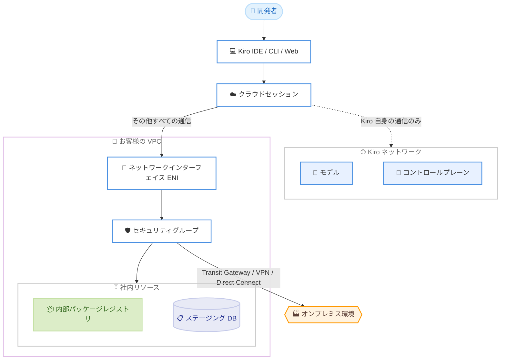

# Kiro - クラウドセッションのプライベートネットワーク接続 (VPC 接続)

**リリース日**: 2026年11月20日
**サービス**: Kiro
**機能**: クラウドセッションの VPC 接続 (Private Networks)

📊 [このアップデートのインフォグラフィックを見る](https://takech9203.github.io/aws-news-summary/20261120-kiro-private-networks.html)

## 概要

Kiro のクラウドセッションが、管理者が設定した VPC にアタッチできるようになりました。これまでクラウドセッションはパブリックインターネットと Kiro 自身のサービスにしか到達できず、社内パッケージミラーからのインストール、パブリックアドレスを持たないデータベースへの統合テスト、境界内からのみ応答するビルドサーバーの呼び出しなど、プライベートネットワーク内のリソースを利用する作業ができませんでした。

今回のアップデートにより、管理者が VPC を一度登録すれば、以降に作成されるすべてのクラウドセッションが自動的にその VPC に参加し、セッションが到達できる範囲をお客様自身のネットワークで制御できるようになります。Kiro 自身の通信を除くすべてのトラフィックは VPC 経由で送出されるため、エージェントのインターネットアクセスもお客様側で制御できます。本機能は、IAM Identity Center プロファイルを使用する Enterprise プランで利用可能です。

本機能は、Kiro IDE からクラウドセッション、Dev Container、自身のマシンを直接開ける「リモートワークスペース」機能と同時にリリースされました。リモートワークスペースは「作業がどこで実行されるか」を決定し、VPC 接続は「その作業が何に到達できるか」を決定します。

**アップデート前の課題**

- クラウドセッションはパブリックインターネットと Kiro のサービスにしか到達できず、社内レジストリ (Artifactory、Nexus など) やプライベートなステージング環境を利用できなかった
- エンタープライズのビルドは内部レジストリの依存関係や、パブリックアドレスを持たないデータストアに依存するため、こうした作業はローカルマシンに留めるか、境界に穴を開けてクラウドから到達可能にする必要があった
- Transit Gateway、VPN、Direct Connect の先にあるオンプレミスシステムにエージェントがアクセスする手段がなかった

**アップデート後の改善**

- 管理者が VPC 接続を一度登録するだけで、以降のすべてのクラウドセッションが自動的に VPC に参加する
- セッションは VPC がルーティングできるあらゆる宛先に IP アドレスまたは内部ホスト名で到達でき、内部 DNS でのプライベートホスト名の解決も可能になった
- NAT、ファイアウォール、VPC Flow Logs、ネットワーク ACL といった既存のネットワーク制御がそのままセッションのトラフィックに適用されるようになった

## アーキテクチャ図



クラウドセッションは起動時にお客様の VPC 内にネットワークインターフェイスをアタッチし、それをデフォルトルートとします。Kiro 自身の通信 (モデル、コントロールプレーン、テレメトリ) は Kiro のネットワークに留まり、それ以外のすべてのトラフィックはお客様の VPC を経由します。

## サービスアップデートの詳細

### 主要機能

1. **VPC へのセッション自動接続**
   - 管理者が VPC 接続を一度登録すると、以降に作成されるすべての新規クラウドセッションが自動的にその VPC に参加する
   - セッション起動時に Kiro がお客様のサブネット内にネットワークインターフェイスを作成し、セッションのデフォルトルートに設定する
   - プライベートホスト名はお客様の DNS で解決され、ネットワーク内の他のマシンと同じように接続できる

2. **到達可能なリソース**
   - VPC がルーティングできるすべての宛先に IP アドレスまたは内部ホスト名でアクセス可能
   - 内部パッケージレジストリやアーティファクトストア (Artifactory、Nexus など)、内部 API・サービス、データベース・データストアに到達できる
   - Transit Gateway、VPC ピアリング、VPN、Direct Connect 経由で到達可能なオンプレミスシステムにも接続できる
   - Kiro Web で設定済みの GitHub や GitLab などのソース管理連携は、既存の連携を通じてそのまま動作する

3. **トラフィック分離とネットワーク制御**
   - Kiro 自身の通信 (モデル、コントロールプレーン、テレメトリ) は Kiro のネットワークに留まり、お客様の VPC を通過しない
   - エージェントがモデルに送信するプロンプトやセッション内で収集したコンテキスト (ファイル内容、コマンド出力など) は VPC を経由しない
   - Kiro のサービス以外へのすべての通信は VPC から送出されるため、NAT、ファイアウォール、データ損失防止の制御で外部送信を制御できる
   - ネットワークから見るとセッションはサブネット内の 1 つのホストであり、NAT、ファイアウォール、Flow Logs、ネットワーク ACL がそのまま適用される

4. **開発者側の透過性**
   - 開発者がネットワークの詳細を入力する必要はなく、新規クラウドセッションは管理者のデフォルト接続に自動的に接続される
   - Kiro Web のサンドボックス設定に、接続先 (例: Connected to prod-shared)、VPC ID、リージョンが読み取り専用カードとして表示される
   - IDE と CLI のセッション情報にも同じ情報が表示される (Kiro IDE 1.4.236 以降、Kiro CLI 3.5.0 以降)

## 技術仕様

### VPC 接続の仕様

| 項目 | 詳細 |
|------|------|
| 対象プラン | Enterprise プラン (IAM Identity Center プロファイル) のみ |
| 接続単位 | 1 セッションにつき 1 つのお客様 VPC にアタッチ |
| 複数接続 | 管理者は複数の接続を登録可能。新規セッションにはデフォルトの 1 つが適用され、本リリースでは開発者による接続の選択は不可 |
| リージョン要件 | VPC はクラウドセッションと同一リージョンに存在する必要がある |
| サブネット要件 | Kiro が使用する各アベイラビリティゾーンにサブネットが必要。サブネットのないゾーンのセッションはアタッチ不可 |
| IP 消費 | 接続されたセッションごとにサブネットの IP アドレスを 1 つ消費 |
| 予約 CIDR | お客様の CIDR は 100.124.0.0/16、172.17.0.0/16、169.254.0.0/16 と重複不可 |
| セキュリティグループ | 管理者が所有する 1〜5 個を選択。Kiro はセキュリティグループを作成・変更しない |
| 認証情報 | Kiro はお客様アカウントに長期的な認証情報を保持せず、一時セッションは最長 1 時間 |
| 監査 | ロールの引き受け、ネットワークインターフェイスの作成・削除、検証用の読み取り呼び出しがすべて CloudTrail に記録される |

### IAM ロールの権限範囲

Kiro が引き受けるサービスロールは、以下に限定されます。

- 指定した VPC 内で Kiro がタグ付けしたネットワークインターフェイスの作成・タグ付け・削除
- 読み取り専用の Describe 系呼び出し
- 信頼ポリシーには SourceAccount および SourceArn 条件を使用し、該当プロファイルに代わってのみ Kiro がロールを引き受け可能 (混乱した代理問題への対策)

## 設定方法

### 前提条件

1. Kiro Enterprise プランと IAM Identity Center プロファイルを使用していること
2. クラウドセッションと同一リージョンに VPC が存在すること
3. セッション情報で VPC 接続を確認する場合は、Kiro IDE 1.4.236 以降または Kiro CLI 3.5.0 以降を使用すること

### 手順

管理者が Kiro Settings > Manage VPC connections から、5 ステップのウィザードで一度だけ設定します。

#### ステップ1: サービスロールの付与

アカウント内で Kiro に引き受けさせるサービスロールを指定します。コンソールは、SourceAccount と SourceArn 条件により該当プロファイルに代わってのみ Kiro が引き受けられる信頼ポリシーを持つロールを作成できます。既存のロールを選択することも可能です。

#### ステップ2: VPC の所在の指定

VPC がどのアカウントにあるかを指定します。共有ネットワークアカウントなど別アカウントの VPC を使用する場合は、ステップ 1 のロールを信頼するロールをそのアカウントに追加し、そのロール ARN を指定します。

#### ステップ3: VPC とサブネットの選択

Kiro が使用する VPC とサブネットを選択します。ウィザードには各サブネットのアベイラビリティゾーンと空き IP アドレス数が表示され、同時に実行できるセッション数の目安が示されます。

#### ステップ4: セキュリティグループの選択

VPC 内で管理者が所有するセキュリティグループを 1〜5 個選択します。Kiro はセキュリティグループを作成・変更しないため、選択したグループがセッションの到達範囲を定義します。

#### ステップ5: 接続チェックと有効化

Kiro が接続を検証し、すべてのチェックに合格した場合にのみ接続を作成します。問題がある場合は、各問題と修正方法が一覧表示されます。作成した接続は、Controls でデフォルトに設定すると有効になります。チェックと警告の全一覧は VPC connections ドキュメントに記載されています。

## メリット

### ビジネス面

- **エンタープライズ開発のクラウド移行**: 内部レジストリやプライベートなステージング環境に依存する作業をローカルマシンに留める必要がなくなり、クラウドセッションでのエージェント活用範囲が拡大する
- **セキュリティ境界の維持**: クラウドからの到達性を確保するために境界に穴を開ける必要がなく、既存のネットワーク統制を変更せずに導入できる
- **ガバナンスと監査性**: すべての操作が CloudTrail に記録され、セキュリティグループ、NAT、ファイアウォールなど既存の統制がそのまま適用される

### 技術面

- **既存ネットワーク制御の継続適用**: セッションはサブネット内の 1 ホストとして扱われ、セキュリティグループのルール変更は実行中のセッションを含めて即時に反映される
- **内部 DNS の利用**: プライベートホスト名がお客様の DNS で解決されるため、エージェントは社内の実際の開発環境に対して作業できる
- **オンプレミス接続**: Transit Gateway、ピアリング、VPN、Direct Connect 経由でオンプレミスのシステムにも到達できる
- **最小権限の IAM 設計**: Kiro のロールはタグ付けされたネットワークインターフェイスの管理と読み取り専用呼び出しに限定され、長期的な認証情報を保持しない

## デメリット・制約事項

### 制限事項

- Enterprise プランかつ IAM Identity Center プロファイルのみで利用可能
- VPC はクラウドセッションと同一リージョンに存在する必要がある
- 1 つのセッションがアタッチできるお客様 VPC は 1 つのみで、本リリースでは開発者が接続を選択することはできない
- Kiro が使用する各アベイラビリティゾーンにサブネットが必要で、サブネットのないゾーンのセッションはアタッチできない
- お客様の CIDR は 100.124.0.0/16、172.17.0.0/16、169.254.0.0/16 と重複できない

### 考慮すべき点

- 接続されたセッションは起動時にサブネット内へネットワークインターフェイスを作成するため、通常のセッションより起動に時間がかかる
- セッションごとに IP アドレスを 1 つ消費するため、想定する同時セッション数に応じてサブネットのサイズを設計する必要がある
- ネットワーク設定はセッション開始時に固定され、管理者による接続の編集は新規セッションにのみ適用される。再開されたセッションは同じ VPC に新しいインターフェイスを取得するが、接続が削除されている場合はセッションを再開できない
- エージェントがモデルに送信するプロンプトとコンテキストは Kiro のネットワークを経由するため、この通信は VPC 側の制御対象外である点を理解しておく

## ユースケース

### ユースケース1: 内部パッケージレジストリからの依存関係インストール

**シナリオ**: 依存パッケージが社内の Artifactory にのみ存在し、ネットワーク内からしか応答しないため、クラウドセッションのエージェントによるインストールがタイムアウトしていた。

**実装例**:
```text
1. 管理者が Kiro Settings > Manage VPC connections で開発用 VPC を登録
2. Artifactory への経路と DNS 解決を許可するセキュリティグループを選択
3. エージェントに「依存関係を追加してサービスのテストを実行」と指示
```

**効果**: 同じコマンドが内部ホスト名をお客様の DNS で解決し、ミラーからインストールしたうえで、ステージングデータベースに対する統合テストへ進めるようになります。

### ユースケース2: プライベートなステージング環境への統合テスト

**シナリオ**: パブリックアドレスを持たないステージングサービスやデータストアに対する統合テストを、クラウドセッションのエージェントに実行させたい。

**実装例**:
```text
1. ステージング環境の VPC またはルーティング可能な VPC を接続として登録
2. ステージング DB への必要最小限のポートのみ許可するセキュリティグループを設定
3. エージェントがテストスイートを実行し、内部ホスト名で DB に接続
```

**効果**: 実際の開発環境に対してエージェントが作業でき、ローカルマシンへの作業の退避やモック環境の構築が不要になります。

### ユースケース3: オンプレミスのビルドサーバー連携

**シナリオ**: ビルドサーバーがオンプレミスのデータセンターにあり、Direct Connect 経由でのみ到達可能なため、クラウドセッションから利用できなかった。

**実装例**:
```text
1. Transit Gateway / Direct Connect へのルートを持つ VPC を接続として登録
2. セキュリティグループのエグレスをオンプレミスのレンジに広げる
3. エージェントがビルドサーバーの内部エンドポイントを呼び出す
```

**効果**: 境界に穴を開けることなく、オンプレミスのシステムを含む実際の開発フローをクラウドセッションで完結できます。

## 利用可能リージョン

グローバル (Kiro はグローバルに提供されるサービスです)。ただし、接続する VPC はクラウドセッションと同一リージョンに存在する必要があります。また、本機能は IAM Identity Center プロファイルを使用する Enterprise プランでのみ利用できます。

## 関連サービス・機能

- **Kiro リモートワークスペース**: 本機能と同時にリリースされ、Kiro IDE からクラウドセッション、Dev Container、自身のマシンを直接開ける。リモートワークスペースが「どこで実行するか」を、VPC 接続が「何に到達できるか」を決定する
- **Amazon VPC**: 接続先となるお客様のネットワーク基盤。セキュリティグループ、ネットワーク ACL、Flow Logs、NAT がセッションのトラフィックに適用される
- **AWS IAM / IAM Identity Center**: Kiro が引き受けるサービスロールの信頼ポリシーと、Enterprise プロファイルの認証基盤
- **AWS CloudTrail**: ロールの引き受け、ネットワークインターフェイスの作成・削除、検証呼び出しなどすべての操作の監査証跡
- **AWS Transit Gateway / AWS Site-to-Site VPN / AWS Direct Connect**: VPC からオンプレミス環境への到達経路

## 参考リンク

- 📊 [インフォグラフィック](https://takech9203.github.io/aws-news-summary/20261120-kiro-private-networks.html)
- [Kiro Blog: Kiro cloud sessions now reach private networks](https://kiro.dev/blog/private-networks/)
- [Kiro Docs: VPC connections](https://kiro.dev/docs/cloud-sessions/vpc/)
- [Kiro Docs](https://kiro.dev/docs/)

## まとめ

Kiro のクラウドセッションがお客様の VPC にアタッチできるようになり、内部パッケージレジストリ、プライベートなステージング環境、オンプレミスシステムを使う実際のエンタープライズ開発フローをエージェントに任せられるようになりました。セキュリティグループや NAT など既存のネットワーク統制がそのまま適用され、操作は CloudTrail で監査できます。Enterprise プランで IAM Identity Center プロファイルを利用している場合は、Kiro IDE 1.4.236 以降または Kiro CLI 3.5.0 以降に更新し、VPC connections ドキュメントに沿って接続の登録を検討することを推奨します。
