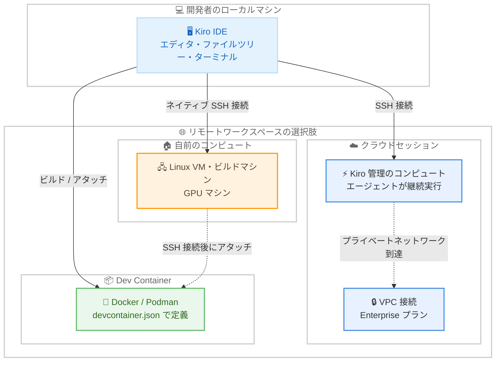

# Kiro - リモートワークスペース (Remote Workspaces)

**リリース日**: 2026 年 11 月 20 日
**サービス**: Kiro
**機能**: リモートワークスペース (クラウドセッション / Dev Container / Remote SSH)

📊 [このアップデートのインフォグラフィックを見る](https://takech9203.github.io/aws-news-summary/20261120-kiro-remote-workspaces.html)

## 概要

Kiro IDE が、コードとコンピュートが実際に存在する場所でワークスペースを開けるようになりました。最新の安定版リリースから、Kiro IDE は Kiro のクラウドセッションへの接続、ローカルまたはリモートホスト上の Dev Container 内での実行、そしてチームが既に所有しているマシンへのネイティブ SSH 接続をサポートします。ワークスペースがどこで動いていても、ファイル編集やターミナル操作を含む完全な IDE 体験がローカルと同じように利用できます。

これまで Kiro は「手元のマシンで動くフル IDE」か「どこか別の場所で動くエージェント」のどちらかしか提供しておらず、重いビルドや長いテストスイート、GPU マシンなどの作業をラップトップの外に移すには何かを諦める必要がありました。今回のアップデートはこのトレードオフを解消し、ワークスペースを Kiro のクラウド、コンテナ、または自前のマシンへ移しても、IDE はそのまま付いてくるようになります。

同日の Kiro Changelog には関連エントリとして「Remote SSH, Dev Containers, and Cloud Sessions in the IDE」が掲載されており、3 つのリモート接続機能が最新安定版に含まれることが示されています。

**アップデート前の課題**

- Kiro IDE はローカルマシン上のワークスペースのみを対象としており、クラウドセッションはブラウザ経由での操作が中心だった
- リポジトリに `devcontainer.json` があっても、Kiro IDE からコンテナ内でワークスペースを開くことができなかった (Kiro CLI は以前から Dev Container 内で実行可能)
- 自前のビルドマシンや GPU マシンに接続するには、サードパーティ製のリモート SSH 拡張機能を別途インストールする必要があった
- ビルドの重い作業やローカルツールチェーンの差異 (「自分のマシンでは動く」問題) への対処が難しかった

**アップデート後の改善**

- IDE からクラウドセッションに SSH で接続し、ファイルツリー・エディタ・統合ターミナルがクラウドセッションのファイルシステムとシェル上で動作するようになった
- リポジトリ内の `.devcontainer/devcontainer.json` をもとに、ローカルまたはリモートホスト上でコンテナをビルド / アタッチして、その中でセッションを実行できるようになった
- 追加インストールなしで、Kiro IDE がネイティブに SSH 接続し、自前の VM・ビルドマシン・社内開発基盤上でセッションを実行できるようになった
- 3 つの機能はすべて最新安定版に含まれ、有効化やインストール作業は不要

## アーキテクチャ図



Kiro IDE から 3 種類のリモートワークスペース (クラウドセッション / Dev Container / 自前のコンピュート) に接続する構成を示しています。Dev Container はローカルの Docker / Podman 上でも、SSH 接続したリモートホスト上でも実行できます。

## サービスアップデートの詳細

### 主要機能

1. **クラウドセッションを IDE から開く**
   - これまで IDE から開始できた Kiro クラウドセッションに、フル IDE を接続できるようになった
   - IDE は SSH 経由でセッションに接続し、ファイルツリー・エディタ・統合ターミナルはすべてクラウドセッション側のファイルシステムとシェルを操作する
   - Sessions サイドバーまたは Agent Focus Mode でセッションを右クリックし、[Open in IDE] を選択すると、そのセッションに接続された別のリモートウィンドウが開く
   - Kiro Web で開始したセッションも同じリストに表示される
   - ウィンドウを閉じたりアイドル状態にしてもエージェントはクラウドで動き続けるため、作業は停止しない
   - Enterprise プランでは管理者がクラウドセッションを VPC に接続でき、プライベートレジストリ・社内サービス・データベースへ既存のネットワーク制御を維持したまま到達できる

2. **Dev Container のサポート (ローカル / リモート)**
   - リポジトリに `.devcontainer/devcontainer.json` がある場合、Kiro IDE がそのコンテナをビルドまたはアタッチし、セッションをコンテナ内で実行できる
   - ローカルマシンでは Docker または Podman で動作する
   - リモートコンピュートでは、まず SSH で接続し、その上でコンテナにアタッチする 2 段階のフローで動作する (他のエディタと同様の方式)
   - コンテナ定義はリポジトリ内に保持されるため、チームメイトや CI が使う環境と Kiro が実行される環境が一致する
   - 定義を変更した場合はリモートメニューから [Rebuild Container] を選択し、コンテナから抜ける場合は [Reopen Folder Locally] を選択する
   - Kiro CLI は以前から Dev Container 内で実行可能であり、今回のリリースは IDE 側のギャップを埋めるもの

3. **自前のコンピュートへのネイティブ SSH 接続**
   - これまではサードパーティ製のリモート SSH 拡張機能が必要だったが、追加インストールなしで Kiro IDE がネイティブに接続できるようになった
   - 既存の VM・ビルドマシン・社内開発プラットフォーム上でセッションを実行できる
   - Kiro はこの場合コンピュートを提供せず課金もしないため、マシン・ネットワーク配置・セキュリティ態勢はユーザーの管理下に残る
   - マネージドクラウドでは提供されない GPU マシンや特殊な Linux ビルドマシン、既にネットワーク内部にあるホストに適している
   - エージェントとモデルの使用は通常どおり Kiro クレジットを消費する

## 技術仕様

### 3 つのリモートワークスペースの比較

| 項目 | クラウドセッション | Dev Container | 自前のコンピュート |
|------|------------------|---------------|------------------|
| ワークスペースの実行場所 | Kiro 管理のクラウドコンピュート | 自分のマシンまたはリモートホスト上のコンテナ | 既に運用しているマシン |
| コンピュートの提供者 | Kiro | ユーザー (Docker または Podman) | ユーザー |
| 環境の定義 | Kiro のデフォルト環境 | リポジトリ内の `devcontainer.json` | マシン上にあるもの |
| 適した用途 | 重いビルド、クリーンなツールチェーン、ラップトップを占有したくない作業 | 再現可能な環境が必要なチーム | 既存の Linux ビルドマシン、GPU マシン、ネットワーク配置の要件 |

### 自前のコンピュートのホスト要件

| 項目 | 詳細 |
|------|------|
| OS / アーキテクチャ | Linux (x86-64 または ARM64) |
| glibc | 2.28 以降 |
| ディスク空き容量 | ホームディレクトリに 4 GiB 以上 |
| その他 | 必要なものは Kiro が自動インストール |

### エージェントの実行場所とデータの流れ

- エージェントはワークスペースと同じ場所で実行される。クラウドセッションではクラウド環境、自前のコンピュートではそのホスト、Dev Container ではコンテナ内
- プロジェクトファイルとコマンドはその環境内に留まり、ローカルマシンには表示に必要なファイル内容・チャット・ターミナル出力・フォワードされたポートのみが届く
- 通常の Kiro セッションと同様に、プロンプトと関連するコードコンテキストは Kiro の AI サービスに送信される
- ローカルサンドボックスとは解決する課題が異なり、独立して併用できる。ローカルサンドボックスは作業をローカルマシンに保ちつつエージェントのコマンドが触れる範囲を制限するのに対し、リモートワークスペースはワークスペース自体を別のコンピュートへ移す

## 設定方法

### 前提条件

1. 最新の安定版 Kiro IDE にアップデートしていること (3 機能とも標準で有効)
2. Dev Container を使用する場合: Docker 互換エンジン (Docker または Podman) が動作していること、リポジトリに `.devcontainer/devcontainer.json` があること
3. 自前のコンピュートを使用する場合: 上記のホスト要件を満たす Linux マシンと SSH アクセス

### 手順

#### ステップ 1: クラウドセッションを IDE で開く

```text
コマンドパレット > Kiro: New Cloud Session
または Sessions サイドバーで既存セッションを右クリック > Open in IDE
```

新しいクラウドセッションを作成するか、既存のセッションを選択して [Open in IDE] を選ぶと、そのセッションに SSH 接続された別のリモートウィンドウが開きます。

#### ステップ 2: Dev Container でワークスペースを開く

```text
コマンドパレット > Dev Containers: Reopen in Container
```

`.devcontainer/devcontainer.json` を含むプロジェクトを開くと Kiro IDE が検出して [Reopen in Container] を提案します。リモートの Dev Container の場合は、先にリモートホストへ SSH 接続してからコンテナで開き直すと、Docker はローカルではなく SSH ホスト側で実行されます。

#### ステップ 3: 自前のマシンに SSH 接続する

```text
コマンドパレット > Kiro: Add New SSH Host… (ホストの保存)
コマンドパレット > Kiro: Connect to Host… (ホストへ接続)
```

ホストを保存するか既存の SSH 設定を利用し、接続後にホスト上のフォルダを開きます。保存したホストは Kiro ビューの [Remote environments] > [SSH Hosts] にも表示され、ウィンドウタイトルに接続先ホストが表示されます。

## メリット

### ビジネス面

- **既存資産の活用**: 既に運用しているビルドマシン・GPU マシン・社内開発基盤をそのまま Kiro の実行環境として利用でき、ハードウェアの重複投資を避けられる
- **セキュリティとガバナンスの維持**: 自前のコンピュートではマシン・ネットワーク配置・セキュリティ態勢がユーザーの管理下に残り、Enterprise プランのクラウドセッションは VPC 接続により既存のネットワーク制御を維持できる
- **チームの環境統一**: `devcontainer.json` による環境定義をチームメイト・CI・Kiro で共有でき、「自分のマシンでは動く」問題を軽減できる

### 技術面

- **ローカルと同一の IDE 体験**: 接続先がどこであっても、ファイル編集・ターミナル操作を含むフル IDE がそのまま利用できる
- **エージェントの継続実行**: クラウドセッションではウィンドウを閉じてもエージェントが動き続けるため、長時間のタスクをラップトップに縛られず進められる
- **追加インストール不要**: ネイティブ SSH 接続を含む 3 機能すべてが最新安定版に標準搭載されており、拡張機能の導入や有効化の設定が不要

## デメリット・制約事項

### 制限事項

- 自前のコンピュートのホストは Linux (x86-64 / ARM64)、glibc 2.28 以降、ホームディレクトリに 4 GiB 以上の空き容量が必要
- Dev Container の利用には Docker または Podman などの Docker 互換エンジンが必要
- クラウドセッションの VPC 接続は Enterprise プランの管理者設定が必要
- Kiro CLI はリモートワークスペースを開くことができない (今回のリリースは IDE が対象)

### 考慮すべき点

- リモートワークスペースでも、プロンプトと関連するコードコンテキストは Kiro の AI サービスに送信される
- 自前のコンピュートではインフラの運用・セキュリティはユーザーの責任となる
- ローカルサンドボックスとは目的が異なるため、要件に応じて使い分けまたは併用を検討する

## ユースケース

### ユースケース 1: 重いビルドをクラウドセッションにオフロード

**シナリオ**: ビルドやテストスイートが長時間化し、ラップトップのリソースを占有して他の作業が止まってしまう。

**実装例**:
```text
1. コマンドパレットから Kiro: New Cloud Session を実行
2. Sessions サイドバーでセッションを右クリックし Open in IDE を選択
3. クラウドセッションのファイルシステム上でビルド・テストを実行
```

**効果**: 重い処理を Kiro 管理のコンピュートに移し、ウィンドウを閉じてもエージェントが作業を継続するため、ラップトップが解放される。

### ユースケース 2: devcontainer.json によるチーム環境の統一

**シナリオ**: 開発者ごとにローカルツールチェーンが異なり、環境差異によるトラブルシューティングに時間がかかっている。

**実装例**:
```jsonc
// .devcontainer/devcontainer.json をリポジトリに配置
{
  "name": "project-dev",
  "image": "mcr.microsoft.com/devcontainers/base:ubuntu"
}
// Kiro IDE が検出したら Reopen in Container を選択
```

**効果**: チームメイトや CI と同一のコンテナ環境で Kiro のセッションが実行され、環境差異に起因する問題を排除できる。

### ユースケース 3: 社内 GPU マシンでのエージェント実行

**シナリオ**: マネージドクラウドでは提供されない GPU マシンや、社内ネットワーク内に配置されたビルドマシンで開発作業を行いたい。

**実装例**:
```text
1. コマンドパレットから Kiro: Add New SSH Host… でホストを登録
2. Kiro: Connect to Host… で接続し、ホスト上のフォルダを開く
3. 必要なコンポーネントは Kiro が自動インストール
```

**効果**: 追加の拡張機能なしで既存マシンに接続でき、マシンのネットワーク位置とセキュリティ態勢を維持したままフル IDE とエージェントを利用できる。

## 料金

自前のコンピュートを使用する場合、Kiro はコンピュートを提供せず、コンピュートに対する課金も行いません。ただし、エージェントとモデルの使用は通常どおり Kiro クレジットを消費します。クラウドセッションは Kiro がコンピュートを提供します。プランごとの詳細は Kiro の料金ページを参照してください。

## 利用可能リージョン

グローバル (Kiro はグローバルに提供されるサービスです)

## 関連サービス・機能

- **Kiro クラウドセッション**: IDE やブラウザから開始できる Kiro 管理のクラウド実行環境。今回のアップデートでフル IDE を接続できるようになった
- **Kiro クラウドセッションの VPC 接続**: Enterprise プランでクラウドセッションを組織の VPC に接続し、プライベートネットワーク内のリソースへ到達できる機能 (同時期に発表)
- **Kiro ローカルサンドボックス**: 作業をローカルに保ったままエージェントのコマンド実行範囲を制限する機能。リモートワークスペースとは独立して併用可能
- **Kiro CLI**: 以前から Dev Container 内での実行をサポート。リモートワークスペースを開く機能は IDE のみ

## 参考リンク

- 📊 [インフォグラフィック](https://takech9203.github.io/aws-news-summary/20261120-kiro-remote-workspaces.html)
- [公式ブログ: Remote workspaces bring the IDE to where your code and compute already live](https://kiro.dev/blog/remote-workspaces/)
- [Kiro Changelog: Remote SSH, Dev Containers, and Cloud Sessions in the IDE](https://kiro.dev/changelog/)
- [ドキュメント: Remote development](https://kiro.dev/docs/ide/remote-development/)
- [ドキュメント: Running Kiro in the cloud](https://kiro.dev/docs/guides/running-kiro-in-the-cloud)

## まとめ

Kiro IDE がクラウドセッション・Dev Container・自前のマシンという 3 つのリモートワークスペースにネイティブ対応し、「フル IDE か、リモートで動くエージェントか」というトレードオフが解消されました。重いビルドのオフロード、チーム環境の統一、既存の GPU / ビルドマシンの活用など、コードとコンピュートの最適な配置を選びながら同一の IDE 体験を得られます。最新の安定版にアップデートするだけで追加設定なしに利用できるため、まずはクラウドセッションの [Open in IDE] や `devcontainer.json` のあるプロジェクトで試すことをお勧めします。
