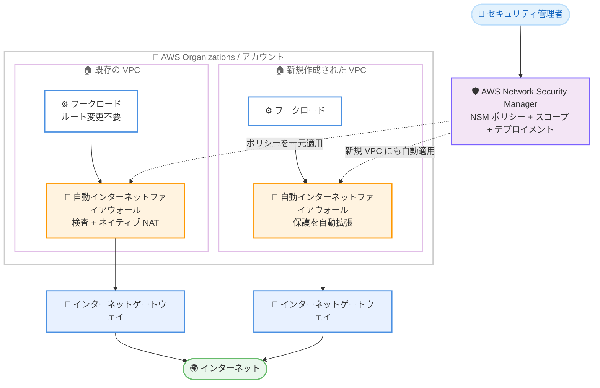

# AWS Network Firewall - 自動インターネットファイアウォール (パブリックプレビュー)

**リリース日**: 2026 年 11 月 20 日
**サービス**: AWS Network Firewall / AWS Network Security Manager
**機能**: Automated Internet Firewall (自動インターネットファイアウォール)

📊 [このアップデートのインフォグラフィックを見る](https://takech9203.github.io/aws-news-summary/20261120-network-firewall-automated-internet.html)

## 概要

AWS Network Firewall は、VPC のインターネットゲートウェイに NAT 機能内蔵のファイアウォールを自動配置する「自動インターネットファイアウォール (Automated Internet Firewall)」をパブリックプレビューとして発表しました。AWS Network Security Manager (NSM) でセキュリティルールを一元定義するだけで、スコープに含まれるすべての VPC のインターネットゲートウェイを通過するインバウンド / アウトバウンドトラフィックに対して、AWS がファイアウォールを直接適用します。

適用範囲は特定の VPC、アカウント全体、AWS Organizations の組織全体、または組織単位 (OU) から柔軟に選択できます。デフォルトポリシーは AWS マネージドルールグループ (AWS 独自の脅威インテリジェンスを活用した active threat defense を含む) で構成されており、カスタムルールグループや AWS Marketplace のマネージドルールグループも利用できます。新しく作成された VPC やサブネットにもセキュリティポリシーを自動拡張できるため、環境の成長に合わせて保護範囲を維持できます。

このアップデートは、組織全体のインターネット境界セキュリティを少ない運用負荷で統制したいセキュリティチームやネットワーク管理者、マルチアカウント環境を運用する企業にとって特に価値のある機能です。

**アップデート前の課題**

自動インターネットファイアウォールの登場以前は、以下の課題がありました。

- ファイアウォールエンドポイント用の専用サブネットを VPC ごとに作成する必要があった
- インターネットアクセスが必要なすべてのサブネットのルートテーブルを更新する必要があった
- VPC やサブネットの所有者がルートを操作することで、ファイアウォールを迂回するトラフィック経路が発生するリスクを監視する必要があった
- アウトバウンド通信用に NAT ゲートウェイを別途構成・管理する必要があった
- 新規 VPC が作成されるたびに、同じファイアウォール構成を手動で展開する必要があった

**アップデート後の改善**

今回のアップデートにより、以下が可能になりました。

- フィルタリングルールを定義・管理するだけで、スコープ内のすべての VPC のインターネットゲートウェイで AWS が直接ポリシーを適用する
- VPC 内のルーティングやアーキテクチャを一切変更せずに導入できる
- インターネットゲートウェイでの適用のため、ルート操作によるファイアウォールの迂回が構造的に不可能になる
- ネイティブ NAT 機能により、NAT ゲートウェイを別途構成せずにアウトバウンド専用のインターネット接続を実現できる
- 新規 VPC / サブネットへの保護の自動拡張により、カバレッジの抜け漏れを防止できる
- モニターモードでトラフィックへの影響を確認してから、エンフォースモードへ安全に移行できる

## アーキテクチャ図



Network Security Manager で一元定義したポリシーが、スコープ内の各 VPC のインターネットゲートウェイに自動配置されたファイアウォールで適用される構成です。VPC 内のルーティング変更は不要で、新規 VPC にも保護が自動拡張されます。

## サービスアップデートの詳細

### 主要機能

1. **インターネットゲートウェイでのインライン検査**
   - ファイアウォールがインターネットゲートウェイにインラインで配置され、スコープ内 VPC のすべてのインターネット通信が宛先に届く前にファイアウォールを通過する
   - ルートテーブル経由のホップではなくインターネットゲートウェイ自体で検査されるため、VPC 内のルート変更でファイアウォールを迂回することができない
   - ファイアウォールエンドポイント用サブネットの作成やルートテーブルの更新が不要

2. **ネイティブ NAT 機能**
   - outbound-only および flexible 接続タイプのサブネットに対し、検査後に IPv4 トラフィックの NAT を実行するため、NAT ゲートウェイの個別構成が不要
   - NAT 用のパブリック IPv4 アドレスはデフォルトで AWS が自動割り当て。BYOIP や AWS からの連続 IP ブロックの利用、Amazon VPC IPAM ポリシー (リソースタイプ `igw-firewall`) によるアドレス制御も可能
   - NAT 用 Elastic IP アドレスは各アベイラビリティーゾーンで 1 個から開始し、NAT ポート使用量の増加に応じて最大 8 個まで自動追加される

3. **柔軟なスコープ設定と自動拡張**
   - 組織全体、OU、アカウント、特定の VPC を対象として宣言的にスコープを定義できる
   - スコープに一致する新規 VPC / サブネットが作成されると、保護が自動的に拡張される
   - マルチアカウントだけでなく、AWS Organizations を使わないシングルアカウントモードでも利用可能

4. **デフォルトセキュリティポリシーとマネージドルールグループ**
   - AWS マネージドテンプレート `AWSManagedTemplateIGWFirewallBaseline` により、既知の攻撃インフラ、マルウェア配布ドメイン、ボットネット C2 ドメインへのトラフィックをブロック (その他のトラフィックはデフォルトアクション ACCEPT)
   - AWS 独自の脅威インテリジェンスを活用した active threat defense を含む Amazon マネージドルールグループを利用でき、AWS のセキュリティ専門家がルールを継続的に更新
   - カスタムルールグループや AWS Marketplace のマネージドルールグループも追加可能

5. **モニターモードによる安全なロールアウト**
   - モニターモードでは、ルールに一致するトラフィックをブロックせずログに記録するため、既存ワークロードへの影響を事前に評価できる
   - 影響を確認した後にエンフォースモード (一致トラフィックをブロック) へ切り替え可能

## 技術仕様

### Network Security Manager のリソース階層

自動インターネットファイアウォールは、以下の 5 つのリソースタイプで構成されます。

| リソース | 説明 |
|------|------|
| NSM ルール | 設定の最小単位。トラフィック検査ルール (Network Firewall ルールグループを参照) と、ファイアウォール設定ルール (モード、デフォルトアクション、ログ設定など) の 2 種類 |
| NSM テンプレート | 複数の NSM ポリシー間で共有できる再利用可能なルールのグループ (オプション) |
| NSM ポリシー | テンプレートとルールの組み合わせ。デフォルトのサブネット接続タイプもここで設定。1 ポリシーに最大 100 アイテム (うちテンプレートは最大 2 個、各テンプレートに最大 50 ルール) |
| スコープ | 保護対象 VPC の宣言的な選択。組織全体、OU、アカウント、特定 VPC (タグまたは ARN 指定、最大 100 ARN) |
| デプロイメント | NSM ポリシーとスコープの結合。VPC ごとのファイアウォールを作成・維持し、新規 VPC へ自動拡張 |

### サブネット接続タイプ

| 接続タイプ | 説明 |
|------|------|
| bidirectional | パブリック IP を持つリソースは、フィルタリングされた双方向のインターネット通信が可能。パブリック IP のないリソースはインターネットに到達できない |
| outbound-only | アウトバウンド専用。インターネットからの未承諾のインバウンドはドロップ。IPv4 は検査後に NAT を実行 (IPv6 は NAT なし) |
| flexible (推奨) | リソースごとに IP 割り当てとルーティングに基づき自動判定。パブリック IP を持ちインターネットゲートウェイにルートするリソースは bidirectional、それ以外はネイティブ NAT 経由の outbound-only |
| exclude | 検査対象外。特定のサブネットを保護から除外する場合に使用 |
| az-unsupported | 自動割り当て。自動インターネットファイアウォールが未対応のアベイラビリティーゾーン (Local Zones など) のサブネットに付与 |

### API 変更履歴

| 日付 | サービス | 変更内容 |
|------|----------|----------|
| 2026/11/20 | [network-security-manager](https://awsapichanges.com/archive/changes/e9d2b3-network-security-manager.html) | 2 new 32 updated api methods - Network Security Manager への自動インターネットファイアウォールのサポート追加 |
| 2026/11/20 | [network-firewall](https://awsapichanges.com/archive/changes/e9d2b3-network-firewall.html) | 18 updated api methods - インターネットゲートウェイファイアウォールの読み取り専用サポート。ファイアウォール操作への FirewallType、Firewall への IgwFirewallConfiguration の追加 |
| 2026/11/20 | [ec2](https://awsapichanges.com/archive/changes/e9d2b3-ec2.html) | 14 updated api methods - 自動インターネットファイアウォール関連の API 変更を含む |

### ファイアウォールリソースの管理モデル

自動インターネットファイアウォールは Network Security Manager のみが作成・変更・削除できます。各 VPC には `arn:aws:network-firewall:<region>:<account-id>:igw-firewall/<vpc-id>` という命名の igw-firewall が作成され、Network Firewall コンソールの [Internet firewalls] タブおよび Network Firewall API から読み取り専用で参照できます。Network Firewall API から直接変更しようとするとリクエストは失敗します。

## 設定方法

### 前提条件

1. インターネットゲートウェイがアタッチされた VPC (アベイラビリティーゾーンに稼働中のネットワークインターフェイスが 1 つ以上あるとプロビジョニングされ、ない場合は Standby 状態になる)
2. Network Security Manager のセットアップ。シングルアカウントモードでは NSM 権限を持つ IAM アイデンティティのみで利用可能 (サービスリンクロールは自動作成)。マルチアカウントモードでは AWS Organizations の全機能有効化、NSM の信頼されたアクセス、NSM 管理者アカウントの登録が必要
3. デプロイメントには課金が発生するため、事前に料金ページの確認を推奨

### 手順

#### ステップ 1: Quick create and deploy でポリシーを作成・デプロイ

Network Security Manager コンソールの [Overview] ページから [Quick create and deploy] を選択し、以下を設定します。

1. **Define protections**: [Firewall type] で [Automated Internet Firewall] を選択し、テンプレート (例: `AWSManagedTemplateIGWFirewallBaseline`) またはルールを追加。[Enforcement mode] は既存ワークロードがある場合は [Monitor] (デフォルト) を推奨。必要に応じてアラートログ / フローログの出力先 (Amazon S3、CloudWatch Logs、Kinesis Data Firehose) を設定
2. **Policy details**: ポリシー名を入力 (Remediation は必須のため変更不可)
3. **Set the scope**: マルチアカウントの場合は組織全体 / OU / アカウントを選択し、VPC スコープを「すべての既存・将来の VPC」「特定の VPC のみ」「特定の VPC を除外」から設定
4. **Subnet connectivity**: 接続タイプ (flexible 推奨) を選択し、必要に応じてサブネット単位のオーバーライド (exclude 含む) をタグまたは ARN で指定
5. [Create and deploy] を選択

Amazon VPC コンソールからも、[Your VPCs] で対象 VPC を選択し [Actions] > [Security] > [Create Automated Internet Firewall] から同じウィザードを開始できます。

#### ステップ 2: デプロイメントの同期状態を確認

デプロイメント詳細ページの [Synchronization] タブで、スコープ内リソースの同期状態 (In sync / Out of sync / Not applicable) を確認します。Out of sync のリソースは NSM が自動的に修復します。ポリシーの [Coverage] タブでは、各 VPC のカバレッジ状態 (In effect / Superseded) を確認できます。

#### ステップ 3: ファイアウォールの確認とエンフォースモードへの移行

Network Firewall コンソールの [Firewalls] ページにある [Internet firewalls] タブで、作成されたファイアウォールのステータス (Provisioning / Ready / Standby)、NAT IP、モニタリング情報を確認します。モニターモードでアクセスログ / アラートログを確認し、トラフィックへの影響を評価した後、NSM のポリシー編集でエンフォースモードに切り替えます。

## メリット

### ビジネス面

- **運用負荷の大幅な削減**: ファイアウォール専用サブネットの設計、ルートテーブル管理、NAT ゲートウェイの構成が不要になり、ネットワークセキュリティの導入・運用コストを削減できる
- **ガバナンスの強化**: 組織全体に一貫したインターネット境界ポリシーを一元適用でき、新規 VPC にも自動で保護が及ぶため、カバレッジの抜け漏れによるリスクを低減できる
- **セキュリティ導入の障壁を低減**: AWS マネージドルールグループによるデフォルトポリシーにより、セキュリティ対策を始めたばかりの組織でもカスタム設定なしで保護を開始できる

### 技術面

- **迂回不可能な適用ポイント**: インターネットゲートウェイでのインライン検査のため、サブネットやゲートウェイのルート変更ではファイアウォールを迂回できず、侵害されたワークロードによるポリシー回避を防止できる
- **アーキテクチャ変更ゼロでの導入**: 既存の VPC にルーティングやアーキテクチャの変更なしで導入でき、flexible 接続タイプでは既存の NAT ゲートウェイ経由のトラフィックもそのまま動作する (段階的に NAT ゲートウェイをネイティブ NAT へ移行可能)
- **安全なロールアウト**: モニターモードでポリシーの影響をログで検証してからエンフォースモードに移行でき、本番環境への影響リスクを抑えられる
- **一元管理と分散実装の両立**: ポリシー管理と可視性は NSM で一元化しつつ、ファイアウォール自体は VPC ごとに分散実装されるため、スケーラビリティと可用性が向上する

## デメリット・制約事項

### 制限事項

- パブリックプレビュー段階の機能であり、仕様が変更される可能性がある
- プレビュー期間中は Regional NAT、noNAT イングレスルーティング、ingress-only VPC Block Public Access と併用できない
- プレビュー期間中は IPv4 宛先への IPv6 トラフィックに対する NAT64 を実行しない (NAT64 が必要な場合は NAT ゲートウェイを別途使用)
- Amazon EC2 Mac インスタンス、および p4d、p4de、p6-b200、p6-b300、p6e-gb200、trn2、trn2u、g7e の機械学習系インスタンスタイプは未サポート
- Local Zones では未サポート。AWS Network Firewall が利用可能なアベイラビリティーゾーンでのみ構築される (未対応 AZ のサブネットは az-unsupported となり検査対象外)
- 自動インターネットファイアウォールとその関連ポリシー / ルールグループは NSM 経由でのみ作成・変更・削除でき、Network Firewall API からの直接変更は不可

### 考慮すべき点

- デプロイメントには課金が発生する。自動インターネットファイアウォールは VPC ごと・アベイラビリティーゾーンごとの時間課金に加え、検査トラフィックの GB 単位課金が適用されるため、組織全体に展開する場合は事前のコスト試算が重要
- VPC ゲートウェイエンドポイント経由で到達するサービスへのトラフィックはインターネットゲートウェイを通過しないため、検査対象外となる
- NAT IP アドレスは VPC ごとに個別に構成されるため、VPC が異なるとアウトバウンドの送信元 IP アドレスも異なる。宛先側で IP 許可リストを運用している場合は、IPAM ポリシーによるアドレス範囲の固定を検討する
- 既存のネットワークファイアウォール構成 (集中型検査 VPC など) と併用する場合は、ポリシーの優先順位とスコープの重複に注意が必要

## ユースケース

### ユースケース 1: 組織全体へのベースラインセキュリティの一括適用

**シナリオ**: 多数のアカウントと VPC を運用する企業で、各チームが個別に VPC を作成しており、インターネット境界のセキュリティ統制が追いついていない。

**実装例**:
```
1. NSM のマルチアカウントモードをセットアップし、管理者アカウントを登録
2. AWSManagedTemplateIGWFirewallBaseline を含むポリシーを作成
3. スコープを「組織全体 + すべての既存・将来の VPC」に設定してデプロイ
4. モニターモードでログを確認後、エンフォースモードへ移行
```

**効果**: 既知の攻撃インフラ、マルウェア配布ドメイン、ボットネット C2 への通信を組織全体で一括ブロックできる。新規 VPC にも保護が自動拡張されるため、統制の抜け漏れがなくなる。

### ユースケース 2: NAT ゲートウェイ構成の簡素化とアウトバウンド通信の検査

**シナリオ**: プライベートサブネットのワークロードがアウトバウンド通信のために NAT ゲートウェイを使用しているが、アウトバウンドトラフィックのフィルタリングとログ記録も必要になった。

**実装例**:
```
1. 接続タイプ flexible でポリシーをデプロイ (既存の NAT ゲートウェイ経由の
   トラフィックはそのまま動作するため、初日から破壊的変更なし)
2. フローログ / アラートログを S3 または CloudWatch Logs に出力
3. 準備ができたタイミングでルートから NAT ゲートウェイを外し、
   ファイアウォールのネイティブ NAT へ段階的に移行
```

**効果**: アウトバウンド通信の検査・ログ記録を実現しつつ、NAT ゲートウェイの運用を段階的に廃止してアーキテクチャを簡素化できる。

### ユースケース 3: 宛先 IP 許可リスト環境でのアウトバウンド IP 管理

**シナリオ**: 接続先の外部パートナーシステムが送信元 IP アドレスの許可リストを運用しており、アウトバウンド通信の送信元 IP を特定の範囲に固定する必要がある。

**実装例**:
```
1. Amazon VPC IPAM で IPAM プールを作成し、BYOIP または AWS からの
   連続 IP ブロックを登録
2. IPAM ポリシーにリソースタイプ igw-firewall の割り当てルールを追加
3. 自動インターネットファイアウォールをデプロイすると、NAT 用の
   Elastic IP が指定プールの範囲から割り当てられる
```

**効果**: アウトバウンドの送信元 IP アドレスを単一の連続 CIDR ブロックに集約でき、パートナー側の許可リスト運用が容易になる。

## 料金

自動インターネットファイアウォールのデプロイメントには課金が発生します。公式ドキュメントによると、VPC ごと・アベイラビリティーゾーンごとの時間課金に加え、検査されたトラフィックに対する GB 単位の課金が適用されます。また、Network Security Manager では監視・保護対象のスコープ内リソースごとに課金が発生します。ログ出力 (S3、CloudWatch Logs、Kinesis Data Firehose) には追加料金がかかります。

具体的な単価は発表ページには記載されていないため、最新の料金は [AWS Network Firewall 料金ページ](https://aws.amazon.com/network-firewall/pricing/) を参照してください。

## 利用可能リージョン

AWS GovCloud (US) および中国リージョンを除くすべての AWS 商用リージョンでパブリックプレビューとして利用可能です。

## 関連サービス・機能

- **AWS Network Security Manager**: 自動インターネットファイアウォールのポリシー、スコープ、デプロイメントを一元管理するサービス。自動インターネットファイアウォールの作成・変更・削除は NSM 経由でのみ可能
- **Amazon VPC**: 保護対象となる VPC とインターネットゲートウェイを提供。VPC コンソールからも自動インターネットファイアウォールの作成を開始できる
- **Amazon VPC IPAM**: IPAM ポリシー (リソースタイプ `igw-firewall`) により、NAT に使用するパブリック IPv4 アドレスの割り当て範囲を制御可能
- **AWS Organizations**: マルチアカウントモードでの組織全体 / OU 単位のスコープ設定に使用
- **NAT ゲートウェイ**: ネイティブ NAT により新規構成は不要になるが、NAT64 が必要な場合や既存アーキテクチャとの併用時には引き続き使用

## 参考リンク

- 📊 [インフォグラフィック](https://takech9203.github.io/aws-news-summary/20261120-network-firewall-automated-internet.html)
- [公式発表 (What's New)](https://aws.amazon.com/about-aws/whats-new/2026/11/network-firewall-automated-internet/)
- [ドキュメント: Automated Internet Firewall](https://docs.aws.amazon.com/network-firewall/latest/developerguide/internet-gateway-firewall.html)
- [ドキュメント: How Automated Internet Firewall works](https://docs.aws.amazon.com/network-firewall/latest/developerguide/internet-gateway-firewall-how-it-works.html)
- [ドキュメント: Getting started with Automated Internet Firewall](https://docs.aws.amazon.com/network-firewall/latest/developerguide/internet-gateway-firewall-getting-started.html)
- [料金ページ](https://aws.amazon.com/network-firewall/pricing/)

## まとめ

自動インターネットファイアウォールは、VPC のアーキテクチャ変更なしにインターネットゲートウェイでのインライン検査とネイティブ NAT を実現する、インターネット境界セキュリティのデプロイモデルを大きく変えるアップデートです。ルート操作による迂回を構造的に防止しつつ、組織全体への一元適用と新規 VPC への自動拡張によりガバナンスを強化できます。パブリックプレビュー段階のため制約事項 (NAT64 非対応、一部インスタンスタイプ未サポートなど) を確認のうえ、まずはモニターモードで非本番環境から評価を開始することを推奨します。
