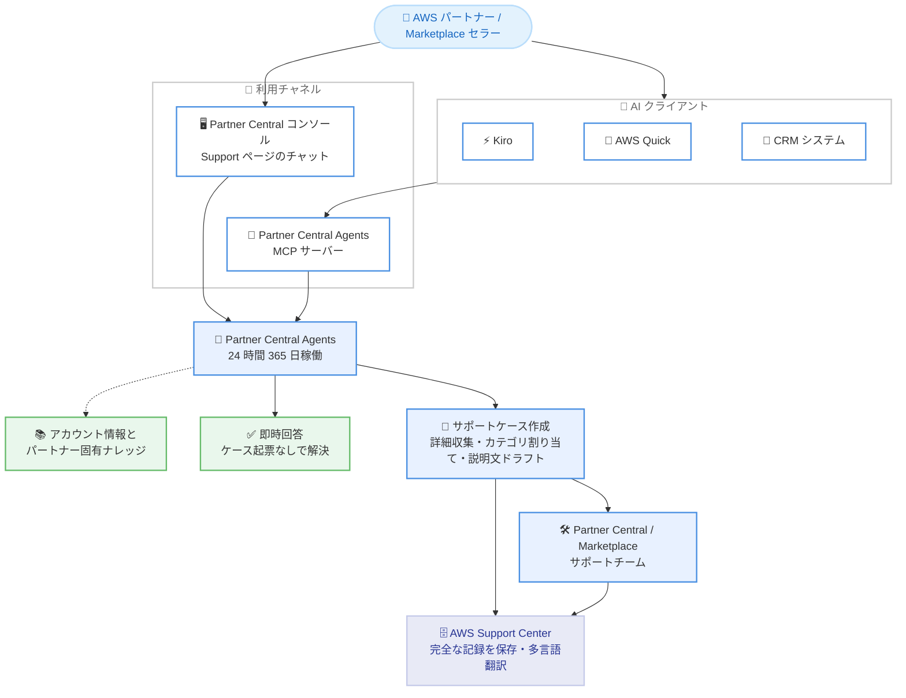

# AWS Partner Central - Partner Central Agents によるサポートケースの作成・管理

**リリース日**: 2026 年 11 月 20 日
**サービス**: AWS Partner Central
**機能**: Partner Central Agents による Partner Central・Marketplace サポートケースの作成と管理

📊 [このアップデートのインフォグラフィックを見る](https://takech9203.github.io/aws-news-summary/20261120-partner-central-agents-support.html)

## 概要

AWS Partner Central Agents が、AWS Partner Central と AWS Marketplace のサポートケースを 1 か所で作成・管理できるようになりました。エージェントは 24 時間 365 日稼働し、パートナーの Partner Central アカウント情報と AWS が提供するパートナー固有の信頼できるナレッジを活用して、多くの問い合わせを即座に解決します。サポートエンジニアの対応が必要な場合は、エージェントが必要な詳細を収集してケースを起票するため、パートナーは問い合わせ先を探す手間が減り、サポートチームはより充実したコンテキストを受け取れます。

パートナーはチャット内で課題を説明するか「get support」と入力するだけでサポートを開始できます。エージェントが必要な情報をヒアリングし、カテゴリを割り当て、ケースの説明文をドラフトします。パートナーは内容を確認して送信するだけで、ケースは適切なチームにルーティングされます。同じチャット内で、やり取りの確認、進捗のモニタリング、返信、ファイル添付までケースをエンドツーエンドで管理でき、完全な記録は AWS Support Center に保存されます。

本機能は、AWS Partner Central コンソールに加えて AWS Partner Central Agents MCP サーバー経由でも提供され、Kiro、AWS Quick、CRM システムなどの AI クライアントからも同じサポート体験を利用できます。

**アップデート前の課題**

本アップデート以前には、以下の課題がありました。

- Partner Central と AWS Marketplace の問い合わせは窓口が分かれており、パートナーはどこに問い合わせるべきかを探す必要があった
- よくある質問であっても、サポートケースを起票して担当者の回答を待つ必要があり、解決までに時間がかかっていた
- ケースの作成時にカテゴリ選択や説明文の記述をすべて手動で行う必要があり、情報不足によりサポートチームとのやり取りが往復しがちだった

**アップデート後の改善**

今回のアップデートにより、以下が可能になりました。

- Partner Central と Marketplace のサポートケースを単一のチャット体験から作成・管理できるようになった
- エージェントがアカウント情報とパートナー固有のナレッジに基づいて多くの問い合わせを即座に回答し、ケース起票なしで解決できるようになった
- ケース作成時はエージェントが詳細をヒアリングし、カテゴリの割り当てと説明文のドラフトを自動で行うため、パートナーは確認と送信だけで済むようになった
- ケースのやり取り確認、進捗モニタリング、返信、ファイル添付まで同一チャット内で完結し、完全な記録が AWS Support Center に保存されるようになった
- MCP サーバー経由で Kiro、AWS Quick、CRM システムなどの AI クライアントからも同じサポート体験を利用できるようになった

## アーキテクチャ図



パートナーはコンソールのチャットまたは MCP サーバー経由の AI クライアントから Partner Central Agents にアクセスし、多くの問い合わせは即時回答で解決、必要な場合のみサポートケースが作成されて AWS Support Center に記録される流れを示しています。

## サービスアップデートの詳細

### 主要機能

1. **単一チャットでのサポートケース作成**
   - Partner Central コンソールの Support ページで「Get support」を選択するか、チャットで課題を説明するだけで開始できる
   - エージェントが必要な詳細 (事象、発生時期、関連する商談・ファンド申請・リスティング・請求書の ID など) をヒアリング
   - 生成 AI が会話内容からケースフォーム (件名、説明、カテゴリ、サブカテゴリ) をドラフトし、パートナーは確認・修正して送信するだけでよい

2. **即時回答による問い合わせの自己解決**
   - Partner Central アカウントの詳細と、AWS Partner Central・AWS Marketplace のガイドに基づく信頼できるナレッジを活用して回答
   - 多くの質問はサポートケースを起票せずにその場で解決できる
   - 24 時間 365 日利用可能

3. **ケースのエンドツーエンド管理**
   - 同一チャット内でケースのやり取りの確認、進捗のモニタリング、返信 (フォローアップ)、ファイル添付が可能
   - ケースのステータス確認や、やり取りの要約もチャットに依頼できる
   - 返信や解決などの書き込み操作は、内容を確認して「Approve」を選択する人間による承認フローを経由する

4. **AWS Support Center への統合**
   - 本リリースにより、Partner Central と Marketplace のケースは AWS Support Center に移行
   - ケースの完全な記録が AWS Support Center に保存され、Support ページの「Active cases」「Resolved cases」タブでも追跡可能
   - ケースのやり取りは中国語、フランス語、ドイツ語、日本語、韓国語、ポルトガル語、スペイン語に翻訳できる

5. **MCP サーバーによる AI クライアント連携**
   - AWS Partner Central Agents MCP サーバー (`https://partnercentral-agents-mcp.us-east-1.api.aws/mcp`) 経由で同じサポート体験を利用可能
   - Kiro、AWS Quick、Claude Code、Claude Desktop、CRM システムなどの MCP 互換クライアントに対応
   - 認証はブラウザベースの OAuth または SigV4 署名に対応し、プロキシや IDE プラグインは不要

## 技術仕様

### サポートケースフォームの仕様

| 項目 | 詳細 |
|------|------|
| 件名 | 1〜250 文字の課題の要約 |
| 説明 | 1〜8,000 文字の課題の詳細 |
| 添付ファイル | 最大 3 ファイル。画像は最大 3.75 MB、ドキュメントは最大 4.5 MB。対応形式: .doc、.docx、.xlsx、.png、.jpeg、.pdf、.csv、.txt、.md |
| ケースタイプ | 常に「Partner Central and Marketplace」(変更不可) |
| サービス | APN Funding、AWS Partner Central、Commercial Marketplace、CRM Integration、European Sovereign Cloud Marketplace、Intelligence Community Marketplace |
| カテゴリ / サブカテゴリ | エージェントが予測して割り当て。予測できない場合は手動で選択 |
| 追加のメール連絡先 | 最大 10 件のメールアドレス (カンマ区切り) |

### MCP サーバーの仕様

| 項目 | 詳細 |
|------|------|
| エンドポイント | `https://partnercentral-agents-mcp.us-east-1.api.aws/mcp` |
| ホストリージョン | 米国東部 (バージニア北部) のみ。接続は任意の場所から可能 |
| 認証方式 | OAuth (ブラウザベースのサインイン) または SigV4 (直接 HTTPS アクセス) |
| 対応クライアント | Kiro、AWS Quick、Claude Code、Claude Desktop、その他 MCP 互換クライアント |
| 主要ツール | `sendMessage` (エージェントへのメッセージ送信)、`getSession` (セッション履歴の取得) |
| セッション | 作成から 48 時間で失効する一時的なデータ |

### 必要な IAM 権限 (Support ページ)

Support ページとサポートチャットの利用には、以下のような AWS Support 関連の権限が必要です。AWS マネージドポリシー (`AWSMarketplaceSellerProductsReadOnly` を除く) を使用している場合は、すでに必要な権限が含まれています。

```json
{
  "Version": "2012-10-17",
  "Statement": [
    {
      "Sid": "PartnerCentralAndMarketplaceSupportCases",
      "Effect": "Allow",
      "Action": [
        "support:SearchForCases",
        "support:DescribeCases",
        "support:DescribeCommunications",
        "support:CreateCase",
        "support:AddAttachmentsToSet",
        "support:AddCommunicationToCase",
        "support:ResolveCase"
      ],
      "Resource": "*"
    },
    {
      "Sid": "SupportCenterConsole",
      "Effect": "Allow",
      "Action": "support-console:*",
      "Resource": "*"
    },
    {
      "Sid": "PartnerCentralAccountCheck",
      "Effect": "Allow",
      "Action": "partnercentral:ListPartners",
      "Resource": "*",
      "Condition": {
        "StringEquals": {
          "partnercentral:Catalog": ["AWS", "Sandbox"]
        }
      }
    }
  ]
}
```

AWS Marketplace セラーの場合は、`partnercentral:ListPartners` の代わりに `aws-marketplace:ListEntities` が必要です。アカウントがパートナーとセラーの両方である場合は両方を含めます。

## 設定方法

### 前提条件

1. AWS Partner Network (APN) に参加し、AWS Partner Central のアカウントを保有していること (または AWS Marketplace セラーであること)
2. Partner Central のアカウントが AWS コンソールに移行済みで、AWS アカウントと連携していること
3. 利用する IAM ロールに、サポートケースの作成・管理に必要な権限が付与されていること
4. MCP サーバーを利用する場合は、MCP 互換クライアント (Kiro、AWS Quick、Claude Code、Claude Desktop など) を用意していること

### 手順

#### ステップ 1: Support ページでサポートチャットを開始する

AWS Partner Central コンソールの Support ページ (https://us-east-1.console.aws.amazon.com/partnercentral/support) を開き、「Get support」を選択するか、提示された質問例を選択します。AWS assistant パネルにサポートチャットが開きます。

#### ステップ 2: 課題を説明して回答を確認する

チャットに質問や課題を入力します。エージェントがアカウント情報とパートナー向けナレッジに基づいて即座に回答します。多くの質問はこの時点で解決します。なお、チャットの会話は保存されないため、必要な情報は閉じる前にコピーしておきます。

#### ステップ 3: 必要に応じてサポートケースを作成する

回答で解決しない場合、エージェントがケース作成に必要な詳細 (事象、発生時期、関連 ID など) をヒアリングし、ケースフォームをドラフトします。フォームの内容を確認・修正し、必要に応じてファイルを添付して「Submit」を選択します。ケース ID が表示され、ケースは Support ページの「Active cases」タブと AWS Support Center に登録されます。

#### ステップ 4: 同一チャットでケースをフォローする

チャットにケース ID を伝えるか、オープン中のケースの一覧表示を依頼することで、ステータス確認、やり取りの要約、フォローアップの送信、ケースの解決を依頼できます。返信や解決などの操作は、表示されたリクエスト内容を確認して「Approve」を選択することで実行されます。

#### ステップ 5 (オプション): MCP サーバー経由で AI クライアントから利用する

Kiro や AWS Quick などの AI クライアントからサポート体験を利用する場合は、MCP サーバーを登録します。以下は Claude Code CLI の例です。

```bash
claude mcp add partnercentral --transport http https://partnercentral-agents-mcp.us-east-1.api.aws/mcp
```

このコマンドは、Partner Central Agents MCP サーバーをリモート MCP サーバーとしてクライアントに登録します。初回接続時にブラウザで AWS Sign-In による OAuth 認証を行います。CI/CD や自動化スクリプトなどブラウザを使えない環境では、SigV4 署名 (サービス名: `partnercentral-agents-mcp`、リージョン: `us-east-1`) で認証します。

## メリット

### ビジネス面

- **問い合わせ解決の高速化**: 24 時間 365 日稼働するエージェントが多くの問い合わせを即時回答で解決するため、サポート回答待ちによる業務の停滞を削減できる
- **窓口の一本化**: Partner Central と Marketplace のサポートが単一のチャット体験に統合され、問い合わせ先を探す手間がなくなる
- **グローバルチームでの活用**: AWS Support Center でケースのやり取りを日本語を含む 7 言語に翻訳でき、グローバルに分散したパートナーチームでも対応しやすい

### 技術面

- **ケース品質の向上**: エージェントが必要な詳細を漏れなくヒアリングし、カテゴリ割り当てと説明文のドラフトを行うため、サポートチームへのコンテキスト提供が充実し、往復のやり取りを削減できる
- **AI クライアント統合**: MCP サーバー経由で Kiro、AWS Quick、CRM システムなどから同じサポート体験を利用でき、パートナーの既存ワークフローに組み込める
- **記録の一元管理**: ケースの完全な記録が AWS Support Center に保存され、コンソールの「Active cases」「Resolved cases」タブと合わせて追跡・監査がしやすい

## デメリット・制約事項

### 制限事項

- サポートチャットの会話自体は保存されないため、必要な情報はチャットを閉じる前にコピーしておく必要がある (ケースの記録は AWS Support Center に保存される)
- チャットからのケース作成時の添付ファイルは最大 3 ファイルで、画像 3.75 MB・ドキュメント 4.5 MB のサイズ制限がある (AWS Support Center からの返信では最大 10 ファイル、各 150 MB)
- MCP サーバーのホストは米国東部 (バージニア北部) のみ (接続は任意の場所から可能)
- MCP サーバーの OAuth 認証には `signin:AuthorizeOAuth2Access` と `signin:CreateOAuth2Token` の IAM 権限が必要で、組織がこれらを制限している場合は SigV4 認証を使用する必要がある

### 考慮すべき点

- ケースのやり取りはケースを閲覧できる全員に表示されるため、認証情報、クレジットカード番号、署名付き URL、個人を特定できる情報は記載しないことが推奨される
- エージェントがドラフトしたケースフォームは送信前に必ず内容を確認し、カテゴリが予測されなかった場合は手動で選択する必要がある
- ルートユーザー以外でサインインしている場合、ケース通知を受け取るには自分のメールアドレスを「Additional email contacts」に追加する必要がある
- MCP サーバー利用時の書き込み操作は人間による承認 (human-in-the-loop) を前提としており、提案されたパラメータを確認してから承認する運用が推奨される

## ユースケース

### ユースケース 1: Marketplace 出品に関する疑問の即時解決

**シナリオ**: AWS Marketplace セラーが、リスティング手数料や出品プロセスについての疑問を解消したいが、サポートケースを起票して回答を待つ時間を省きたい。

**実装例**:
```text
1. Partner Central コンソールの Support ページでサポートチャットを開始
2. 「How much are listing fees?」などの質問を入力
3. エージェントがアカウント情報と Marketplace ガイドに基づき即時回答
```

**効果**: ケースを起票せずにその場で疑問を解消でき、出品作業を中断せずに進められる。

### ユースケース 2: ファンド申請のトラブルをコンテキスト付きでエスカレーション

**シナリオ**: パートナーの APN Funding 申請が想定どおり処理されず、サポートエンジニアの調査が必要になった。

**実装例**:
```text
1. サポートチャットで事象、発生時期、ファンド申請 ID を説明
2. エージェントが追加の質問で詳細を収集し、カテゴリ APN Funding の
   ケースフォームをドラフト
3. 内容を確認し、関連するスクリーンショットを添付して送信
4. 以降の進捗確認・返信も同じチャットで実施
```

**効果**: 初回起票時点で十分なコンテキストがサポートチームに伝わり、往復のやり取りが減って解決までの時間を短縮できる。

### ユースケース 3: Kiro や CRM からのサポート体験の統合

**シナリオ**: パートナーの営業・開発チームが日常的に Kiro や自社 CRM を使用しており、Partner Central コンソールに切り替えずにサポートへアクセスしたい。

**実装例**:
```text
1. Partner Central Agents MCP サーバーを MCP 互換クライアントに登録
   claude mcp add partnercentral --transport http \
     https://partnercentral-agents-mcp.us-east-1.api.aws/mcp
2. OAuth でサインインし、普段使用するツールからエージェントに質問
3. 必要に応じてケースの作成・確認・返信を同じツール内で実行
```

**効果**: 既存のワークフローを離れることなくサポートを利用でき、チームのコンテキストスイッチを削減できる。

## 料金

公式発表に料金に関する記載はありません。本機能は AWS Partner Central コンソールおよび Partner Central Agents MCP サーバーの一部として、すべての AWS パートナーと AWS Marketplace セラーに提供されます。

## 利用可能リージョン

本機能は、本日よりすべての AWS パートナーと AWS Marketplace セラーが利用できます。AWS Partner Central はパートナー向けポータルとしてグローバルに提供されています。なお、Partner Central Agents MCP サーバーのホストは米国東部 (バージニア北部) のみですが、任意の場所から接続できます。

## 関連サービス・機能

- **AWS Support Center**: 本リリースにより Partner Central と Marketplace のケースの保存先となるサービス。ケースのやり取りの翻訳 (7 言語) や返信・解決の操作も可能
- **AWS Partner Central Agents MCP サーバー**: サポートに加えて、商談管理、ファンディング、パートナーオンボーディングなどのエージェント体験を MCP 互換クライアントに提供するサーバー
- **Kiro / AWS Quick**: MCP サーバー経由で Partner Central Agents のサポート体験を利用できる AWS の AI ツール。AWS Quick ではコネクタとして登録して組織内で共有できる
- **AWS Marketplace**: セラー向けのサポートケース (Commercial Marketplace、European Sovereign Cloud Marketplace など) も本チャット体験の対象

## 参考リンク

- 📊 [インフォグラフィック](https://takech9203.github.io/aws-news-summary/20261120-partner-central-agents-support.html)
- [公式発表 (What's New)](https://aws.amazon.com/about-aws/whats-new/2026/11/partner-central-agents-support/)
- [Getting support (AWS Partner Central Getting Started Guide)](https://docs.aws.amazon.com/partner-central/latest/getting-started/getting-support.html)
- [Getting support (AWS Marketplace Seller Guide)](https://docs.aws.amazon.com/marketplace/latest/userguide/getting-support.html)
- [Getting Started with the Partner Central Agent MCP Server](https://docs.aws.amazon.com/partner-central/latest/developer-guide/mcp-getting-started.html)
- [AWS Partner Central コンソール Support ページ](https://us-east-1.console.aws.amazon.com/partnercentral/support?region=us-east-1)

## まとめ

Partner Central Agents のサポートケース対応により、AWS パートナーと Marketplace セラーは Partner Central と Marketplace の問い合わせを単一のチャットで即時解決またはケース化でき、記録は AWS Support Center に一元管理されるようになりました。まずはコンソールの Support ページでチャットを試し、Kiro や AWS Quick などを日常的に使用しているチームは MCP サーバー経由での統合も検討することを推奨します。
