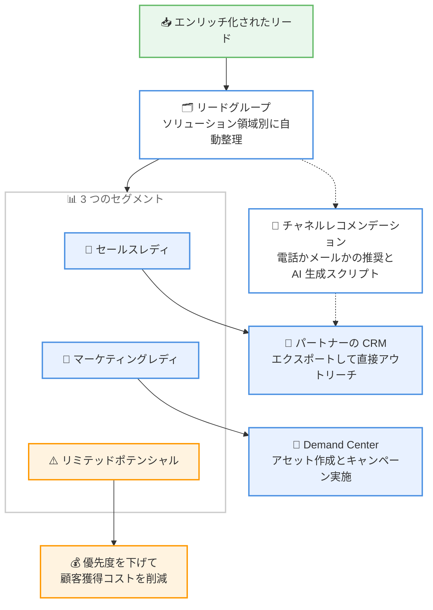

# AWS Partner Central - リードグループとチャネルレコメンデーション

**リリース日**: 2026 年 11 月 20 日
**サービス**: AWS Partner Central
**機能**: Lead groups and channel recommendations

📊 [このアップデートのインフォグラフィックを見る](https://takech9203.github.io/aws-news-summary/20261120-partner-central-lead-groups.html)

## 概要

AWS Partner Central で、リードグループ (lead groups) とチャネルレコメンデーション (channel recommendations) が利用可能になりました。AWS パートナーは、エンリッチ化されたリード (enriched leads) をソリューション領域ごとに自動的に整理し、アウトリーチ活動を効率的に計画できるようになります。

リードは「セールスレディ」「マーケティングレディ」「リミテッドポテンシャル」の 3 つのセグメントに自動分類されます。さらに、各リードには電話とメールのどちらのアプローチが効果的かを示すチャネルレコメンデーションが付与され、AI が生成したコールスクリプトとメールスクリプトも提供されます。本機能は ACE (APN Customer Engagements) 対象パートナーが、Partner Central の Leads ページおよび AWS Partner Central Selling API から利用できます。

**アップデート前の課題**

本アップデート以前には、以下の課題がありました。

- パートナーは受領したリードを手動でセグメント分けし、優先順位を判断する必要があった
- 成約見込みの低いリードにも営業リソースを投入してしまい、顧客獲得コストが増大しやすかった
- リードごとに電話とメールのどちらでアプローチすべきかの判断材料がなく、スクリプトも自前で作成する必要があった

**アップデート後の改善**

今回のアップデートにより、以下が可能になりました。

- エンリッチ化されたリードがソリューション領域別に自動グルーピングされ、手動でのセグメント分けが不要になった
- 成約見込みの低いリードが「リミテッドポテンシャル」として明示され、顧客獲得コストの削減に役立つようになった
- 各リードにチャネルレコメンデーションと AI 生成のコールスクリプト・メールスクリプトが付与され、即座にアウトリーチを開始できるようになった
- マーケティングレディのグループは Demand Center に送信してキャンペーンを作成でき、セールスレディのリードは CRM にエクスポートできるようになった

## アーキテクチャ図



エンリッチ化されたリードがソリューション領域別のリードグループに自動整理され、3 つのセグメントに分類された後、セールスレディは CRM へ、マーケティングレディは Demand Center へ連携される流れを示しています。

## サービスアップデートの詳細

### 主要機能

1. **リードグループによる自動整理**
   - エンリッチ化されたリードをソリューション領域ごとに自動でグルーピング
   - 「セールスレディ」「マーケティングレディ」「リミテッドポテンシャル」の 3 セグメントに自動分類
   - 手動でのリードセグメンテーション作業が不要

2. **リミテッドポテンシャルの明示による獲得コスト削減**
   - 成約見込みが低いリードを「リミテッドポテンシャル」として分類
   - 見込みの低いリードへの過剰な営業投資を回避し、顧客獲得コストの低減に寄与

3. **チャネルレコメンデーション**
   - 各リードに対して、電話とメールのどちらのアウトリーチが効果的かを提示
   - 推奨チャネルに即した AI 生成のコールスクリプトとメールスクリプトを提供

4. **Demand Center・CRM との連携**
   - マーケティングレディのグループを Demand Center に送信し、アセット作成とターゲットキャンペーンを実施可能
   - セールスレディのリードをパートナーの CRM にエクスポートして直接アウトリーチ可能

## 技術仕様

### 利用条件とアクセス方法

| 項目 | 詳細 |
|------|------|
| 対象パートナー | ACE 対象 (ACE-eligible) の AWS パートナー |
| コンソールアクセス | AWS Partner Central の Leads ページ |
| API アクセス | AWS Partner Central Selling API |
| セグメント分類 | セールスレディ / マーケティングレディ / リミテッドポテンシャル |
| 連携先 | Demand Center (マーケティングレディ)、パートナーの CRM (セールスレディ) |

### API 変更履歴

| 日付 | サービス | 変更内容 |
|------|----------|----------|
| 2026/11/19 | [Partner Central Selling API](https://awsapichanges.com/archive/changes/b8bc94-partnercentral-selling.html) | 18 new 10 updated api methods - Leads API (SearchEngagements、ListEngagementGroups) の追加、リードインサイトへのチャネルレコメンデーションの追加など |

API 変更履歴によると、Partner Central Selling API に Leads 関連の API (SearchEngagements、ListEngagementGroups) と、リードインサイト上のチャネルレコメンデーションが追加されています。

## 設定方法

### 前提条件

1. AWS Partner Network (APN) に参加し、AWS Partner Central のアカウントを保有していること
2. ACE 対象 (ACE-eligible) パートナーであること
3. API を利用する場合は、Partner Central と AWS アカウントの連携および適切な IAM 権限が設定されていること

### 手順

#### ステップ 1: Partner Central にサインインする

AWS Partner Central (https://partnercentral.awspartner.com/) にサインインします。

#### ステップ 2: Leads ページでリードグループを確認する

ナビゲーションから Leads ページに移動します。エンリッチ化されたリードがソリューション領域別にグルーピングされ、「セールスレディ」「マーケティングレディ」「リミテッドポテンシャル」の各セグメントに分類された状態で表示されます。

#### ステップ 3: チャネルレコメンデーションに基づいてアウトリーチする

各リードのチャネルレコメンデーション (電話またはメール) を確認し、AI 生成のコールスクリプトまたはメールスクリプトを活用してアウトリーチを実施します。マーケティングレディのグループは Demand Center に送信してキャンペーンを作成し、セールスレディのリードは CRM にエクスポートして営業チームが直接フォローします。

#### ステップ 4 (オプション): API で自動化する

CRM 連携を構築している場合は、AWS Partner Central Selling API を使用してリードグループやチャネルレコメンデーションをプログラムから取得し、自社の CRM ワークフローに組み込みます。API の詳細は [AWS Partner Central Developer Guide](https://docs.aws.amazon.com/partner-central/latest/developer-guide/welcome.html) を参照してください。

## メリット

### ビジネス面

- **営業リソースの最適配分**: 成約見込みの高いセールスレディのリードに営業リソースを集中でき、商談化率の向上が期待できる
- **顧客獲得コストの削減**: 成約見込みの低いリードが明示されることで、無駄なアウトリーチコストを回避できる
- **マーケティング施策との連動**: マーケティングレディのグループを Demand Center に送信し、ナーチャリングキャンペーンへスムーズに移行できる

### 技術面

- **手動セグメンテーションの排除**: ソリューション領域別・成熟度別の分類が自動化され、リード管理の運用負荷が軽減される
- **AI 生成スクリプトの活用**: 推奨チャネルに応じたコールスクリプトとメールスクリプトが提供され、アウトリーチ準備の工数を削減できる
- **API による CRM 統合**: Partner Central Selling API を通じてリードグループやチャネルレコメンデーションを取得でき、既存の CRM ワークフローに統合できる

## デメリット・制約事項

### 制限事項

- ACE 対象パートナーのみが利用可能であり、ACE 要件を満たしていないパートナーは利用できない
- 対象はエンリッチ化されたリードであり、エンリッチメントの対象とならないリードには適用されない

### 考慮すべき点

- セグメント分類やチャネルレコメンデーションは自動生成されるため、自社の営業戦略や顧客理解と照らし合わせた上で活用することが望ましい
- AI 生成のスクリプトはそのまま使用するのではなく、自社のトーンや顧客の状況に合わせて調整することが推奨される
- 「リミテッドポテンシャル」に分類されたリードでも、自社の得意領域によっては価値がある場合があるため、一律に除外せず内容を確認することが望ましい

## ユースケース

### ユースケース 1: インサイドセールスチームの優先順位付け

**シナリオ**: パートナーのインサイドセールスチームが、多数のリードの中からどのリードに最初にアプローチすべきか判断に時間を要している。

**実装例**:
```text
1. Leads ページでセールスレディのリードグループを確認
2. チャネルレコメンデーションで電話推奨のリードを抽出
3. AI 生成のコールスクリプトを基に初回架電を実施
```

**効果**: 成約見込みの高いリードから効率的にアプローチでき、商談化までのリードタイムを短縮できる。

### ユースケース 2: Demand Center を活用したナーチャリングキャンペーン

**シナリオ**: すぐには商談化しないマーケティングレディのリードを、継続的なマーケティング施策で育成したい。

**実装例**:
```text
1. マーケティングレディのリードグループを Demand Center に送信
2. Demand Center でソリューション領域に合わせたアセットを作成
3. ターゲットを絞ったメールキャンペーンを実施し、リードを育成
```

**効果**: 営業がすぐに対応できないリードも取りこぼさず、中長期的なパイプラインを構築できる。

### ユースケース 3: API による CRM 連携の自動化

**シナリオ**: 自社の CRM で営業活動を管理しているパートナーが、Partner Central のリード情報を手動で転記しており、二重管理が発生している。

**実装例**:
```text
1. AWS Partner Central Selling API で Partner Central と CRM を接続
2. セールスレディのリードグループとチャネルレコメンデーションを API で取得
3. CRM 側で推奨チャネルとスクリプトを営業担当者に自動割り当て
```

**効果**: リード情報の転記作業がなくなり、推奨チャネル情報を含むリードが CRM に自動反映されることで、営業の初動が早くなる。

## 料金

公式発表に料金に関する記載はありません。AWS Partner Central は AWS パートナー向けのポータルとして提供されており、本機能は ACE 対象パートナーが Leads ページおよび Partner Central Selling API から利用できます。

## 利用可能リージョン

公式発表に特定のリージョンに関する記載はありません。AWS Partner Central はパートナー向けポータルとしてグローバルに提供されており、ACE 対象パートナーが利用できます。

## 関連サービス・機能

- **ACE (APN Customer Engagements)**: AWS とパートナーの共同営業プログラム。本機能は ACE 対象パートナーが利用できる
- **AWS Partner Central Selling API**: リード・商談管理を CRM と統合するための API。今回のアップデートで Leads API とチャネルレコメンデーションが追加された
- **Demand Center**: マーケティングレディのリードグループを送信し、アセット作成やターゲットキャンペーンを実施できる Partner Central の機能
- **Partner Central Marketing API**: 2026 年 11 月に初回リリースされた API。AWS 作成のテンプレートから共同ブランドのマーケティングキャンペーンを作成できる

## 参考リンク

- 📊 [インフォグラフィック](https://takech9203.github.io/aws-news-summary/20261120-partner-central-lead-groups.html)
- [公式発表 (What's New)](https://aws.amazon.com/about-aws/whats-new/2026/11/partner-central-lead-groups/)
- [AWS Partner Central Developer Guide](https://docs.aws.amazon.com/partner-central/latest/developer-guide/welcome.html)
- [AWS Partner Central Selling API リファレンス](https://docs.aws.amazon.com/partner-central/latest/APIReference/Welcome.html)
- [API 変更履歴 (Partner Central Selling API)](https://awsapichanges.com/archive/changes/b8bc94-partnercentral-selling.html)

## まとめ

AWS Partner Central のリードグループとチャネルレコメンデーションにより、パートナーはエンリッチ化されたリードの手動セグメンテーションから解放され、成約見込みに応じた効率的なアウトリーチが可能になります。ACE 対象パートナーは、まず Leads ページで自社のリードグループと推奨チャネルを確認し、Demand Center や CRM との連携を含めた活用を検討することを推奨します。
