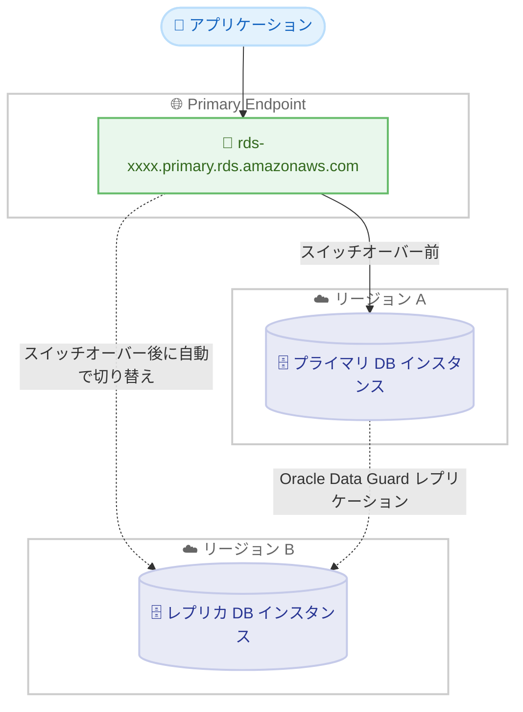

# Amazon RDS for Oracle - Primary Endpoint サポート

**リリース日**: 2026 年 11 月 20 日
**サービス**: Amazon RDS for Oracle
**機能**: Primary Endpoint

📊 [このアップデートのインフォグラフィックを見る](https://takech9203.github.io/aws-news-summary/20261120-rds-oracle-primary-endpoint-v2.html)

## 概要

Amazon RDS for Oracle が Primary Endpoint をサポートしました。Primary Endpoint は、レプリカ構成において常に現在のプライマリ DB インスタンスに解決される DNS 名です。Oracle レプリカへのスイッチオーバーが発生すると、RDS が自動的にこのエンドポイントを新しいプライマリに向け直すため、アプリケーション側で接続文字列を変更する必要がありません。

この機能により、同一リージョン内またはクロスリージョンのレプリカへの計画的なスイッチオーバー (例: 災害復旧訓練) を、アプリケーション設定の変更なしで実行できるようになります。Oracle Enterprise Edition を使用するすべての RDS for Oracle インスタンスに Primary Endpoint が追加料金なしで自動的に提供され、作成作業は不要です。既存のインスタンスエンドポイントに加えて提供されるため、現在のアプリケーションへの影響はありません。

**アップデート前の課題**

- スイッチオーバーのたびに、アプリケーションの接続文字列または DNS レコードを更新する必要があった
- 接続文字列の変更には、変更承認やチーム間の調整が必要になることが多かった
- 災害復旧訓練などの計画的なスイッチオーバーの運用負荷が高かった

**アップデート後の改善**

- Primary Endpoint が常に現在のプライマリ DB インスタンスに解決されるため、スイッチオーバー後の接続文字列変更が不要になった
- 同一リージョンおよびクロスリージョンのスイッチオーバーを、アプリケーション設定の変更なしで実行できるようになった
- Enterprise Edition のすべての DB インスタンスに追加料金なしで自動提供され、セットアップ作業が不要になった

## アーキテクチャ図



アプリケーションは Primary Endpoint に接続するだけで、スイッチオーバー後も RDS が自動的に DNS を新しいプライマリへ向け直すため、接続文字列の変更が不要になります。

## サービスアップデートの詳細

### 主要機能

1. **常にプライマリに解決される DNS エンドポイント**
   - Primary Endpoint は、レプリカ構成内の現在のプライマリ DB インスタンスに常に解決される DNS 名
   - プライマリロールが別の DB インスタンスに移動すると (同一リージョン・クロスリージョンを問わず)、Primary Endpoint が自動的に新しいプライマリに解決される
   - プライマリ DB インスタンスとそのすべてのレプリカは、同じ Primary Endpoint を共有する

2. **自動プロビジョニングと追加料金なし**
   - Oracle Enterprise Edition のすべての DB インスタンスに Primary Endpoint が自動的に提供される
   - ユーザーによる作成作業は不要で、追加料金もかからない
   - 既存のインスタンスエンドポイントに加えて提供されるため、現在のアプリケーションは影響を受けず、準備ができたタイミングで接続文字列を Primary Endpoint に移行できる

3. **SSL/TLS 証明書の自動更新**
   - Primary Endpoint の作成時に、レプリカ構成内の各 DB インスタンスの SSL/TLS 証明書が再生成され、Primary Endpoint の DNS 名がサブジェクト代替名 SAN として含まれる
   - レプリカの昇格時にも証明書が再生成され、新しい Primary Endpoint が含まれる
   - 独自の証明書を管理することなく、Primary Endpoint 経由で有効な SSL/TLS ホスト名検証が可能

## 技術仕様

### Primary Endpoint の仕様

| 項目 | 詳細 |
|------|------|
| DNS 名の形式 | `rds-{32 文字の 16 進数文字列}.primary.rds.amazonaws.com` |
| ポート | DB インスタンスに設定されたポートと同じ (例: Oracle の 1521) |
| 対象エディション | Oracle Enterprise Edition のみ (SE2 はレプリカ非対応のため対象外) |
| プロビジョニング | 自動 (作成作業は不要) |
| 料金 | 追加料金なし |
| 確認方法 | AWS マネジメントコンソール、AWS CLI、Amazon RDS API |

### 各操作における Primary Endpoint の動作

| 操作 | 動作 |
|------|------|
| スイッチオーバー | Primary Endpoint が新しいプライマリ (元レプリカ) を指すように更新される。既存接続は切断されるため、アプリケーションは再接続が必要 |
| レプリカの昇格 | 昇格した DB インスタンスはスタンドアロンになり、新しい独自の Primary Endpoint を取得する。元のプライマリと残りのレプリカは元の Primary Endpoint を維持 |
| Multi-AZ フェイルオーバー | Primary Endpoint は引き続き現在のプライマリに解決されるため、接続文字列の変更は不要 |
| レプリカの削除 | Primary Endpoint に影響なし。すべてのレプリカを削除しても、プライマリを削除するまで Primary Endpoint はプライマリを指し続ける |
| スナップショット復元・PITR | 復元された DB インスタンスは新しい Primary Endpoint を取得する。ただし、同一アカウント・同一リージョンで元の DB インスタンス識別子を使用して復元した場合は、元と同じ Primary Endpoint を引き継ぐ |

### API 変更履歴

| 日付 | サービス | 変更内容 |
|------|----------|----------|
| 2026/11/19 | [rds](https://awsapichanges.com/archive/changes/b8bc94-rds.html) | 25 updated api methods - `DBInstance` に `PrimaryEndpoint` 構造体を追加。スイッチオーバー後に別の DNS 名へ再接続する必要がなくなる |

## 設定方法

### 前提条件

1. Amazon RDS for Oracle の DB インスタンスが Oracle Enterprise Edition であること
2. スイッチオーバーを行う場合は、レプリカ構成 (Oracle Data Guard によるレプリカ) が存在すること
3. クライアント側の DNS キャッシュ TTL を短く設定できること (推奨: 60 秒程度)

### 手順

#### ステップ 1: Primary Endpoint の確認 (AWS CLI)

```bash
aws rds describe-db-instances --db-instance-identifier myinstance
```

`describe-db-instances` コマンドで DB インスタンスの詳細を取得し、出力内の `PrimaryEndpoint` フィールドを確認します。`Address` に Primary Endpoint の DNS 名が含まれ、ポートはインスタンスエンドポイントと同じ `Endpoint.Port` を使用します。

```json
{
    "DBInstances": [
        {
            "DBInstanceIdentifier": "myinstance",
            "Endpoint": {
                "Address": "myinstance.123456789012.us-west-2.rds.amazonaws.com",
                "Port": 1521,
                "HostedZoneId": "Z1PVIF0B656C1W"
            },
            "PrimaryEndpoint": {
                "Address": "rds-0123456789abcdef0123456789abcdef.primary.rds.amazonaws.com",
                "HostedZoneId": "Z0123456789ABCDEFGHIJ"
            }
        }
    ]
}
```

コンソールの場合は、対象 DB インスタンスの [接続とセキュリティ] タブで [エンドポイント] を選択すると、Primary Endpoint を確認できます。

#### ステップ 2: アプリケーションの接続文字列を更新

```text
# 変更前 (インスタンスエンドポイント)
myinstance.123456789012.us-west-2.rds.amazonaws.com:1521

# 変更後 (Primary Endpoint)
rds-0123456789abcdef0123456789abcdef.primary.rds.amazonaws.com:1521
```

アプリケーションの接続文字列を Primary Endpoint に変更します。ポート番号はインスタンスエンドポイントと同じものを指定します。既存のインスタンスエンドポイントも引き続き利用できるため、準備ができたタイミングで段階的に移行できます。

#### ステップ 3: クライアントの DNS TTL を設定

```text
# JVM の場合の例 (java.security または起動時プロパティ)
networkaddress.cache.ttl=60
```

Primary Endpoint は時間の経過とともに異なる DB インスタンスに解決されるため、クライアントはスイッチオーバー後に新しい DNS 解決を行う必要があります。DNS 結果をキャッシュするクライアントや接続プールは、キャッシュが期限切れになるまで以前のプライマリに接続し続ける可能性があるため、クライアントの DNS TTL を 60 秒程度の低い値に設定します。

#### ステップ 4: スイッチオーバーの実行

```bash
aws rds switchover-read-replica \
    --db-instance-identifier my-replica-instance
```

Oracle Data Guard のスイッチオーバーを実行すると、レプリカが新しいプライマリになり、RDS が Primary Endpoint を新しいプライマリに向け直します。スイッチオーバーにより既存の接続は切断されるため、アプリケーションは切断を検知して Primary Endpoint 経由で再接続する必要があります。

## メリット

### ビジネス面

- **運用負荷の削減**: スイッチオーバーごとの接続文字列変更や DNS レコード更新、それに伴う変更承認やチーム間調整が不要になる
- **DR 訓練の簡素化**: 災害復旧訓練としての計画的スイッチオーバーを、アプリケーション側の作業なしで定期的に実施しやすくなる
- **追加コストなし**: Enterprise Edition のすべてのインスタンスに追加料金なしで提供される

### 技術面

- **自動 DNS 切り替え**: スイッチオーバー時に RDS が Primary Endpoint を自動的に新しいプライマリへ向け直す
- **SSL/TLS 検証の維持**: 証明書に Primary Endpoint の DNS 名が SAN として自動的に含まれるため、独自の証明書管理なしでホスト名検証が機能する
- **段階的な移行が可能**: インスタンスエンドポイントと併存するため、既存アプリケーションに影響なく任意のタイミングで移行できる

## デメリット・制約事項

### 制限事項

- Oracle Enterprise Edition のみ対応 (Standard Edition 2 はレプリカをサポートしないため Primary Endpoint も非対応)
- スイッチオーバーは既存の接続を切断するため、Primary Endpoint はオープンセッションや実行中の処理を保持しない
- スイッチオーバーにはプライマリとレプリカの両方が利用可能であることが必要。プライマリが利用不可の計画外イベントでは `promote-read-replica` による昇格が必要となり、昇格後は新しい Primary Endpoint への接続文字列更新が必要

### 考慮すべき点

- DNS 結果をキャッシュするクライアントや接続プールは、TTL を低い値 (60 秒程度) に設定しないと、スイッチオーバー後も古いプライマリへ接続を試み続ける可能性がある
- アプリケーションは切断検知と再接続を行うように設計する必要がある。接続使用前に検証を行う接続プールは、新規接続作成時に DNS を再解決するため自動的に復旧する
- クロスリージョンレプリカへスイッチオーバーした場合、元のリージョンに残るアプリケーションはリージョンをまたいで接続することになり、ネットワークレイテンシーが増加する
- 元の DB インスタンスの名前を変更した場合、Primary Endpoint はそのインスタンスに残るため、元の識別子で復元しても同じ Primary Endpoint は引き継がれない

## ユースケース

### ユースケース 1: 災害復旧訓練としての定期的なスイッチオーバー

**シナリオ**: 金融系システムで、DR 対応力を検証するためにクロスリージョンレプリカへの計画的なスイッチオーバー訓練を四半期ごとに実施したい。従来は訓練のたびに接続文字列変更の承認プロセスが必要だった。

**実装例**:
```bash
# クロスリージョンレプリカへのスイッチオーバー
aws rds switchover-read-replica \
    --db-instance-identifier my-dr-replica \
    --region us-east-1
```

**効果**: アプリケーションは Primary Endpoint に接続したままで、接続文字列の変更や承認プロセスなしに DR 訓練を実施できる。訓練の頻度を上げ、DR 対応力を継続的に検証できる。

### ユースケース 2: メンテナンス時のダウンタイム影響の最小化

**シナリオ**: プライマリ DB インスタンスのインスタンスタイプ変更やインフラ作業の際に、事前にレプリカへスイッチオーバーして作業を行い、完了後に元に戻したい。

**実装例**:
```bash
# 1. レプリカへスイッチオーバーして旧プライマリで作業を実施
aws rds switchover-read-replica --db-instance-identifier my-replica

# 2. 作業完了後、元のインスタンスへスイッチバック
aws rds switchover-read-replica --db-instance-identifier my-original-instance
```

**効果**: 各スイッチオーバーで Primary Endpoint が自動的に現在のプライマリへ向け直されるため、アプリケーション側の変更なしに往復のスイッチオーバーを実行できる。

### ユースケース 3: 接続プールを利用するアプリケーションの可用性向上

**シナリオ**: Java アプリケーションが接続プール経由で RDS for Oracle に接続しており、スイッチオーバー後に自動的に新しいプライマリへ再接続させたい。

**実装例**:
```text
# JVM の DNS キャッシュ TTL を 60 秒に設定
networkaddress.cache.ttl=60

# 接続プールで接続使用前の検証を有効化 (例: HikariCP)
connectionTestQuery=SELECT 1 FROM DUAL
```

**効果**: 接続使用前に検証を行う接続プールは、切断された接続を破棄して新規接続を作成する際に Primary Endpoint の DNS を再解決するため、スイッチオーバー後に自動的に新しいプライマリへ復旧する。

## 料金

Primary Endpoint は追加料金なしで利用できます。Oracle Enterprise Edition のすべての DB インスタンスに自動的に提供され、エンドポイントの作成や維持に対する課金はありません。

通常の Amazon RDS for Oracle の料金 (DB インスタンス、ストレージ、レプリカ、クロスリージョンのデータ転送など) は引き続き適用されます。クロスリージョンレプリカ構成では、リージョン間のデータ転送料金が発生する点に注意してください。

## 利用可能リージョン

Amazon RDS for Oracle が利用可能なすべての AWS 商用リージョンで利用できます。

## 関連サービス・機能

- **Oracle Data Guard スイッチオーバー**: RDS for Oracle のレプリカへの計画的なロール切り替え機能。Primary Endpoint はこのスイッチオーバーと連動して DNS を自動的に向け直す
- **RDS for Oracle リードレプリカ**: 同一リージョンまたはクロスリージョンに作成できるレプリカ。Enterprise Edition でのみサポートされ、Primary Endpoint の前提となる構成
- **Amazon RDS Multi-AZ 配置**: AZ 障害時の自動フェイルオーバー機能。Multi-AZ フェイルオーバー中も Primary Endpoint は現在のプライマリに解決され続ける
- **Amazon Route 53**: Primary Endpoint の DNS 解決基盤。API レスポンスの `PrimaryEndpoint` には Route 53 の `HostedZoneId` が含まれる

## 参考リンク

- 📊 [インフォグラフィック](https://takech9203.github.io/aws-news-summary/20261120-rds-oracle-primary-endpoint-v2.html)
- [公式発表 (What's New)](https://aws.amazon.com/about-aws/whats-new/2026/11/rds-oracle-primary-endpoint-v2/)
- [ドキュメント: Using the Primary Endpoint for Amazon RDS for Oracle](https://docs.aws.amazon.com/AmazonRDS/latest/UserGuide/oracle-primary-endpoint.html)
- [Amazon RDS for Oracle 製品ページ](https://aws.amazon.com/rds/oracle/)
- [API 変更履歴 (awsapichanges.com)](https://awsapichanges.com/archive/changes/b8bc94-rds.html)

## まとめ

Primary Endpoint により、RDS for Oracle のスイッチオーバー時に接続文字列を変更するという長年の運用負荷が解消され、DR 訓練や計画メンテナンスを大幅に簡素化できます。Oracle Enterprise Edition を利用中であれば追加料金なしで自動的に提供されるため、クライアントの DNS TTL 設定と再接続処理を確認した上で、接続文字列を Primary Endpoint へ段階的に移行することを推奨します。
