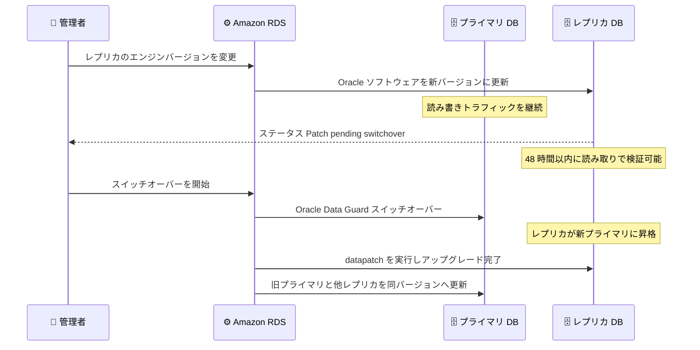

# Amazon RDS for Oracle - Replica First Patching サポート

**リリース日**: 2026 年 11 月 20 日
**サービス**: Amazon RDS for Oracle
**機能**: Replica First Patching

📊 [このアップデートのインフォグラフィックを見る](https://takech9203.github.io/aws-news-summary/20261120-rds-oracle-replica-first-patching.html)

## 概要

Amazon RDS for Oracle が Replica First Patching をサポートしました。Replica First Patching は、マイナーバージョンアップグレードの際に、まず同一リージョン内のレプリカをアップグレードし、準備ができたタイミングでスイッチオーバーすることで、プライマリ DB インスタンスのダウンタイムを削減する機能です。Oracle Enterprise Edition の DB インスタンスで利用できます。

従来の標準的なマイナーバージョンアップグレードでは、Oracle Database ソフトウェアの更新中にプライマリ DB インスタンスがオフラインになっていました。Replica First Patching では、ソフトウェアの更新はレプリカ側で行われるため、プライマリ DB インスタンスが利用できなくなるのは、スイッチオーバー中と新プライマリでのアップグレード完了処理の間だけになります。レプリカが読み取り専用モードの場合は、スイッチオーバー前に読み取りトラフィックで新しいマイナーエンジンバージョンを検証できます。

スイッチオーバーのタイミングは 48 時間のスイッチオーバーウィンドウ内で任意に選択でき、例えばトラフィックが少ない時間帯に実行できます。ウィンドウ内にスイッチオーバーしなかった場合、Amazon RDS はレプリカを元のマイナーエンジンバージョンへ自動的にロールバックします。ミッションクリティカルな Oracle ワークロードを、より少ない中断でマイナーバージョンに追従させたい運用チームに有用なアップデートです。

**アップデート前の課題**

- 標準のマイナーバージョンアップグレードでは、ソフトウェア更新中にプライマリ DB インスタンスがオフラインになり、その間アプリケーションが読み書きできなかった
- 新しいマイナーエンジンバージョンを本番相当のトラフィックで事前検証する手段が限られていた
- ダウンタイムを避けるためにパッチ適用を先送りすると、セキュリティ修正の適用が遅れるリスクがあった

**アップデート後の改善**

- レプリカ側で先にソフトウェアを更新するため、プライマリ DB インスタンスはスイッチオーバーとアップグレード完了処理の間のみ利用不可となり、ダウンタイムが短縮された
- レプリカが読み取り専用モードであれば、スイッチオーバー前に読み取りトラフィックで新バージョンを検証できるようになった
- 48 時間のスイッチオーバーウィンドウ内で、低トラフィック帯など任意のタイミングで切り替えを実行できるようになった
- スイッチオーバー後は、旧プライマリやクロスリージョンレプリカを含む残りのレプリカを Amazon RDS が自動的に同じバージョンへアップグレードする

## アーキテクチャ図



プライマリがトラフィックを処理し続ける間にレプリカを先にアップグレードし、任意のタイミングでスイッチオーバーすることで、ダウンタイムをスイッチオーバーとアップグレード完了処理の間だけに抑えます。

## サービスアップデートの詳細

### 主要機能

1. **レプリカ先行アップグレードによるダウンタイム削減**
   - レプリカのエンジンバージョンを変更すると、Amazon RDS がレプリカ側の Oracle Database ソフトウェアを新しいマイナーバージョンに置き換える。この間プライマリ DB インスタンスは影響を受けない
   - スイッチオーバーには Oracle Data Guard のスイッチオーバーが使用され、レプリカが新プライマリに、旧プライマリがレプリカになる
   - スイッチオーバー後、Amazon RDS が新プライマリで Oracle データディクショナリ更新 (datapatch) を実行してアップグレードを完了し、その後、旧プライマリを含む他のレプリカ (クロスリージョンレプリカも含む) を同じバージョンへ自動的にアップグレードする

2. **48 時間のスイッチオーバーウィンドウ**
   - レプリカのステータスが `replica-patched-pending-switchover` (コンソールでは「Patch pending switchover」) になると、48 時間のスイッチオーバーウィンドウが開始される
   - ウィンドウ内であれば任意のタイミング (例: 低トラフィック帯) でスイッチオーバーを開始できる。レプリカが読み取り専用モードなら、この時間を使って読み取りトラフィックで新バージョンを検証できる
   - 48 時間以内にスイッチオーバーしなかった場合、Amazon RDS はレプリカを元のマイナーエンジンバージョンへ自動的にロールバックする。ロールバックはプライマリに影響しない
   - ウィンドウの開始時と半分経過時に RDS イベント通知が送信され、コンソールの「Patch pending switchover」ステータスから残り時間と切り替えボタンを確認できる

3. **Primary Endpoint との連携**
   - Replica First Patching の利用時は、アプリケーションを Primary Endpoint 経由で接続することが推奨される
   - Primary Endpoint は常に現在のプライマリ DB インスタンスに解決される DNS 名のため、スイッチオーバー後も接続文字列の変更なしで新プライマリに接続できる
   - Enterprise Edition のすべての DB インスタンスに追加料金なしで自動提供される。インスタンスエンドポイントで接続している場合は、スイッチオーバー後に新プライマリのエンドポイントへ更新が必要

## 技術仕様

### Replica First Patching の仕様

| 項目 | 詳細 |
|------|------|
| 対象エディション | Oracle Enterprise Edition のみ (Standard Edition 2 は非対応) |
| 必要なレプリカ | プライマリと同一リージョン内の Oracle レプリカが 1 つ以上 (読み取り専用モードまたはマウントモード) |
| 読み取り専用モードの要件 | Oracle Active Data Guard オプションが必要 |
| 対象アップグレード | 同一メジャーバージョン内のマイナーバージョンアップグレードのみ (RU、MRP、SPB) |
| スイッチオーバーウィンドウ | 48 時間 (超過時は自動ロールバック) |
| スイッチオーバー方式 | Oracle Data Guard スイッチオーバー (自動バックアップの有効化などの要件を満たす必要あり) |
| Multi-AZ 配置 | サポート。Multi-AZ スタンバイはスイッチオーバーの一部として自動的に更新される |
| 料金 | 追加料金なし (レプリカには通常の料金が適用) |

### レプリカのステータス遷移

| ステータス | 意味 |
|------|------|
| `available` | 開始前の通常稼働状態 |
| `upgrading` | Amazon RDS がレプリカの Oracle ソフトウェアを更新中 |
| `replica-patched-pending-switchover` | ソフトウェア更新が完了し、スイッチオーバー待ち。コンソール表示は「Patch pending switchover」 |

プライマリ DB インスタンスのステータスは、スイッチオーバーを開始するまで `available` のまま維持されます。

### 主な RDS イベント

| イベント ID | カテゴリ | 内容 |
|------|------|------|
| RDS-EVENT-0510 | maintenance | レプリカのアップグレードが完了し、48 時間のスイッチオーバーウィンドウが開始 |
| RDS-EVENT-0551 | notification | スイッチオーバーウィンドウの半分が経過 |
| RDS-EVENT-0511 | notification | ウィンドウ内にスイッチオーバーされず、レプリカをロールバック |
| RDS-EVENT-0527 | notification | スイッチオーバー前にプライマリがアップグレードされたためロールバック |
| RDS-EVENT-0548 | notification | プライマリの自動マイナーバージョンアップグレード開始によりロールバック |
| RDS-EVENT-0549 | notification | 手動のロールバック要求によりロールバック |

### API 変更履歴

Replica First Patching 自体は既存の API (`ModifyDBInstance`、`SwitchoverReadReplica`、`DescribeDBInstances`) を使用するため、この機能のための新しい API は追加されていません。関連する変更として、推奨される接続方法である Primary Endpoint が前日に API へ追加されています。

| 日付 | サービス | 変更内容 |
|------|----------|----------|
| 2026/11/19 | [rds](https://awsapichanges.com/archive/changes/b8bc94-rds.html) | 25 updated api methods - `DBInstance` に `PrimaryEndpoint` 構造体を追加。スイッチオーバー後に別の DNS 名へ再接続する必要がなくなる |

## 設定方法

### 前提条件

1. プライマリ DB インスタンスが Oracle Database Enterprise Edition で稼働していること (Standard Edition 2 は非対応)
2. プライマリと同一リージョン内に Oracle レプリカが 1 つ以上存在し、ステータスが `available` であること (読み取り専用モードには Oracle Active Data Guard オプションが必要)
3. ターゲットエンジンバージョンが同一メジャーバージョン内の新しいマイナーバージョン (RU、MRP、SPB) であること
4. プライマリ DB インスタンスに、同じターゲットバージョンへの保留中・スケジュール済みのメンテナンスアクションがないこと
5. レプリカが Oracle Data Guard スイッチオーバーの要件 (自動バックアップの有効化など) を満たしていること

### 手順

#### ステップ 1: レプリカのアップグレード

```bash
aws rds modify-db-instance \
    --db-instance-identifier my-oracle-replica \
    --engine-version 19.0.0.0.ru-2026-07.rur-2026-07.r1 \
    --apply-immediately
```

`modify-db-instance` コマンドで、レプリカのエンジンバージョンをターゲットのマイナーバージョンに変更します。`--apply-immediately` を指定すると即時にアップグレードが開始され、`--no-apply-immediately` を指定するとレプリカの次のメンテナンスウィンドウで実行されます。アップグレード中もプライマリ DB インスタンスは読み書きトラフィックを処理し続けます。

#### ステップ 2: レプリカのステータス監視

```bash
aws rds describe-db-instances \
    --db-instance-identifier my-oracle-replica \
    --query 'DBInstances[0].DBInstanceStatus'
```

`describe-db-instances` コマンドでレプリカのステータスを確認します。アップグレード中は `upgrading` と表示され、`replica-patched-pending-switchover` に変わるとスイッチオーバーの準備が完了し、48 時間のスイッチオーバーウィンドウが開始されます。残り時間は RDS コンソールの「Patch pending switchover」ステータスのポップアップで確認できます。イベント通知を受け取るには、レプリカに対して maintenance と notification の両方のイベントカテゴリをサブスクライブします。

#### ステップ 3: 検証とスイッチオーバーの実行

```bash
aws rds switchover-read-replica \
    --db-instance-identifier my-oracle-replica
```

レプリカが読み取り専用モードの場合は、スイッチオーバー前に読み取りトラフィックを送信して新バージョンを検証します。準備ができたら `switchover-read-replica` コマンドでスイッチオーバーを開始します。Oracle Data Guard スイッチオーバーによりレプリカが新プライマリになり、既存の接続は切断されます。スイッチオーバーはプライマリが利用不可となるため、低トラフィックの時間帯に計画することが推奨されます。

#### ステップ 4: アップグレードの確認

スイッチオーバー後、Amazon RDS が新プライマリで datapatch を実行してアップグレードを完了します。新プライマリのステータスが `available` になり、ターゲットエンジンバージョンで稼働していることを確認します。その後、Amazon RDS が旧プライマリ (現レプリカ) とクロスリージョンレプリカを含む他のレプリカを同じバージョンへ自動的にアップグレードします。アプリケーションが Primary Endpoint 経由で接続していれば、接続文字列の変更は不要です。

## メリット

### ビジネス面

- **ダウンタイムの削減**: プライマリが利用不可となる時間がスイッチオーバーとアップグレード完了処理の間だけになり、サービス停止の影響を最小化できる
- **パッチ適用の促進**: ダウンタイムを理由としたパッチ先送りを減らし、ミッションクリティカルな Oracle ワークロードを最新のマイナーバージョンに維持しやすくなる
- **追加コストなし**: 機能自体に追加料金はなく、レプリカの通常料金のみで利用できる

### 技術面

- **事前検証が可能**: 読み取り専用モードのレプリカに読み取りトラフィックを送ることで、本番相当のワークロードで新バージョンを検証してから切り替えられる
- **切り替えタイミングの制御**: 48 時間のウィンドウ内で、低トラフィック帯など任意のタイミングでスイッチオーバーを開始できる
- **自動的な全体のバージョン統一**: スイッチオーバー後、旧プライマリやクロスリージョンレプリカを含む残りのレプリカを Amazon RDS が自動的に同じバージョンへアップグレードする
- **安全なロールバック**: ウィンドウ超過時や手動要求時にレプリカが元のバージョンへロールバックされ、レプリケーションが再開される。プライマリには影響しない

## デメリット・制約事項

### 制限事項

- Oracle Enterprise Edition のみ対応 (Standard Edition 2 はレプリカ非対応のため利用不可)
- マイナーバージョンアップグレードのみ対応で、メジャーバージョンアップグレードには使用できない
- アップグレード対象のレプリカはプライマリと同一リージョン内である必要がある (クロスリージョンレプリカは先行アップグレードの対象にできない)
- 同一プライマリに対して複数のレプリカで同時に Replica First Patching を実行することはできない
- `replica-patched-pending-switchover` 状態のレプリカでは、オプショングループおよびパラメータグループの変更ができない

### 考慮すべき点

- 自動マイナーバージョンアップグレード (AMVU) が優先される。プライマリのメンテナンスウィンドウがスイッチオーバー前に開始されると、レプリカはロールバックされ、標準の自動アップグレードが実行される。Replica First Patching を完了したい場合は、ウィンドウ開始前にスイッチオーバーするか、AMVU を一時的に無効化する必要がある
- スイッチオーバー前にプライマリを直接アップグレードしたり、レプリカを昇格・プライマリを削除したりすると、レプリカは自動的にロールバックされる
- 読み取り専用モードのレプリカでは、ソフトウェア置き換えの間、読み取りトラフィックが一時的に中断される。また、読み取り専用モードには Oracle Active Data Guard オプションが必要となる
- スイッチオーバーで既存接続は切断されるため、アプリケーションには切断検知と再接続の仕組みが必要。インスタンスエンドポイントで接続している場合は、スイッチオーバー後に接続先の更新が必要になるため、Primary Endpoint の利用が推奨される

## ユースケース

### ユースケース 1: ミッションクリティカルなシステムのセキュリティパッチ適用

**シナリオ**: 24 時間稼働の基幹システムで RDS for Oracle を利用しており、四半期ごとの Release Update (RU) を適用したいが、標準アップグレードのダウンタイムが業務影響の観点で許容しにくい。

**実装例**:
```bash
# 1. レプリカを先行アップグレード (業務時間中でもプライマリに影響なし)
aws rds modify-db-instance \
    --db-instance-identifier prod-oracle-replica \
    --engine-version 19.0.0.0.ru-2026-10.rur-2026-10.r1 \
    --apply-immediately

# 2. 深夜の低トラフィック帯にスイッチオーバー
aws rds switchover-read-replica \
    --db-instance-identifier prod-oracle-replica
```

**効果**: ソフトウェア更新そのものは業務時間中にレプリカ側で完了させ、プライマリが利用不可となる時間をスイッチオーバー前後のみに短縮できる。ダウンタイムを理由にしたパッチ先送りを減らし、セキュリティ修正を迅速に適用できる。

### ユースケース 2: 読み取りトラフィックによる新バージョンの事前検証

**シナリオ**: Active Data Guard の読み取り専用レプリカをレポート用途で利用しており、新しいマイナーバージョンが自社ワークロードで問題なく動作するかを本番相当のクエリで確認してから切り替えたい。

**実装例**:
```bash
# レプリカをアップグレード後、レポート系クエリを読み取り専用レプリカへ送信して検証
# 問題がなければ 48 時間以内にスイッチオーバー
aws rds switchover-read-replica \
    --db-instance-identifier prod-oracle-ro-replica

# 問題が見つかった場合は手動ロールバック (元のバージョンに戻す)
aws rds modify-db-instance \
    --db-instance-identifier prod-oracle-ro-replica \
    --engine-version 19.0.0.0.ru-2026-07.rur-2026-07.r1 \
    --apply-immediately
```

**効果**: 新バージョンを実際の読み取りワークロードで検証し、問題があればプライマリに影響を与えることなくロールバックできる。ウィンドウを超過させて自動ロールバックに任せることも可能で、アップグレードの意思決定に 48 時間の猶予が得られる。

### ユースケース 3: Primary Endpoint と組み合わせた無変更スイッチオーバー運用

**シナリオ**: 複数のアプリケーションが同じ RDS for Oracle に接続しており、スイッチオーバーのたびに各チームへ接続先変更を依頼する運用コストを削減しつつ、定期的なパッチ適用サイクルを確立したい。

**実装例**:
```text
# アプリケーションの接続先を Primary Endpoint に統一
rds-0123456789abcdef0123456789abcdef.primary.rds.amazonaws.com:1521

# クライアントの DNS キャッシュ TTL を短く設定 (例: JVM)
networkaddress.cache.ttl=60
```

**効果**: Primary Endpoint はスイッチオーバー後に自動的に新プライマリへ解決されるため、アプリケーション側の接続文字列変更が不要になる。Replica First Patching によるパッチ適用を、アプリケーションチームの作業なしで定期的なサイクルとして運用できる。

## 料金

Replica First Patching に追加料金はありません。レプリカに対して通常の Amazon RDS for Oracle の料金 (DB インスタンス、ストレージなど) が適用されます。

なお、レプリカを読み取り専用モードで作成して新バージョンを読み取りトラフィックで検証する場合は、Oracle Active Data Guard オプションが必要です。マウントモードのレプリカであれば Active Data Guard は不要です。

## 利用可能リージョン

Amazon RDS for Oracle が利用可能なすべての AWS 商用リージョンで利用できます。

## 関連サービス・機能

- **Primary Endpoint**: 常に現在のプライマリ DB インスタンスに解決される DNS 名。Replica First Patching のスイッチオーバー後も接続文字列の変更が不要になるため、併用が推奨される (2026 年 11 月 20 日に同時発表)
- **Oracle Data Guard スイッチオーバー**: Replica First Patching の切り替えに使用される仕組み。自動バックアップの有効化などのスイッチオーバー要件を満たす必要がある
- **RDS for Oracle リードレプリカ**: 先行アップグレードの対象となる同一リージョンレプリカ。読み取り専用モード (Active Data Guard) またはマウントモードで構成できる
- **自動マイナーバージョンアップグレード (AMVU)**: Replica First Patching とは別の仕組みで、スケジュールが重なった場合は AMVU が優先される。完了前にメンテナンスウィンドウが開始されるとレプリカはロールバックされる
- **Amazon RDS イベント通知**: スイッチオーバーウィンドウの開始・半分経過・ロールバックなどのイベントを Amazon SNS 経由で受け取れる

## 参考リンク

- 📊 [インフォグラフィック](https://takech9203.github.io/aws-news-summary/20261120-rds-oracle-replica-first-patching.html)
- [公式発表 (What's New)](https://aws.amazon.com/about-aws/whats-new/2026/11/rds-oracle-replica-first-patching/)
- [ドキュメント: Upgrading with Replica First Patching](https://docs.aws.amazon.com/AmazonRDS/latest/UserGuide/oracle-upgrade-replica-first.html)
- [ドキュメント: Requirements and limitations for Replica First Patching](https://docs.aws.amazon.com/AmazonRDS/latest/UserGuide/oracle-upgrade-replica-first.requirements.html)
- [ドキュメント: Performing Replica First Patching](https://docs.aws.amazon.com/AmazonRDS/latest/UserGuide/oracle-upgrade-replica-first.performing.html)
- [ドキュメント: Rolling back Replica First Patching](https://docs.aws.amazon.com/AmazonRDS/latest/UserGuide/oracle-upgrade-replica-first.rollback.html)
- [ドキュメント: Using the Primary Endpoint for Amazon RDS for Oracle](https://docs.aws.amazon.com/AmazonRDS/latest/UserGuide/oracle-primary-endpoint.html)
- [Amazon RDS for Oracle 製品ページ](https://aws.amazon.com/rds/oracle/)

## まとめ

Replica First Patching により、RDS for Oracle のマイナーバージョンアップグレードにおけるプライマリのダウンタイムが、スイッチオーバーとアップグレード完了処理の間だけに短縮され、48 時間のウィンドウ内で切り替えタイミングを制御しながら新バージョンを事前検証できるようになりました。Enterprise Edition で同一リージョンレプリカを持つ環境であれば追加料金なしで利用できるため、Primary Endpoint への接続移行と RDS イベント通知のサブスクライブを整備した上で、次回のマイナーバージョンアップグレードから適用することを推奨します。
