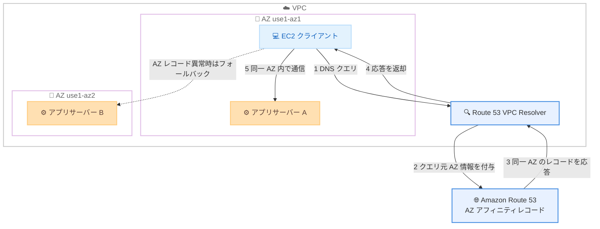
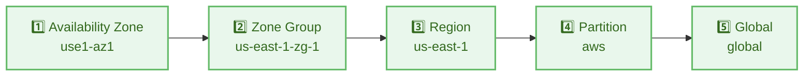

# Amazon Route 53 - アベイラビリティーゾーン (AZ) アフィニティルーティング

**リリース日**: 2026 年 11 月 20 日
**サービス**: Amazon Route 53
**機能**: AZ アフィニティルーティング (AZ Affinity Routing)

📊 [このアップデートのインフォグラフィックを見る](https://takech9203.github.io/aws-news-summary/20261120-route-53-affinity-routing.html)

## 概要

Amazon Route 53 が、アベイラビリティーゾーン (AZ) アフィニティルーティングをサポートしました。この新しいルーティングポリシーにより、VPC 内のクライアントからの DNS クエリに対して、クエリ元と同じ AZ 内のリソースを応答として返すことができます。トラフィックをクライアントと同一の AZ 内に留めることで、レイテンシーの削減と AZ 間データ転送コストの削減を実現し、アプリケーションのパフォーマンスを向上させます。

AZ アフィニティレコードには、Availability Zone、Zone Group、Region、Partition、Global の 5 種類のロケーションタイプを指定できます。クエリ元の AZ に対応するレコードが存在しない場合や、ヘルスチェックで異常と判定された場合は、Route 53 がより広いロケーション (Zone Group → Region → Partition → Global) の順に自動的にフォールバックするため、可用性を維持しながら AZ ローカルなルーティングを実現できます。

本機能はパブリックホストゾーンとプライベートホストゾーンの両方で利用でき、Route 53 コンソール、API、AWS CLI、AWS SDK、AWS CloudFormation から設定できます。マイクロサービス間通信やセルベースアーキテクチャを採用するユーザーにとって、特に価値のあるアップデートです。

**アップデート前の課題**

- 以前は、低レイテンシーを目的としたルーティングにはレイテンシーベースルーティングやジオプロキシミティルーティングなどを利用する必要があり、AZ 単位の粒度でトラフィックを制御できなかった
- 同一リージョン内の AZ をまたぐ通信が発生し、AZ 間データ転送コストと追加のレイテンシーが発生していた
- AZ 単位のルーティングを実現するには、アプリケーション側でエンドポイント選択ロジックを独自に実装する必要があった

**アップデート後の改善**

- DNS レベルでクエリ元と同じ AZ のリソースへ自動的にルーティングできるようになり、トラフィックを AZ 内に維持できるようになった
- レコードが存在しない場合や異常時には Zone Group → Region → Partition → Global の順でフォールバックし、可用性を確保できるようになった
- ヘルスチェックと組み合わせることで、AZ 障害時にも自動的に他のロケーションへ切り替えられるようになった

## アーキテクチャ図



VPC 内のクライアントが DNS クエリを実行すると、Route 53 VPC Resolver がクエリ元の AZ 情報を Route 53 に伝え、Route 53 は同一 AZ のリソースを指すレコードを応答します。該当レコードが存在しない場合や異常な場合は、他のロケーションのレコードにフォールバックします。

**フォールバック順序**



Route 53 は最も具体的なロケーションから順に正常なレコードを探して応答します。レコードを作成していないレベルはスキップされます。

## サービスアップデートの詳細

### 主要機能

1. **AZ 単位の DNS ルーティング**
   - クエリ元の AZ と同じ AZ のリソースを指すレコードを応答
   - AZ の指定には AZ 名 (us-east-1a など) ではなく AZ ID (use1-az1 など) を使用
   - AZ 名はアカウントごとに異なる AZ にマッピングされるため、AZ ID により一貫した指定が可能

2. **5 段階のロケーションタイプとフォールバック**
   - Availability Zone → Zone Group → Region → Partition → Global の順にフォールバック
   - すべてのロケーションタイプのレコードを作成する必要はなく、存在しないレベルはスキップされる
   - Global レコードは VPC 外 (インターネットなど) からのクエリに応答するため、常に作成することが推奨される

3. **ヘルスチェックとの統合**
   - 各 AZ アフィニティレコードにヘルスチェックを関連付け可能 (エイリアスレコードの場合は Evaluate Target Health を有効化)
   - エンドポイントが異常な場合、次のロケーションのレコードで応答
   - ヘルスチェックを関連付けない非エイリアスレコードは常に正常とみなされ、フォールバックが発生しない点に注意

4. **パブリック・プライベート両ホストゾーンに対応**
   - パブリックホストゾーンとプライベートホストゾーンの両方で利用可能
   - VPC Resolver 経由のクエリのみ AZ 情報が伝わり、それ以外のクエリは Global レコードにのみマッチ

## 技術仕様

### ロケーションタイプ

| ロケーションタイプ | 指定する値の例 | 説明 |
|------|------|------|
| Availability Zone | `use1-az1` | クエリ元の AZ。AZ ID を小文字で指定 |
| Zone Group | `us-east-1-zg-1` | Zone Group 内の任意の AZ |
| Region | `us-east-1` | リージョン内の任意の AZ |
| Partition | `aws` | パーティション内の任意のリージョン。AWS 内からのクエリのフォールバック用 |
| Global | `global` | その他すべてのクエリ (インターネットなど) |

### API 変更履歴

| 日付 | サービス | 変更内容 |
|------|----------|----------|
| 2026/11/20 | [route53](https://awsapichanges.com/archive/changes/e9d2b3-route53.html) | 4 new 8 updated api methods - `ChangeResourceRecordSets`、`ListResourceRecordSets` などに `AZAffinity` パラメータ (`LocationType`、`LocationId`) が追加 |

### レコード設定例

```json
{
  "Action": "CREATE",
  "ResourceRecordSet": {
    "Name": "api.example.internal",
    "Type": "A",
    "SetIdentifier": "az-use1-az1",
    "AZAffinity": {
      "LocationType": "AvailabilityZone",
      "LocationId": "use1-az1"
    },
    "TTL": 60,
    "ResourceRecords": [{ "Value": "10.0.1.10" }],
    "HealthCheckId": "健全性チェックの ID"
  }
}
```

## 設定方法

### 前提条件

1. Route 53 のパブリックホストゾーンまたはプライベートホストゾーンが作成済みであること
2. ルーティング先リソースの AZ ID と Zone Group を把握していること
3. フォールバックを機能させる場合、各レコードに関連付けるヘルスチェックを用意すること

### 手順

#### ステップ 1: AZ ID と Zone Group の確認

```bash
aws ec2 describe-availability-zones \
    --region us-east-1 \
    --filters Name=zone-type,Values=availability-zone \
    --query "AvailabilityZones[].[ZoneId,GroupName]" \
    --output text
```

リージョン内の各 AZ の AZ ID と Zone Group を一覧表示します。`zone-type` フィルタを指定することで、AZ アフィニティルーティングが対応していない Local Zones や Wavelength Zones を除外します。

#### ステップ 2: AZ アフィニティレコードの作成

```bash
aws route53 change-resource-record-sets \
    --hosted-zone-id Z1234567890ABC \
    --change-batch '{
      "Changes": [{
        "Action": "CREATE",
        "ResourceRecordSet": {
          "Name": "api.example.internal",
          "Type": "A",
          "SetIdentifier": "az-use1-az1",
          "AZAffinity": {
            "LocationType": "AvailabilityZone",
            "LocationId": "use1-az1"
          },
          "TTL": 60,
          "ResourceRecords": [{"Value": "10.0.1.10"}]
        }
      }]
    }'
```

同じ名前・同じタイプのレコードを、ルーティングしたいロケーションごとに作成します。AZ レベルのレコードに加えて、Region レベルや Global レベルのフォールバック用レコードも作成します。

#### ステップ 3: 動作確認

Route 53 コンソールの DNS チェックツールと `TestDNSAnswer` API は AZ アフィニティレコードに対応していません。レコードを作成した各 AZ 内の EC2 インスタンスから `dig` などのコマンドを実行し、VPC Resolver (VPC のデフォルト DNS サーバー) に対してクエリを送信して動作を確認します。Route 53 のネームサーバーに直接クエリを送信しないよう注意してください。

## メリット

### ビジネス面

- **コスト削減**: トラフィックを AZ 内に維持することで、AZ 間データ転送コストを削減できる
- **ユーザー体験の向上**: レイテンシーの削減によりアプリケーションの応答性能が向上する
- **運用負荷の軽減**: アプリケーション側の独自エンドポイント選択ロジックが不要になり、DNS レベルで一元管理できる

### 技術面

- **AZ 単位の粒度のルーティング**: 従来のレイテンシーベースやジオプロキシミティでは実現できなかった AZ 単位のトラフィック制御が可能
- **自動フォールバック**: ヘルスチェックと組み合わせることで、AZ 障害時にも Zone Group → Region → Partition → Global の順で自動的に切り替わる
- **セルベースアーキテクチャとの親和性**: AZ 単位で独立したセルを構成する設計において、DNS だけで AZ ローカルなルーティングを実現できる

## デメリット・制約事項

### 制限事項

- Local Zones、Wavelength Zones、AWS Outposts はロケーションタイプとしてサポートされない
- Traffic Flow (トラフィックポリシー) では AZ アフィニティルーティングを利用できない
- Route 53 コンソールの DNS チェックツールと `TestDNSAnswer` API は AZ アフィニティレコードに対応していない
- ロケーション ID は大文字小文字が区別されるため、`use1-az1`、`global` のように小文字で指定する必要がある

### 考慮すべき点

- AZ 情報が伝わるのは Route 53 VPC Resolver 経由のクエリのみで、インターネットからのクエリや Route 53 ネームサーバーへの直接クエリは Global レコードにのみマッチする
- Global レコードを作成していない場合、マッチするレコードがないクエリには応答が返らない (NODATA) ため、Global レコードの作成が推奨される
- ヘルスチェックを関連付けていない非エイリアスレコードは常に正常とみなされ、フォールバックが機能しない
- マッチするレコードがすべて異常な場合は、異常であっても最も具体的なレコードで応答される
- AZ アフィニティルーティングは応答するレコードを選択する機能であり、アクセス制御ではないため、レコード値の秘匿目的には使用できない

## ユースケース

### ユースケース 1: マイクロサービス間通信の AZ ローカル化

**シナリオ**: 複数 AZ に展開したマイクロサービス間の内部通信で、AZ 間データ転送コストとレイテンシーを削減したい。

**実装例**:
```
プライベートホストゾーンに internal-api.example.internal の
AZ アフィニティレコードを AZ ごとに作成。
- use1-az1: 10.0.1.10 (AZ use1-az1 の内部 ALB)
- use1-az2: 10.0.2.10 (AZ use1-az2 の内部 ALB)
- Region us-east-1: フォールバック用レコード
各レコードにヘルスチェックを関連付け
```

**効果**: サービス間通信が同一 AZ 内で完結し、AZ 間データ転送コストの削減とレイテンシーの短縮を実現。AZ 障害時はリージョンレコードに自動フォールバック。

### ユースケース 2: セルベースアーキテクチャの障害分離

**シナリオ**: AZ ごとに独立したセルを構成し、障害の影響範囲を AZ 単位に限定したい。

**実装例**:
```
各 AZ のセルを指す AZ アフィニティレコードを作成し、
ヘルスチェックを関連付ける。
正常時: 各クライアントは自身の AZ のセルのみと通信
障害時: ヘルスチェック失敗により他ロケーションへフォールバック
```

**効果**: 正常時は AZ をまたぐ依存関係を排除して障害分離を強化しつつ、AZ 障害時には自動的に他のセルへ切り替えて可用性を維持。

### ユースケース 3: ハイブリッド公開エンドポイントの最適化

**シナリオ**: 同一の DNS 名を VPC 内クライアントとインターネットクライアントの両方が利用するが、VPC 内からのアクセスは AZ ローカルに最適化したい。

**実装例**:
```
パブリックホストゾーンに api.example.com のレコードを作成。
- AZ レコード: 各 AZ のエンドポイント (VPC 内クライアント向け)
- Global レコード: インターネット向けの公開エンドポイント
```

**効果**: VPC 内からのクエリは同一 AZ のエンドポイントに、インターネットからのクエリは Global レコードに自動的に振り分けられ、単一の DNS 名で両方のアクセス経路を最適化。

## 料金

What's New の発表には本機能固有の料金情報は記載されていません。Route 53 の標準的な料金体系 (ホストゾーン料金、DNS クエリ料金、ヘルスチェック料金) が適用されます。最新の料金は [Route 53 料金ページ](https://aws.amazon.com/route53/pricing/) を確認してください。

## 利用可能リージョン

Route 53 のパブリックホストゾーンおよびプライベートホストゾーンが提供されているすべての AWS 商用リージョンで利用可能です。

## 関連サービス・機能

- **Amazon Route 53 Resolver (VPC Resolver)**: VPC 内からのクエリ元 AZ 情報を Route 53 に伝達し、AZ アフィニティルーティングを実現する基盤
- **Route 53 ヘルスチェック**: AZ アフィニティレコードと関連付けることで、異常時のフォールバックを実現
- **Amazon EC2**: `describe-availability-zones` API で AZ ID と Zone Group を確認。インスタンスメタデータ `placement/availability-zone-id` からも AZ ID を取得可能
- **Elastic Load Balancing**: AZ ごとの内部 ALB / NLB を AZ アフィニティレコードのルーティング先として利用可能

## 参考リンク

- 📊 [インフォグラフィック](https://takech9203.github.io/aws-news-summary/20261120-route-53-affinity-routing.html)
- [公式発表 (What's New)](https://aws.amazon.com/about-aws/whats-new/2026/11/route-53-affinity-routing/)
- [ドキュメント: AZ-affinity routing](https://docs.aws.amazon.com/Route53/latest/DeveloperGuide/routing-policy-azaffinity.html)
- [AZ ID について](https://docs.aws.amazon.com/global-infrastructure/latest/regions/az-ids.html)
- [料金ページ](https://aws.amazon.com/route53/pricing/)

## まとめ

Route 53 の AZ アフィニティルーティングにより、DNS レベルでトラフィックをクライアントと同一の AZ 内に維持できるようになり、レイテンシーと AZ 間データ転送コストの削減が可能になりました。マイクロサービス間通信やセルベースアーキテクチャを採用している場合は、本機能の適用によるコスト・パフォーマンス改善の効果を検証することを推奨します。導入時は、ヘルスチェックの関連付けと Global レコードの作成を忘れずに行うことが重要です。
